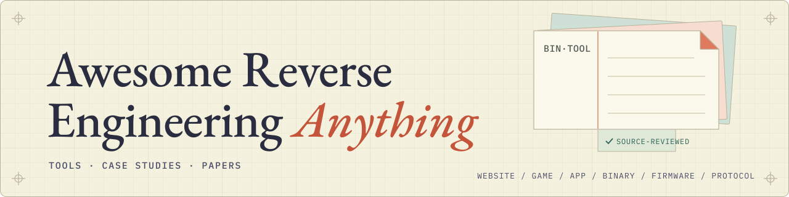

<h1 align="center"><a href="https://awesomerea.org/"><picture><source media="(prefers-color-scheme: dark)" srcset="assets/brand/readme-banner-dark.svg"></picture></a></h1>

A collection of tools, case studies and research for websites, games, apps, native binaries, firmware and communication protocols.

**English** · [简体中文](README.zh-CN.md)

**[Search the website](https://awesomerea.org/)** · **[Browse resources](https://awesomerea.org/resources/)** · **[Cases](https://awesomerea.org/cases/)** · **[Papers](https://awesomerea.org/papers/)** · **[API](https://awesomerea.org/api/)** · **[Suggest a resource](https://github.com/reacher-z/Awesome-REA/issues/new?template=resource.yml)** · **[Contributing](#contributing)**

<!-- BEGIN GENERATED BADGES -->
<!-- Generated by scripts/build_readme.py from data/rea-resources.json, data/tool-resources.json and data/papers.json. Edit the source data and rerun the script; do not edit this block by hand. -->
    
<!-- END GENERATED BADGES -->

If this collection is useful, a [star on GitHub](https://github.com/reacher-z/Awesome-REA) helps others find it.

[Review method](https://awesomerea.org/about/)

Featured benchmarks:

| Website reconstruction                                                                                                                                                                                                                                                                                                                                                                                                                                                                                                                                                                    | Browser agents                                                                                                                                                                                                                                                                                                                                                                                                                                                                                                                                                                         |
| ----------------------------------------------------------------------------------------------------------------------------------------------------------------------------------------------------------------------------------------------------------------------------------------------------------------------------------------------------------------------------------------------------------------------------------------------------------------------------------------------------------------------------------------------------------------------------------------- | -------------------------------------------------------------------------------------------------------------------------------------------------------------------------------------------------------------------------------------------------------------------------------------------------------------------------------------------------------------------------------------------------------------------------------------------------------------------------------------------------------------------------------------------------------------------------------------- |
| <a href="https://github.com/TIGER-AI-Lab/WebsiteBench"><picture><source media="(prefers-color-scheme: dark)" srcset="https://raw.githubusercontent.com/TIGER-AI-Lab/WebsiteBench/78f5558e8197bb91b3bab63428c12b92060ddc6f/assets/wordmark-dark.svg"></picture></a> Can AI agents rebuild websites through browser exploration? <a href="https://github.com/TIGER-AI-Lab/WebsiteBench">★ Star on GitHub</a> | <a href="https://github.com/TIGER-AI-Lab/ClawBench"><picture><source media="(prefers-color-scheme: dark)" srcset="https://raw.githubusercontent.com/TIGER-AI-Lab/ClawBench/c8409629f4f2f9768731350d764aeb3035946c5d/assets/brand/wordmark-dark.svg"></picture></a> Open-source benchmark for browser AI agents on daily tasks. <a href="https://github.com/TIGER-AI-Lab/ClawBench">★ Star on GitHub</a> |

**Featured:** [Awesome Computer-Use Agents](https://github.com/reacher-z/Awesome-CUA) — a source-backed catalog of papers, models, datasets, benchmarks and tools for agents that use computers.

## Contents

<!-- BEGIN GENERATED FINDER -->
<!-- Generated by scripts/build_readme.py from data/rea-resources.json, data/tool-resources.json, data/papers.json, data/source-index.json, data/source-scope.json and data/source-supplements/. Edit the source data and rerun the script; do not edit this block by hand. -->
5,191 curated resources (4,025 cases) · 442 papers · 3,309 indexed repositories · latest source review 2026-11-09.

<!-- END GENERATED FINDER -->

<!-- BEGIN GENERATED CONTENTS -->
<!-- Generated by scripts/build_readme.py from data/rea-resources.json, data/tool-resources.json, data/papers.json, data/source-index.json, data/source-scope.json and data/source-supplements/. Edit the source data and rerun the script; do not edit this block by hand. -->
- [Find by task](#find-by-task)
- [Use the data](#use-the-data)
- [Resources](#resources) (5,188)
  - [Website](#website) (128) — Tools and cases for inspecting, deobfuscating and rebuilding websites
  - [Game](#game) (2,976) — Decompilations, recompilations, ports, engine reimplementations, analysis tools and cases
  - [App](#app) (370) — Analysis tools and cases for Android, .NET, JVM and Electron apps
  - [Native Binary](#native-binary) (502) — Disassemblers, decompilers, debuggers, binary libraries, diffing tools and native cases
  - [Firmware and Hardware](#firmware-and-hardware) (260) — Firmware extraction and analysis tools, plus hardware and device-image cases
  - [Protocol](#protocol) (720) — Tools and cases for wire formats, device protocols and packet captures
  - [Agents and MCP](#agents-and-mcp) (91) — Official REA material, MCP servers, integrations and agent workflows, labelled by REA relationship
  - [Related Collections](#related-collections) (33) — Other curated lists on reverse engineering and related security topics
  - [References and Learning](#references-and-learning) (108) — Documentation, investigation guides, labs and learning resources
- [Papers](#papers) (442) — Research bibliography, kept in generated paper lists
  - [Most recent papers](#most-recent-papers) (10)
- [Full Repository Index](#full-repository-index) (3,309) — Public repositories found by README scans; unreviewed
- [About](#about)
- [Star History](#star-history)
<!-- END GENERATED CONTENTS -->

**For agents:** [Repository instructions](AGENTS.md) · [How to contribute and submit a PR](docs/agent-contributing.md) · [Contribution forms](https://awesomerea.org/contribute/)

## Find by task

| Task                                     | Where to look                                                                                                                                                   |
| ---------------------------------------- | --------------------------------------------------------------------------------------------------------------------------------------------------------------- |
| Inspect a website or app interface       | [Website resources](https://awesomerea.org/resources/#heading-website) · [App resources](https://awesomerea.org/resources/#heading-app)                         |
| Rebuild a game or check matching code    | [Game resources](https://awesomerea.org/resources/#heading-game) · [Game cases](https://awesomerea.org/cases/#cases-game)                                       |
| Analyze compiled code or recover symbols | [Native binary resources](https://awesomerea.org/resources/#heading-native-binary) · [Agents and MCP](https://awesomerea.org/resources/#heading-agents-and-mcp) |
| Investigate firmware or device protocols | [Firmware resources](https://awesomerea.org/resources/#heading-firmware) · [Protocol resources](https://awesomerea.org/resources/#heading-protocol)             |
| Compare methods and evaluation evidence  | [Survey comparisons](https://awesomerea.org/survey/#comparative-studies)                                                                                        |

## Use the data

Use these public files and pages to read the catalog, follow changes, or work with its structured data.

- [llms.txt](https://awesomerea.org/llms.txt) - Machine-readable site map for language models.
- [llms-full.txt](https://awesomerea.org/llms-full.txt) - Curated entries in one Markdown text.
- [API index](https://awesomerea.org/api/v1/index.json) - Static JSON and CSV exports of resources, papers and categories, plus unreviewed candidates.
- [catalog.json](https://awesomerea.org/catalog.json) - Curated catalog in one JSON file.
- [JSON Feed](https://awesomerea.org/feed.json) - New and changed entries in JSON Feed format.
- [Hugging Face dataset](https://huggingface.co/datasets/TIGER-Lab/AwesomeREA) - Parquet and JSONL exports for resources, papers, cases and discovery records.
- [Catalog format](https://github.com/reacher-z/Awesome-REA/blob/main/data/README.md) - Fields, vocabulary and review rules for every record.

## Resources

Names link to original sources. Each line gives the opening sentence of the description, then the type and relationship; “Full entry” opens the complete description, prerequisites, limitations and review sources.

Each resource appears once under its main purpose. Cases reuse these entries; papers are listed separately.

REA labels refer to the separate upstream CLI and MCP project, described under About.

<!-- BEGIN GENERATED CATALOG -->
<!-- Generated by scripts/build_readme.py from data/rea-resources.json and data/tool-resources.json. Edit the source data and rerun the script; do not edit this block by hand. -->
**Tags:** Official REA: published by the REA project · Community REA: third-party REA work · REA maintainer: an REA maintainer's list · Independent MCP, Independent agent, Independent reconstruction: no established REA connection · Mixed workflow: REA plus other tools, per the author · Android, .NET, JVM, WebAssembly: platform · Library: code library · type only: foundation tool or learning resource.

### Website

**76 case studies**. The 10 newest are below. [Full case list](docs/cases.md#website).

#### Case studies

- [**canopy-dotmatrix: reconstructing davidluft.com's dot-matrix window**](https://github.com/isjiajia01/canopy-dotmatrix) - Reconstructs the dot-matrix window on davidluft.com from its public JavaScript bundle and scene payloads. Case study · Independent reconstruction · [Full entry](https://awesomerea.org/resources/canopy-dotmatrix-case/)
- [**Dih Pinterest: reconstructing a Pinterest search site's page and data flow**](https://github.com/Ikyletwar/dih-pinterest-replica) - Dih Pinterest reconstructs the search interface and data flow of searchpinterest.vercel.app as a static web app with an optional Vercel proxy. Case study · Independent reconstruction · [Full entry](https://awesomerea.org/resources/dih-pinterest-case/)
- [**Drama Live: analysing its Android and web clients and rebuilding an API client**](https://github.com/barhomus10/dramalive-analysis) - Drama Live analysis documents the Android APK and web PWA of the IPTV player, including their component stacks, endpoint maps and content-source flows. Case study · Independent reconstruction · Also: App · [Full entry](https://awesomerea.org/resources/dramalive-analysis-case/)
- [**edgestash: reconstructing Vercel Blob and Upstash Redis API behavior**](https://github.com/devtechedge/edgestash) - edgestash implements a self-hosted server for the Vercel Blob and Upstash Redis REST APIs, allowing their published SDKs to use a different endpoint. Case study · Mixed workflow · [Full entry](https://awesomerea.org/resources/edgestash-case/)
- [**github-websocket-pipelines-api: probing GitHub Actions live-log messages**](https://github.com/Hacksore/github-websocket-pipeline-api) - github-websocket-pipelines-api probes GitHub Actions' undocumented live-log WebSocket interface. Case study · Independent reconstruction · Also: Protocol · [Full entry](https://awesomerea.org/resources/github-websocket-pipelines-api-case/)
- [**Google Earth: reconstructing 3D satellite asset formats and access**](https://github.com/retroplasma/earth-reverse-engineering) - earth-reverse-engineering investigates Google Earth's 3D satellite mode and reconstructs its resource URL structure, octree metadata, Protobuf asset formats, and mesh and texture decoding steps. Case study · Independent reconstruction · [Full entry](https://awesomerea.org/resources/earth-reverse-engineering-case/)
- [**Inception Chat: reconstructing a chat page from design and prompt captures**](https://github.com/creativerezz/inception) - Inception Chat reconstructs the public chat.inceptionlabs.ai landing page from observed desktop and mobile layouts, deployed CSS tokens and captured suggested prompts. Case study · Independent reconstruction · [Full entry](https://awesomerea.org/resources/inception-chat-extraction-case/)
- [**LoreMaps: a static rewrite of a fantasy-map atlas**](https://github.com/loremaps/loremaps) - A static Astro atlas rewritten from the project’s earlier ASP.NET MVC site. Case study · Independent reconstruction · [Full entry](https://awesomerea.org/resources/loremaps-atlas-case/)
- [**MAX Messenger: documenting WebSocket and TCP message formats**](https://github.com/pr0bel1230/max-api-docs) - MAX Messenger API Documentation maps the messenger's WebSocket JSON and TCP MessagePack exchanges from browser traffic and direct request experiments. Case study · Independent reconstruction · Also: Protocol · [Full entry](https://awesomerea.org/resources/max-messenger-protocol-case/)
- [**muse-cli: reconstructing the muse.ai personal gateway protocol**](https://github.com/nikships/muse-cli) - muse-cli implements terminal access to the muse.ai personal gateway using behavior derived from its web client bundle. Case study · Independent reconstruction · Also: Protocol · [Full entry](https://awesomerea.org/resources/muse-cli-case/)

#### Tools, projects and integrations

- [**webcrack**](https://github.com/j4k0xb/webcrack) - Improves JavaScript readability by reversing supported obfuscation patterns and unpacking webpack/Browserify bundles. Tool · Also: App · [Full entry](https://awesomerea.org/resources/webcrack/)
- [**humanify**](https://github.com/jehna/humanify) - Rename identifiers in minified JavaScript with LLM-suggested names, applied through scope-aware AST rewriting so the program structure stays unchanged. Tool · [Full entry](https://awesomerea.org/resources/humanify/)
- [**WABT**](https://github.com/WebAssembly/wabt) - WebAssembly tools for binary-to-text conversion, section inspection, validation, interpretation and C translation. Tool · WebAssembly · Also: Binary · [Full entry](https://awesomerea.org/resources/wabt/)
- [**wasm-tools**](https://github.com/bytecodealliance/wasm-tools) - Bytecode Alliance CLI and Rust libraries for inspecting WebAssembly modules, metadata, components and WIT interfaces. Tool · WebAssembly · Also: Binary · [Full entry](https://awesomerea.org/resources/wasm-tools/)
- [**Chrome DevTools MCP**](https://github.com/ChromeDevTools/chrome-devtools-mcp) - Connect an agent to Chrome for live page inspection, network debugging, and performance traces. Integration · Independent MCP · [Full entry](https://awesomerea.org/resources/chrome-devtools-mcp/)
- [**mitmproxy**](https://github.com/mitmproxy/mitmproxy) - Inspect and record HTTP traffic with an interactive proxy, web interface, or scriptable command-line tools. Tool · Also: App, Protocol · [Full entry](https://awesomerea.org/resources/mitmproxy/)
- [**Playwright MCP**](https://github.com/microsoft/playwright-mcp) - Drive browser interactions through structured accessibility snapshots to investigate reproducible web behavior. Integration · Independent MCP · [Full entry](https://awesomerea.org/resources/playwright-mcp/)
- [**Burp Suite MCP Server**](https://github.com/PortSwigger/mcp-server) - PortSwigger's Burp Suite extension serves an MCP endpoint, plus a packaged stdio proxy, so agents can query proxy HTTP and WebSocket history, send HTTP/1.1 or HTTP/2 requests, and open Repeater or Intruder tabs. Integration · Independent MCP · Also: App · [Full entry](https://awesomerea.org/resources/burp-suite-mcp-server/)
- [**Wakaru**](https://github.com/pionxzh/wakaru) - Recover readable modules from shipped JavaScript bundles by reversing recognized minifier and transpiler patterns. Tool · [Full entry](https://awesomerea.org/resources/wakaru/)
- [**Spectral**](https://github.com/spectral-mcp/spectral) - Analyze captured application HTTP traffic with an LLM to generate MCP tools, OpenAPI 3.1 specifications, or GraphQL schemas. Integration · Independent agent · Also: App, Protocol · [Full entry](https://awesomerea.org/resources/spectral-mcp/)
- [**jsdeob-workbench**](https://github.com/Owl4444/jsdeob-workbench) - Inspect JavaScript ASTs and variable scopes while building visual chains of Babel transforms. Tool · [Full entry](https://awesomerea.org/resources/jsdeob-workbench/)
- [**Browser Reverse Engineering Toolkit**](https://github.com/Dvurechensky/Browser.Reverse.Engineering.Toolkit) - Capture browser-session evidence, crawl websites in a persistent Chromium session, and generate offline architecture/API reports plus OpenAPI, SDK and mock-server drafts from saved captures. Tool · [Full entry](https://awesomerea.org/resources/browser-reverse-engineering-toolkit/)
- [**screenshot-to-code**](https://github.com/abi/screenshot-to-code) - Generate HTML/CSS, Tailwind, React, Vue, Bootstrap or Ionic front-end code from screenshots, mockups, Figma designs or screen recordings with multimodal models; an optional headless-browser preview lets the model check its rendered output. Tool · [Full entry](https://awesomerea.org/resources/screenshot-to-code/)
- [**Dembrandt**](https://github.com/dembrandt/dembrandt) - Node.js CLI that renders a website in Playwright-driven Chromium or Firefox and reads computed styles from the DOM to extract its design system: logo, color roles with the evidence behind each pick, typography, spacing, borders, shadows, motion, breakpoints and component styles such as buttons and inputs. Tool · [Full entry](https://awesomerea.org/resources/dembrandt/)
- [**shuji**](https://github.com/paazmaya/shuji) - Command-line tool that writes the original JavaScript and CSS sources embedded in source maps back out as files. Tool · [Full entry](https://awesomerea.org/resources/shuji/)
- [**Obfuscator.io Deobfuscator**](https://github.com/ben-sb/obfuscator-io-deobfuscator) - Deobfuscator dedicated to JavaScript produced by Obfuscator.io (javascript-obfuscator), which its README says also handles most forks. Tool · [Full entry](https://awesomerea.org/resources/obfuscator-io-deobfuscator/)
- [**javascript-deobfuscator**](https://github.com/ben-sb/javascript-deobfuscator) - General-purpose JavaScript deobfuscator for common obfuscation patterns, published on npm as js-deobfuscator and usable as a library or CLI. Tool · [Full entry](https://awesomerea.org/resources/ben-sb-javascript-deobfuscator/)
- [**mitmproxy2swagger**](https://github.com/alufers/mitmproxy2swagger) - Command-line tool that reverse-engineers undocumented REST APIs from captured traffic. Tool · Also: Protocol · [Full entry](https://awesomerea.org/resources/mitmproxy2swagger/)
- [**JPEXS Free Flash Decompiler (FFDec)**](https://github.com/jindrapetrik/jpexs-decompiler) - Java desktop decompiler and editor for Adobe Flash SWF files. Tool · Also: Game · [Full entry](https://awesomerea.org/resources/jpexs-decompiler/)
- [**WasmLens: exploratory WebAssembly inspection**](https://github.com/alexandrmotologa/wasmlens) - Python CLI with static paths for inspecting WebAssembly sections and function signatures, producing WAT-style instruction listings, and reconstructing limited C-like pseudocode. Tool · WebAssembly · Also: Binary · [Full entry](https://awesomerea.org/resources/wasmlens/)

32 more tools are in the [full section list](docs/README-website.md).

### Game

**2,832 case studies**. The 10 newest are below. [Full case list](docs/cases.md#game).

**By method:** [Matching decompilations and disassemblies](docs/cases.md#game-matching-decompilation) (583) · [Non-matching decompilations](docs/cases.md#game-decompilation) (343) · [Static recompilations](docs/cases.md#game-static-recompilation) (761) · [Ports of reconstructed source](docs/cases.md#game-port) (357) · [Engine reimplementations](docs/cases.md#game-engine-reimplementation) (467) · [Other methods and analyses](docs/cases.md#game-other) (321)

#### Case studies

- [**2ooM: decoding Master of Orion II's LBX data for a remake**](https://sourceforge.net/projects/toom/) - 2ooM works toward a remake of Master of Orion II that runs on the original game's data files. Case study · Independent reconstruction · [Full entry](https://awesomerea.org/resources/2oom-master-of-orion-ii-case/)
- [**A-Team: an Atari 2600 disassembly with PAL conversion**](https://www.qotile.net/minidig/disassembly/a-team.asm) - A two-bank 6502 disassembly of A-Team for the Atari 2600 assembles with DASM and doubles as the basis for a PAL conversion. Case study · Independent reconstruction · [Full entry](https://awesomerea.org/resources/a-team-atari-2600-disassembly-case/)
- [**ACEmulator: Asheron's Call server emulator**](https://emulator.ac) - ACEmulator rebuilds the Asheron's Call MMORPG server in C#, aiming to reproduce the game world as it was when the official servers closed in January 2017. Case study · Independent reconstruction · Also: Protocol · [Full entry](https://awesomerea.org/resources/acemulator-case/)
- [**Air-Sea Battle: an annotated Atari 2600 disassembly**](https://www.qotile.net/minidig/disassembly/air_sea_battle.asm) - A labeled and commented 6502 assembly listing reconstructs Air-Sea Battle, Atari's 1977 game for the Atari 2600, on the MiniDig disassembly page. Case study · Independent reconstruction · [Full entry](https://awesomerea.org/resources/air-sea-battle-disassembly-case/)
- [**Berzerk: a commented Atari 2600 disassembly**](https://www.qotile.net/minidig/disassembly/berzerk.asm) - Berzerk for the Atari 2600 (Atari, 1982) is reconstructed as a labeled, commented 6502 assembly listing that assembles to the exact original ROM image, with a switch for the NTSC or PAL build. Case study · Independent reconstruction · [Full entry](https://awesomerea.org/resources/berzerk-atari-2600-disassembly-case/)
- [**blackhack: runblack.exe UI widget decompilation**](https://gitlab.com/bwrsandman/blackhack) - blackhack rebuilds the SetupControl UI widget classes of runblack.exe as hand-decompiled C, covering buttons, big and tab buttons, check boxes, lists, sliders, edit fields, colour pickers, pictures and graph widgets, along with parts of Lionhead's lhlib. Case study · Independent reconstruction · Also: Binary · [Full entry](https://awesomerea.org/resources/blackhack-case/)
- [**Combat: an annotated Atari 2600 disassembly**](https://www.qotile.net/minidig/disassembly/dicombat.asm) - A commented 6502 assembly listing reconstructs Combat, the Atari 2600 tank, biplane and jet game, aiming to explain every instruction, memory location and table. Case study · Independent reconstruction · [Full entry](https://awesomerea.org/resources/combat-atari-2600-disassembly-case/)
- [**Cosmic Ark: a commented Atari 2600 disassembly with PAL conversion**](https://www.qotile.net/minidig/disassembly/CosmicArk.asm) - Cosmic Ark for the Atari 2600 (Imagic, 1982) is reconstructed as an analyzed, labeled and commented 6502 assembly listing with NTSC and PAL builds. Case study · Independent reconstruction · [Full entry](https://awesomerea.org/resources/cosmic-ark-atari-2600-disassembly-case/)
- [**dataeast\_snddrv: High Seas Havoc sound driver disassembly**](https://codeberg.org/techmetx11/dataeast_snddrv) - dataeast\_snddrv is a disassembly of the sound driver Data East used in High Seas Havoc, split into 68000 driver code, a Z80 DAC sample player and a frequency table, assembled with vasm. Case study · Independent reconstruction · [Full entry](https://awesomerea.org/resources/dataeast-snddrv-case/)
- [**Donkey Kong 64: matching N64 decompilation**](https://gitlab.com/dk64_decomp/dk64) - A matching decompilation of the US release of Donkey Kong 64 for the Nintendo 64, rebuilding the ROM from C source organised by the boot segment, global code and overlays named arcade, jetpac, bonus, boss, menu, minecart, multiplayer, race and critter. Case study · Independent reconstruction · [Full entry](https://awesomerea.org/resources/dk64-decomp-case/)

#### Tools, projects and integrations

- [**RenderDoc**](https://github.com/baldurk/renderdoc) - Inspect frame captures, draw calls, shaders, and graphics resources in your own game or graphics application. Tool · Also: App · [Full entry](https://awesomerea.org/resources/renderdoc/)
- [**AssetRipper**](https://github.com/AssetRipper/AssetRipper) - Analyze Unity game files, inspect asset dependencies, and convert supported assets into Unity project formats. Tool · [Full entry](https://awesomerea.org/resources/assetripper/)
- [**Cpp2IL**](https://github.com/SamboyCoding/Cpp2IL) - Recover managed representations from Unity IL2CPP builds using binary and metadata analysis; reconstruction remains a work in progress. Tool · Also: App, Binary · [Full entry](https://awesomerea.org/resources/cpp2il/)
- [**Il2CppDumper**](https://github.com/Perfare/Il2CppDumper) - Recover IL2CPP metadata and dummy assemblies, and generate helper scripts for native analysis tools; method code is not restored. Tool · Also: App, Binary · [Full entry](https://awesomerea.org/resources/il2cppdumper/)
- [**RenderDoc MCP**](https://github.com/scarletfantasy/renderdoc-mcp) - Expose existing RenderDoc captures to an agent for bounded frame, pipeline, resource, and shader inspection. Integration · Independent MCP · Also: App · [Full entry](https://awesomerea.org/resources/renderdoc-mcp/)
- [**UndertaleModTool**](https://github.com/UnderminersTeam/UndertaleModTool) - Browse and modify supported GameMaker data files, extract assets, and decompile or compile GML VM code. Tool · [Full entry](https://awesomerea.org/resources/undertalemodtool/)
- [**frida-il2cpp-bridge**](https://github.com/vfsfitvnm/frida-il2cpp-bridge) - Inspect IL2CPP classes, methods, and fields in a live process, and trace or intercept method calls without supplying global-metadata.dat. Tool · Also: App · [Full entry](https://awesomerea.org/resources/frida-il2cpp-bridge/)
- [**objdiff**](https://github.com/encounter/objdiff) - Compare functions and data in reference and rebuilt object files to guide matching decompilation. Tool · Also: Binary · [Full entry](https://awesomerea.org/resources/objdiff/)
- [**decomp-permuter**](https://github.com/simonlindholm/decomp-permuter) - Randomly or systematically permutes one C function, recompiling each variant and scoring it against a target object file to search for matching compiler output. Tool · Also: Binary · [Full entry](https://awesomerea.org/resources/decomp-permuter/)
- [**asm-differ**](https://github.com/simonlindholm/asm-differ) - Diffs original and rebuilt assembly for one function or ROM address to guide matching decompilation; its watch mode can rerun make when sources change. Tool · Also: Binary · [Full entry](https://awesomerea.org/resources/asm-differ/)
- [**UE Explorer**](https://github.com/UE-Explorer/UE-Explorer) - Explore Unreal packages through class, property, and dependency trees; decompile and export UnrealScript classes, inspect bytecode, and examine structured binary data. Tool · Also: Binary · [Full entry](https://awesomerea.org/resources/ue-explorer/)
- [**GARbro**](https://github.com/morkt/GARbro) - Browse recognized visual-novel resource archives as folders, preview their contents, and extract images or audio with conversion to common formats. Tool · [Full entry](https://awesomerea.org/resources/garbro/)
- [**Godot RE Tools**](https://github.com/GDRETools/gdsdecomp) - Recover supported Godot project files, GDScript and imported resources from exported games. Tool · [Full entry](https://awesomerea.org/resources/godot-re-tools/)
- [**UE4SS**](https://github.com/UE4SS-RE/RE-UE4SS) - Inspect Unreal Engine games at runtime through live UObject property views, reflected C++ header dumps, property mappings and actor dumps. Tool · [Full entry](https://awesomerea.org/resources/ue4ss/)
- [**FModel**](https://github.com/4sval/FModel) - Explore Unreal Engine game archives with CUE4Parse-backed package and property inspection, asset previews and export. Tool · [Full entry](https://awesomerea.org/resources/fmodel/)
- [**PSP Web Recomp**](https://github.com/snuri00/psp-web-recomp) - Translate PSP MIPS executables into C++ and WebAssembly, backed by a PSP high-level emulation runtime and WebGL2 renderer. Project · Also: Website · [Full entry](https://awesomerea.org/resources/psp-web-recomp/)
- [**N64: Recompiled**](https://github.com/N64Recomp/N64Recomp) - Statically recompiles N64 MIPS binaries into C functions from symbol metadata, emitting function lookups and relocation macros so a runtime can handle statically linked and relocatable overlays. Tool · Also: Binary · [Full entry](https://awesomerea.org/resources/n64recomp/)
- [**XenonRecomp**](https://github.com/hedge-dev/XenonRecomp) - Converts Xbox 360 PowerPC executables into C++ that can be compiled for other platforms, with the XenonAnalyse companion detecting jump tables and function boundaries. Tool · Also: Binary · [Full entry](https://awesomerea.org/resources/xenonrecomp/)
- [**decomp.me**](https://decomp.me) - Collaborative decompilation website for matching work: its compile service builds candidate source with a selected platform compiler, assembles the target assembly and diffs the two objects with asm-differ. Tool · Also: Binary · [Full entry](https://awesomerea.org/resources/decomp-me/)
- [**splat**](https://github.com/ethteck/splat) - Binary splitter for decompilation and modding projects: a YAML config says where and how to cut an N64 ROM or PSX, PS2 or PSP binary into code, data and asset segments. Tool · Also: Binary · [Full entry](https://awesomerea.org/resources/splat/)

124 more tools are in the [full section list](docs/README-game.md).

### App

**233 case studies**. The 10 newest are below. [Full case list](docs/cases.md#app).

#### Case studies

- [**ag-psd: reconstructing PSD document reading and writing**](https://github.com/Agamnentzar/ag-psd) - ag-psd reconstructs reading and writing of Photoshop PSD documents in JavaScript and TypeScript using format references and trial and error. Case study · Independent reconstruction · [Full entry](https://awesomerea.org/resources/ag-psd-case/)
- [**AionLink Open: investigating ICCOA CarLink connectivity for the GAC AION i60**](https://github.com/codepdbh/aionlink-open) - AionLink Open investigates ICCOA CarLink connectivity for the GAC AION i60 through static analysis of Android APKs and an independently written Android client. Case study · Independent reconstruction · Also: Protocol · [Full entry](https://awesomerea.org/resources/aionlink-open-case/)
- [**AirTray: reconstructing an Elgin Air cloud client**](https://github.com/JoseAlexandreMeloPacheco/airtray) - AirTray reconstructs an Elgin Air app client as a Windows system-tray controller for compatible air conditioners. Case study · Independent reconstruction · [Full entry](https://awesomerea.org/resources/airtray-case/)
- [**AvatarEditorRecomp: a Kinect-preview Avatar Editor PC port**](https://github.com/panedivitasei/AvatarEditorRecomp) - AvatarEditorRecomp statically recompiles the Fall 2010 Kinect-preview Xbox 360 Avatar Editor into a PC application with ReXGlue. Case study · Independent reconstruction · [Full entry](https://awesomerea.org/resources/avatar-editor-recomp-case/)
- [**baseus-desktop: reconstructing Baseus earbuds control**](https://github.com/elaxptr/baseus-desktop) - baseus-desktop reconstructs Baseus earbuds control in a Windows and Linux desktop client. Case study · Independent reconstruction · Also: Protocol · [Full entry](https://awesomerea.org/resources/baseus-desktop-case/)
- [**bline: decoding LINE voice-call traffic**](https://github.com/thebabush/bline) - bline investigates an earlier LINE voice-call stack and supplies tools for its custom ZLIB-compressed SIP data. Case study · Independent reconstruction · Also: Protocol · [Full entry](https://awesomerea.org/resources/bline-line-voip-case/)
- [**cam-server: reconstructing the Digicam Print Channel backend**](https://github.com/WiiLink24/cam-server) - cam-server implements a backend for the Digicam Print Channel, producing responses in the format the client expects and rendering images from its templates. Case study · Independent reconstruction · Also: Protocol · [Full entry](https://awesomerea.org/resources/cam-server-case/)
- [**caniOn Rebirth: reconstructing the Mitsubishi ZEV CAN client and protocol**](https://github.com/linuxkafe/caniOn-rebirth) - caniOn Rebirth reconstructs the Mitsubishi ZEV CAN protocol used by the caniOn v152 Android app for the i-MiEV, iOn and C-Zero. Case study · Independent reconstruction · Also: Protocol · [Full entry](https://awesomerea.org/resources/canion-rebirth-case/)
- [**claude-peer: reconstructing Claude's local peer IPC**](https://github.com/nsozturk/claude-peer) - claude-peer reconstructs the local Unix socket peer exchange used by Claude Code and Claude Desktop. Case study · Independent reconstruction · Also: Protocol · [Full entry](https://awesomerea.org/resources/claude-peer-ipc-case/)
- [**Cordial: hosting the Roblox Android client on Linux**](https://github.com/luohoa97/cordial) - Cordial hosts the unmodified Roblox Android client on Linux through a ported bionic linker, ELF import resolution and substitutes for Android JNI and framework calls. Case study · Independent reconstruction · [Full entry](https://awesomerea.org/resources/cordial-roblox-linux-case/)

#### Tools, projects and integrations

- [**JADX-AI-MCP**](https://github.com/zinja-coder/jadx-ai-mcp) - JADX plugin paired with a Python MCP server to inspect decompiled Android classes, resources, cross-references and debugger context. Integration · Independent MCP · [Full entry](https://awesomerea.org/resources/jadx-ai-mcp/)
- [**apktool-mcp-server**](https://github.com/zinja-coder/apktool-mcp-server) - Python MCP server that drives a local Apktool install so agents can decode APKs; list, read, search and edit smali and resource files; read AndroidManifest.xml and apktool.yml; and rebuild the project. Integration · Independent MCP · [Full entry](https://awesomerea.org/resources/apktool-mcp-server/)
- [**frida-mcp (yfe404)**](https://github.com/yfe404/frida-mcp) - Frida MCP server with persistent instrumentation sessions, runtime inspection and Android static-to-dynamic navigation. Integration · Independent MCP · Also: Game · [Full entry](https://awesomerea.org/resources/frida-mcp-yfe404/)
- [**Super Trouper**](https://github.com/crissyfield/super-trouper) - Single-binary Frida MCP server for discovering devices, managing process sessions and loading instrumentation scripts. Integration · Independent MCP · Also: Game · [Full entry](https://awesomerea.org/resources/super-trouper/)
- [**Frida**](https://github.com/frida/frida) - Dynamic instrumentation toolkit for observing and scripting the behavior of live native and managed processes. Tool · Also: Game · [Full entry](https://awesomerea.org/resources/frida/)
- [**JADX**](https://github.com/skylot/jadx) - Dex-to-Java decompiler with CLI/GUI navigation, resource decoding and cross-reference search for Android packages. Tool · Android · [Full entry](https://awesomerea.org/resources/jadx/)
- [**Apktool**](https://github.com/iBotPeaches/Apktool) - Decodes Android resources and smali into a project-like tree and can rebuild modified packages. Tool · Android · [Full entry](https://awesomerea.org/resources/apktool/)
- [**Androguard**](https://github.com/androguard/androguard) - Python toolkit for APK/DEX metadata, bytecode and reference analysis; the v5 source branch also documents agent skills and MCP. Tool · Android · [Full entry](https://awesomerea.org/resources/androguard/)
- [**ILSpy**](https://github.com/icsharpcode/ILSpy) - .NET assembly browser and C# decompiler with whole-project export, metadata inspection and a scriptable command-line frontend. Tool · .NET · [Full entry](https://awesomerea.org/resources/ilspy/)
- [**dnSpyEx**](https://github.com/dnSpyEx/dnSpy) - Community continuation of dnSpy for debugging and editing .NET assemblies without the original source. Tool · .NET · [Full entry](https://awesomerea.org/resources/dnspyex/)
- [**@electron/asar**](https://github.com/electron/asar) - Electron's archive tool lists and extracts ASAR contents so packaged JavaScript and application assets can be inspected. Tool · Also: Website · [Full entry](https://awesomerea.org/resources/electron-asar/)
- [**Mobile Security Framework (MobSF)**](https://github.com/MobSF/Mobile-Security-Framework-MobSF) - Inspect mobile application packages with static analysis and supported-device dynamic testing, including runtime behavior and network traffic, through a web interface and APIs. Tool · Android · [Full entry](https://awesomerea.org/resources/mobsf/)
- [**objection**](https://github.com/sensepost/objection) - Explore running Android and iOS apps with a Frida-backed command interface for inspecting app storage, memory, runtime objects, and instrumented behavior. Tool · Android · [Full entry](https://awesomerea.org/resources/objection/)
- [**Grapefruit**](https://github.com/ChiChou/grapefruit) - Inspect and hook running iOS and Android apps from a Frida-based web interface, with method and crypto-API hooks, filesystem and SQLite browsers, iOS keychain and UI-hierarchy views, and HTTP capture from common networking libraries. Tool · [Full entry](https://awesomerea.org/resources/grapefruit/)
- [**Blutter**](https://github.com/worawit/blutter) - Analyze Flutter Android ARM64 AOT binaries using the matching Dart runtime. Tool · Android · Also: Binary · [Full entry](https://awesomerea.org/resources/blutter/)
- [**hermes-dec**](https://github.com/P1sec/hermes-dec) - Parse, disassemble and partially decompile React Native Hermes bytecode bundles. Tool · Android · [Full entry](https://awesomerea.org/resources/hermes-dec/)
- [**Recaf**](https://github.com/Col-E/Recaf) - Inspect and modify compiled JVM applications with integrated decompilers, bytecode assembly, reference search, mappings and deobfuscation tools. Tool · JVM · Also: Binary · [Full entry](https://awesomerea.org/resources/recaf/)
- [**nibkit**](https://github.com/tokenbleed/nibkit) - Decode compiled iOS/macOS interface archives into object trees, Outlet/Action connections, custom classes and navigation relationships. Tool · [Full entry](https://awesomerea.org/resources/nibkit/)
- [**AOTopsy**](https://github.com/BroNils/aotopsy) - Statically inspect Flutter/Dart AOT libapp.so files to recover available metadata, class structures, call edges and pseudocode without embedding a Dart VM or compiling a matching SDK. Tool · Android · Also: Binary · [Full entry](https://awesomerea.org/resources/aotopsy/)
- [**hbctool**](https://github.com/bongtrop/hbctool) - Disassemble and reassemble supported React Native Hermes bytecode bundles through HASM files, enabling bytecode inspection and editing for the explicitly supported legacy HBC versions. Tool · Android · [Full entry](https://awesomerea.org/resources/hbctool/)

117 more tools are in the [full section list](docs/README-app.md).

### Native Binary

**64 case studies**. The 10 newest are below. [Full case list](docs/cases.md#native-binary).

#### Case studies

- [**8088 BIOS: disassembling Tandy and IBM PC firmware images**](https://github.com/ricardoquesada/bios-8088) - This repository disassembles BIOS images from 8088 machines: the Tandy 1000, Tandy 1000A, Tandy 1000 HX, IBM PCjr, and IBM PC 5150. Case study · Independent reconstruction · [Full entry](https://awesomerea.org/resources/bios-8088/)
- [**AGS Aging Cartridge: disassembling version 7.0**](https://github.com/Normmatt/ags_aging) - The project reconstructs AGS Aging Cartridge 7.0 from a user-supplied Game Boy Advance ROM as assembly and C source. Case study · Independent reconstruction · [Full entry](https://awesomerea.org/resources/ags-aging-cartridge-case/)
- [**Character Pipeline: April 2001 library decompilation**](https://github.com/doldecomp/dolcp-apr2001) - Character Pipeline April 2001 Libraries reconstructs C source for the component's built code libraries. Case study · Independent reconstruction · [Full entry](https://awesomerea.org/resources/character-pipeline-apr2001-decomp-case/)
- [**cod4map: reconstructing the Call of Duty 4 BSP compiler**](https://github.com/prd0nja/cod4map) - cod4map reconstructs the BSP compiler shipped with the 2007 Call of Duty 4 mod tools from its executable. Case study · Independent reconstruction · [Full entry](https://awesomerea.org/resources/cod4map-reconstruction-case/)
- [**dargh: reconstructing Dynamic Animation Replacer for Skyrim**](https://github.com/noxsidereum/dargh) - dargh reconstructs the Dynamic Animation Replacer DLL for Skyrim Special Edition in C++ from analysis of versions 1.1.2 and 1.1.3. Case study · Independent reconstruction · [Full entry](https://awesomerea.org/resources/dargh-case/)
- [**DLSS 5 Neural Rendering: reconstructing a runtime model from DLL analysis**](https://huggingface.co/inarikami/dlss5-nr-reverse-engineering) - DLSS 5 Neural Rendering reconstructs parts of NVIDIA's model from static analysis of nvngx\_dlssnr.dll 310.8.0.0 shipped with NBA 2K27. Case study · Independent reconstruction · [Full entry](https://awesomerea.org/resources/dlss5-nr-reverse-engineering-case/)
- [**dolnetbp: reconstructing GameCube network SDK libraries**](https://github.com/Cuyler36/dolnetbp) - dolnetbp reconstructs the GameCube Dolphin Network Base Package eth, mdm and netcfg libraries in C. Case study · Independent reconstruction · [Full entry](https://awesomerea.org/resources/dolnetbp-case/)
- [**Dolphin SDK 2004 Libraries: decompiling GameCube SDK archives**](https://github.com/doldecomp/dolsdk2004) - Dolphin SDK 2004 Libraries reconstructs the built code libraries of the April 20, 2004 Dolphin SDK as C and assembly sources. Case study · Independent reconstruction · [Full entry](https://awesomerea.org/resources/dolphin-sdk-2004-libraries-case/)
- [**dolsocketlibrary: reconstructing Dolphin networking libraries**](https://github.com/Cuyler36/dolsocketlibrary) - dolsocketlibrary reconstructs the Dolphin Network Base Package ip and dvdeth libraries in C. Case study · Independent reconstruction · [Full entry](https://awesomerea.org/resources/dolsocketlibrary-case/)
- [**EGG Library: shared-source Wii library decompilation**](https://github.com/vabold/EGG) - EGG Library is a work-in-progress decompilation of a Wii software library, aiming to share one source set across multiple games and applications. Case study · Independent reconstruction · [Full entry](https://awesomerea.org/resources/egg-wii-library-decomp-case/)

#### Tools, projects and integrations

- [**Ghidra**](https://github.com/NationalSecurityAgency/ghidra) - Open-source analysis suite for disassembly, decompilation, graphs and Java/Python automation across executable formats. Tool · Also: Game, Firmware · [Full entry](https://awesomerea.org/resources/ghidra/)
- [**radare2**](https://github.com/radareorg/radare2) - Scriptable command-line framework for inspecting, disassembling, debugging and modifying binaries across many architectures. Tool · Also: Game · [Full entry](https://awesomerea.org/resources/radare2/)
- [**Cutter**](https://github.com/rizinorg/cutter) - Rizin-powered graphical reverse-engineering workspace with extensible views and Ghidra decompiler integration. Tool · Also: Game · [Full entry](https://awesomerea.org/resources/cutter/)
- [**Qiling**](https://github.com/qilingframework/qiling) - Python emulation framework that adds OS, filesystem and API behavior around CPU emulation for instrumented binary analysis. Tool · Also: Firmware · [Full entry](https://awesomerea.org/resources/qiling/)
- [**Unicorn Engine**](https://github.com/unicorn-engine/unicorn) - Multi-architecture CPU emulator for executing selected instruction ranges with register, memory and hook control. Tool · Library · Also: Game, Firmware · [Full entry](https://awesomerea.org/resources/unicorn/)
- [**angr**](https://github.com/angr/angr) - Python binary-analysis framework combining control-flow recovery, symbolic execution, data-flow analysis and decompilation. Tool · Library · [Full entry](https://awesomerea.org/resources/angr/)
- [**LIEF**](https://github.com/lief-project/LIEF) - Library for structured parsing and modification of executable formats including ELF, PE and Mach-O. Tool · Library · [Full entry](https://awesomerea.org/resources/lief/)
- [**Capstone**](https://github.com/capstone-engine/capstone) - Disassembly library with architecture-neutral APIs and instruction details for custom binary-analysis pipelines. Tool · Library · [Full entry](https://awesomerea.org/resources/capstone/)
- [**ImHex**](https://github.com/WerWolv/ImHex) - Hex editor with a binary-pattern language, structured data inspection and visual tools for understanding file formats. Tool · Also: Game, Firmware · [Full entry](https://awesomerea.org/resources/imhex/)
- [**x64dbg**](https://github.com/x64dbg/x64dbg) - Windows binary debugger with disassembly, memory views and plugins for analyzing programs without source code. Tool · [Full entry](https://awesomerea.org/resources/x64dbg/)
- [**GDB**](https://sourceware.org/gdb/) - Native and remote debugger for controlling execution and inspecting live or crashed program state. Tool · [Full entry](https://awesomerea.org/resources/gdb/)
- [**rr**](https://github.com/rr-debugger/rr) - Records process execution and replays it under GDB, enabling repeatable inspection and reverse execution. Tool · [Full entry](https://awesomerea.org/resources/rr/)
- [**Diaphora**](https://github.com/joxeankoret/diaphora) - IDA-based binary diffing that matches functions and transfers names, comments and types between analyzed versions. Tool · Also: Game · [Full entry](https://awesomerea.org/resources/diaphora/)
- [**BinDiff**](https://github.com/google/bindiff) - Compares disassembled binaries to find matching functions and changed code across versions. Tool · Also: Game · [Full entry](https://awesomerea.org/resources/bindiff/)
- [**Detect It Easy**](https://github.com/horsicq/Detect-It-Easy) - Format-aware file identification and static inspection using parsers, signatures and programmable heuristics. Tool · Also: Game · [Full entry](https://awesomerea.org/resources/detect-it-easy/)
- [**r2frida**](https://github.com/nowsecure/r2frida) - Use radare2 commands and Frida instrumentation together to inspect local or remote process memory, symbols, classes, and runtime calls on desktop and mobile targets. Tool · Also: App · [Full entry](https://awesomerea.org/resources/r2frida/)
- [**Kaitai Struct**](https://github.com/kaitai-io/kaitai_struct) - Turn documented binary layouts into reusable parsers for files and network packets. Tool · Library · Also: Firmware, Protocol · [Full entry](https://awesomerea.org/resources/kaitai-struct/)
- [**GoReSym**](https://github.com/mandiant/GoReSym) - Recover Go build metadata, function names and address ranges, source file and line tables, embedded types and strings from Go binaries, including stripped and some malformed unpacked samples. Tool · [Full entry](https://awesomerea.org/resources/goresym/)
- [**rev.ng**](https://github.com/revng/revng) - Open-source decompilation pipeline that lifts x86-64, AArch64, i386, ARM and MIPS code with QEMU, runs LLVM-based analyses and emits C designed to be valid and recompilable. Tool · [Full entry](https://awesomerea.org/resources/revng/)
- [**Rizin**](https://github.com/rizinorg/rizin) - Command-line reverse-engineering framework that began as a fork of radare2. Tool · Also: Game · [Full entry](https://awesomerea.org/resources/rizin/)

418 more tools are in the [full section list](docs/README-native-binary.md).

### Firmware and Hardware

**175 case studies**. The 10 newest are below. [Full case list](docs/cases.md#firmware).

#### Case studies

- [**fdsboot: Famicom Disk System boot ROM disassembly**](https://gitlab.com/segaloco/fdsboot) - fdsboot is a 6502 disassembly of the Famicom Disk System boot ROM, split into disk I/O, PPU, joypad, timer, sound, interrupt and random-number routines with include files for the console and FDS registers. Case study · Independent reconstruction · [Full entry](https://awesomerea.org/resources/fdsboot-case/)
- [**gyx-decomp: Casio ES PLUS GYX firmware decompilation**](https://codeberg.org/gwetm/gyx-decomp) - gyx-decomp is a decompilation of the Casio ES PLUS GYX scientific calculator firmware, which runs on ROHM nX-U8/100 microcontrollers. Case study · Independent reconstruction · [Full entry](https://awesomerea.org/resources/gyx-decomp-case/)
- [**vmiv: View-Master Interactive Video emulator and format notes**](https://codeberg.org/Sprite_tm/vmiv) - vmiv emulates the View-Master Interactive Video system by decoding a captured tape video with FFmpeg, extracting the UART-style data bytes and auxiliary audio carried in the scanlines, and feeding them to an 8051 core that runs the VMI8802 ROM alongside a TMS9128 video chip model rendered with SDL2. Case study · Independent reconstruction · Also: Protocol · [Full entry](https://awesomerea.org/resources/vmiv-case/)
- [**6502 Model: reconstructing 65C02 cycle behavior**](https://github.com/EmulationOnline/model_6502) - 6502 Model reconstructs the 65C02 chip’s cycle behavior in Rust from traces of external buses recorded during execution on a physical chip. Case study · Independent reconstruction · [Full entry](https://awesomerea.org/resources/6502-model-case/)
- [**B3603: reconstructing control-board behavior for replacement firmware**](https://github.com/baruch/b3603) - B3603 investigates the buck converter's control board to support replacement STM8 firmware. Case study · Independent reconstruction · [Full entry](https://awesomerea.org/resources/b3603-case/)
- [**Band 9 表盘生成器: Huawei Band 9 HWT watch-face format reconstruction**](https://github.com/daiyuxiang520/band9-watchface-generator) - Band 9 表盘生成器 reconstructs the Huawei Band 9 HWT watch-face package format from binary observations of public packages and builds installable packages for the 194 × 368 HWHD07 screen. Case study · Independent reconstruction · [Full entry](https://awesomerea.org/resources/band9-watchface-generator-case/)
- [**BCM5719 Firmware Reimplementation: rebuilding network-card firmware**](https://github.com/meklort/bcm5719-fw) - BCM5719 Firmware Reimplementation rebuilds firmware for the Broadcom BCM5719 network controller from the Ortega specification. Case study · Independent reconstruction · [Full entry](https://awesomerea.org/resources/bcm5719-firmware-reimplementation-case/)
- [**CamLink 4K: replacement gateware and firmware for an Elgato capture card**](https://github.com/enjoy-digital/camlink_4k) - CamLink 4K rebuilds the first-generation Elgato Cam Link 4K capture pipeline with LiteX gateware for its ECP5 FPGA and bare-metal C firmware for its FX3 controller. Case study · Independent reconstruction · [Full entry](https://awesomerea.org/resources/camlink-4k-case/)
- [**canon\_cr3: mapping Canon CR3 camera files**](https://github.com/lclevy/canon_cr3) - canon\_cr3 maps Canon camera image files, especially the CR3 container and its CRX image structures. Case study · Independent reconstruction · [Full entry](https://awesomerea.org/resources/canon-cr3-format-case/)
- [**Capybara: reconstructing Sonix hardware for Tamagotchi Paradise firmware**](https://github.com/infinition/capybara) - Capybara reconstructs the Sonix SNC73410 hardware environment needed to run Tamagotchi Paradise factory firmware on a computer. Case study · Independent reconstruction · [Full entry](https://awesomerea.org/resources/capybara-tamagotchi-paradise-case/)

#### Tools, projects and integrations

- [**Binwalk**](https://github.com/ReFirmLabs/binwalk) - Identifies embedded formats and optionally extracts their contents, with entropy analysis for firmware triage. Tool · [Full entry](https://awesomerea.org/resources/binwalk/)
- [**unblob**](https://github.com/onekey-sec/unblob) - Recursively extracts archives and filesystems from binary blobs while reporting chunk boundaries and unknown regions. Tool · [Full entry](https://awesomerea.org/resources/unblob/)
- [**Ghidra Firmware Utilities**](https://github.com/al3xtjames/ghidra-firmware-utils) - Ghidra loaders and helpers for PCI option ROMs, UEFI firmware volumes, Intel flash descriptors and coreboot images. Tool · [Full entry](https://awesomerea.org/resources/ghidra-firmware-utils/)
- [**EMBA**](https://github.com/e-m-b-a/emba) - Extract firmware, combine static checks with emulation-based analysis, inventory software components, and generate web reports and SBOMs for further investigation. Tool · [Full entry](https://awesomerea.org/resources/emba/)
- [**Firmware Analysis and Comparison Tool (FACT)**](https://github.com/fkie-cad/FACT_core) - Unpack and analyze firmware through an extensible platform whose web interface and HTTP API make component contents and analysis results searchable and comparable across samples. Tool · [Full entry](https://awesomerea.org/resources/fact-core/)
- [**OFRAK**](https://github.com/redballoonsecurity/ofrak) - Recursively identify, unpack, analyze, modify, and repack firmware and binary formats using a resource-tree GUI and Python API, with optional disassembler backends. Tool · Also: Binary · [Full entry](https://awesomerea.org/resources/ofrak/)
- [**FirmAE**](https://github.com/pr0v3rbs/FirmAE) - Emulate router and IP-camera firmware to inspect network services and runtime behavior, with automated emulation checks and separate analysis, run, and debugging modes. Tool · [Full entry](https://awesomerea.org/resources/firmae/)
- [**PulseView**](https://github.com/sigrokproject/pulseview) - Examine captured logic and analog waveforms with sigrok's graphical frontend. Tool · Also: Protocol · [Full entry](https://awesomerea.org/resources/pulseview/)
- [**UEFITool**](https://github.com/LongSoft/UEFITool) - Parse UEFI firmware images into an inspectable tree and check their structure. Tool · [Full entry](https://awesomerea.org/resources/uefitool/)
- [**Glasgow Interface Explorer**](https://github.com/GlasgowEmbedded/glasgow) - Use FPGA-based open hardware and Python applets to read and write SPI flash, I2C EEPROM and parallel memory chips, determine JTAG pinouts, debug supported processors and analyze UART, SPI and QSPI transactions on physical devices. Tool · Also: Protocol · [Full entry](https://awesomerea.org/resources/glasgow-interface-explorer/)
- [**Penguin**](https://github.com/rehosting/penguin) - Rehost embedded Linux firmware from an extracted root filesystem using a generated, editable configuration of emulation transformations, then refine it through a guest root shell, forwarded network services and recorded dynamic-analysis output. Tool · [Full entry](https://awesomerea.org/resources/penguin/)
- [**ipsw**](https://github.com/blacktop/ipsw) - Command-line toolkit for Apple firmware research and reverse engineering. Tool · Also: App, Binary · [Full entry](https://awesomerea.org/resources/ipsw/)
- [**avatar²**](https://github.com/avatartwo/avatar2) - Python framework from EURECOM's S3 group that orchestrates emulators, debuggers and physical devices for dynamic analysis of embedded firmware. Tool · [Full entry](https://awesomerea.org/resources/avatar2/)
- [**efiXplorer**](https://github.com/REhints/efiXplorer) - IDA Pro plugin and loader that automate static analysis of UEFI firmware. Tool · [Full entry](https://awesomerea.org/resources/efixplorer/)
- [**vmlinux-to-elf**](https://github.com/marin-m/vmlinux-to-elf) - Rebuild an analyzable ELF with function and variable symbols from a Linux kernel image, whether a raw or compressed vmlinux, vmlinuz, zImage or bzImage blob, certain Android boot.img files or a stripped kernel ELF, by locating and decoding the embedded kallsyms symbol table. Tool · Also: Binary · [Full entry](https://awesomerea.org/resources/vmlinux-to-elf/)
- [**Sony-PMCA-RE**](https://github.com/ma1co/Sony-PMCA-RE) - USB tool built from reverse engineering Sony digital cameras. Tool · Also: Protocol · [Full entry](https://awesomerea.org/resources/sony-pmca-re/)
- [**cpu\_rec**](https://github.com/airbus-seclab/cpu_rec) - Statistically recognize the CPU instruction set in an arbitrary binary file, such as an unknown firmware image, by comparing Markov-chain byte statistics with a default corpus covering dozens of architectures, from 6502 and 8051 to ARM, MIPS, PowerPC, RISC-V, x86-64 and WebAssembly. Tool · Also: Binary · [Full entry](https://awesomerea.org/resources/cpu-rec/)
- [**ME Analyzer**](https://github.com/platomav/MEAnalyzer) - Parse Intel Management Engine (CS)ME, TXE and SPS firmware, Graphics System Controller firmware and their independent PMC, PCHC, PHY and option-ROM images to report family, version, release, SKU, platform, size and health status. Tool · [Full entry](https://awesomerea.org/resources/me-analyzer/)
- [**CHIPSEC**](https://github.com/chipsec/chipsec) - Platform security assessment framework, with Intel Corporation copyright notices, for analyzing PC hardware configuration, BIOS/UEFI system firmware and platform components from Windows, Linux or the UEFI shell. Tool · [Full entry](https://awesomerea.org/resources/chipsec/)
- [**binbloom**](https://github.com/quarkslab/binbloom) - Quarkslab command-line tool that infers basic properties of a headerless raw firmware image from simple statistics on its content, which is why the README says it works with any architecture. Tool · [Full entry](https://awesomerea.org/resources/binbloom/)

65 more tools are in the [full section list](docs/README-firmware.md).

### Protocol

**645 case studies**. The 10 newest are below. [Full case list](docs/cases.md#protocol).

#### Case studies

- [**433home: reconstructing REV power-switch radio commands**](https://github.com/jadeaffenjaeger/433home) - 433home reconstructs the 433 MHz control signals of REV wireless power sockets. Case study · Independent reconstruction · [Full entry](https://awesomerea.org/resources/433home-case/)
- [**A-OK: reconstructing a 433.92 MHz remote-control protocol**](https://github.com/akirjavainen/A-OK) - A-OK implements the 433.92 MHz remote-control protocol used by AC114-01B controls for roller shades and projector screens. Case study · Independent reconstruction · [Full entry](https://awesomerea.org/resources/a-ok-rf-protocol-case/)
- [**Acurite 00592TX Decoder: decoding wireless sensor messages**](https://github.com/trlafleur/Acurite-00592TX-Decoder-ESP32a) - Acurite 00592TX Decoder implements a receiver for the 433.92 MHz messages sent by AcuRite 00592TX, 06002M and 06044 temperature sensors. Case study · Independent reconstruction · [Full entry](https://awesomerea.org/resources/acurite-00592tx-decoder-case/)
- [**AcuRite 00592TX: decoding wireless temperature frames**](https://github.com/bhunting/Acurite_00592TX_sniffer) - The AcuRite 00592TX investigation captures and decodes 433 MHz temperature-probe transmissions with Arduino. Case study · Independent reconstruction · [Full entry](https://awesomerea.org/resources/acurite-00592tx-protocol-case/)
- [**aioharmony: Logitech Harmony Hub protocol notes and client**](https://github.com/Harmony-Libs/aioharmony) - aioharmony documents Logitech Harmony Hub authentication and control messages while providing an asyncio client for the device. Case study · Independent reconstruction · [Full entry](https://awesomerea.org/resources/aioharmony-case/)
- [**AirDrop for Windows: investigating iPhone discovery and AWDL reception**](https://github.com/businessbaum/AirDrop-Windows) - AirDrop for Windows investigates how an iPhone discovers receivers and sends files over AWDL. Case study · Independent reconstruction · [Full entry](https://awesomerea.org/resources/airdrop-windows-case/)
- [**AirVideo for Ruby: reconstructing server communication**](https://github.com/jphastings/AirVideo) - AirVideo for Ruby implements a client for the AirVideo server from a reverse engineered communication protocol. Case study · Independent reconstruction · [Full entry](https://awesomerea.org/resources/airvideo-ruby-protocol-case/)
- [**Ajazz AK820 Pro: reconstructing keyboard lighting control on Linux**](https://github.com/TaxMachine/ajazz-keyboard-software-linux) - Ajazz AK820 Pro Linux Software reconstructs lighting control for the Ajazz SONiX AK820 Pro keyboard from USB traffic captured with Wireshark and PCapUSB. Case study · Independent reconstruction · [Full entry](https://awesomerea.org/resources/ajazz-keyboard-software-linux-case/)
- [**AK·LINK: reconstructing AJAZZ AK820 Pro HID control**](https://github.com/AaditPani-RVU/aklink) - AK·LINK implements Linux control of the AJAZZ AK820 Pro keyboard through its recovered wired HID commands for lighting, per-key RGB and the TFT screen. Case study · Mixed workflow · [Full entry](https://awesomerea.org/resources/aklink-case/)
- [**Apple Wi-Fi Password Sharing: reconstructing the sharing protocol**](https://github.com/seemoo-lab/wifi-password-sharing) - Apple Wi-Fi Password Sharing reconstructs grantor and requestor behavior for Apple's Wi-Fi password-sharing protocol on macOS. Case study · Independent reconstruction · [Full entry](https://awesomerea.org/resources/apple-wifi-password-sharing-case/)

#### Tools, projects and integrations

- [**Wireshark**](https://gitlab.com/wireshark/wireshark) - Inspect captured application and device traffic as decoded protocol fields, with filtering and shared GUI/TShark dissection. Tool · Also: App, Firmware · [Full entry](https://awesomerea.org/resources/wireshark/)
- [**Netzob**](https://github.com/netzob/netzob) - Model communication protocols and infer message layouts from traces, with configured active learning for protocol state machines. Tool · [Full entry](https://awesomerea.org/resources/netzob/)
- [**Scapy**](https://github.com/secdev/scapy) - Script packet dissection, construction, request/reply matching and capture-file analysis in Python. Tool · [Full entry](https://awesomerea.org/resources/scapy/)
- [**Universal Radio Hacker (URH)**](https://github.com/jopohl/urh) - Demodulate and decode signals captured with software-defined radios, with automatic modulation-parameter detection and customizable decodings. Tool · [Full entry](https://awesomerea.org/resources/universal-radio-hacker/)
- [**SavvyCAN**](https://github.com/collin80/SavvyCAN) - Capture or load CAN bus traffic and investigate frames with sniffer, graphing, file-comparison and ISO-TP/UDS decoding views; loaded or analyst-edited DBC files map raw bytes to named signals. Tool · [Full entry](https://awesomerea.org/resources/savvycan/)
- [**AALpy**](https://github.com/DES-Lab/AALpy) - General-purpose Python automata-learning library that infers deterministic, non-deterministic, stochastic and pushdown models of black-box systems from active queries or passive traces. Tool · [Full entry](https://awesomerea.org/resources/aalpy/)
- [**rtl\_433**](https://github.com/merbanan/rtl_433) - Receives and decodes transmissions from ISM-band devices such as weather sensors, remote controls, doorbells and alarm sensors, using RTL-SDR or SoapySDR receivers or recorded I/Q files, and emits decoded fields as JSON, CSV, MQTT and other outputs. Tool · [Full entry](https://awesomerea.org/resources/rtl-433/)
- [**Blackbox Protobuf**](https://github.com/nccgroup/blackboxprotobuf) - NCC Group's tools for decoding and re-encoding Protocol Buffers messages without the matching .proto definition. Tool · Also: App · [Full entry](https://awesomerea.org/resources/blackbox-protobuf/)
- [**furiousMAC Continuity**](https://github.com/furiousMAC/continuity) - Reverse-engineering notes and a Wireshark dissector for Apple's proprietary Continuity Bluetooth LE advertisements, continuing the authors' PETS 2019 privacy study. Tool · [Full entry](https://awesomerea.org/resources/furiousmac-continuity/)
- [**opendbc**](https://github.com/commaai/opendbc) - comma.ai's repository of DBC files describing the CAN messages and signals of many car makes, with a Python library that parses and builds CAN messages from those definitions; its porting guide has contributors reverse engineer new messages from recorded drives in the cabana tool. Tool · [Full entry](https://awesomerea.org/resources/opendbc/)
- [**FISSURE**](https://github.com/ainfosec/FISSURE) - GNU Radio-based RF framework that carries a signal from survey and detection through IQ capture, inspection, conditioning, feature extraction and classification into a protocol discovery workflow. Tool · [Full entry](https://awesomerea.org/resources/fissure/)
- [**friTap**](https://github.com/fkie-cad/friTap) - Frida-based tool that hooks TLS libraries such as OpenSSL, BoringSSL, NSS and GnuTLS inside a running process and writes NSS key logs and decrypted payloads as PCAP, so analysts can inspect an application's encrypted traffic in Wireshark. Tool · Also: App · [Full entry](https://awesomerea.org/resources/fritap/)
- [**pbtk**](https://github.com/marin-m/pbtk) - Recover Protobuf message definitions from compiled programs as readable .proto files. Tool · Also: App · [Full entry](https://awesomerea.org/resources/pbtk/)
- [**SteamKit**](https://github.com/SteamRE/SteamKit) - .NET library that implements the client side of Valve’s Steam network protocol: connection-manager sessions, authentication, friends, unified service and Game Coordinator messages, Web API calls and CDN depot downloads. Tool · Also: Game · [Full entry](https://awesomerea.org/resources/steamkit/)
- [**protobuf-inspector**](https://github.com/mildsunrise/protobuf-inspector) - Parses Protocol Buffers blobs (proto2 or proto3) without their .proto definition and prints a colored view of the fields in wire order, trying each length-delimited chunk as a nested message, then a packed array, a string and finally a hexdump. Tool · [Full entry](https://awesomerea.org/resources/protobuf-inspector/)
- [**libimobiledevice**](https://github.com/libimobiledevice/libimobiledevice) - C library and command-line tools that speak iOS devices' native service protocols without Apple's proprietary libraries or a jailbreak. Tool · Also: App · [Full entry](https://awesomerea.org/resources/libimobiledevice/)
- [**Sniffle**](https://github.com/nccgroup/Sniffle) - NCC Group's sniffer for Bluetooth 5 and 4.x Low Energy, made of firmware for TI CC1352/CC26x2 radio boards and Python host tools. Tool · [Full entry](https://awesomerea.org/resources/sniffle/)
- [**Packetry**](https://github.com/greatscottgadgets/packetry) - Great Scott Gadgets' USB 2.0 protocol analysis application for live capture with the Cynthion analyzer or for exploring previously captured traffic, working from physical-layer packet data at High, Full and Low Speed. Tool · [Full entry](https://awesomerea.org/resources/packetry/)
- [**Caring Caribou**](https://github.com/CaringCaribou/caringcaribou) - Python automotive security exploration tool, begun in the HEAVENS research project, that the README describes as a zero-knowledge tool to drop onto a CAN network and collect information about the services present. Tool · [Full entry](https://awesomerea.org/resources/caringcaribou/)
- [**protodump**](https://github.com/arkadiyt/protodump) - Go command-line utility that recovers Protocol Buffers schemas from a compiled binary or any other file: it scans the raw bytes for serialized FileDescriptorProto records embedded by generated code, locating them through their .proto file names, and writes each one back out as a .proto source file under its original descriptor path. Tool · Also: Binary · [Full entry](https://awesomerea.org/resources/protodump/)

55 more tools are in the [full section list](docs/README-protocol.md).

### Agents and MCP

**Also in target sections:** Website: [Chrome DevTools MCP](https://awesomerea.org/resources/chrome-devtools-mcp/), [Playwright MCP](https://awesomerea.org/resources/playwright-mcp/), [Burp Suite MCP Server](https://awesomerea.org/resources/burp-suite-mcp-server/), [Spectral](https://awesomerea.org/resources/spectral-mcp/) · Game: [RenderDoc MCP](https://awesomerea.org/resources/renderdoc-mcp/), [Cheat Engine MCP Bridge](https://awesomerea.org/resources/cheatengine-mcp-bridge/) · App: [JADX-AI-MCP](https://awesomerea.org/resources/jadx-ai-mcp/), [apktool-mcp-server](https://awesomerea.org/resources/apktool-mcp-server/), [frida-mcp (yfe404)](https://awesomerea.org/resources/frida-mcp-yfe404/), [Super Trouper](https://awesomerea.org/resources/super-trouper/)

- [**REA — Reverse Engineer Anything**](https://github.com/morluto/rea) - The upstream CLI and MCP server for evidence-based investigations of shipped software and runtime behavior. Project · Official REA · Targets: Website, Game, App, Binary, Firmware, Protocol · [Full entry](https://awesomerea.org/resources/rea-upstream/)
- [**Official reverse-engineer-anything skill**](https://github.com/morluto/rea/tree/main/.agents/skills/reverse-engineer-anything) - Target routing, connection recovery and evidence practices for agents using REA. Integration · Official REA · Targets: Website, Game, App, Binary, Firmware, Protocol · [Full entry](https://awesomerea.org/resources/rea-official-skill/)
- [**dsh-mcp-rea**](https://github.com/Ersith/dsh-mcp-rea) - A community MCP bridge presents a smaller selected tool surface and forwards explicit commands to the REA CLI. Integration · Community REA · Targets: Website, Game, App, Binary, Firmware · [Full entry](https://awesomerea.org/resources/dsh-mcp-rea/)
- [**rea-jev**](https://github.com/juan-viox/rea-jev) - A Claude Code plugin adds Jev-based routing and evidence checks around a pinned REA MCP integration. Integration · Community REA · Targets: Website, App · [Full entry](https://awesomerea.org/resources/rea-jev/)
- [**rea-casebook**](https://github.com/pablodiazjorge/rea-casebook) - A Claude Code mod collects received REA Evidence, tracks unknowns and records findings that cite delivered evidence IDs. Integration · Community REA · Targets: Binary · [Full entry](https://awesomerea.org/resources/rea-casebook/)
- [**Eleven**](https://github.com/Zfinix/eleven) - An agent-first desktop reverse-engineering app that opens Mach-O, ELF and PE binaries, Android packages and GPU kernels, and lets any Agent Client Protocol agent read code, rename functions, add notes and propose patches in a shared window. Integration · Community REA · Targets: App, Binary · [Full entry](https://awesomerea.org/resources/eleven-agent-re-workbench/)
- [**REA plugin for Hermes Agent**](https://github.com/NousResearch/hermes-official-plugins/tree/main/rea) - Nous Research’s Hermes Agent plugin package for REA. Integration · Community REA · Targets: Website, App, Binary, Firmware · [Full entry](https://awesomerea.org/resources/hermes-rea-plugin/)
- [**crashlens**](https://github.com/mingleiw/crashlens) - A crash-triage tool that turns Linux core dumps, runtime panics, exception traces and sanitizer reports into Markdown bug reports naming the crash type, the first frame in the user’s code and a stable signature. Integration · Community REA · Targets: Binary · [Full entry](https://awesomerea.org/resources/crashlens-rea-crash-triage/)
- [**REA Workspace Template**](https://github.com/dobest1024/rea-workspace-template) - A clone-first Chinese workspace template for analyzing one target per workspace with REA from Claude Code or Codex. Integration · Community REA · Targets: Website, App, Binary · [Full entry](https://awesomerea.org/resources/rea-workspace-template/)
- [**REA Reconstruction Companion**](https://github.com/ShadowSwaps/REA-Reconstruction-Companion) - A third-party Agent Skill that works alongside REA’s own skill to turn reverse-engineering evidence into scoped requirements, design, staged implementation and validation, from one feature or format to a whole app. Integration · Community REA · Targets: App, Binary · [Full entry](https://awesomerea.org/resources/rea-reconstruction-companion/)
- [**App X-Ray**](https://github.com/Eliot5566/app-xray) - Builds evidence-linked HTML/JSON reports, summary cards and diffs from REA analysis of app packages, native build metadata and model files. Integration · Community REA · Targets: App, Binary · [Full entry](https://awesomerea.org/resources/app-xray-rea-evidence-reports/)
- [**Decepticon: REA reversing service and subagent tools**](https://github.com/BitterSecurity/Decepticon/blob/0647e8bd24110960a8c8e3654a8a944647bee3d0/docs/features/rea-reversing.md) - An optional reversing workload in BitterSecurity’s Decepticon wraps rea-agents and Ghidra inside a dedicated HTTP/MCP container and exposes three tools to its reverser subagent. Integration · Community REA · Targets: Binary · [Full entry](https://awesomerea.org/resources/decepticon-rea-reverser/)
- [**Hex-Rays IDA MCP**](https://github.com/HexRaysSA/ida-mcp) - Official Hex-Rays MCP server for agent access to IDA databases, with headless operation and optional GUI integration. Integration · Independent MCP · Targets: Binary · [Full entry](https://awesomerea.org/resources/hex-rays-ida-mcp/)
- [**GhidraMCP**](https://github.com/LaurieWired/GhidraMCP) - Ghidra extension and MCP bridge exposing decompilation, symbol navigation and renaming to agents, with GUI and headless modes. Integration · Independent MCP · Targets: Binary · [Full entry](https://awesomerea.org/resources/ghidramcp/)
- [**Binary Ninja MCP (official)**](https://docs.binary.ninja/guide/mcp.html) - Binary Ninja's own MCP interface exposes functions, symbols, disassembly, intermediate languages and decompiled text to agents. Integration · Independent MCP · Targets: Binary · [Full entry](https://awesomerea.org/resources/binary-ninja-official-mcp/)
- [**Binary Ninja MCP (fosdickio)**](https://github.com/fosdickio/binary_ninja_mcp) - Community Binary Ninja plugin and bridge for MCP clients, including workflows that switch among multiple open binaries. Integration · Independent MCP · Targets: Binary · [Full entry](https://awesomerea.org/resources/binary-ninja-community-mcp/)
- [**IDA Pro MCP (mrexodia)**](https://github.com/mrexodia/ida-pro-mcp) - Community IDA integration useful for existing setups and migration context; its maintainer now recommends the official Hex-Rays MCP server. Integration · Independent MCP · Targets: Binary · [Full entry](https://awesomerea.org/resources/ida-pro-mcp-community/)
- [**Radare2 MCP Server**](https://github.com/radareorg/radare2-mcp) - Native radare2 MCP server offering binary-analysis tools, reusable sessions and configurable read-only access. Integration · Independent MCP · Targets: Binary · [Full entry](https://awesomerea.org/resources/radare2-mcp/)
- [**r2ai**](https://github.com/radareorg/r2ai) - AI plugins inside radare2 for function explanations, naming suggestions and model-assisted decompilation using local or remote models. Integration · Independent agent · Targets: Binary · [Full entry](https://awesomerea.org/resources/r2ai/)
- [**DAILA**](https://github.com/mahaloz/DAILA) - Decompiler-independent AI assistant for function summaries and naming across IDA, Ghidra, Binary Ninja and angr-management. Integration · Independent agent · Targets: Binary · [Full entry](https://awesomerea.org/resources/daila/)

71 more tools are in the [full section list](docs/README-agents-and-mcp.md).

### Related Collections

- [**Awesome Reverse Engineering**](https://github.com/morluto/awesome-reverse-engineering) - A task-oriented reverse-engineering resource list by REA's maintainer, useful for broader tools and foundations. Collection · REA maintainer · Targets: Website, Game, App, Binary, Firmware, Protocol · [Full entry](https://awesomerea.org/resources/morluto-awesome-re/)
- [**Awesome REA Cases**](https://github.com/songshikang0111/awesome-REA-cases) - A bilingual collection of REA and other AI-assisted reverse engineering cases, with source links and explicit distinctions between reported and reproduced outcomes. Collection · Community REA · Targets: Website, Game, App, Binary, Firmware, Protocol · [Full entry](https://awesomerea.org/resources/awesome-rea-cases/)
- [**awesome-rea (yibie): verification-focused projects and practice reports**](https://github.com/yibie/awesome-rea) - Organizes AI-assisted game decompilation, native ports, static recompilation and tooling around stated acceptance checks, alongside a separate track of practitioner write-ups and discussions. Collection · Community REA · Targets: Game, Binary · [Full entry](https://awesomerea.org/resources/yibie-awesome-rea/)
- [**Reversed with AI**](https://reversedwithai.com/) - A moderated website directory of AI-assisted reverse-engineering projects across games, firmware, file formats, APIs and protocols, apps and legacy software. Collection · Community REA · Targets: Game, App, Binary, Firmware, Protocol · [Full entry](https://awesomerea.org/resources/reversed-with-ai-directory/)
- [**Awesome Malware Analysis**](https://github.com/rshipp/awesome-malware-analysis) - A long-running single-README list of malware analysis tools and resources, grouped into 17 top-level sections covering open-source threat intelligence, detection and classification, online scanners and sandboxes, document and shellcode analysis, deobfuscation, debugging and reverse engineering, network, memory forensics, Windows artifacts, plus books and other references. Collection · Targets: Binary · [Full entry](https://awesomerea.org/resources/awesome-malware-analysis/)
- [**Awesome Connected Things Security**](https://github.com/V33RU/awesome-connected-things-sec) - A single-README list of security-research references for IoT, embedded, industrial and automotive systems, organized into sections on hardware attacks, wireless protocols (BLE, Zigbee/Z-Wave, LoRa, Matter/Thread, cellular, NFC/RFID, Wi-Fi, USB), firmware security including extraction, static and dynamic analysis and secure boot, network and web protocols, cloud backends, mobile apps, and industrial and automotive topics. Collection · Targets: Firmware, Protocol · [Full entry](https://awesomerea.org/resources/awesome-connected-things-sec/)
- [**Awesome CAN Bus**](https://github.com/iDoka/awesome-canbus) - A single-README list of CAN bus tools, hardware and resources for automotive and embedded work, grouped into sections for reverse-engineering tools, test equipment and simulators, higher-layer protocols (OBD-II, UDS, ISO-TP, J1939, J2534), general and Linux utilities, CAN database formats (DBC, KCD) with converters, and hardware for ARM, Arduino, ESP32, single-board computers and FPGA cores. Collection · Targets: Firmware, Protocol · [Full entry](https://awesomerea.org/resources/awesome-canbus/)
- [**Awesome CAN ID**](https://github.com/iDoka/awesome-automotive-can-id) - A single-README list that gathers links to CAN message identifier and payload decodings in one place, grouped by vehicle make and model under about 30 car brands and brand groups plus BMW, Ducati and KTM motorcycles. Collection · Targets: Protocol · [Full entry](https://awesomerea.org/resources/awesome-automotive-can-id/)
- [**Awesome REA: Reverse Engineer Anything with AI (AIshihzong)**](https://github.com/AIshihzong/awesome-reverse-engineer-anything) - An unofficial, bilingual awesome list of what AI agents have reverse-engineered and rebuilt, tagged by whether each case's own sources show that REA was used. Collection · Community REA · Targets: Game, App, Binary, Protocol · [Full entry](https://awesomerea.org/resources/aishihzong-awesome-reverse-engineer-anything/)
- [**AI Rebuilds**](https://ai-rebuilds.com/) - A website and GitHub list of 81 projects that rebuild existing software or games without the original source: AI-built clean-room apps such as the ArtCraft suite, software rewritten with coding agents, AI-assisted game decompilations, game engine reimplementations, human-led decompilations and ports, clean-room classics such as Wine and ReactOS, and tools for rebuilders. Collection · Community REA · Targets: Game, App, Binary · [Full entry](https://awesomerea.org/resources/ai-rebuilds-directory/)
- [**awesome-game-decompilations**](https://github.com/CharlotteCross1998/awesome-game-decompilations) - A single-README list of about 480 game decompilation, recompilation and disassembly projects, grouped by console from the NES and Game Boy to the Xbox 360, PC and mobile, with a large uncategorised section. Collection · Targets: Game · [Full entry](https://awesomerea.org/resources/awesome-game-decompilations/)
- [**Awesome Decomp Games**](https://github.com/SubmitGame/awesome-decomp-games) - A generated, rated index of public game reconstruction projects: decompilations, disassemblies, static recompilations, source ports, engine remakes and browser ports. Collection · Targets: Game · [Full entry](https://awesomerea.org/resources/submitgame-awesome-decomp-games/)
- [**awesome-unofficial-pc-ports**](https://github.com/Sebastrion/awesome-unofficial-pc-ports) - A single-README guide to unofficial PC ports of console games built from decompilations or recompilations and chosen for easy installation by players. Collection · Targets: Game · [Full entry](https://awesomerea.org/resources/awesome-unofficial-pc-ports/)
- [**awesome-decompilation**](https://github.com/nforest/awesome-decompilation) - A short, link-only reading list on decompiling machine code, last updated in 2023. Collection · Targets: Binary · [Full entry](https://awesomerea.org/resources/nforest-awesome-decompilation/)
- [**Remade**](https://github.com/replicraft/remade) - The source repository of remade.wiki, a community-curated directory of open-source reimplementations of closed-source software, mostly creative, productivity and engineering applications. Collection · Targets: App · [Full entry](https://awesomerea.org/resources/remade-reimplementation-directory/)
- [**Reverse Engineering resources (wtsxDev)**](https://github.com/wtsxDev/reverse-engineering) - A single-README awesome list, started in January 2017 and maintained under the KaliTut name, of 139 reverse-engineering links in 16 sections: books, courses, practice targets, hex editors, binary-format tools, disassemblers, binary analysis, bytecode analysis, import reconstruction, dynamic analysis, debugging, Mac decryption, document analysis, scripting, Android and YARA. Collection · Targets: App, Binary · [Full entry](https://awesomerea.org/resources/wtsxdev-reverse-engineering-list/)
- [**Awesome Android Reverse Engineering**](https://github.com/user1342/Awesome-Android-Reverse-Engineering) - An awesome list of Android reverse-engineering training, tools and resources started in 2023 by James Stevenson, with 92 one-line entries, 16 of them starred as great and up to date. Collection · Targets: App · [Full entry](https://awesomerea.org/resources/awesome-android-reverse-engineering/)
- [**Awesome Frida**](https://github.com/dweinstein/awesome-frida) - An awesome list of libraries, scripts, tools, talks and articles built on or about Frida, the dynamic instrumentation toolkit, started by David Weinstein in May 2016. Collection · Targets: App, Binary · [Full entry](https://awesomerea.org/resources/awesome-frida/)
- [**Awesome Ghidra**](https://github.com/AllsafeCyberSecurity/awesome-ghidra) - An awesome list of Ghidra scripts, plugins, extensions, learning materials and related services, kept by the Allsafe GitHub organization since December 2019. Collection · Targets: Binary · [Full entry](https://awesomerea.org/resources/awesome-ghidra/)
- [**PRE-list**](https://github.com/techge/PRE-list) - A table-based reading list of 71 research papers on automatic protocol reverse engineering for network protocols, from the Protocol Informatics project (2004) to NetPlier (2021). Collection · Targets: Protocol · [Full entry](https://awesomerea.org/resources/pre-list/)

13 more tools are in the [full section list](docs/README-related-collections.md).

### References and Learning

- [**Installation and client setup**](https://github.com/morluto/rea/blob/main/docs/getting-started/installation.md) - Reviewed setup plans, client registration, provider prerequisites and scoped readiness checks. Documentation · Official REA · Targets: Website, Game, App, Binary, Firmware · [Full entry](https://awesomerea.org/resources/rea-installation/)
- [**CLI and Evidence**](https://github.com/morluto/rea/blob/main/docs/getting-started/cli.md) - CLI workflows for saving Evidence and projecting smaller views from completed analysis. Documentation · Official REA · Targets: Website, Game, App, Binary, Firmware · [Full entry](https://awesomerea.org/resources/rea-cli-evidence/)
- [**MCP contracts and generated catalog**](https://github.com/morluto/rea/blob/main/docs/reference/mcp-contracts.md#generated-catalog) - Canonical tool contracts, provider discovery and Evidence semantics for integration authors. Documentation · Official REA · Targets: Website, Game, App, Binary, Firmware · [Full entry](https://awesomerea.org/resources/rea-mcp-contracts/)
- [**Native binary investigation**](https://github.com/morluto/rea/blob/main/docs/guides/native/native-investigation.md) - Locate a function, inspect instructions and pseudocode, and follow references with a selected native provider. Documentation · Official REA · Targets: Game, Binary · [Full entry](https://awesomerea.org/resources/rea-native-workflow/)
- [**Cross-layer JavaScript application workflows**](https://github.com/morluto/rea/blob/main/docs/guides/javascript/javascript-application-workflows.md) - Trace features and compare authenticated JavaScript application graphs while preserving static-analysis limits. Documentation · Official REA · Targets: Website, App · [Full entry](https://awesomerea.org/resources/rea-js-workflows/)
- [**Static Android APK analysis**](https://github.com/morluto/rea/blob/main/docs/guides/android/android-analysis.md) - Inspect Android package identity, classes, methods and references through REA's JADX integration. Documentation · Official REA · Targets: App · [Full entry](https://awesomerea.org/resources/rea-android-guide/)
- [**Managed-code analysis**](https://github.com/morluto/rea/blob/main/docs/guides/managed/managed-code-analysis.md) - Read PE/CLI metadata and CIL, compare managed members and inspect declared native boundaries without loading the assembly. Documentation · Official REA · Targets: App · [Full entry](https://awesomerea.org/resources/rea-managed-guide/)
- [**Historical web network captures**](https://github.com/morluto/rea/blob/main/docs/guides/web/web-network-captures.md) - Inspect saved web captures offline; recorded URLs are not fetched and no proxy is started. Documentation · Official REA · Targets: Website, App, Protocol · [Full entry](https://awesomerea.org/resources/rea-web-captures/)
- [**Firmware analysis**](https://github.com/morluto/rea/blob/main/docs/guides/firmware/firmware-analysis.md) - Inspect firmware regions with Binwalk and explicitly extract with Unblob, retaining tool and artifact identity. Documentation · Official REA · Targets: Firmware · [Full entry](https://awesomerea.org/resources/rea-firmware-guide/)
- [**Recorded packet capture inspection**](https://github.com/morluto/rea/blob/main/docs/guides/data/packet-captures.md) - Select TShark fields, display filters and decode-as rules over an existing network, USB or Bluetooth capture, and look up installed field names. Documentation · Official REA · Targets: Protocol · [Full entry](https://awesomerea.org/resources/rea-packet-captures/)
- [**Packet capture summaries**](https://github.com/morluto/rea/blob/main/docs/guides/data/pcap-analysis.md) - Summarize a saved pcap or pcapng file’s endpoints, DNS questions and addresses, TLS SNI, protocol stacks and HTTP URIs into paged Evidence views. Documentation · Official REA · Targets: Protocol · [Full entry](https://awesomerea.org/resources/rea-pcap-summaries/)
- [**Recorded signal decoding**](https://github.com/morluto/rea/blob/main/docs/guides/signals/signal-recordings.md) - Run caller-chosen sigrok protocol decoders, such as UART or I2C, over an existing logic-signal recording and keep annotation text with sample ranges. Documentation · Official REA · Targets: Firmware, Protocol · [Full entry](https://awesomerea.org/resources/rea-signal-recordings/)
- [**Browser observation guide**](https://rea.tools/guides/browser/) - Follow a user-triggered export request in the supplied Notes browser example and connect it to the downloaded result. Documentation · Official REA · Targets: Website · [Full entry](https://awesomerea.org/resources/rea-browser-guide/)
- [**JavaScript and Electron: follow a CSV export**](https://rea.tools/guides/javascript/) - A source-owned Notes fixture teaches the renderer, preload, IPC and CSV path with linked analysis evidence. Documentation · Official REA · Targets: App · [Full entry](https://awesomerea.org/resources/rea-electron-guide/)
- [**rea-playbook**](https://github.com/jinshi666888/rea-playbook) - An Electron practice target, Evidence extractor and MCP probe; offline fixture mode is distinguished from real REA analysis. Learning resource · Community REA · Targets: App · [Full entry](https://awesomerea.org/resources/rea-playbook/)
- [**rea-lab**](https://github.com/pablodiazjorge/rea-lab) - A Windows REA/Ghidra lab with seeded challenges, published studies, upstream contributions and recorded limitations. Research · Community REA · Targets: Binary · [Full entry](https://awesomerea.org/resources/rea-lab/)
- [**Flutter build identification**](https://github.com/morluto/rea/blob/main/docs/guides/android/flutter-analysis.md) - Identifies a Flutter APK’s Dart snapshot hash, per-ABI library digests and engine build provenance, then inspects one ABI’s AOT snapshot sections, through REA’s pure-parsing CLI and MCP tools. Documentation · Official REA · Targets: App · [Full entry](https://awesomerea.org/resources/rea-flutter-guide/)
- [**Static HarmonyOS package inventory**](https://github.com/morluto/rea/blob/main/docs/guides/harmony/harmony-analysis.md) - Inventories HarmonyOS HAP, HSP and App Pack files through REA’s hardened ZIP reader and projects an execution-free application graph: component paths, IDs and hashes, Stage/FA packaging hints, runtime-family hints and path-based native-bridge hypotheses. Documentation · Official REA · Targets: App · [Full entry](https://awesomerea.org/resources/rea-harmony-guide/)
- [**MIPS ELF analysis through Ghidra**](https://github.com/morluto/rea/blob/main/docs/providers/ghidra-mips.md) - Documents REA’s Ghidra lane for MIPS ELF executables, relocatable objects and MIPS16 shared images, including a pinned 32-bit language for recordless legacy firmware executables that Ghidra would otherwise import as 64-bit. Documentation · Official REA · Targets: Binary, Firmware · [Full entry](https://awesomerea.org/resources/rea-ghidra-mips-guide/)
- [**PSP static ELF analysis through Ghidra**](https://github.com/morluto/rea/blob/main/docs/providers/ghidra-psp.md) - Documents REA’s bounded Ghidra profile for static PSP ELF executables, which leaves Allegrex instructions, PSP loading and calling conventions to a caller-installed ghidra-allegrex extension while reusing REA’s CLI, MCP, Evidence and snapshot workflows. Documentation · Official REA · Targets: Game, Binary · [Full entry](https://awesomerea.org/resources/rea-ghidra-psp-guide/)

88 more tools are in the [full section list](docs/README-references-and-learning.md).
<!-- END GENERATED CATALOG -->

<!-- BEGIN GENERATED PAPERS -->
<!-- Generated by scripts/build_readme.py from data/papers.json. Edit the source data and rerun the script; do not edit this block by hand. -->

## Papers

**442 papers**, grouped by topic and ordered newest first in the full paper list. The 10 most recent are below; each line shows the study’s opening sentence, venue, publication status and first author.

[Full paper list](docs/papers.md) · [Complete bibliography JSON](data/papers.json)

**By topic:** [Agent evaluation](docs/papers.md#papers-agent-evaluation) (14) · [Decompilation](docs/papers.md#papers-decompilation) (272) · [Websites](docs/papers.md#papers-website-reconstruction) (31) · [Games](docs/papers.md#papers-game-reconstruction) (15) · [Apps](docs/papers.md#papers-app-reconstruction) (22) · [Firmware](docs/papers.md#papers-firmware-analysis) (55) · [Protocols](docs/papers.md#papers-protocol-analysis) (33)

Each paper’s “Full entry” holds its complete summary, scope and limitations, all authors and citation.

### Most recent papers

- [**ICALL-BENCH: Benchmarking LLM Interprocedural Reasoning in Binary Programs**](https://arxiv.org/abs/2610.37871v1) - ICALL-BENCH measures whether language models and agents can follow interprocedural meaning in compiled binaries, using indirect-call target recovery as the probe. arXiv 2026 · Preprint · Shenglong Yao et al. · [PDF](https://arxiv.org/pdf/2610.37871v1) · [Full entry](https://awesomerea.org/papers/paper-icall-bench/)
- [**BUSTA: Teaching Small Language Models to Reason About Binary Execution**](https://arxiv.org/abs/2610.36288) - BUSTA trains small language models to infer input register values from an x86-64 basic block and desired output register state. arXiv 2026 · Preprint · Ritika Poddar et al. · [PDF](https://arxiv.org/pdf/2610.36288) · [Full entry](https://awesomerea.org/papers/paper-busta/)
- [**VulDec: Vulnerability Detection in Binaries via Neural Decompilation**](https://arxiv.org/abs/2610.33716) - VulDec pairs real-world assembly and C code with CWE labels and uses neural decompilation to detect binary vulnerabilities. arXiv 2026 · Preprint · Francesco Crescenzo Grasso et al. · [PDF](https://arxiv.org/pdf/2610.33716) · [Full entry](https://awesomerea.org/papers/paper-vuldec/)
- [**Rethinking Neural Decompilation: Candidate Selection as the Hidden Bottleneck**](https://doi.org/10.1007/978-981-92-6837-5_38) - The paper compares methods for selecting LLM4Decompile's reconstructed code candidates and evaluates fine-tuning on an OLLVM-obfuscated binary dataset. ICICS 2026 · Conference paper · Felix Mächtle et al. · [PDF](https://arxiv.org/pdf/2611.02788) · [Code](https://github.com/UzL-ITS/rethinking-neural-decompilation) · [Full entry](https://awesomerea.org/papers/paper-rethinking-neural-decompilation/)
- [**SEMPRE: Semantic-Aware Protocol Reverse Engineering via Consistency-Driven Joint Optimization**](https://arxiv.org/abs/2610.31844) - SEMPRE uses dynamic analysis and LLM reasoning to recover hierarchical message fields, infer their types and roles, and refine field boundaries. arXiv 2026 · Preprint · Yihua Xu et al. · [PDF](https://arxiv.org/pdf/2610.31844) · [Full entry](https://awesomerea.org/papers/paper-sempre/)
- [**ATLAS: A Multi-Agent Framework for Lifting Binary to Canonical Compiler IR**](https://arxiv.org/abs/2610.30877) - ATLAS lifts optimized disassembly to canonical LLVM IR using region-level retrieval and agents that iteratively repair IR with compiler diagnostics and runtime checks. arXiv 2026 · Preprint · Xiaoao Zhu et al. · [PDF](https://arxiv.org/pdf/2610.30877) · [Full entry](https://awesomerea.org/papers/paper-atlas/)
- [**VMSpec: A Decompiler-based Approach against Virtual Machine Obfuscation**](https://arxiv.org/abs/2610.29566) - VMSpec automatically builds VM processor specifications that let decompilers recover the behavior of VM-obfuscated programs. arXiv 2026 · Preprint · Fabian Kilger et al. · [PDF](https://arxiv.org/pdf/2610.29566) · [Full entry](https://awesomerea.org/papers/paper-vmspec/)
- [**ExeBench-FHD: Addressing Fidelity Issues in Decompiler Evaluation**](https://arxiv.org/abs/2610.28212) - The paper identifies nine fidelity issues in ExeBench and introduces ExeBench-FHD, adding assembly, data, wrapper and warning fields to improve LLM decompiler evaluation. arXiv 2026 · Preprint · Akarsh Ashok et al. · [PDF](https://arxiv.org/pdf/2610.28212) · [Full entry](https://awesomerea.org/papers/paper-exebench-fhd/)
- [**A Neuro-Symbolic Reasoning Engine for Compilation-Free Patch Presence Testing**](https://arxiv.org/abs/2610.27871) - SyLares converts source code and decompiled pseudocode into SMT-LIB equivalence queries, using an LLM to align code and Z3 to decide whether a patch is present. arXiv 2026 · Preprint · Siyuan Li et al. · [PDF](https://arxiv.org/pdf/2610.27871) · [Full entry](https://awesomerea.org/papers/paper-sylares/)
- [**Locate, Then Reason: End-to-End Patch Presence Testing in Stripped Binaries**](https://arxiv.org/abs/2610.25071) - Locates patch-relevant code in stripped binaries using instruction-aligned retrieval and caller/callee context, then uses an LLM to screen candidate matches and compare patch-specific behavior with vulnerable and patched references. arXiv 2026 · Preprint · Huaijin Wang et al. · [PDF](https://arxiv.org/pdf/2610.25071v1) · [Full entry](https://awesomerea.org/papers/paper-patchalign/)
<!-- END GENERATED PAPERS -->

## Full Repository Index

<!-- BEGIN REPOSITORY INDEX SUMMARY -->
<!-- Generated by scripts/build_repository_index.py from data/source-index.json, data/source-scope.json and data/source-supplements/. Edit the source data and rerun the script; do not edit this block by hand. -->
This published selection contains **3,500** captured repository records and **3,309** browsable entries. **187** scope-excluded entries and **4** whose upstream repository is no longer available remain in the published JSON. These entries are discovered automatically and unreviewed.

[Browse by category on GitHub](docs/repositories/README.md) · [Search website](https://awesomerea.org/?view=source-index&lang=en) · [Full bilingual index JSON](https://awesomerea.org/source-published.json)
<!-- END REPOSITORY INDEX SUMMARY -->

The resource list above is curated from primary sources. Each “Full entry” page gives the requirements, original evidence and review date.

## Contributing

Help improve an entry or share a useful source. Start with the [contribution guide](CONTRIBUTING.md), then use the resource form linked at the top of this page, [recommend a paper](https://github.com/reacher-z/Awesome-REA/issues/new?template=paper.yml), [correct a translation](https://github.com/reacher-z/Awesome-REA/issues/new?template=translation.yml) or [report an outdated entry](https://github.com/reacher-z/Awesome-REA/issues/new?template=broken-resource.yml).

## About

<a href="https://github.com/morluto/rea">REA (Reverse Engineer Anything)</a> is a separate upstream CLI and MCP project, and this collection takes its name from it. “REA” in entry tags and labels such as “Official REA documentation” refers to that project.

Original descriptions and code are [MIT licensed](LICENSE); linked projects retain their own licenses.

To cite the collection itself, use its [citation metadata](CITATION.cff). Cite listed papers, tools and other works from their own primary sources, and give the commit or snapshot date with any scan-derived counts.

For AI-built software and agent training or evaluation resources, explore [AI Can What?](https://aicanwhat.com/) across games, websites and applications.

## Star History

[Explore the interactive star history](https://www.star-history.com/#reacher-z/Awesome-REA&Date).

<a href="https://www.star-history.com/#reacher-z/Awesome-REA&amp;Date">
  <picture>
    <source media="(prefers-color-scheme: dark)" srcset="https://api.star-history.com/svg?repos=reacher-z/Awesome-REA&amp;type=Date&amp;theme=dark">
    <source media="(prefers-color-scheme: light)" srcset="https://api.star-history.com/svg?repos=reacher-z/Awesome-REA&amp;type=Date">
    
  </picture>
</a>

---

[Catalog format](data/README.md) · [Scan methodology](docs/source-scan.md) · [Build status](https://github.com/reacher-z/Awesome-REA/actions/workflows/validate.yml) · [Back to top](#readme)
