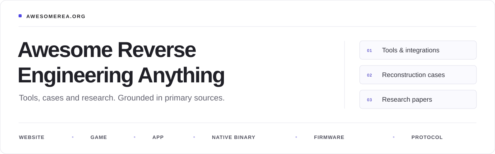

# Awesome Reverse Engineering Anything

An independent collection of tools, case studies and research for websites, games, apps, native binaries, firmware and communication protocols.

**English** · [简体中文](README.zh-CN.md)

<!-- BEGIN GENERATED BADGES -->
<!-- Generated by scripts/build_readme.py from data/rea-resources.json, data/tool-resources.json and data/papers.json. Edit the source data and rerun the script; do not edit this block by hand. -->
    
<!-- END GENERATED BADGES -->

**[Search & filter](https://awesomerea.org/)** · **[Browse cases](https://awesomerea.org/cases/)** · **[Research papers](https://awesomerea.org/papers/)** · **[HTML survey](https://awesomerea.org/survey/)** · **[Suggest a resource](https://github.com/reacher-z/Awesome-REA/issues/new?template=resource.yml)** · **[Contributing](#contributing)**

**Source review does not imply runtime verification.** [Review method](https://awesomerea.org/about/)

## Contents

**For agents:** [Repository instructions](AGENTS.md) · [How to contribute and submit a PR](docs/agent-contributing.md) · [Contribution forms](https://awesomerea.org/contribute/)

<!-- BEGIN GENERATED CONTENTS -->
<!-- Generated by scripts/build_readme.py from data/rea-resources.json, data/tool-resources.json, data/papers.json, data/source-index.json, data/source-scope.json and data/source-supplements/. Edit the source data and rerun the script; do not edit this block by hand. -->
770 curated resources (294 cases) · 188 papers · 3,309 indexed repositories · latest source review 2026-11-01. Section counts add up to 767 because 3 of these appear only under Papers.

- [Find by task](#find-by-task)
- [Resources](#resources) (767)
  - [Website](#website) (40)
  - [Game](#game) (252)
  - [App](#app) (117)
  - [Native Binary](#native-binary) (133)
  - [Firmware and Hardware](#firmware-and-hardware) (47)
  - [Protocol](#protocol) (44)
  - [Agents and MCP](#agents-and-mcp) (58)
  - [Related Collections](#related-collections) (24)
  - [References and Learning](#references-and-learning) (52)
- [Papers](#papers) (188)
  - [Most recent papers](#most-recent-papers) (10)
- [Full Repository Index](#full-repository-index) (3,309)
- [Contributors](#contributors)
- [About](#about)

Also on this page: [Contributing](#contributing)
<!-- END GENERATED CONTENTS -->

## Find by task

| Task                                     | Relevant sections                                                                            |
| ---------------------------------------- | -------------------------------------------------------------------------------------------- |
| Inspect a website or app interface       | [Websites](#website) · [Apps](#app)                                                          |
| Rebuild a game or check matching code    | [Games](#game) · [Game cases](https://awesomerea.org/cases/#cases-game)                      |
| Analyze compiled code or recover symbols | [Native binaries](#native-binary) · [Agents and MCP](#agents-and-mcp)                        |
| Investigate firmware or device protocols | [Firmware](#firmware) · [Protocols](#protocol)                                               |
| Compare methods and evaluation evidence  | [Papers](#papers) · [Survey comparisons](https://awesomerea.org/survey/#comparative-studies) |

## Resources

Names link to original sources. Each line gives the opening sentence of the description, then the type and relationship; “Full entry” opens the complete description, prerequisites, limitations and review sources.

Each resource appears once under its main purpose. Cases reuse these entries; [papers are listed separately](#papers). [Browse the resource directory](https://awesomerea.org/resources/).

REA labels refer to the separate [upstream CLI and MCP project](https://github.com/morluto/rea). Listing does not imply REA integration. [About this independent collection](#about).

<!-- BEGIN GENERATED CATALOG -->
<!-- Generated by scripts/build_readme.py from data/rea-resources.json and data/tool-resources.json. Edit the source data and rerun the script; do not edit this block by hand. -->
**Tags:** Official REA: published by the REA project · Community REA: third-party REA work · REA maintainer: an REA maintainer's list · Independent MCP, Independent agent, Independent reconstruction: no established REA connection · Mixed workflow: REA plus other tools, per the author · Android, .NET, JVM, WebAssembly: platform · Library: code library · type only: foundation tool or learning resource.

### Website

[↑ Contents](#contents)

#### Case studies

- [**Dinosaur runner: recovering one acceleration rule**](https://github.com/morluto/rea/blob/c360cfcd6d7901514b16dd6113eba2e0b0fdf422/website/evidence/calculator-and-dino.md#dinosaur-speed) - REA’s documented teaching case inspects the HTTP t-rex-runner edition and reconstructs its speed-update rule. Case study · Official REA · Also: Game · [Full entry](https://awesomerea.org/resources/rea-dinosaur-speed-case/)
- [**rauchg.com: rebuilding an RSC blog from captured Flight output**](https://github.com/boyang-hu/website-rebuild-skill/blob/ac60c9d8a2ab40045a89b5403c3457f1404e92b3/skills/website-rebuild/references/rsc-reconstruction.md) - Documents a website-rebuild-skill case that decodes browser-delivered React Server Component Flight streams, reconstructs a buildable Next project and compares its output with a captured site. Case study · Independent reconstruction · [Full entry](https://awesomerea.org/resources/rauchg-rsc-reconstruction-case/)
- [**BaoCut Slides: adapting an interactive web editor**](https://github.com/JimLiu/baocut/tree/b8585e0c8d7a82bdee9f0ed019cf6edb075e41c1/packages/slides-runtime) - Documents BaoCut’s interactive slide editor, whose author says the implementation draws on Claude Slides. Case study · Independent reconstruction · Also: App · [Full entry](https://awesomerea.org/resources/baocut-slides-editor-case/)
- [**REA in Claude Code: an isolated static-analysis A/B trial**](https://zenn.dev/keigoly/articles/8738d8d241b5a1) - A Japanese field report connects REA 6.4.0 to Claude Code in a separate project directory, denies 43 of its 170 tools and common shell launch forms, and compares REA-enabled and REA-disabled runs on two real tasks: an Electron terminal’s packaged files and a saved HAR capture. Case study · Mixed workflow · Also: App · [Full entry](https://awesomerea.org/resources/rea-claude-code-isolated-ab-case/)
- [**Dinosaur runner: an REA-inspected speed rule rebuilt with Codex**](https://github.com/zhxunzh84/rea-dino-reverse-engineering) - The author uses REA’s MCP browser tools to passively capture the JavaScript loaded by wayou’s open-source T-Rex Runner page, then has Codex rebuild its acceleration rule in one self-contained HTML5 Canvas game. Case study · Mixed workflow · Also: Game · [Full entry](https://awesomerea.org/resources/rea-dino-runner-community-case/)
- [**Terminal: a Rust terminal informed by TradingView chart research**](https://github.com/michaelshimeles/terminal) - An independent Rust market interface uses REA browser-scenario research on public logged-out TradingView chart interactions. Case study · Mixed workflow · Also: App · [Full entry](https://awesomerea.org/resources/terminal-tradingview-rea-chart-case/)
- [**BaoCut Design: porting reconstructed canvas and design-system editors**](https://github.com/JimLiu/baocut/tree/7aa049e82e1367da013b7aba80f0b79033fa04ad/packages/design-runtime) - Documents BaoCut’s design-canvas and design-system editors, which the project says it ported 1:1 from TypeScript reconstructions of Claude Design’s editors and hosts in agent sessions with annotation and export. Case study · Independent reconstruction · Also: App · [Full entry](https://awesomerea.org/resources/baocut-design-canvas-case/)
- [**whatsapp-web-reveng: documenting the legacy WhatsApp Web protocol**](https://github.com/sigalor/whatsapp-web-reveng) - Documents and reimplements the WebSocket protocol WhatsApp Web used while browser sessions mirrored a paired phone: QR pairing, Curve25519/HKDF key setup, AES/HMAC-protected binary messages, the token-based node encoding and end-to-end media encryption. Case study · Independent reconstruction · Also: Protocol · [Full entry](https://awesomerea.org/resources/whatsapp-web-reveng-legacy-protocol-case/)
- [**Ruffle: a Rust reimplementation of Adobe Flash Player**](https://github.com/ruffle-rs/ruffle) - Reimplements Adobe Flash Player in Rust so that SWF content, from ActionScript 1/2 (AVM1) to ActionScript 3 (AVM2), runs in a native desktop player or in browsers through WebAssembly, as a self-hosted script or a browser extension. Case study · Independent reconstruction · Also: Game · [Full entry](https://awesomerea.org/resources/ruffle-flash-player-case/)
- [**Littlebird.ai static home-page rebuild**](https://github.com/AkashNaickar/crdb-sample-frontend) - Rebuilds the Littlebird.ai home page in plain HTML/CSS/JavaScript from captured markup and assets, with source-wired mobile navigation, FAQ toggles, scroll reveals and OS-dependent call-to-action presentation. Case study · Independent reconstruction · [Full entry](https://awesomerea.org/resources/littlebird-static-rebuild-case/)

#### Tools, projects and integrations

- [**webcrack**](https://github.com/j4k0xb/webcrack) - Improves JavaScript readability by reversing supported obfuscation patterns and unpacking webpack/Browserify bundles. Tool · Also: App · [Full entry](https://awesomerea.org/resources/webcrack/)
- [**humanify**](https://github.com/jehna/humanify) - Rename identifiers in minified JavaScript with LLM-suggested names, applied through scope-aware AST rewriting so the program structure stays unchanged. Tool · [Full entry](https://awesomerea.org/resources/humanify/)
- [**WABT**](https://github.com/WebAssembly/wabt) - WebAssembly tools for binary-to-text conversion, section inspection, validation, interpretation and C translation. Tool · WebAssembly · Also: Binary · [Full entry](https://awesomerea.org/resources/wabt/)
- [**wasm-tools**](https://github.com/bytecodealliance/wasm-tools) - Bytecode Alliance CLI and Rust libraries for inspecting WebAssembly modules, metadata, components and WIT interfaces. Tool · WebAssembly · Also: Binary · [Full entry](https://awesomerea.org/resources/wasm-tools/)
- [**Chrome DevTools MCP**](https://github.com/ChromeDevTools/chrome-devtools-mcp) - Connect an agent to Chrome for live page inspection, network debugging, and performance traces. Integration · Independent MCP · [Full entry](https://awesomerea.org/resources/chrome-devtools-mcp/)
- [**mitmproxy**](https://github.com/mitmproxy/mitmproxy) - Inspect and record HTTP traffic with an interactive proxy, web interface, or scriptable command-line tools. Tool · Also: App, Protocol · [Full entry](https://awesomerea.org/resources/mitmproxy/)
- [**Playwright MCP**](https://github.com/microsoft/playwright-mcp) - Drive browser interactions through structured accessibility snapshots to investigate reproducible web behavior. Integration · Independent MCP · [Full entry](https://awesomerea.org/resources/playwright-mcp/)
- [**Burp Suite MCP Server**](https://github.com/PortSwigger/mcp-server) - PortSwigger's Burp Suite extension serves an MCP endpoint, plus a packaged stdio proxy, so agents can query proxy HTTP and WebSocket history, send HTTP/1.1 or HTTP/2 requests, and open Repeater or Intruder tabs. Integration · Independent MCP · Also: App · [Full entry](https://awesomerea.org/resources/burp-suite-mcp-server/)
- [**Wakaru**](https://github.com/pionxzh/wakaru) - Recover readable modules from shipped JavaScript bundles by reversing recognized minifier and transpiler patterns. Tool · [Full entry](https://awesomerea.org/resources/wakaru/)
- [**Spectral**](https://github.com/spectral-mcp/spectral) - Analyze captured application HTTP traffic with an LLM to generate MCP tools, OpenAPI 3.1 specifications, or GraphQL schemas. Integration · Independent agent · Also: App, Protocol · [Full entry](https://awesomerea.org/resources/spectral-mcp/)
- [**jsdeob-workbench**](https://github.com/Owl4444/jsdeob-workbench) - Inspect JavaScript ASTs and variable scopes while building visual chains of Babel transforms. Tool · [Full entry](https://awesomerea.org/resources/jsdeob-workbench/)
- [**Browser Reverse Engineering Toolkit**](https://github.com/Dvurechensky/Browser.Reverse.Engineering.Toolkit) - Capture browser-session evidence, crawl websites in a persistent Chromium session, and generate offline architecture/API reports plus OpenAPI, SDK and mock-server drafts from saved captures. Tool · [Full entry](https://awesomerea.org/resources/browser-reverse-engineering-toolkit/)
- [**screenshot-to-code**](https://github.com/abi/screenshot-to-code) - Generate HTML/CSS, Tailwind, React, Vue, Bootstrap or Ionic front-end code from screenshots, mockups, Figma designs or screen recordings with multimodal models; an optional headless-browser preview lets the model check its rendered output. Tool · [Full entry](https://awesomerea.org/resources/screenshot-to-code/)
- [**Dembrandt**](https://github.com/dembrandt/dembrandt) - Node.js CLI that renders a website in Playwright-driven Chromium or Firefox and reads computed styles from the DOM to extract its design system: logo, color roles with the evidence behind each pick, typography, spacing, borders, shadows, motion, breakpoints and component styles such as buttons and inputs. Tool · [Full entry](https://awesomerea.org/resources/dembrandt/)
- [**shuji**](https://github.com/paazmaya/shuji) - Command-line tool that writes the original JavaScript and CSS sources embedded in source maps back out as files. Tool · [Full entry](https://awesomerea.org/resources/shuji/)
- [**Obfuscator.io Deobfuscator**](https://github.com/ben-sb/obfuscator-io-deobfuscator) - Deobfuscator dedicated to JavaScript produced by Obfuscator.io (javascript-obfuscator), which its README says also handles most forks. Tool · [Full entry](https://awesomerea.org/resources/obfuscator-io-deobfuscator/)
- [**javascript-deobfuscator**](https://github.com/ben-sb/javascript-deobfuscator) - General-purpose JavaScript deobfuscator for common obfuscation patterns, published on npm as js-deobfuscator and usable as a library or CLI. Tool · [Full entry](https://awesomerea.org/resources/ben-sb-javascript-deobfuscator/)
- [**mitmproxy2swagger**](https://github.com/alufers/mitmproxy2swagger) - Command-line tool that reverse-engineers undocumented REST APIs from captured traffic. Tool · Also: Protocol · [Full entry](https://awesomerea.org/resources/mitmproxy2swagger/)
- [**JPEXS Free Flash Decompiler (FFDec)**](https://github.com/jindrapetrik/jpexs-decompiler) - Java desktop decompiler and editor for Adobe Flash SWF files. Tool · Also: Game · [Full entry](https://awesomerea.org/resources/jpexs-decompiler/)
- [**WasmLens: exploratory WebAssembly inspection**](https://github.com/alexandrmotologa/wasmlens) - Python CLI with static paths for inspecting WebAssembly sections and function signatures, producing WAT-style instruction listings, and reconstructing limited C-like pseudocode. Tool · WebAssembly · Also: Binary · [Full entry](https://awesomerea.org/resources/wasmlens/)
- [**synchrony**](https://github.com/relative/synchrony) - JavaScript cleaner and deobfuscator aimed mainly at output from javascript-obfuscator (obfuscator.io). Tool · [Full entry](https://awesomerea.org/resources/synchrony/)
- [**sourcemapper**](https://github.com/denandz/sourcemapper) - Go command-line tool that recreates a web front end's original JavaScript source tree from a source map generated by webpack or a similar bundler, writing each embedded source file under the path the map records. Tool · [Full entry](https://awesomerea.org/resources/sourcemapper/)
- [**ngrev**](https://github.com/mgechev/ngrev) - Electron desktop application that statically analyzes an Angular project's TypeScript sources and draws interactive graphs of its NgModules, components, directives, pipes and providers and how they depend on each other, without running the application. Tool · [Full entry](https://awesomerea.org/resources/ngrev/)
- [**jsluice**](https://github.com/BishopFox/jsluice) - Bishop Fox's Go library and command-line tool that parses JavaScript with tree-sitter to recover the endpoints a script calls, judging values by how the code uses them rather than by regular expressions alone. Tool · [Full entry](https://awesomerea.org/resources/jsluice/)
- [**REstringer**](https://github.com/HumanSecurity/restringer) - HUMAN Security's Node.js JavaScript deobfuscator. Tool · [Full entry](https://awesomerea.org/resources/restringer/)
- [**Chrome extension source viewer (CRX Viewer)**](https://github.com/Rob--W/crxviewer) - Browser extension and web page by Rob Wu for inspecting packaged browser extensions without installing them. Tool · [Full entry](https://awesomerea.org/resources/crxviewer/)
- [**har-to-openapi**](https://github.com/jonluca/har-to-openapi) - TypeScript library and CLI that infers OpenAPI 3.0 or 3.1 documents from HAR captures of HTTP traffic, loosely based on har2openapi. Tool · [Full entry](https://awesomerea.org/resources/har-to-openapi/)
- [**decode-js**](https://github.com/echo094/decode-js) - Babel-based AST processor that turns obfuscated JavaScript back into readable source, with one target selected per run: javascript-obfuscator (obfuscator.io), JS-Confuser 2.x up to its high preset, sojson and its v7 variant for jsjiami.com.v7, sojson's jjencode variant, and a generic pass for unreachable code, nested blocks and constant expressions. Tool · [Full entry](https://awesomerea.org/resources/decode-js/)
- [**javascript-deobfuscator (LostMyCode)**](https://github.com/LostMyCode/javascript-deobfuscator) - Browser-based Vue app that restores the strings Obfuscator.io hides behind string-array lookups in JavaScript. Tool · [Full entry](https://awesomerea.org/resources/lostmycode-javascript-deobfuscator/)
- [**minusone**](https://github.com/airbus-cert/minusone) - Airbus CERT's Rust deobfuscation engine for scripts: it parses PowerShell or JavaScript with tree-sitter, applies rules that infer the values of syntax-tree nodes and prints a simplified script. Tool · [Full entry](https://awesomerea.org/resources/minusone-script-deobfuscator/)

### Game

[↑ Contents](#contents)

#### Case studies

- [**DX-Ball: reconstruct sound panning**](https://rea.tools/showcase/dx-ball/) - Recover one sound-pan function from instructions and constants; upstream cites 3,205 cases and a 63-byte match. Case study · Official REA · Also: Binary · [Full entry](https://awesomerea.org/resources/rea-dxball-case/)
- [**TH04: recover a DOS bullet-ring helper**](https://rea.tools/showcase/th04/) - Inspect a 16-bit PC-98 DOS helper and relate its angle calculation to a pinned reconstruction and historical compiler checks. Case study · Official REA · Also: Binary · [Full entry](https://awesomerea.org/resources/rea-th04-case/)
- [**Super Mario 64 DS: matching decompilation with relocation checks**](https://github.com/tangosdev/sm64ds-decomp) - Reconstructs Super Mario 64 DS functions as C/C++ and permitted assembly primitives, comparing compiled output with a user-supplied cartridge dump. Case study · Independent reconstruction · [Full entry](https://awesomerea.org/resources/sm64ds-decomp-case/)
- [**GoldenEye 007: an agent-assisted native port from a decompilation**](https://github.com/jkdansereau/goldeneye-pc-port) - Builds a native PC port on the existing GoldenEye 007 decompilation, with a host platform layer and assets extracted from the user’s ROM. Case study · Independent reconstruction · [Full entry](https://awesomerea.org/resources/goldeneye-pc-port-case/)
- [**ssbu-recomp: static recompilation with explicit mode limits**](https://github.com/Denkishi/ssbu-recomp) - Translates Super Smash Bros. Ultimate 13.0.4 AArch64 code ahead of time and supplies a Windows runtime with Vulkan/OpenGL rendering. Case study · Independent reconstruction · [Full entry](https://awesomerea.org/resources/ssbu-recomp-case/)
- [**KartPad: platform integration for a Mario Kart Wii recompilation**](https://github.com/chrissotraidis/kartpad) - Builds Apple and Android integration around WiiCompiled’s ahead-of-time translation of Mario Kart Wii, with native graphics, input and optional Retro Rewind support. Case study · Independent reconstruction · [Full entry](https://awesomerea.org/resources/kartpad-case/)
- [**BattleShip: an AI-assisted Super Smash Bros. native port**](https://github.com/JRickey/BattleShip) - Ports the existing Super Smash Bros. N64 decompilation using libultraship and Torch. Case study · Independent reconstruction · [Full entry](https://awesomerea.org/resources/battleship-port-case/)
- [**Agent decompilation: a byte-matching retrospective**](https://momo5502.com/posts/2026-10-09-game-decompilation/) - Maurice Heumann describes replacing plausible-looking agent output with compiler-based checks of reconstructed functions, relocations, data and types. Case study · Independent reconstruction · [Full entry](https://awesomerea.org/resources/agent-decompilation-oracle-case/)
- [**Snowboard Kids 2: an LLM-assisted N64 matching decompilation**](https://github.com/cdlewis/snowboardkids2-decomp) - A public matching decompilation of the N64 game Snowboard Kids 2, begun in 2024 with community decompilation tools. Case study · Independent reconstruction · [Full entry](https://awesomerea.org/resources/snowboardkids2-decomp-case/)
- [**IsaacRecomp: translating Flash game bytecode to native C++**](https://github.com/whylurking/IsaacRecomp) - Translates The Binding of Isaac’s Flash AVM1 bytecode into C++ functions and supplies a native rendering/input runtime. Case study · Independent reconstruction · [Full entry](https://awesomerea.org/resources/isaacrecomp-case/)
- [**Nanolathe: a documented Total Annihilation engine reimplementation**](https://github.com/nanolathe-gg/nanolathe) - Reimplements a Total Annihilation-compatible strategy-game engine in Go, with public file-format research and separate gameplay profiles. Case study · Independent reconstruction · [Full entry](https://awesomerea.org/resources/nanolathe-case/)
- [**TH08: exact-source reconstruction and separately tested ports**](https://github.com/N0zoM1z0/th08) - Reconstructs the original Japanese Touhou 8 version 1.00d against its binary and original compiler, then adapts the recovered code for other platforms. Case study · Independent reconstruction · [Full entry](https://awesomerea.org/resources/th08-reconstruction-case/)
- [**Zelda 64: Recompiled — a native Majora’s Mask port without a full source decompilation**](https://github.com/Zelda64Recomp/Zelda64Recomp) - Uses N64Recomp to translate Majora’s Mask into a native application and RT64 for rendering. Case study · Independent reconstruction · [Full entry](https://awesomerea.org/resources/zelda64recomp-case/)
- [**OpenGOAL: recovering GOAL code and rebuilding the Jak games**](https://github.com/open-goal/jak-project) - Reconstructs readable GOAL code from the original Jak binaries and compiles it with a new GOAL compiler for modern PCs. Case study · Independent reconstruction · [Full entry](https://awesomerea.org/resources/opengoal-jak-case/)
- [**LEGO Island: source reconstruction with separately reported exact rebuilds**](https://github.com/isledecomp/isle) - Reconstructs the English LEGO Island 1.1 source for its original 32-bit Windows target. Case study · Independent reconstruction · [Full entry](https://awesomerea.org/resources/lego-island-decomp-case/)
- [**Snowball War: a bounded REA-assisted minigame reconstruction**](https://github.com/tuunanet/rea-ski-or-die-reconstruction) - The author uses REA’s Ghidra workflow to investigate the DOS Ski or Die binary, document Snowball War rules and rebuild that one minigame in Rust with SDL2. Case study · Mixed workflow · [Full entry](https://awesomerea.org/resources/snowball-war-rea-case/)
- [**SpaceCadetPinball: decompiled game logic adapted to SDL2**](https://github.com/k4zmu2a/SpaceCadetPinball) - Converts the reverse-engineered Space Cadet pinball game into compilable C++ for desktop platforms. Case study · Independent reconstruction · [Full entry](https://awesomerea.org/resources/space-cadet-pinball-case/)
- [**Super Mario 64: ROM reconstruction with explicit comparison gates**](https://github.com/n64decomp/sm64) - Reconstructs Super Mario 64 source for Japanese, North American, European, Shindou and iQue releases. Case study · Independent reconstruction · [Full entry](https://awesomerea.org/resources/sm64-decomp-case/)
- [**Unleashed Recompiled: translating Xbox 360 game code and shaders**](https://github.com/hedge-dev/UnleashedRecomp) - Builds an unofficial Sonic Unleashed PC port by statically recompiling Xbox 360 PowerPC code with XenonRecomp and Xenos shaders with XenosRecomp. Case study · Independent reconstruction · [Full entry](https://awesomerea.org/resources/unleashed-recompiled-case/)
- [**OpenMW: replacing Morrowind’s engine while reusing original content**](https://github.com/OpenMW/openmw) - Provides an independent engine for playing Morrowind and an alternative editor, OpenMW-CS. Case study · Independent reconstruction · [Full entry](https://awesomerea.org/resources/openmw-engine-case/)
- [**REDRIVER2: reconstructing Driver 2 through a PlayStation compatibility layer**](https://github.com/OpenDriver2/REDRIVER2) - Translates reverse-engineered Driver 2 MIPS routines into C/C++ and uses Psy-X/Psy-Cross to adapt PlayStation interfaces for desktop systems. Case study · Independent reconstruction · [Full entry](https://awesomerea.org/resources/redriver2-case/)
- [**DevilutionX: porting Diablo’s reconstructed engine**](https://github.com/diasurgical/DevilutionX) - Builds a modern Diablo and Hellfire port on the Devilution reconstruction, with platform support, bug fixes and optional quality-of-life features. Case study · Independent reconstruction · [Full entry](https://awesomerea.org/resources/devilutionx-case/)
- [**Touhou reconstructions: an agent-driven method across three games**](https://rea.tools/blog/touhou-reconstruction/) - An essay published on REA’s site, with pinned evidence notes, describes one author’s agent-driven reconstructions of TH08, TH095 and TH04. Case study · Official REA · Also: Binary · [Full entry](https://awesomerea.org/resources/rea-touhou-reconstruction-method-case/)
- [**TicTacToe-AI: a bounded REA-fork reconstruction of one game method**](https://github.com/heaven-hm/re-agent/tree/develop/benchmarks/tictactoe) - The author’s REA fork, posted as rea-engine and since renamed RE-Agent, decompiles the shipped .NET executable of the GPL-licensed TicTacToe-AI game, recompiles the recovered C# and resources, and repairs one decompiler error against the original IL. Case study · Mixed workflow · [Full entry](https://awesomerea.org/resources/rea-engine-tictactoe-case/)
- [**UltraSunnyMoon: a partial, REA-led Pokémon Ultra Sun reconstruction**](https://github.com/tylergraydev/UltraSunnyMoon) - The author uses a pinned REA build with Ghidra to analyze a user-supplied Pokémon Ultra Sun base executable, rebuild it byte for byte from split objects, and swap in two small compiled C runtime routines. Case study · Mixed workflow · [Full entry](https://awesomerea.org/resources/ultrasunnymoon-rea-case/)
- [**DX-Ball: an REA-guided function-level reconstruction with Codex**](https://github.com/N0zoM1z0/dx-ball) - The author has Codex use REA’s Ghidra tools to inspect the English DX-Ball 1.07 executable and recover it as typed C/C++, then compiles each function with the original-era Visual C++ 4.0 and compares it byte for byte with the original after mapping relocations. Case study · Mixed workflow · Also: Binary · [Full entry](https://awesomerea.org/resources/dx-ball-rea-reconstruction-case/)
- [**re2ds: a native Nintendo DS engine for Resident Evil 2**](https://github.com/eray1605/re2ds) - Reimplements Resident Evil 2’s PS1 game rules in a native Nintendo DS engine, with converters that turn data from the user’s own disc into DS formats. Case study · Mixed workflow · [Full entry](https://awesomerea.org/resources/re2ds-nds-engine-case/)
- [**Horizon: a Rust rewrite of Minecraft: Java Edition 26.3 with REA bytecode queries**](https://github.com/ludovic111/horizon) - Rewrites Minecraft: Java Edition 26.3 as a native Rust client, dedicated server and launcher that prepare their resources from the user’s own copy of the game. Case study · Mixed workflow · [Full entry](https://awesomerea.org/resources/horizon-minecraft-rust-rewrite-case/)
- [**Untangle: a browser rebuild from REA and Ghidra evidence**](https://github.com/az9713/untangle-rebuild) - An author-documented REA/Ghidra investigation of the shipped Untangle Windows binary produces a single-page playable rebuild and a claim-by-claim grading receipt. Case study · Mixed workflow · Also: Binary · [Full entry](https://awesomerea.org/resources/untangle-rea-evidence-rebuild-case/)
- [**OpenBattlefield2: an unfinished Refractor 2 engine reimplementation**](https://github.com/Moxnatiy/OpenBattlefield2) - A C++20 reimplementation of Battlefield 2’s Refractor 2 engine reads original game data and documents menu rendering, level loading and server interoperability. Case study · Mixed workflow · Also: Binary · [Full entry](https://awesomerea.org/resources/openbattlefield2-refractor-engine-case/)
- [**keen-clone: a Commander Keen 1 C/SDL2 port**](https://github.com/carlhako/keen-clone) - A native Linux and browser port of Commander Keen Episode One is documented as a function-by-function REA/Ghidra reconstruction of KEEN1.EXE. Case study · Mixed workflow · Also: Binary · [Full entry](https://awesomerea.org/resources/keen-clone-rea-commander-keen-case/)
- [**samp-client-re: a partial SA-MP client reconstruction**](https://github.com/NathanKanaeru/samp-client-re) - A documented REA/Ghidra investigation maps SA-MP 0.3.DL-R1 client subsystems to a new C++ DLL, loader and smoke-test executable. Case study · Mixed workflow · Also: Binary · [Full entry](https://awesomerea.org/resources/samp-client-rea-partial-reconstruction-case/)
- [**Desktop Games Nostalgia: a macOS and browser port**](https://github.com/ucodia/desktop-games-nostalgia) - A Swift/macOS and JavaScript/browser port recreates the Desktop Games screen-smashing toy from a captured image. Case study · Mixed workflow · Also: Binary · [Full entry](https://awesomerea.org/resources/desktop-games-nostalgia-rea-port-case/)
- [**GunZRs: a Rust reimplementation of GunZ: The Duel**](https://github.com/OpenRsG/GunZRs) - A Rust/Bevy port reads GunZ: The Duel files from the user's installation and provides native releases, browser build tooling, screenshots and a documented REA/Ghidra investigation framework. Case study · Mixed workflow · [Full entry](https://awesomerea.org/resources/gunzrs-rea-rust-reimplementation-case/)
- [**Does reverse engineering need a bigger model? General and specialist models in Touhou reconstruction**](https://rea.tools/blog/reverse-engineering-models/) - An essay on REA’s site by N0zoM1z0 (13 October 2026) uses dated Touhou reconstruction commits to ask whether exact function matching needs a larger general model, a compiler-specialist model or better retrieval. Case study · Official REA · Also: Binary · [Full entry](https://awesomerea.org/resources/rea-bigger-model-essay-case/)
- [**LASRecomp: Link’s Awakening static recompilation**](https://github.com/peiikai/LASRecomp) - A native desktop reconstruction of the 2019 Switch version of Link’s Awakening using static recompilation. Case study · Independent reconstruction · [Full entry](https://awesomerea.org/resources/lasrecomp/)
- [**ArkWeb: a two-game movement and collision experiment**](https://github.com/luki-1/ArkWeb) - Runs Spider-Man Remastered and Arkham Knight together, streaming Gotham collision into Spider-Man’s physics world and compositing his rendered frame into Arkham. Case study · Independent reconstruction · [Full entry](https://awesomerea.org/resources/arkweb-two-game-case/)
- [**Perfect Dark: matching Nintendo 64 decompilation**](https://github.com/n64decomp/perfect_dark) - Reconstructs Perfect Dark’s Nintendo 64 code with a documented matching-ROM build. Case study · Independent reconstruction · [Full entry](https://awesomerea.org/resources/perfect-dark-matching-decomp-case/)
- [**Super Mario Sunshine: a native PC port from an AI-assisted decompilation**](https://github.com/chasem-dev/sms-pc-port) - Builds a native PC port of Super Mario Sunshine’s North American release from a pinned matching-decompilation fork, adding a host platform layer for graphics, disc, audio, input and OS services. Case study · Independent reconstruction · [Full entry](https://awesomerea.org/resources/sms-pc-port-case/)
- [**Majora’s Mask: matching US N64 decompilation**](https://github.com/zeldaret/mm) - Recreates a C source base for The Legend of Zelda: Majora’s Mask from information in the game and static or dynamic analysis, then rebuilds the US Nintendo 64 ROM. Case study · Independent reconstruction · [Full entry](https://awesomerea.org/resources/zelda-mm-decomp-case/)
- [**DLSSNR-AMD: reimplementing DLSS 5 neural rendering for RDNA4**](https://github.com/mochizuki0323/DLSSNR-AMD) - Reimplements the neural-rendering network of NVIDIA’s DLSS 5 library as Vulkan compute shaders for AMD RX 9000 (RDNA4) cards and supplies it to games through an NGX-compatible core and ReShade or Vulkan-layer routes. Case study · Independent reconstruction · Also: Binary · [Full entry](https://awesomerea.org/resources/dlssnr-amd-neural-rendering-case/)
- [**Breath of the Wild: per-function matching decompilation of the Switch executable**](https://github.com/zeldaret/botw) - Reimplements part of Breath of the Wild’s Switch v1.5.0 main executable in C++ and checks each function against the original machine code. Case study · Independent reconstruction · [Full entry](https://awesomerea.org/resources/botw-decomp-case/)
- [**Skyward Sword: Wii decompilation with hash-checked relinking**](https://github.com/zeldaret/ss) - Reconstructs C++ source for The Legend of Zelda: Skyward Sword’s Wii main.dol and REL modules, starting from the user’s NTSC-U 1.0 (SOUE01) disc files. Case study · Independent reconstruction · [Full entry](https://awesomerea.org/resources/skyward-sword-decomp-case/)
- [**2 Ship 2 Harkinian: a native Majora’s Mask port built on the decompilation**](https://github.com/2ship2harkinian/2ship2harkinian) - Builds native Windows, Linux and macOS versions of The Legend of Zelda: Majora’s Mask from an adapted copy of the zeldaret/mm decompilation, with libultraship reimplementing N64 SDK functions. Case study · Independent reconstruction · [Full entry](https://awesomerea.org/resources/2ship2harkinian-mm-port-case/)
- [**Ship of Harkinian: a native Ocarina of Time port built on the decompilation**](https://github.com/HarbourMasters/Shipwright) - Builds Ocarina of Time as a native PC application from the OoT decompilation’s source, with libultraship standing in for the N64 libultra SDK and DirectX 11, OpenGL or Metal rendering. Case study · Independent reconstruction · [Full entry](https://awesomerea.org/resources/ship-of-harkinian-oot-port-case/)
- [**The Minish Cap: a GBA decompilation targeting five ROMs**](https://github.com/zeldaret/tmc) - Recreates a C source base for The Legend of Zelda: The Minish Cap from information in the game and static or dynamic analysis, building five Game Boy Advance ROMs: USA, EU, JP and two demos. Case study · Independent reconstruction · [Full entry](https://awesomerea.org/resources/zelda-tmc-decomp-case/)
- [**Ocarina of Time: decompilation with MD5-checked ROM builds for 16 versions**](https://github.com/zeldaret/oot) - Recreates a C source base for Ocarina of Time that rebuilds 16 Nintendo 64, GameCube and iQue Player ROM versions, using information from the game and static and dynamic analysis. Case study · Independent reconstruction · [Full entry](https://awesomerea.org/resources/ocarina-of-time-decomp-case/)
- [**Project Arwing: Star Fox recompiled from a matching disassembly**](https://github.com/carlosrmz009/arwing) - Disassembles Star Fox’s 65816 and SuperFX code from runtime coverage and recursive descent, reassembles it into the original ROM, then translates it statically to C on a from-scratch SNES runtime for Windows, macOS and Linux. Case study · Independent reconstruction · [Full entry](https://awesomerea.org/resources/project-arwing-star-fox-recomp-case/)
- [**Project Arwing (2): Star Fox 2 recompiled from a matching disassembly**](https://github.com/carlosrmz009/arwing2) - Rebuilds Star Fox 2 from a coverage-seeded 65816 and SuperFX disassembly that reassembles to the original ROM, then translates it statically to C for native Windows, macOS and Linux builds. Case study · Independent reconstruction · [Full entry](https://awesomerea.org/resources/project-arwing-2-star-fox-2-recomp-case/)
- [**Little Planet: Sonic CD recompiled from a matching disassembly**](https://github.com/carlosrmz009/littleplanet) - Disassembles every executable file on the Sonic CD disc from runtime coverage and recursive descent, reassembles them byte-identically, and translates the code statically to C on a from-scratch Mega-CD runtime that replaces the BIOS with a high-level implementation. Case study · Independent reconstruction · [Full entry](https://awesomerea.org/resources/little-planet-sonic-cd-recomp-case/)
- [**vf2-decomp: differentially validated Virtua Fighter 2 recovery**](https://github.com/celsowm/vf2-decomp) - Recovers Virtua Fighter 2 Version 2.1’s Sega Model 2A i960 program into portable, non-matching C17, accepting each recovered path only when it matches a reference i960 executor at controlled boundaries. Case study · Independent reconstruction · [Full entry](https://awesomerea.org/resources/vf2-decomp-differential-recovery-case/)
- [**z2rs: an incremental Rust reconstruction of Zelda II checked against an emulator**](https://github.com/troyedwardsjr/z2rs) - Rebuilds Zelda II: The Adventure of Link (NES) in Rust for desktop, browser and Android by replacing the game’s 6502 routines one at a time. Case study · Independent reconstruction · [Full entry](https://awesomerea.org/resources/z2rs-zelda2-reconstruction-case/)
- [**sm64ex: an enhanced Super Mario 64 PC port from the decompilation**](https://github.com/sm64pc/sm64ex) - Builds native Super Mario 64 executables from decompiled source, extending the sm64-port fork of the n64decomp reconstruction with renderer, input, camera, save-format and external-data options. Case study · Independent reconstruction · [Full entry](https://awesomerea.org/resources/sm64ex-pc-port-case/)
- [**Ghostship: a libultraship native port of Super Mario 64**](https://github.com/HarbourMasters/Ghostship) - Builds Super Mario 64 as a native PC, Switch and Android program by compiling decompilation-style game source against the libultraship platform library. Case study · Independent reconstruction · [Full entry](https://awesomerea.org/resources/ghostship-sm64-port-case/)
- [**Super Mario Sunshine: an in-progress matching GameCube decompilation**](https://github.com/doldecomp/sms) - Reconstructs Super Mario Sunshine’s C++ source so that the original Metrowerks compiler reproduces byte-identical object files for four GameCube releases and the Switch 3D All-Stars build. Case study · Independent reconstruction · [Full entry](https://awesomerea.org/resources/sms-matching-decomp-case/)
- [**Dusklight: a native Twilight Princess port built on the decompilation**](https://github.com/TwilitRealm/dusklight) - Reimplements Twilight Princess as a native application for desktop and mobile platforms, building on the zeldaret/tp decompilation and the Aurora GameCube/Wii compatibility layer. Case study · Independent reconstruction · [Full entry](https://awesomerea.org/resources/dusklight-twilight-princess-port-case/)
- [**Metaforce: a Metroid Prime engine reimplementation rebuilt on the decompilation**](https://github.com/AxioDL/metaforce) - Started in 2015 as a reverse-engineered reimplementation of the Metroid Prime engine, Metaforce has been rewritten on top of the PrimeDecomp matching decompilation. Case study · Independent reconstruction · [Full entry](https://awesomerea.org/resources/metaforce-metroid-prime-case/)
- [**Super Mario Sunshine (USA): an AI-assisted matching decompilation fork**](https://github.com/chasem-dev/sms-english) - Extends the doldecomp Super Mario Sunshine decompilation to the North American GMSE01 release. Case study · Independent reconstruction · [Full entry](https://awesomerea.org/resources/sms-english-gmse01-decomp-case/)
- [**Donkey Kong 64: Recompiled — an N64Recomp native port**](https://github.com/Rainchus/Donkey-Kong-64-Recompiled) - Uses N64Recomp to statically recompile the US Nintendo 64 release of Donkey Kong 64 into a native port, with RT64 as the renderer. Case study · Independent reconstruction · [Full entry](https://awesomerea.org/resources/dk64-recompiled-case/)
- [**Twilight Princess: a decompilation with fully matching GameCube code**](https://github.com/zeldaret/tp) - Reconstructs Twilight Princess source that compiles back to binaries identical to the originals, building GameCube, Wii and Nvidia Shield releases from one codebase through conditional compilation. Case study · Independent reconstruction · [Full entry](https://awesomerea.org/resources/twilight-princess-decomp-case/)
- [**Castlevania: Symphony of the Night: matching decompilation across PlayStation, PSP and Saturn builds**](https://github.com/Xeeynamo/sotn-decomp) - Recreates C source for Castlevania: Symphony of the Night from its PlayStation, PSP and Saturn binaries, aiming for code that compiles byte for byte to the original game files. Case study · Independent reconstruction · [Full entry](https://awesomerea.org/resources/sotn-matching-decomp-case/)
- [**LEGO Island, portable: a multi-platform port of the decompiled source**](https://github.com/isledecomp/isle-portable) - Adapts the LEGO Island decompilation into a portable build for desktop, mobile, console, DOS and Web targets. Case study · Independent reconstruction · [Full entry](https://awesomerea.org/resources/lego-island-portable-case/)
- [**c1: a C port of PlayStation Crash Bandicoot**](https://github.com/wurlyfox/c1) - Ports the original PlayStation Crash Bandicoot game code to C function by function; its coding standard labels functions with the addresses of their original implementations. Case study · Independent reconstruction · [Full entry](https://awesomerea.org/resources/crash-bandicoot-c1-port-case/)
- [**Metroid Prime Port: an AI-assisted native port of the PrimeDecomp decompilation**](https://github.com/Odrannnn/MetroidPrimePort) - Compiles the PrimeDecomp decompilation of Metroid Prime’s game and engine code as native C++20 for Linux, Windows and Android, with an experimental macOS build. Case study · Independent reconstruction · [Full entry](https://awesomerea.org/resources/metroid-prime-port-case/)
- [**The Wind Waker: a GameCube decompilation with hash-checked relinking**](https://github.com/zeldaret/tww) - Reconstructs source for The Wind Waker’s GameCube executable and REL modules across the USA/Korea, PAL and Japanese releases and a Japanese kiosk demo. Case study · Independent reconstruction · [Full entry](https://awesomerea.org/resources/wind-waker-decomp-case/)
- [**Sonic Mania: a game-code decompilation for the RSDKv5 engine**](https://github.com/RSDKModding/Sonic-Mania-Decompilation) - Reconstructs Sonic Mania’s game code in C and builds it with the separately decompiled RSDKv5 or RSDKv5U engine for Windows, Linux, Switch and Android. Case study · Independent reconstruction · [Full entry](https://awesomerea.org/resources/sonic-mania-decomp-case/)
- [**MediEvil Recomp: a PlayStation static recompilation to C#**](https://github.com/BlackLabelHQ/MediEvilRecomp) - Statically recompiles the North American PlayStation release of MediEvil into C# with the RecompOne recompiler and runtime. Case study · Independent reconstruction · [Full entry](https://awesomerea.org/resources/medievil-recomp-case/)
- [**Crash Bandicoot 2 Recompiled: a PSXRecomp native build**](https://github.com/Zumbo06/Crash2Recomp) - A Windows launcher that uses the PSXRecomp recompiler and runtime to translate the user’s Crash Bandicoot 2: Cortex Strikes Back disc to C and compile it locally, so the game runs as native code with an emulated PlayStation hardware layer. Case study · Independent reconstruction · [Full entry](https://awesomerea.org/resources/crash2recomp-case/)
- [**Petari: a matching Super Mario Galaxy decompilation**](https://github.com/SMGCommunity/Petari) - Reconstructs Super Mario Galaxy’s Wii code as C++ that rebuilds, object by object, against main.dol files extracted from the user’s own Japanese, North American, PAL or Korean disc. Case study · Independent reconstruction · [Full entry](https://awesomerea.org/resources/petari-smg-decomp-case/)
- [**Wind Waker HD Recomp: a native port by static recompilation of the Wii U game**](https://github.com/ZeldaWWHDRecomp/ZeldaWWHDRecomp) - Statically recompiles The Wind Waker HD’s Wii U PowerPC code to C ahead of time, reimplements the Cafe OS libraries the game uses and implements GX2 graphics on Metal or Vulkan, producing native macOS, Linux, Windows and Android builds without a Cemu runtime. Case study · Independent reconstruction · [Full entry](https://awesomerea.org/resources/wind-waker-hd-recomp-case/)
- [**Castlevania 64: Recompiled — a beta static-recompilation port**](https://github.com/RevoSucks/CV64Recomp) - Uses N64Recomp to statically recompile the US 1.0 Nintendo 64 release of Castlevania into a native PC port rendered with RT64. Case study · Independent reconstruction · [Full entry](https://awesomerea.org/resources/cv64-recompiled-case/)
- [**RSDKv5 Decompilation: reconstructing Retro Engine v5 and v5U**](https://github.com/RSDKModding/RSDKv5-Decompilation) - Reconstructs the Retro Engine (RSDK) v5 and v5 Ultimate runtime, the engine that runs Sonic Mania’s game code, and builds it for Windows, Linux, Switch and Android. Case study · Independent reconstruction · [Full entry](https://awesomerea.org/resources/rsdkv5-engine-decomp-case/)
- [**C2C: hybrid recompilation and hand decompilation of Crash Bandicoot 2**](https://github.com/ughman/c2c) - An early reverse-engineering effort on PlayStation Crash Bandicoot 2 that converts the engine’s MIPS machine code directly into a very large C file and runs it against a modified PCSX-R emulator library for hardware I/O. Case study · Independent reconstruction · [Full entry](https://awesomerea.org/resources/c2c-crash2-hybrid-recompilation-case/)
- [**MediEvil decompilation: an early checksum-gated PlayStation project**](https://github.com/MediEvilDecompilation/medievil-decomp) - Decompiles the US PlayStation release of MediEvil toward C source that rebuilds its main executable, game executable and 26 overlays. Case study · Independent reconstruction · [Full entry](https://awesomerea.org/resources/medievil-decomp-case/)
- [**Conker's Bad Fur Day: Recompiled — an N64Recomp native port**](https://github.com/sciaschi/CBFD-Recompiled) - Statically recompiles the US Nintendo 64 release of Conker’s Bad Fur Day with N64Recomp into a native Windows, Linux and macOS port on N64ModernRuntime and RT64. Case study · Independent reconstruction · [Full entry](https://awesomerea.org/resources/cbfd-recompiled-case/)
- [**ProjectCane: a native PC port of Sly Cooper and the Thievius Raccoonus**](https://github.com/theclub654/ProjectCane) - Rebuilds the NTSC PlayStation 2 release of Sly Cooper and the Thievius Raccoonus as a native C++ game for Windows and Linux, running on data extracted from the player's own disc image. Case study · Independent reconstruction · [Full entry](https://awesomerea.org/resources/projectcane-sly1-pc-port-case/)
- [**Firefighter: a decompiled DOS game ported to Rust**](https://gitlab.com/esr/firefighter) - Eric S. Raymond’s terminal port of Firefighter, Eben Sprinsock’s 1985 DOS shareware game. Case study · Independent reconstruction · [Full entry](https://awesomerea.org/resources/firefighter-rust-port-case/)
- [**Kingdom Hearts 358/2 Days: native PC port built on a matching decompilation**](https://github.com/Yokimitsuro/khdays-port) - Compiles the C of the khdays-decomp matching decompilation for Windows x64 and supplies a native platform layer for the Nintendo DS hardware, SDK services and sound driver. Case study · Independent reconstruction · [Full entry](https://awesomerea.org/resources/khdays-native-pc-port-case/)
- [**ico-pc: a native ICO port compiled from the PS2 decompilation**](https://github.com/nathanialf/ico-pc) - Compiles the decompiled C of the PlayStation 2 game ICO natively for Windows, Linux, Android, iPhone and Apple-silicon Macs, with host code standing in for the PS2 hardware and Sony libraries. Case study · Independent reconstruction · [Full entry](https://awesomerea.org/resources/ico-pc-port-case/)
- [**Sly Cooper and the Thievius Raccoonus: matching PlayStation 2 decompilation**](https://github.com/TheOnlyZac/sly1) - Reconstructs source code for SCUS\_971.98, the NTSC-U PlayStation 2 executable of Sly Cooper and the Thievius Raccoonus, as a work-in-progress matching decompilation. Case study · Independent reconstruction · [Full entry](https://awesomerea.org/resources/sly1-matching-decomp-case/)
- [**Pokémon Emerald: a matching Game Boy Advance decompilation**](https://github.com/pret/pokeemerald) - Reconstructs Pokémon Emerald for the Game Boy Advance as buildable C source, with game scripts and data kept as assembler directives. Case study · Independent reconstruction · [Full entry](https://awesomerea.org/resources/pokemon-emerald-decomp-case/)
- [**Paper Mario: matching Nintendo 64 decompilation for four releases**](https://github.com/pmret/papermario) - Reconstructs Paper Mario’s Nintendo 64 code as C source that rebuilds the US, Japanese, PAL and iQue ROMs. Case study · Independent reconstruction · [Full entry](https://awesomerea.org/resources/paper-mario-matching-decomp-case/)
- [**Budokai Tenkaichi 3: a native PC port built on a matching decompilation**](https://github.com/z3xox/Tenkaichi3Decomp) - Compiles the decompiled code of Dragon Ball Z: Budokai Tenkaichi 3 (PS2, USA release SLUS-21678) for PC on a new renderer, sound, input and platform layer rather than an emulator. Case study · Independent reconstruction · [Full entry](https://awesomerea.org/resources/tenkaichi3-pc-port-case/)
- [**D2R Mobile: rehosting Diablo II: Resurrected’s Switch program on Apple devices**](https://github.com/jhaizhou-ops/d2r-mobile) - Runs the Nintendo Switch release’s own aarch64 program natively on iPhone, iPad and Apple silicon Macs, rewriting only instructions that depend on the Horizon kernel and supplying its system services and the NVN graphics API on Metal. Case study · Independent reconstruction · [Full entry](https://awesomerea.org/resources/d2r-mobile-switch-rehost-case/)
- [**Ratchet &amp; Clank: a matching PS2 decompilation with a documented agent workflow**](https://github.com/OpenRAC/rac1-decomp) - Reconstructs C source for SCES\_509.16, the PAL v2.00 PlayStation 2 executable of Ratchet &amp; Clank (2002), with every function linked at its retail address. Case study · Independent reconstruction · [Full entry](https://awesomerea.org/resources/rac1-matching-decomp-case/)
- [**Banjo: Recompiled — an N64Recomp Banjo-Kazooie native port**](https://github.com/BanjoRecomp/BanjoRecomp) - Uses N64Recomp to statically recompile the US 1.0 Nintendo 64 release of Banjo-Kazooie into a native port on N64ModernRuntime, rendered by RT64 and extended with mod support. Case study · Independent reconstruction · [Full entry](https://awesomerea.org/resources/banjo-recompiled-case/)
- [**Pokémon FireRed and LeafGreen: a matching Game Boy Advance decompilation**](https://github.com/pret/pokefirered) - Reconstructs the English Game Boy Advance releases of Pokémon FireRed and LeafGreen as buildable C source, with game scripts and data kept as assembler directives. Case study · Independent reconstruction · [Full entry](https://awesomerea.org/resources/pokemon-firered-leafgreen-decomp-case/)
- [**PaperBoat: a native Paper Mario port built on the decompilation**](https://github.com/HarbourMasters/PaperBoat) - Compiles Paper Mario decompilation sources, credited to the pmret and Paper Mario DX projects, into a native US-version application on libultraship. Case study · Independent reconstruction · [Full entry](https://awesomerea.org/resources/paperboat-paper-mario-port-case/)
- [**Halo 2: an agent-assisted matching decompilation of an LTCG Xbox build**](https://github.com/kirklandsig/halo2-decompiled) - A work-in-progress matching decompilation of Halo 2 for the original Xbox: contributors write C and C++ that the period compiler, building the whole program with link-time code generation, must turn back into the retail executable's bytes function by function. Case study · Independent reconstruction · [Full entry](https://awesomerea.org/resources/halo2-matching-decomp-case/)
- [**DiabloWeb: a WebAssembly browser port built on Devilution**](https://github.com/d07RiV/diabloweb) - Runs Diablo in web browsers by compiling a stripped-down fork of Devilution, the community reconstruction of the game’s original source, to WebAssembly behind a React front end. Case study · Independent reconstruction · [Full entry](https://awesomerea.org/resources/diabloweb-devilution-wasm-port-case/)
- [**pokered: a matching Pokémon Red and Blue disassembly**](https://github.com/pret/pokered) - Reconstructs the Game Boy games Pokémon Red and Blue as RGBDS assembly, with graphics and data kept as editable source files. Case study · Independent reconstruction · [Full entry](https://awesomerea.org/resources/pokered-disassembly-case/)
- [**Lighthouse: a Banjo-Kazooie PC port built on the decompilation**](https://github.com/HarbourMasters/Lighthouse) - A native Windows, Linux and macOS port of Banjo-Kazooie that compiles game C sources, many tagged with their Banjo-Kazooie decompilation file paths, against libultraship, a reimplementation of the N64 SDK. Case study · Independent reconstruction · [Full entry](https://awesomerea.org/resources/lighthouse-banjo-kazooie-port-case/)
- [**Lost Odyssey Recomp: statically recompiling an Xbox 360 RPG into native ports**](https://github.com/freefrank/LostOdysseyRecomp) - Translates Lost Odyssey’s Xbox 360 PowerPC executable with patched XenonRecomp tooling and runs the generated code on a native runtime that renders through Direct3D 12, Vulkan or Metal. Case study · Independent reconstruction · [Full entry](https://awesomerea.org/resources/lost-odyssey-recomp-case/)
- [**Super Smash Bros. Melee: a matching GameCube decompilation with a shiftable build**](https://github.com/doldecomp/melee) - A matching decompilation of Super Smash Bros. Melee's US 1.02 release (GALE01) that rebuilds main.dol from C with the original Metrowerks compilers and checks it against the retail SHA-1. Case study · Independent reconstruction · [Full entry](https://awesomerea.org/resources/melee-matching-decomp-case/)
- [**pokecrystal: a matching Pokémon Crystal disassembly**](https://github.com/pret/pokecrystal) - Reconstructs the Game Boy Color game Pokémon Crystal as RGBDS assembly, with graphics, maps and data stored as editable sources. Case study · Independent reconstruction · [Full entry](https://awesomerea.org/resources/pokecrystal-disassembly-case/)
- [**Pokémon HeartGold and SoulSilver: a work-in-progress, checksum-matched DS disassembly**](https://github.com/pret/pokeheartgold) - Rebuilds the US Nintendo DS releases of Pokémon HeartGold and SoulSilver from a work-in-progress disassembly in which part of the code has been decompiled to C. Case study · Independent reconstruction · [Full entry](https://awesomerea.org/resources/pokemon-heartgold-soulsilver-disassembly-case/)
- [**FFTARecomp: static recompilation of Final Fantasy Tactics Advance**](https://github.com/Jorge262007/FFTARecomp) - Recompiles the user’s Final Fantasy Tactics Advance (USA) Game Boy Advance ROM ahead of time into native code for Windows, Linux and Steam Deck, building on JRickey’s gba-recomp toolkit. Case study · Independent reconstruction · [Full entry](https://awesomerea.org/resources/fftarecomp-gba-static-recomp-case/)
- [**SymphonyRecomp: a RecompOne static recompilation of Symphony of the Night**](https://github.com/BlackLabelHQ/SymphonyRecomp) - Statically recompiles the North American PlayStation release of Castlevania: Symphony of the Night into C# with BlackLabelHQ’s RecompOne, whose runtime simulates the BIOS, memory-mapped I/O, GPU and CD-ROM so the game runs natively without a console BIOS. Case study · Independent reconstruction · [Full entry](https://awesomerea.org/resources/symphonyrecomp-case/)
- [**The Two Towers Recompiled: an original Xbox static-recompilation port**](https://github.com/Gumpolas/TooTawersRecomp) - Statically recompiles the x86 code of The Lord of the Rings: The Two Towers (Xbox, USA, 2002) into C with the bundled xboxrecomp toolkit, producing native Windows, Linux and experimental macOS builds. Case study · Independent reconstruction · [Full entry](https://awesomerea.org/resources/two-towers-recompiled-case/)
- [**Melee Unlocked: a Windows source port and static recompilation of Melee**](https://github.com/Hero88go/melee-unlocked) - A beta Windows build of Super Smash Bros. Melee (NTSC 1.02) with two engines: a source port that compiles the doldecomp decompilation as a native library, and a static recompilation that translates the retail DOL's PowerPC code and Slippi's Gecko codes into C++. Case study · Independent reconstruction · [Full entry](https://awesomerea.org/resources/melee-unlocked-case/)
- [**pokeruby: a matching Pokémon Ruby and Sapphire decompilation**](https://github.com/pret/pokeruby) - Reconstructs the Game Boy Advance games Pokémon Ruby and Sapphire as C source built with pret's agbcc compiler, alongside assembly data scripts and editable graphics. Case study · Independent reconstruction · [Full entry](https://awesomerea.org/resources/pokeruby-decomp-case/)
- [**Vandal Hearts: native PC port built on matching decompilations**](https://github.com/HalmyLyseas/VandalHearts-PcPort) - Builds on shao113’s matching decompilation of PlayStation Vandal Hearts, adds a Japanese matching tree, and carries both through to a native Windows and Linux port. Case study · Independent reconstruction · [Full entry](https://awesomerea.org/resources/vandal-hearts-pc-port-case/)
- [**Pokémon Platinum: a checksum-matched Nintendo DS decompilation**](https://github.com/pret/pokeplatinum) - Reconstructs the US Nintendo DS release of Pokémon Platinum as C source that rebuilds revision 1 by default and revision 0 on request. Case study · Independent reconstruction · [Full entry](https://awesomerea.org/resources/pokemon-platinum-decomp-case/)
- [**Saints Reborn: a ReXGlue static recompilation of Saints Row**](https://github.com/whompay/SaintsReborn) - An unofficial native Windows port of Saints Row (Xbox 360, 2006) that statically recompiles the game's PowerPC executable to C++ for x86-64 with the ReXGlue SDK, which also reimplements the console's kernel, GPU (on Direct3D 12), audio and input. Case study · Independent reconstruction · [Full entry](https://awesomerea.org/resources/saints-reborn-recomp-case/)
- [**Pokémon Platinum PC Port: a native port built on the pret decompilation**](https://github.com/cybervisi0n/pokeplatinum) - Builds native 64-bit Windows and Linux executables of Pokémon Platinum from a fork of pret’s decompilation, replacing NitroSDK with the author’s libntr libraries; the same tree keeps the DS ROM build and an experimental Switch target. Case study · Independent reconstruction · [Full entry](https://awesomerea.org/resources/pokemon-platinum-pc-port-case/)
- [**MikuPan: a native Fatal Frame PC port built on the Himuro decompilation**](https://github.com/Mikompilation/MikuPan) - Ports the PS2 game Fatal Frame to native PC builds without emulation; its repository description names the Himuro decompilation as its basis. Case study · Independent reconstruction · [Full entry](https://awesomerea.org/resources/mikupan-fatal-frame-port-case/)
- [**Starfox 64: Recompiled — an N64Recomp static-recompilation port**](https://github.com/sonicdcer/Starfox64Recomp) - Uses N64: Recompiled to statically recompile the US 1.1 (Rev A) Nintendo 64 release of Star Fox 64 into a native port for Windows, Linux and macOS, rendered with RT64. Case study · Independent reconstruction · [Full entry](https://awesomerea.org/resources/starfox64-recompiled-case/)
- [**Syphon Filter: The Omega Strain — matching PS2 executable decompilation**](https://github.com/zm2283145/syphon-filter-omega-strain-decomp) - Reconstructs much of the NTSC-U PlayStation 2 executable of Syphon Filter: The Omega Strain as C; with the remaining functions kept as split assembly, the build reproduces the retail SCUS\_972.64 byte for byte. Case study · Independent reconstruction · [Full entry](https://awesomerea.org/resources/syphon-filter-omega-strain-decomp-case/)
- [**Animal Crossing: a native PC port of the GameCube decompilation**](https://github.com/flyngmt/ACGC-PC-Port) - Runs Animal Crossing’s decompiled GameCube C code natively on 32-bit x86, replacing the GX graphics API with an OpenGL 3.3 translation layer and console services with SDL2-based platform code. Case study · Independent reconstruction · [Full entry](https://awesomerea.org/resources/animal-crossing-pc-port-case/)
- [**GoldenEye 007: matching Nintendo 64 decompilation for three releases**](https://github.com/n64decomp/007) - Reconstructs GoldenEye 007’s Nintendo 64 code as C source that rebuilds the US, Japanese and PAL ROMs. Case study · Independent reconstruction · [Full entry](https://awesomerea.org/resources/goldeneye-007-matching-decomp-case/)
- [**Starship: a Star Fox 64 PC port built from the decompilation**](https://github.com/HarbourMasters/Starship) - A native PC port of Star Fox 64 that compiles the game's decompiled C code against libultraship, an N64 porting library that reimplements libultra and renders through Fast3D. Case study · Independent reconstruction · [Full entry](https://awesomerea.org/resources/starship-sf64-pc-port-case/)
- [**CTR Turbocharged: a PC sourceport built on the Crash Team Racing decompilation**](https://github.com/CameronRedmore/Crash-Team-Racing-Turbocharged) - Extends the Crash Team Racing: High Octane sourceport, which derives from the CTR Native port of the CTR-ModSDK PlayStation decompilation, into Windows and Linux builds with a native 3D renderer, selectable aspect ratios and frame rates up to 240 FPS. Case study · Independent reconstruction · [Full entry](https://awesomerea.org/resources/ctr-turbocharged-port-case/)
- [**The Darkness Recomp: an Xbox 360 static recompilation with a native D3D11 renderer**](https://github.com/portingpete/The-Darkness-Recomp) - Builds a native Windows x64 port of The Darkness by translating its Xbox 360 executable to C++ ahead of time with a patched XenonRecomp. Case study · Independent reconstruction · [Full entry](https://awesomerea.org/resources/the-darkness-recomp-case/)
- [**MarioKart 64: Recompiled — a native port through N64Recomp static recompilation**](https://github.com/sonicdcer/MarioKart64Recomp) - Statically recompiles the US Nintendo 64 release of Mario Kart 64 into a native Windows, Linux and macOS application with N64Recomp, rendering through RT64. Case study · Independent reconstruction · [Full entry](https://awesomerea.org/resources/mariokart64-recompiled-case/)
- [**Animal Crossing: matching GameCube decompilation**](https://github.com/ACreTeam/ac-decomp) - Reconstructs Animal Crossing’s GameCube code as C and C++ source that rebuilds the USA release’s main executable and its foresta.rel module. Case study · Independent reconstruction · [Full entry](https://awesomerea.org/resources/animal-crossing-gamecube-decomp-case/)
- [**Kingdom Hearts 358/2 Days: a matching Nintendo DS decompilation**](https://github.com/Yokimitsuro/khdays-decomp) - Reconstructs the ARM9 program and overlays of the EU Nintendo DS release of Kingdom Hearts 358/2 Days as C that recompiles byte for byte with CodeWarrior. Case study · Independent reconstruction · [Full entry](https://awesomerea.org/resources/kingdom-hearts-days-matching-decomp-case/)
- [**TonyWasAProSkater: a THPS1 native port forked from a matching decompilation**](https://github.com/LANCommander/TonyWasAProSkater) - Ports Tony Hawk’s Pro Skater (PlayStation, USA) to native Windows and Linux builds from a fork of an in-progress matching decompilation of the retail executable. Case study · Independent reconstruction · [Full entry](https://awesomerea.org/resources/thps1-decomp-native-port-case/)
- [**P.T. for PC: a behavior-based engine reimplementation that reads the PS4 data**](https://github.com/LoreanXavier/pt-pc) - Reimplements P.T.’s game logic in C++ on a new Vulkan engine that reads levels, models, textures, sounds, scripts and cutscenes from the user’s own PS4 copy at run time. Case study · Independent reconstruction · [Full entry](https://awesomerea.org/resources/pt-pc-port-case/)
- [**SpaghettiKart: a native Mario Kart 64 port built on decompiled source**](https://github.com/HarbourMasters/SpaghettiKart) - Builds a native Mario Kart 64 port for Windows, Linux, macOS and Switch from source that keeps the Mario Kart 64 decompilation’s file layout, running on libultraship’s reimplemented N64 SDK. Case study · Independent reconstruction · [Full entry](https://awesomerea.org/resources/spaghettikart-mk64-port-case/)
- [**Animal Crossing: Wild World: matching Korean DS decompilation with differential runtime checks**](https://github.com/banatic/acww-decomp) - Reconstructs the ARM9 game code of Animal Crossing: Wild World’s Korean DS release as one C or C++ source per function, checked against the user’s ROM with the original Metrowerks compiler and linker. Case study · Independent reconstruction · [Full entry](https://awesomerea.org/resources/animal-crossing-wild-world-decomp-case/)
- [**King Kong Recompiled: an AI-developed Xbox 360 static recompilation**](https://github.com/TekRantGaming/king-kong-recompiled) - Translates the Xbox 360 release of Peter Jackson's King Kong into native Windows code with the ReXGlue static-recompilation SDK, adding a launcher and display, control and graphics options. Case study · Independent reconstruction · [Full entry](https://awesomerea.org/resources/king-kong-recompiled-case/)
- [**Mario Party 4: matching GameCube decompilation of the USA releases**](https://github.com/mariopartyrd/marioparty4) - Reconstructs Mario Party 4’s GameCube main executable and REL modules as C source that rebuilds both USA releases. Case study · Independent reconstruction · [Full entry](https://awesomerea.org/resources/mario-party-4-decomp-case/)
- [**SpeedBreaker: statically recompiling Need for Speed: Most Wanted for Xbox 360**](https://github.com/SpeedBreakerProject/speedbreaker) - Translates the Xbox 360 executable of Need for Speed: Most Wanted (2005) into native C++ with a patched XenonRecomp and runs it on a project runtime that stands in for the console’s kernel, Xenos GPU, XMA audio and controllers. Case study · Independent reconstruction · [Full entry](https://awesomerea.org/resources/speedbreaker-nfs-most-wanted-case/)
- [**The Sims: Bustin' Out: an AI-driven partial GBA matching decompilation**](https://github.com/DaBrown95/tsbodp) - Rebuilds the USA/Europe Game Boy Advance release of The Sims: Bustin' Out byte for byte while gradually replacing ROM regions with matching C compiled by agbcc. Case study · Independent reconstruction · [Full entry](https://awesomerea.org/resources/sims-bustin-out-gba-decomp-case/)
- [**Destiny 2 build 86657: Sunrise/Dawn reconstruction research report**](https://github.com/isinternets/d2-research) - A dated research report on the Sunrise/Dawn reconstruction of the archived Destiny 2 build 86657 client, which emulates platform sign-on and the examined Bungie service contracts locally and adds reconstructed mission host policy. Case study · Independent reconstruction · Also: Protocol · [Full entry](https://awesomerea.org/resources/destiny2-build-86657-reconstruction-report-case/)
- [**SVR2011-Recomp: a ReXGlue recompilation of WWE SmackDown vs. Raw 2011**](https://github.com/shaneomac1337/SVR2011-Recomp) - Translates the Xbox 360 executable of WWE SmackDown vs. Raw 2011 to C++ ahead of time with ReXGlue and builds it as a Windows program on a Vulkan runtime derived from Xenia. Case study · Independent reconstruction · [Full entry](https://awesomerea.org/resources/svr2011-recomp-case/)
- [**Snap64 Recomp: a static-recompilation port of Pokémon Snap**](https://github.com/JackandBeans/Snap64Recomp) - Uses N64Recomp to statically recompile the US Nintendo 64 release of Pokémon Snap into a native Windows, Linux, Steam Deck and macOS port rendered with RT64. Case study · Independent reconstruction · [Full entry](https://awesomerea.org/resources/snap64-recomp-case/)
- [**Dead Rising 2: Case Zero — an Xbox 360 XBLA static recompilation port**](https://github.com/wivi514/Dead_Rising_2_Case_Zero_Xenon_Recomp) - Builds a native Windows, Linux, Steam Deck and Apple Silicon port of the XBLA game Dead Rising 2: Case Zero by statically recompiling its Xbox 360 code with patched XenonRecomp and translating its shaders with patched XenosRecomp. Case study · Independent reconstruction · [Full entry](https://awesomerea.org/resources/dead-rising-2-case-zero-recomp-case/)
- [**OpenRA: an engine reimplementation reimagining early Westwood RTS games**](https://github.com/OpenRA/OpenRA) - Provides a C# engine for early Westwood real-time strategy games, with mods that reimagine Command &amp; Conquer: Red Alert, Tiberian Dawn and Dune 2000. Case study · Independent reconstruction · [Full entry](https://awesomerea.org/resources/openra-engine-case/)
- [**Dead Rising 2: Case West — a sibling Xbox 360 XBLA static recompilation port**](https://github.com/wivi514/Dead_Rising_2_Case_West_Xenon_Recomp) - Builds a native Windows, Linux, Steam Deck and Apple Silicon port of the XBLA epilogue Dead Rising 2: Case West by statically recompiling its Xbox 360 code with patched XenonRecomp and translating its shaders with patched XenosRecomp. Case study · Independent reconstruction · [Full entry](https://awesomerea.org/resources/dead-rising-2-case-west-recomp-case/)
- [**The Simpsons Wrestling Recompiled: a psxrecomp PlayStation static recompilation**](https://github.com/TekRantGaming/simpsons-wrestling-recompiled) - Translates the PlayStation game’s MIPS code to C with a pinned psxrecomp fork and builds Windows and Linux programs on its hardware-modelling runtime, with a launcher and a game-specific plugin. Case study · Independent reconstruction · [Full entry](https://awesomerea.org/resources/simpsons-wrestling-recompiled-case/)
- [**OpenRCT2: an open re-implementation of RollerCoaster Tycoon 2**](https://github.com/OpenRCT2/OpenRCT2) - Re-implements RollerCoaster Tycoon 2, originally written in x86 assembly, as a C++ engine that runs on the original game’s data. Case study · Independent reconstruction · [Full entry](https://awesomerea.org/resources/openrct2-engine-case/)
- [**Touhou 6: reconstructing Embodiment of Scarlet Devil 1.02h source**](https://github.com/GensokyoClub/th06) - Reconstructs C++ source for the Windows executable of Touhou 6: Embodiment of Scarlet Devil version 1.02h, aiming at an exact rebuild with the original Visual Studio .NET 2002 and DirectX 8 toolchain. Case study · Independent reconstruction · [Full entry](https://awesomerea.org/resources/th06-decomp-case/)
- [**Driver Recompiled: a psxrecomp setup host that builds the game locally**](https://github.com/alexbeavs-ps1-ports/driver-recomp) - Packages a psxrecomp static-recompilation project for Driver (PlayStation, USA) as a setup host: releases carry the recompiler, runtime and a recomp-ui launcher, and the player’s machine generates and compiles the game from the user’s own disc image. Case study · Independent reconstruction · [Full entry](https://awesomerea.org/resources/driver-recomp-setup-host-case/)
- [**Himuro: a matching Fatal Frame PS2 decompilation**](https://github.com/Mikompilation/Himuro) - Reconstructs Fatal Frame’s PS2 executable as C for the US, EU and Japanese releases, built with the original EE-GCC 2.9 toolchain and checked by SHA-1 against the user’s own executables. Case study · Independent reconstruction · [Full entry](https://awesomerea.org/resources/himuro-fatal-frame-decomp-case/)
- [**DOAXVB Native PC Port: statically recompiling Dead or Alive Xtreme Beach Volleyball**](https://github.com/NoRain211/doaxvb-re) - Lifts the original Xbox executable of Dead or Alive Xtreme Beach Volleyball to C with a fork of xboxrecomp and links it with a hand-written runtime that replaces kernel imports, audio and key Direct3D 8 and DirectSound APIs. Case study · Independent reconstruction · [Full entry](https://awesomerea.org/resources/doaxvb-native-port-case/)
- [**TH08 Web: a WebAssembly port built from reconstructed source**](https://github.com/N0zoM1z0/th08-web) - Compiles the reconstructed C++ source of the Japanese Touhou 8 1.00d release to WebAssembly with Emscripten, adding WebGL 2 rendering, Web Audio, browser input and IndexedDB saves behind the game’s D3D8-, DirectSound- and DirectInput-shaped interfaces. Case study · Independent reconstruction · [Full entry](https://awesomerea.org/resources/th08-web-wasm-port-case/)
- [**OpenXcom: an open-source clone of X-COM: UFO Defense and Terror from the Deep**](https://github.com/OpenXcom/OpenXcom) - Reimplements MicroProse’s UFO: Enemy Unknown (X-COM: UFO Defense) and X-COM: Terror from the Deep as a C++/SDL engine that runs on the user’s original game resources. Case study · Independent reconstruction · [Full entry](https://awesomerea.org/resources/openxcom-engine-case/)
- [**Skate 3 Recomp: a native Xbox 360 recompilation through ReXGlue**](https://github.com/mchughalex/skate3recomp) - Recompiles the Xbox 360 version of Skate 3 into native Windows, Linux and macOS builds with a Skate-specific fork of the ReXGlue SDK. Case study · Independent reconstruction · [Full entry](https://awesomerea.org/resources/skate3-recomp-case/)
- [**Uncharted: The Nathan Drake Collection native Windows port**](https://github.com/bc160201983/Uncharted-The-Nathan-Drake-Collection-PC-port) - Runs the PS4 Uncharted: The Nathan Drake Collection’s own x86-64 executables natively on Windows: a runtime supplies the PS4 system libraries and a shadPS4-derived Vulkan renderer executes the GPU work. Case study · Independent reconstruction · [Full entry](https://awesomerea.org/resources/uncharted-collection-pc-port-case/)
- [**TH095: function-level reconstruction of Shoot the Bullet 1.02a**](https://github.com/N0zoM1z0/th095) - Reconstructs source for the original Japanese Touhou 9.5: Shoot the Bullet 1.02a executable, accepting function exactness only through reproducible byte comparison of pinned Visual C++ .NET 2003 builds against one hash-attested target. Case study · Independent reconstruction · [Full entry](https://awesomerea.org/resources/th095-reconstruction-case/)
- [**CorsixTH: an open reimplementation of Theme Hospital**](https://github.com/CorsixTH/CorsixTH) - Reimplements the engine of Bullfrog’s 1997 Theme Hospital, with game logic in Lua and C++ for graphics, sound, movies and pathfinding, on top of the original game’s data files. Case study · Independent reconstruction · [Full entry](https://awesomerea.org/resources/corsixth-engine-case/)
- [**OpenRiseOfNations: a native macOS engine reimplementation**](https://github.com/ben-wright-1/OpenRiseOfNations) - Reimplements the Rise of Nations: Extended Edition engine as a native macOS app with a Metal renderer, a deterministic simulation, a computer opponent and a compatible BigHugeScript compiler and virtual machine, loading art, maps, rules and scripts from the user’s own Windows installation. Case study · Independent reconstruction · [Full entry](https://awesomerea.org/resources/openriseofnations-engine-case/)
- [**TH04: rebuilding Lotus Land Story’s four PC-98 programs from source**](https://github.com/N0zoM1z0/th04) - Reconstructs source for the Japanese PC-98 Touhou 4: Lotus Land Story and rebuilds all four DOS programs, MAIN.EXE, OP.EXE, MAINE.EXE and ZUN.COM, with a pinned Borland toolchain under Wine. Case study · Independent reconstruction · [Full entry](https://awesomerea.org/resources/th04-reconstruction-case/)
- [**inFAMOUS Second Son native PC port**](https://github.com/HayatoG/iss_pc) - Runs the PS4 inFAMOUS Second Son’s own x86-64 code natively on Windows and Linux: a runtime reimplements the PS4 system libraries the game uses, and a shadPS4-derived core translates its GPU commands and shaders to Vulkan. Case study · Independent reconstruction · [Full entry](https://awesomerea.org/resources/infamous-second-son-pc-port-case/)
- [**xoreos: an open reimplementation of BioWare’s Aurora engine family**](https://github.com/xoreos/xoreos) - Reimplements BioWare’s Aurora engine and its later derivatives as a portable C++ engine that runs on the user’s installed game data, targeting nine games from Neverwinter Nights to Dragon Age II. Case study · Independent reconstruction · [Full entry](https://awesomerea.org/resources/xoreos-aurora-engine-case/)
- [**librw: a re-implementation of the RenderWare Graphics engine**](https://github.com/aap/librw) - Re-implements a large part of the RenderWare Graphics middleware API as a portable C++ library that reads and writes its DFF model and TXD texture files for PS2, D3D8, D3D9 and Xbox and is meant to convert them between platforms. Case study · Independent reconstruction · [Full entry](https://awesomerea.org/resources/librw-renderware-reimplementation-case/)
- [**Super Mario Odyssey: per-function matching decompilation of the Switch executable**](https://github.com/MonsterDruide1/OdysseyDecomp) - Reconstructs C++ source for Super Mario Odyssey’s Switch 1.0 main executable and checks each function against the original AArch64 machine code with the shared nx-decomp-tools checker. Case study · Independent reconstruction · [Full entry](https://awesomerea.org/resources/odyssey-decomp-case/)
- [**Star Fox 64: a complete matching Nintendo 64 decompilation**](https://github.com/sonicdcer/sf64) - Reconstructs C source for the US 1.1 (Rev A) Nintendo 64 release of Star Fox 64 that, compiled with the IDO compiler through a static recompilation, rebuilds a ROM with the published MD5; the README badge counts all 2,951 functions as matching. Case study · Independent reconstruction · [Full entry](https://awesomerea.org/resources/sf64-matching-decomp-case/)
- [**Metroid Prime: the PrimeDecomp matching GameCube decompilation**](https://github.com/PrimeDecomp/prime) - Reconstructs C++ source for Metroid Prime’s GameCube executable and its NES-emulator module so that CodeWarrior builds match the originals, across the USA, Korean, PAL and Japanese releases, with early configurations for demo discs and three Wii releases. Case study · Independent reconstruction · [Full entry](https://awesomerea.org/resources/primedecomp-metroid-prime-decomp-case/)
- [**Batla 3D server emulator (2015 client)**](https://github.com/Serega25511s/Batla-3D-server-emu) - C# server emulator for the 2015 Steam client of Batla 3D, covering HTTP account, shop and room services and Lidgren UDP gameplay. Case study · Independent reconstruction · Also: Protocol · [Full entry](https://awesomerea.org/resources/batla-3d-server-emulator-case/)
- [**RSDKv4 Decompilation: Retro Engine v4 and the Sonic 1 &amp; 2 (2013) menus**](https://github.com/RSDKModding/RSDKv4-Decompilation) - Decompiles Retro Engine (RSDK) v4, the engine behind Sonic the Hedgehog and Sonic the Hedgehog 2 (2013), together with the games’ natively coded menus, and builds it for Windows, Linux and Android. Case study · Independent reconstruction · [Full entry](https://awesomerea.org/resources/rsdkv4-sonic-1-2-decomp-case/)
- [**OpenRW: an open re-implementation of the Grand Theft Auto III engine**](https://github.com/rwengine/openrw) - Re-implements Rockstar Games’ Grand Theft Auto III (2001) as a cross-platform C++ engine that runs on the data of a legitimate PC copy. Case study · Independent reconstruction · [Full entry](https://awesomerea.org/resources/openrw-gta3-engine-case/)
- [**CoD4 Rewrite: Rust/Bevy reconstruction**](https://github.com/Nilbong/COD4-Rewrite) - A Rust/Bevy reconstruction of Call of Duty 4 multiplayer systems, using assets from a local game installation. Case study · Independent reconstruction · Also: Binary · [Full entry](https://awesomerea.org/resources/cod4-rewrite-reconstruction-case/)
- [**libd2: Diablo II 1.14d engine-core libraries**](https://github.com/jaenster/libd2) - Zig libraries reconstructing Diablo II 1.14d seeded maps, item generation, saves, simulation rules and network formats. Case study · Independent reconstruction · Also: Binary, Protocol · [Full entry](https://awesomerea.org/resources/libd2-engine-core-reconstruction-case/)
- [**Underworld Exhumed: reconstructing Ultima Underworld I and II**](https://github.com/abedegno/underworld-exhumed) - Pairs reconstructed DOS sources with native ports of Ultima Underworld I and II. Case study · Independent reconstruction · Also: Binary · [Full entry](https://awesomerea.org/resources/underworld-exhumed-case/)
- [**LineWars II: a portable SDL3 reconstruction**](https://github.com/fredangstadt-lang/LineWarsII-SDL) - Provides an SDL3 backend for a portable-C reconstruction of the 1994 DOS game. Case study · Independent reconstruction · Also: Binary · [Full entry](https://awesomerea.org/resources/linewars-ii-sdl-case/)
- [**BFM-decomp: Brave Fencer Musashi matching decompilation**](https://github.com/Druthulu/BFM-decomp) - Documents an agent-assisted reconstruction of the USA PlayStation game with a pinned compiler and whole-binary SHA-1 gates. Case study · Independent reconstruction · Also: Binary · [Full entry](https://awesomerea.org/resources/bfm-decomp-case/)
- [**Snowboard Kids: an agent-assisted N64 matching decompilation**](https://github.com/cdlewis/snowboardkids-decomp) - A matching decompilation of the original Nintendo 64 Snowboard Kids that rebuilds SHA1-identical North American and Japanese ROMs from a user-supplied ROM. Case study · Independent reconstruction · [Full entry](https://awesomerea.org/resources/snowboardkids-matching-decomp-case/)
- [**Sonic Advance 3: an AI-assisted match of one enemy module**](https://gambiconf.substack.com/p/development-journey-on-game-decompilation) - Macabeus’s dated study describes prompting Claude Sonnet 3.5 and DeepSeek R1 with assembly, similar decompiled functions and structs to write matching C for Marun, one enemy module of the community Sonic Advance 3 GBA decompilation. Case study · Independent reconstruction · [Full entry](https://awesomerea.org/resources/sa3-marun-ai-decomp-case/)
- [**pw: a matching decompilation of the Pokéwalker firmware**](https://github.com/lumirth/pw) - Reconstructs as C the firmware of the Pokéwalker, the pedometer accessory for Pokémon HeartGold and SoulSilver, for its Renesas H8/38606 microcontroller. Case study · Independent reconstruction · Also: Firmware · [Full entry](https://awesomerea.org/resources/pokewalker-matching-decomp-case/)
- [**wii-ipl: a decompilation of the Wii Menu (System Menu 4.3)**](https://github.com/koopthekoopa/wii-ipl) - A work-in-progress decompilation of the Wii Menu, the console’s System Menu (IPL), targeting version 4.3 in its USA, European, Japanese and Korean builds. Case study · Independent reconstruction · Also: Firmware · [Full entry](https://awesomerea.org/resources/wii-menu-ipl-decomp-case/)
- [**sead: a decompilation of Nintendo’s first-party C++ standard library**](https://github.com/open-ead/sead) - Decompiles sead, the C++ standard library that Nintendo statically links into its first-party games, covering containers, heaps, strings, math, file devices, threads, the game framework and graphics. Case study · Independent reconstruction · [Full entry](https://awesomerea.org/resources/sead-nintendo-library-decomp-case/)
- [**Animal Forest: an in-progress matching N64 decompilation**](https://github.com/zeldaret/af) - Rebuilds the Japanese Nintendo 64 release of Animal Forest (Dōbutsu no Mori) from C code reverse-engineered from the ROM, combined with assets and assembly extracted from a user-supplied ROM. Case study · Independent reconstruction · [Full entry](https://awesomerea.org/resources/animal-forest-n64-decomp-case/)
- [**Phantom Hourglass: an early-stage matching Nintendo DS decompilation**](https://github.com/zeldaret/ph) - Recreates C++ source for The Legend of Zelda: Phantom Hourglass by hand-decompiling its European and US Nintendo DS releases, using the dsd toolkit to delink code from a user-supplied ROM and rebuild the ROM. Case study · Independent reconstruction · [Full entry](https://awesomerea.org/resources/phantom-hourglass-ds-decomp-case/)
- [**Kinoko: reimplementing Mario Kart Wii’s physics engine for exact ghost replay**](https://github.com/vabold/Kinoko) - Re-implements Mario Kart Wii’s physics engine in C++ as a command-line simulator, continuing stblr/Hanachan’s goal of perfectly accurate time-trial ghost replay. Case study · Independent reconstruction · [Full entry](https://awesomerea.org/resources/kinoko-mkwii-physics-reimplementation-case/)
- [**Mario Kart: Double Dash!!: a matching GameCube decompilation of the debug build**](https://github.com/doldecomp/mkdd) - A work-in-progress 1:1 decompilation of Mario Kart: Double Dash!! Case study · Independent reconstruction · [Full entry](https://awesomerea.org/resources/mario-kart-double-dash-decomp-case/)
- [**3S Decomp: a byte-compared PS2 decompilation of Street Fighter III: 3rd Strike**](https://github.com/crowded-street/3s-decomp) - Decompiles the PlayStation 2 executable of Street Fighter III: 3rd Strike from Street Fighter Anniversary Collection into C that period Metrowerks and EE GCC compilers rebuild, then compares the rebuilt executable word by word with the user’s original. Case study · Independent reconstruction · [Full entry](https://awesomerea.org/resources/sfiii-3rd-strike-ps2-decomp-case/)
- [**Halo: Combat Evolved: an incremental re-implementation patched into the original Xbox executable**](https://github.com/halo-re/halo) - A research project re-implementing the original Xbox Halo: Combat Evolved in C, one function at a time. Case study · Independent reconstruction · [Full entry](https://awesomerea.org/resources/halo-ce-xbox-reimplementation-case/)
- [**Paper Mario: The Thousand-Year Door: an early matching GameCube decompilation**](https://github.com/doldecomp/ttyd) - A work-in-progress matching decompilation of Paper Mario: The Thousand-Year Door that targets the Japanese Rev 0 GameCube release (G8MJ01), rebuilding MarioSt.dol and 31 REL modules with the original Metrowerks compilers and checking each against a stored SHA-1. Case study · Independent reconstruction · [Full entry](https://awesomerea.org/resources/paper-mario-ttyd-decomp-case/)
- [**3SX: a native Street Fighter III: 3rd Strike port continuing the PS2 decompilation**](https://github.com/crowded-street/3sx) - Builds Street Fighter III: 3rd Strike as native C for Windows, macOS and Linux, continuing the 3s-decomp PS2 decompilation, with SDL3 for video, input and audio and GekkoNet for rollback netplay. Case study · Independent reconstruction · [Full entry](https://awesomerea.org/resources/3sx-third-strike-native-port-case/)
- [**re4: a byte-identical decompilation of the Resident Evil 4 GameCube debug build**](https://github.com/adonis-singh/re4) - Reconstructs C and C++ source for the two-disc Resident Evil 4 GameCube debug prototype (G4BE08) and rebuilds main.dol and all 114 REL overlays with the compilers the README names, checking every output against a SHA-1 list. Case study · Independent reconstruction · [Full entry](https://awesomerea.org/resources/re4-gamecube-debug-decomp-case/)
- [**Super Smash Bros. Brawl: an early matching Wii decompilation**](https://github.com/doldecomp/brawl) - A work-in-progress matching decompilation of Super Smash Bros. Brawl that targets the USA Rev 2 Wii release (RSBE01\_02), splitting main.dol and 126 REL modules from a user-supplied disc image and checking the rebuilt binaries against stored SHA-1 values. Case study · Independent reconstruction · [Full entry](https://awesomerea.org/resources/smash-bros-brawl-decomp-case/)
- [**re-plants-vs-zombies: decompiling and modernizing Plants vs. Zombies GOTY**](https://github.com/Patoke/re-plants-vs-zombies) - Reconstructs C++ source for Plants vs. Zombies on PopCap’s open-source SexyAppFramework, starting from an earlier community decompilation of version 0.9.9 and adding functionality reversed from the Game of the Year edition, with functions annotated by GOTY addresses. Case study · Independent reconstruction · [Full entry](https://awesomerea.org/resources/re-plants-vs-zombies-decomp-case/)
- [**Sonic Advance 1 &amp; 2: a matching GBA decompilation with widescreen ports**](https://github.com/SAT-R/sa2) - Reconstructs Sonic Advance and Sonic Advance 2 for the Game Boy Advance as C that rebuilds six hash-listed ROMs with SAT-R’s agbcc fork, and compiles the same code into widescreen SDL ports for Linux, macOS and Windows plus PSP and PS2 builds. Case study · Independent reconstruction · [Full entry](https://awesomerea.org/resources/sonic-advance-1-2-decomp-port-case/)
- [**Paleblood: a functional decompilation of Bloodborne with its own runtime**](https://github.com/Yharnam-Hunters/Paleblood) - Rewrites code from Bloodborne’s PS4 executable (CUSA03173 with update 1.09) as readable C++, one function at a time, aiming at a native PC source port on a clean-room runtime of its own. Case study · Independent reconstruction · [Full entry](https://awesomerea.org/resources/paleblood-bloodborne-functional-decomp-case/)
- [**Pikmin 2: a fully matched GameCube decompilation across five releases**](https://github.com/projectPiki/pikmin2) - A fan decompilation of Pikmin 2 that rebuilds main.dol for five GameCube releases (USA retail, two USA demos, PAL and Japan) with the original Metrowerks compilers, checking each against a stored SHA-1. Case study · Independent reconstruction · [Full entry](https://awesomerea.org/resources/pikmin-2-matching-decomp-case/)
- [**Gran Turismo 4: an agent-assisted PS2 engine matching decompilation**](https://github.com/gustavocanepa/gt4-decomp) - Decompiles Gran Turismo 4’s PS2 engine executable (CORE.GT4, NTSC-U v1.01) into one C or C++ source per function for Sony’s ee-gcc 2.96, matching public libraries such as newlib and Expat from their own source. Case study · Independent reconstruction · [Full entry](https://awesomerea.org/resources/gran-turismo-4-matching-decomp-case/)
- [**Mario Kart Wii: an in-progress matching decompilation of the PAL release**](https://github.com/snailspeed3/mkw) - A work-in-progress matching decompilation of Mario Kart Wii that targets the PAL release (RMCP01), rebuilding main.dol and the StaticR.rel module from C and C++ with Metrowerks compilers and checking both against stored SHA-1 values. Case study · Independent reconstruction · [Full entry](https://awesomerea.org/resources/mario-kart-wii-decomp-case/)
- [**Pinyon Shift: a ShiftGlue static recompilation of Forza Horizon for PC**](https://github.com/arcanite24/pinyon-shift) - Builds a native port of the Xbox 360 release of Forza Horizon by translating its PowerPC executable ahead of time into C++ with ShiftGlue, the author’s fork of ReXGlue, and compiling it on the player’s machine from their own disc. Case study · Independent reconstruction · [Full entry](https://awesomerea.org/resources/pinyon-shift-forza-horizon-recomp-case/)
- [**Touhou 7: reconstructing Perfect Cherry Blossom 1.00b source**](https://github.com/some100/th07) - Reconstructs C++ source for the Windows executable of Touhou 7: Perfect Cherry Blossom 1.00b and its custom.exe configuration tool, built with the original Visual Studio .NET 2002 and DirectX 8 toolchain and compared function by function with the user’s originals through reccmp. Case study · Independent reconstruction · [Full entry](https://awesomerea.org/resources/th07-decomp-case/)
- [**DKC1Recomp: static recompilation of Donkey Kong Country**](https://github.com/elliotttate/DKC1Recomp) - Statically recompiles the North American v1.0 SNES release of Donkey Kong Country into native Windows, macOS and iOS applications with a pinned fork of snesrecomp, which translates 65816 code to C and links it against a modelled SNES hardware runtime. Case study · Independent reconstruction · [Full entry](https://awesomerea.org/resources/dkc1-recomp-case/)
- [**San Andreas Unity: a GTA San Andreas engine reimplementation in Unity**](https://github.com/in0finite/SanAndreasUnity) - Reimplements the Grand Theft Auto: San Andreas engine in Unity (C#), loading the archives, RenderWare models and textures, collision, animations, audio, text and item definitions from the user’s own PC installation. Case study · Independent reconstruction · [Full entry](https://awesomerea.org/resources/san-andreas-unity-engine-case/)
- [**MinecraftLCE: an early-stage Minecraft: Nintendo Switch Edition decompilation**](https://github.com/GRAnimated/MinecraftLCE) - Decompiles Minecraft: Nintendo Switch Edition v1.0.17, a Legacy Console Edition release, into C++ that is compared function by function with the original executable using a patched Clang 4.0.1 and the open-ead Switch decompilation tools. Case study · Independent reconstruction · [Full entry](https://awesomerea.org/resources/minecraft-lce-switch-decomp-case/)
- [**Final Fantasy VII: a matching PlayStation decompilation**](https://github.com/Xeeynamo/ff7-decomp) - Reconstructs C source for the US PlayStation release of Final Fantasy VII, aiming for code that compiles back to the original main executable and its game overlays. Case study · Independent reconstruction · [Full entry](https://awesomerea.org/resources/ff7-ps1-matching-decomp-case/)
- [**Mega Man X Recompiled: a snesrecomp static recompilation**](https://github.com/mstan/MegaManXSNESRecomp) - Statically translates the 65816 CPU code of the SNES Mega Man X (USA Rev 1) to C with the snesrecomp framework; the PPU, audio, DMA and other hardware run in the framework’s runtime, and a LakeSnes-derived interpreter executes whatever the static pass cannot prove. Case study · Independent reconstruction · [Full entry](https://awesomerea.org/resources/megaman-x-snes-recomp-case/)
- [**OpenSC4: an early open-source reimplementation of SimCity 4**](https://github.com/OpenSC4-org/OpenSC4) - Reimplements SimCity 4 as a Godot project in GDScript that reads DBPF archives, region folders and city saves from the user’s own SimCity 4 installation. Case study · Independent reconstruction · [Full entry](https://awesomerea.org/resources/opensc4-simcity-4-reimplementation-case/)
- [**R.E.L.I.V.E.: an Oddworld Abe’s Oddysee and Abe’s Exoddus engine reimplementation**](https://github.com/AliveTeam/alive_reversing) - Reimplements the engine of Oddworld: Abe’s Oddysee and Abe’s Exoddus as an open-source replacement executable that runs from the user’s own game folder. Case study · Independent reconstruction · [Full entry](https://awesomerea.org/resources/relive-oddworld-abe-engine-case/)
- [**Age of Empires Free Software Remake: a re-implementation on the original data**](https://github.com/FolkertVanVerseveld/aoe) - Re-implements Microsoft’s Age of Empires and its Rise of Rome expansion as a cross-platform C++17 engine on SDL2 and OpenGL that loads the original game’s DRS archives and language.dll resources. Case study · Independent reconstruction · [Full entry](https://awesomerea.org/resources/aoe-free-software-remake-case/)
- [**God of War PS2 static recompilation: a native Windows port via PS2Recomp**](https://github.com/KIexster/god-of-war-recomp) - Statically recompiles the MIPS R5900 code of the NTSC-U PlayStation 2 God of War executable (SCUS-97399) to C++ with PS2Recomp and builds it as a native Windows program. Case study · Independent reconstruction · [Full entry](https://awesomerea.org/resources/god-of-war-ps2-recomp-case/)
- [**RaceWave46: an AI-assisted Wave Race 64 recompilation for Windows**](https://github.com/DomazinUS/RaceWave46) - Recompiles the USA Rev 1 Nintendo 64 release of Wave Race 64 into a native Windows application with N64Recomp and RSPRecomp, on modified copies of the N64ModernRuntime, RecompFrontend and RT64 stacks. Case study · Independent reconstruction · [Full entry](https://awesomerea.org/resources/racewave46-wave-race-64-recomp-case/)
- [**Jazz² Resurrection: a native C++ reimplementation of Jazz Jackrabbit 2**](https://github.com/deathkiller/jazz2-native) - Reimplements Jazz Jackrabbit 2 (1998) as a native C++ game on an extensively modified nCine engine, converting the user’s original game files into its own cache on first start. Case study · Independent reconstruction · [Full entry](https://awesomerea.org/resources/jazz2-resurrection-engine-case/)
- [**LBA2 Remake: a Little Big Adventure 1 and 2 reimplementation in TypeScript and Three.js**](https://github.com/LBALab/lba2remake) - Reimplements the engine of Little Big Adventure 2, and now also Little Big Adventure 1, in TypeScript, Three.js and React so that it runs in a browser on resources imported from the user’s copy of the game. Case study · Independent reconstruction · [Full entry](https://awesomerea.org/resources/lba2remake-little-big-adventure-case/)
- [**OpenAWE: an open reimplementation of Remedy’s Alan Wake engine**](https://github.com/OpenAWE-Project/OpenAWE) - Reimplements Remedy Entertainment’s Alan Wake engine, later known as Northlight, in C++ and OpenGL, aiming to run Alan Wake and Alan Wake’s American Nightmare portably from the user’s game data, with Quantum Break and possibly Control as later goals. Case study · Independent reconstruction · [Full entry](https://awesomerea.org/resources/openawe-alan-wake-engine-case/)
- [**CPS-2 Recomp: static recompilation of Capcom CPS-2 and CPS-1 arcade games**](https://github.com/tmcleroy/cps2recomp) - Translates the 68000 game programs and Z80 sound programs of Capcom arcade boards ahead of time into C++ and runs them on a machine model written for the project, with an interpreter for code that has not been translated. Case study · Independent reconstruction · [Full entry](https://awesomerea.org/resources/cps2recomp-arcade-static-recomp-case/)
- [**impacto: a reimplementation of the MAGES. visual-novel engine**](https://github.com/CommitteeOfZero/impacto) - Reimplements the MAGES. visual-novel engine, used by the Science Adventure and Memories Off series, in C++ with OpenGL, running supported titles from the user’s original data files through per-game Lua profiles in one binary. Case study · Independent reconstruction · [Full entry](https://awesomerea.org/resources/impacto-mages-engine-case/)
- [**Wind Waker HD decompilation: functions verified against the recompiled Wii U game**](https://github.com/ZeldaWWHDDecomp/wwhd) - Decompiles the USA Wii U release of The Wind Waker HD function by function into readable C++ in zeldaret/tww’s style, and verifies each function by running it beside the original, statically recompiled from the user’s own copy, comparing return values, memory writes and calls on generated and recorded inputs, with coverage and mutation checks. Case study · Independent reconstruction · [Full entry](https://awesomerea.org/resources/wind-waker-hd-decomp-case/)
- [**SiegeFX: a Dungeon Siege engine reimplementation in alpha**](https://github.com/codingncaffeine/SiegeFX) - A C#/.NET 10 engine loads Dungeon Siege's original archives, scripts and models, with published alpha builds and an audit/parity ledger. Case study · Independent reconstruction · [Full entry](https://awesomerea.org/resources/siegefx-dungeon-siege-engine-case/)
- [**Legend of Legaia: a Rust port with disc-local browser tooling**](https://github.com/AndrewAltimit/legend-of-legaia-re) - A from-scratch Rust port of the North American PlayStation Legend of Legaia includes native/browser play, asset extraction and disc patching. Case study · Independent reconstruction · [Full entry](https://awesomerea.org/resources/legend-of-legaia-rust-port-case/)
- [**RSDKv3 Decompilation: Sonic CD (2011) on a reconstructed Retro Engine v3**](https://github.com/RSDKModding/RSDKv3-Decompilation) - Reconstructs Retro Engine v3, the engine behind the 2011 Sonic CD remaster, as a native C++ source port for Windows, Linux, macOS and Android. Case study · Independent reconstruction · [Full entry](https://awesomerea.org/resources/rsdkv3-sonic-cd-decomp-case/)
- [**ICO decompilation: byte-identical PAL and Japanese PlayStation 2 boot ELFs**](https://github.com/nathanialf/ico) - Rebuilds the boot ELFs of ICO’s PAL (SCES-50760) and Japanese (SCPS-11003) PlayStation 2 discs from one source tree with the game’s original compiler versions, and checks that every loaded byte and the whole ELF file match the disc’s SHA-1. Case study · Independent reconstruction · [Full entry](https://awesomerea.org/resources/ico-matching-decomp-case/)
- [**game-and-watch-patch: Nintendo Game &amp; Watch custom firmware**](https://github.com/BrianPugh/game-and-watch-patch) - Custom firmware for the Mario and Zelda Game &amp; Watch consoles that patches new C code into the user's own stock firmware backups, so the original firmware runs alongside the retro-go emulator. Case study · Independent reconstruction · Also: Firmware · [Full entry](https://awesomerea.org/resources/game-and-watch-patch-cfw-case/)
- [**IW4L: a Rust runtime that plays Modern Warfare 2 from the user’s installed game**](https://github.com/vladtrc/iw4L) - Implements a standalone runtime for Call of Duty: Modern Warfare 2 (2009) in Rust on Bevy and wgpu, loading maps, models, textures and weapons from the user’s installed game through native FastFile readers and translating its Direct3D 9 shaders to WGSL. Case study · Independent reconstruction · [Full entry](https://awesomerea.org/resources/iw4l-mw2-rust-runtime-case/)
- [**Skate 3 Rust Engine: a Bevy rewrite built on Skate 3 reverse-engineering research**](https://github.com/SK8-ENGINE/skate-3-rust-engine) - Reimplements Skate 3’s skating, tricks, grinds and offboard movement in a new Rust and Bevy engine that runs on assets converted from the user’s own Xbox 360 copy, adding difficulty settings and a .skate custom-map format. Case study · Independent reconstruction · [Full entry](https://awesomerea.org/resources/skate-3-rust-engine-case/)
- [**Bravo: a reverse-engineered Minecraft server**](https://github.com/bravoserver/bravo) - Reimplements the server side of Minecraft’s Alpha- and Beta-era multiplayer in Python on Twisted; its documentation calls it a reverse-engineered implementation written from scratch, credits network traffic dumps and says general Minecraft data went to a community wiki. Case study · Independent reconstruction · Also: Protocol · [Full entry](https://awesomerea.org/resources/bravo-minecraft-server-case/)

#### Tools, projects and integrations

- [**RenderDoc**](https://github.com/baldurk/renderdoc) - Inspect frame captures, draw calls, shaders, and graphics resources in your own game or graphics application. Tool · Also: App · [Full entry](https://awesomerea.org/resources/renderdoc/)
- [**AssetRipper**](https://github.com/AssetRipper/AssetRipper) - Analyze Unity game files, inspect asset dependencies, and convert supported assets into Unity project formats. Tool · [Full entry](https://awesomerea.org/resources/assetripper/)
- [**Cpp2IL**](https://github.com/SamboyCoding/Cpp2IL) - Recover managed representations from Unity IL2CPP builds using binary and metadata analysis; reconstruction remains a work in progress. Tool · Also: App, Binary · [Full entry](https://awesomerea.org/resources/cpp2il/)
- [**Il2CppDumper**](https://github.com/Perfare/Il2CppDumper) - Recover IL2CPP metadata and dummy assemblies, and generate helper scripts for native analysis tools; method code is not restored. Tool · Also: App, Binary · [Full entry](https://awesomerea.org/resources/il2cppdumper/)
- [**RenderDoc MCP**](https://github.com/scarletfantasy/renderdoc-mcp) - Expose existing RenderDoc captures to an agent for bounded frame, pipeline, resource, and shader inspection. Integration · Independent MCP · Also: App · [Full entry](https://awesomerea.org/resources/renderdoc-mcp/)
- [**UndertaleModTool**](https://github.com/UnderminersTeam/UndertaleModTool) - Browse and modify supported GameMaker data files, extract assets, and decompile or compile GML VM code. Tool · [Full entry](https://awesomerea.org/resources/undertalemodtool/)
- [**frida-il2cpp-bridge**](https://github.com/vfsfitvnm/frida-il2cpp-bridge) - Inspect IL2CPP classes, methods, and fields in a live process, and trace or intercept method calls without supplying global-metadata.dat. Tool · Also: App · [Full entry](https://awesomerea.org/resources/frida-il2cpp-bridge/)
- [**objdiff**](https://github.com/encounter/objdiff) - Compare functions and data in reference and rebuilt object files to guide matching decompilation. Tool · Also: Binary · [Full entry](https://awesomerea.org/resources/objdiff/)
- [**decomp-permuter**](https://github.com/simonlindholm/decomp-permuter) - Randomly or systematically permutes one C function, recompiling each variant and scoring it against a target object file to search for matching compiler output. Tool · Also: Binary · [Full entry](https://awesomerea.org/resources/decomp-permuter/)
- [**asm-differ**](https://github.com/simonlindholm/asm-differ) - Diffs original and rebuilt assembly for one function or ROM address to guide matching decompilation; its watch mode can rerun make when sources change. Tool · Also: Binary · [Full entry](https://awesomerea.org/resources/asm-differ/)
- [**UE Explorer**](https://github.com/UE-Explorer/UE-Explorer) - Explore Unreal packages through class, property, and dependency trees; decompile and export UnrealScript classes, inspect bytecode, and examine structured binary data. Tool · Also: Binary · [Full entry](https://awesomerea.org/resources/ue-explorer/)
- [**GARbro**](https://github.com/morkt/GARbro) - Browse recognized visual-novel resource archives as folders, preview their contents, and extract images or audio with conversion to common formats. Tool · [Full entry](https://awesomerea.org/resources/garbro/)
- [**Godot RE Tools**](https://github.com/GDRETools/gdsdecomp) - Recover supported Godot project files, GDScript and imported resources from exported games. Tool · [Full entry](https://awesomerea.org/resources/godot-re-tools/)
- [**UE4SS**](https://github.com/UE4SS-RE/RE-UE4SS) - Inspect Unreal Engine games at runtime through live UObject property views, reflected C++ header dumps, property mappings and actor dumps. Tool · [Full entry](https://awesomerea.org/resources/ue4ss/)
- [**FModel**](https://github.com/4sval/FModel) - Explore Unreal Engine game archives with CUE4Parse-backed package and property inspection, asset previews and export. Tool · [Full entry](https://awesomerea.org/resources/fmodel/)
- [**PSP Web Recomp**](https://github.com/snuri00/psp-web-recomp) - Translate PSP MIPS executables into C++ and WebAssembly, backed by a PSP high-level emulation runtime and WebGL2 renderer. Project · Also: Website · [Full entry](https://awesomerea.org/resources/psp-web-recomp/)
- [**N64: Recompiled**](https://github.com/N64Recomp/N64Recomp) - Statically recompiles N64 MIPS binaries into C functions from symbol metadata, emitting function lookups and relocation macros so a runtime can handle statically linked and relocatable overlays. Tool · Also: Binary · [Full entry](https://awesomerea.org/resources/n64recomp/)
- [**XenonRecomp**](https://github.com/hedge-dev/XenonRecomp) - Converts Xbox 360 PowerPC executables into C++ that can be compiled for other platforms, with the XenonAnalyse companion detecting jump tables and function boundaries. Tool · Also: Binary · [Full entry](https://awesomerea.org/resources/xenonrecomp/)
- [**decomp.me**](https://decomp.me) - Collaborative decompilation website for matching work: its compile service builds candidate source with a selected platform compiler, assembles the target assembly and diffs the two objects with asm-differ. Tool · Also: Binary · [Full entry](https://awesomerea.org/resources/decomp-me/)
- [**splat**](https://github.com/ethteck/splat) - Binary splitter for decompilation and modding projects: a YAML config says where and how to cut an N64 ROM or PSX, PS2 or PSP binary into code, data and asset segments. Tool · Also: Binary · [Full entry](https://awesomerea.org/resources/splat/)
- [**m2c**](https://github.com/matt-kempster/m2c) - Decompiler for matching projects that turns GNU as-format 32-bit MIPS, ARM, PowerPC and SuperH assembly into draft C, with partial C++ support. Tool · Also: Binary · [Full entry](https://awesomerea.org/resources/m2c/)
- [**decomp-toolkit**](https://github.com/encounter/decomp-toolkit) - GameCube/Wii matching-decompilation toolkit that analyzes DOL and REL executables and, from a project configuration, splits them into relocatable objects plus an ldscript.lcf for CodeWarrior's linker, so decompiled objects can replace original ones while the relinked binary is checked against the original. Tool · Also: Binary · [Full entry](https://awesomerea.org/resources/decomp-toolkit/)
- [**Cheat Engine MCP Bridge**](https://github.com/miscusi-peek/cheatengine-mcp-bridge) - Connects MCP clients to Cheat Engine through a Lua bridge script and a Python MCP server, so an agent can inspect a process the user runs under Cheat Engine: memory reads and value scans, pointer-chain resolution, structure dissection, RTTI class names, disassembly, cross-references and hardware or DBVM breakpoints. Integration · Independent MCP · Also: Binary · [Full entry](https://awesomerea.org/resources/cheatengine-mcp-bridge/)
- [**ido-static-recomp**](https://github.com/decompals/ido-static-recomp) - Statically recompiles the IRIX MIPS programs of SGI's IDO 5.3 and 7.1 C toolchain, such as cc, cfe, uopt, ugen and as1, into native Linux, macOS and Windows executables, so matching decompilation projects can build with the original compiler code on modern hosts. Tool · Also: Binary · [Full entry](https://awesomerea.org/resources/ido-static-recomp/)
- [**PS2Recomp**](https://github.com/ran-j/PS2Recomp) - Experimental static recompiler that translates MIPS R5900 code from PlayStation 2 ELF executables into C++ and links it with a bundled runtime. Tool · Also: Binary · [Full entry](https://awesomerea.org/resources/ps2recomp/)
- [**Xenosaga I Decomp Compatibility Kit**](https://github.com/LinuxJessi/decomp-compat-kit) - Checks a PS2 matching decompilation from outside its own build: the C is recompiled with a stock, unpatched ee-gcc 2.96 and assembler, then each function is byte-compared against the original and every difference is classified by its likely toolchain cause. Tool · Also: Binary · [Full entry](https://awesomerea.org/resources/decomp-compat-kit/)
- [**GB Recompiled**](https://github.com/arcanite24/gb-recompiled) - Static recompiler that turns Game Boy and Game Boy Color ROMs into portable C projects: it decodes and analyzes banked LR35902 code, emits C with machine-readable metadata, and links it with a shared SDL2 runtime for video, audio, input, saves and hardware timing. Tool · Also: Binary · [Full entry](https://awesomerea.org/resources/gb-recompiled/)
- [**dtk-template**](https://github.com/encounter/dtk-template) - Project template for starting GameCube and Wii matching-decompilation repositories around decomp-toolkit. Tool · [Full entry](https://awesomerea.org/resources/dtk-template/)
- [**N64ModernRuntime**](https://github.com/N64Recomp/N64ModernRuntime) - Runtime for N64Recomp static recompilations and traditional source ports of N64 games, made of two libraries. Tool · [Full entry](https://awesomerea.org/resources/n64modernruntime/)
- [**REDscript**](https://github.com/jac3km4/redscript) - Compiler and decompiler toolkit for REDscript, a statically typed, object-oriented language for writing scripts for REDengine, CD Projekt's engine used in Cyberpunk 2077. Tool · [Full entry](https://awesomerea.org/resources/redscript/)
- [**Spice86**](https://github.com/OpenRakis/Spice86) - PC emulator for executing, reverse engineering and rewriting real-mode DOS programs whose source code is unavailable. Tool · Also: Binary · [Full entry](https://awesomerea.org/resources/spice86/)
- [**PS2 Web Recomp**](https://github.com/snuri00/ps2-web-recomp) - Statically recompiles PlayStation 2 games for the browser: eerecomp translates the Emotion Engine code of a game's boot executable into C++ that is compiled to WebAssembly, and a runtime emulates the rest of the console, including a high-level EE kernel, an interpreted I/O processor running the disc's IRX modules, the vector units, SPU2 sound and the Graphics Synthesizer on WebGPU compute shaders. Tool · Also: Binary · [Full entry](https://awesomerea.org/resources/ps2-web-recomp/)
- [**xboxrecomp**](https://github.com/sp00nznet/xboxrecomp) - Static-recompilation toolkit for original Xbox games: a Python pipeline parses a retail XBE, disassembles it, classifies library functions, recovers calling conventions and lifts every x86 function to C. Tool · Also: Binary · [Full entry](https://awesomerea.org/resources/xboxrecomp/)
- [**PCSX-Redux**](https://github.com/grumpycoders/pcsx-redux) - PlayStation 1 emulator forked from PCSX and built around development and reverse engineering, with an interpreter and dynamic recompiler, software and OpenGL renderers, a MIPS debugger, VRAM viewer, SPU and GPU debugging tools, and a built-in GDB server that its documentation connects to gdb, IDA Pro and Ghidra's debugger. Tool · Also: Binary · [Full entry](https://awesomerea.org/resources/pcsx-redux/)
- [**Il2CppInspector**](https://github.com/djkaty/Il2CppInspector) - Static analysis tool for Unity IL2CPP applications that reads an IL2CPP binary with its global-metadata.dat and outputs the application's type structure and method addresses as C# stub code, .NET assembly shim DLLs for decompilers such as ILSpy and dnSpy, IDA and Ghidra Python scripts that apply symbols and types, C++ type scaffolding and JSON address maps. Tool · Also: App, Binary · [Full entry](https://awesomerea.org/resources/il2cppinspector/)
- [**MelonLoader**](https://github.com/LavaGang/MelonLoader) - Mod loader for Unity games on both the Mono and IL2CPP runtimes, which loads plugins and mods from folders in a locally installed game; on Windows a proxy DLL, version.dll by default, starts it with the game. Tool · [Full entry](https://awesomerea.org/resources/melonloader/)
- [**BepInEx**](https://github.com/BepInEx/BepInEx) - Plugin and patching framework for Unity Mono, Unity IL2CPP and .NET Framework games such as XNA, FNA and MonoGame titles, which loads mods and analysis plugins into a locally installed game. Tool · [Full entry](https://awesomerea.org/resources/bepinex/)
- [**ReXGlue SDK**](https://github.com/rexglue/rexglue-sdk) - Experimental SDK for statically recompiling Xbox 360 executables into portable C++23 that runs natively on Windows, Linux and macOS. Tool · Also: Binary · [Full entry](https://awesomerea.org/resources/rexglue-sdk/)
- [**ps3recomp**](https://github.com/sp00nznet/ps3recomp) - Toolkit and runtime for statically recompiling PlayStation 3 games into native executables. Tool · Also: Binary · [Full entry](https://awesomerea.org/resources/ps3recomp/)
- [**Nebula (NebulaFD)**](https://github.com/AITYunivers/NebulaFD) - Work-in-progress decompiler for games made with Clickteam Fusion 2.5, with fixes for older Multimedia Fusion 1.5 files. Tool · [Full entry](https://awesomerea.org/resources/nebulafd/)
- [**swe1r-assets-unity: Racer model-block editor sample**](https://github.com/akopetsch/swe1r-assets-unity) - Work-in-progress Unity editor sample for importing and modifying Star Wars Episode I: Racer model blocks, then serializing them back through swe1r-assets. Tool · [Full entry](https://awesomerea.org/resources/swe1r-assets-unity/)
- [**LuaJIT Decompiler v2**](https://github.com/marsinator358/luajit-decompiler-v2) - Decompiles LuaJIT bytecode files back into Lua source, written as a replacement for the older Python LuaJIT decompiler. Tool · Also: Binary · [Full entry](https://awesomerea.org/resources/luajit-decompiler-v2/)
- [**NTRGhidra**](https://github.com/pedro-javierf/NTRGhidra) - Ghidra loader and plugin for Nintendo DS programs. Tool · [Full entry](https://awesomerea.org/resources/ntrghidra/)
- [**mgbdis**](https://github.com/mattcurrie/mgbdis) - Python disassembler that turns a Game Boy or Game Boy Color ROM, including multi-bank ROMs, into RGBDS-compatible assembly plus a Makefile that reassembles it, so the rebuilt ROM can be compared with the input. Tool · Also: Binary · [Full entry](https://awesomerea.org/resources/mgbdis/)
- [**ghidra-allegrex**](https://github.com/kotcrab/ghidra-allegrex) - Ghidra processor module for the Allegrex CPU of the PlayStation Portable, derived from Ghidra's MIPS module. Tool · Also: Binary, Firmware · [Full entry](https://awesomerea.org/resources/ghidra-allegrex/)
- [**GM8Decompiler**](https://github.com/OpenGMK/GM8Decompiler) - Command-line tool that turns games built with GameMaker 8.0 or 8.1 back into editable .gmk or .gm81 project files. Tool · [Full entry](https://awesomerea.org/resources/gm8decompiler/)
- [**UELib (Unreal-Library)**](https://github.com/EliotVU/Unreal-Library) - C# library that reads Unreal Engine 1, 2 and 3 package files such as .u, .upk and .udk, auto-detects a matching game build and deserializes their exports, imports and properties. Tool · [Full entry](https://awesomerea.org/resources/uelib-unreal-package-library/)

### App

[↑ Contents](#contents)

#### Case studies

- [**Aegis: trace a login-code calculation**](https://rea.tools/showcase/aegis/) - An official APK investigation follows TOTP methods in Aegis and publishes artifact identities and selected Evidence. Case study · Official REA · [Full entry](https://awesomerea.org/resources/rea-aegis-case/)
- [**Notion: trace the clipboard bridge**](https://rea.tools/showcase/notion/) - Trace a packaged Electron clipboard path using REA findings and separate source inspection; the dynamic wrapper remains a stated limit. Case study · Official REA · [Full entry](https://awesomerea.org/resources/rea-notion-case/)
- [**PicoPrint: LX-D02 printer investigation**](https://github.com/bigtower17/picoprint) - The author describes REA-assisted Android investigation followed by separate Hermes decompilation to support a Windows BLE printer. Case study · Mixed workflow · Also: Protocol · [Full entry](https://awesomerea.org/resources/picoprint-rea-investigation/)
- [**ReaCut: video-editor reconstruction**](https://github.com/Xiangyu-CAS/rea-capcut) - An independent video editor whose authors document REA-assisted investigation of Jianying/CapCut behavior and project formats. Case study · Mixed workflow · [Full entry](https://awesomerea.org/resources/reacut-reconstruction/)
- [**CF632BLE: a local client from scale-protocol research**](https://github.com/guyru/cf632ble) - Reimplements the CF632BLE scale’s BLE protocol and body-composition calculations from research on the vendor’s Unique Health Android app. Case study · Independent reconstruction · Also: Protocol · [Full entry](https://awesomerea.org/resources/cf632ble-case/)
- [**zee-rp: reconstructing supported Axure RP 11 document operations**](https://github.com/LilZeeCN/zee-rp) - Reads and rewrites supported native Axure RP 11 documents through a binary-record codec, reference-aware cloning and constrained interaction writers. Case study · Independent reconstruction · [Full entry](https://awesomerea.org/resources/zee-rp-case/)
- [**Virtual Desktop Streamer: rehosting the platform layer on Linux**](https://github.com/cudanexus/vd-streamer-linux) - An author-reported Claude Code and REA workflow replaces the macOS streamer’s capture, encoding, audio and input layer with Linux implementations while reusing vendor protocol libraries. Case study · Mixed workflow · [Full entry](https://awesomerea.org/resources/vd-streamer-linux-case/)
- [**Open Claude UI: REA-informed interface reference components**](https://github.com/Caho1/open-claude-ui) - Publishes React components, motion helpers and design-system notes derived from the author’s reported REA investigation of Claude Desktop. Case study · Mixed workflow · [Full entry](https://awesomerea.org/resources/open-claude-ui-case/)
- [**PlxNative: reconstructing a native webOS media-client interface**](https://github.com/GLinnik21/plx-native) - An unofficial Plex client built after the author investigated LG webOS native media interfaces with Ghidra and coding agents. Case study · Independent reconstruction · [Full entry](https://awesomerea.org/resources/plx-native-case/)
- [**Windows Calculator: reconstructing percentage rules**](https://github.com/morluto/rea/blob/c360cfcd6d7901514b16dd6113eba2e0b0fdf422/website/evidence/calculator-and-dino.md#windows-calculator) - REA’s case traces the installed Windows Calculator model DLL to explain different percentage behavior for multiplication/division and other operations. Case study · Official REA · Also: Binary · [Full entry](https://awesomerea.org/resources/rea-calculator-percent-case/)
- [**Feishu: an author-reported isolated second app instance**](https://benx.ai/blog/posts/rea-reverse-engineer-feishu-dual-instance/) - The author reports using Codex and REA analysis to adapt a separate macOS Feishu copy with its own application identity, data directory and single-instance lock. Case study · Mixed workflow · [Full entry](https://awesomerea.org/resources/feishu-dual-instance-case/)
- [**PhotoCraft: editor workflow reconstruction and PSD round-trip boundaries**](https://github.com/storytold/photocraft) - The authors describe this Rust image editor as a clean-room reimplementation of Photoshop-style workflows. Case study · Independent reconstruction · [Full entry](https://awesomerea.org/resources/photocraft-case/)
- [**WordCraft: document workflow reconstruction and bounded DOCX compatibility**](https://github.com/storytold/wordcraft) - The authors describe WordCraft as a clean-room Rust implementation of familiar Microsoft Word workflows. Case study · Independent reconstruction · [Full entry](https://awesomerea.org/resources/wordcraft-case/)
- [**GridCraft: spreadsheet workflow reconstruction and XLSX round-trip limits**](https://github.com/storytold/gridcraft) - The authors describe GridCraft as a clean-room Rust implementation of Excel-style spreadsheet workflows. Case study · Independent reconstruction · [Full entry](https://awesomerea.org/resources/gridcraft-case/)
- [**DeckCraft: presentation workflow reconstruction and bounded PPTX interchange**](https://github.com/storytold/deckcraft) - The authors describe DeckCraft as a clean-room Rust implementation of PowerPoint-style presentation workflows. Case study · Independent reconstruction · [Full entry](https://awesomerea.org/resources/deckcraft-case/)
- [**Ledger Reborn: an independent accounting app informed by QuickBooks study**](https://github.com/lxistired/ledger-reborn) - The maintainer reports using REA and Ghidra to study selected QuickBooks Desktop for Mac behavior, then independently implements a local accounting application. Case study · Mixed workflow · [Full entry](https://awesomerea.org/resources/ledger-reborn-accounting-case/)
- [**Pocket Tasks: reconstructing task state and persistence**](https://github.com/ShadowSwaps/REA-Reconstruction-Companion/tree/main/evals/reference/reconstruction) - A teaching case with disclosed prior source access carries a REA-assisted investigation of a small command-line app into a separate Node implementation. Case study · Mixed workflow · [Full entry](https://awesomerea.org/resources/pocket-tasks-reconstruction-case/)
- [**Open Scrantic: reconstructing the Johnny Castaway screensaver engine**](https://github.com/glauberlima/open-scrantic) - Reconstructs the Johnny Castaway screensaver engine in Rust, with author-disclosed REA and Claude Code use. Case study · Mixed workflow · [Full entry](https://awesomerea.org/resources/open-scrantic-screensaver-case/)
- [**Screen Studio: an author-reported REA study of auto-zoom rules**](https://x.com/i/article/2109834677343432704) - The author reports using REA to map Screen Studio’s Electron package, reading six auto-zoom and cursor rules from its obfuscated code with Claude Code’s help, and having Claude Code write an independent recorder and renderer from those rules. Case study · Mixed workflow · [Full entry](https://awesomerea.org/resources/screen-studio-auto-zoom-case/)
- [**Claude Code background lab: an REA-informed reimplementation of a desktop animation**](https://github.com/Henry-fan88/claude-code-background) - Reimplements the glyph-wind background of the Claude desktop app’s Claude Code New session view as an offline WebGL2 page with a 38-slider control panel. Case study · Mixed workflow · [Full entry](https://awesomerea.org/resources/claude-code-background-lab-case/)
- [**Notes CSV export: an author-reported REA check of reconstruction oracles**](https://x.com/i/article/2110962506604929025) - A Chinese article breaks three versions of a Python CSV exporter that reproduces the Notes teaching app shipped with REA. Case study · Mixed workflow · [Full entry](https://awesomerea.org/resources/rea-notes-csv-oracle-mutation-case/)
- [**Sofa TV Browser: a remote-friendly BrowseHere alternative**](https://github.com/sonalder-darlene/sofa-tv-browser) - An Android TV browser follows BrowseHere's remote-control interaction design with its own implementation. Case study · Mixed workflow · [Full entry](https://awesomerea.org/resources/sofa-tv-browser-browsehere-case/)
- [**FastView-REA: a Rust reconstruction of Fast View 5**](https://github.com/dmytrobsp/fastview-rea) - A Rust desktop reconstruction of Mekhanotronika Fast View 5 uses REA and Ghidra research to reproduce oscillogram analysis and relay-characteristic views. Case study · Mixed workflow · [Full entry](https://awesomerea.org/resources/fastview-rea-relay-analysis-rebuild-case/)
- [**DiskLens: a WinDirStat-derived disk usage analyzer**](https://github.com/KarlssonChristoffer/DiskLens) - A Rust/Tauri disk analyzer combines REA/Ghidra investigation of WinDirStat 2.5.0 with source-code ports of its treemap and color handling. Case study · Mixed workflow · Also: Binary · [Full entry](https://awesomerea.org/resources/disklens-windirstat-rea-case/)
- [**SoundConnect Desktop: a Windows client reusing a reviewed headset engine**](https://github.com/B-Howell/soundconnect-desktop) - A Windows Sony-headphone client adopts existing libmdr/libmdr-bt engine DLLs after a documented REA-assisted binary inventory and source review. Case study · Mixed workflow · Also: Binary · [Full entry](https://awesomerea.org/resources/soundconnect-desktop-rea-engine-case/)
- [**rec-rs: an OBS-informed Rust recorder for macOS**](https://github.com/michaelshimeles/rec-rs) - A macOS recorder is informed by OBS architecture research using REA package inspection, platform tools and public source references. Case study · Mixed workflow · [Full entry](https://awesomerea.org/resources/rec-rs-obs-rea-recorder-case/)
- [**Sketch: a Paper-shell-informed native Rust canvas**](https://github.com/michaelshimeles/sketch) - A Rust canvas models Paper-like editing behavior after REA investigation of the Paper Desktop shell. Case study · Mixed workflow · [Full entry](https://awesomerea.org/resources/sketch-paper-rea-canvas-case/)
- [**LSX II Volume Fixer: reconstructing volume behavior**](https://github.com/roberdorfer/kef-lsx-volume) - Uses measured USB-volume behavior and a macOS audio proxy to map volume keys to a KEF LSX II’s LAN control. Case study · Independent reconstruction · [Full entry](https://awesomerea.org/resources/kef-lsx-volume-case/)
- [**UU Remote on Linux: an unofficial protocol implementation**](https://github.com/VallierDev/uu-remote-linux) - Implements an unofficial native Linux host for NetEase UU Remote, using protocol behavior the maintainer says was recovered from official-client traffic and shipped programs. Case study · Independent reconstruction · Also: Protocol · [Full entry](https://awesomerea.org/resources/uu-remote-linux-protocol-case/)
- [**TCLimate: reconstructing selected TCL Home cloud controls**](https://github.com/umarz317/TCLimate) - Implements selected TCL Home air-conditioner controls and electricity reporting in a native macOS menu-bar app. Case study · Independent reconstruction · Also: Protocol · [Full entry](https://awesomerea.org/resources/tclimate-cloud-controls-case/)
- [**Browserbase plugin: re-hosting Claude in Chrome’s browser bridge**](https://github.com/browserbase/claude-code-plugin) - Stands in for the Claude in Chrome extension side of Claude Code’s local browser bridge and runs the requested actions in Browserbase cloud browsers. Case study · Independent reconstruction · Also: Protocol · [Full entry](https://awesomerea.org/resources/browserbase-claude-chrome-bridge-case/)
- [**Visor: an independent Ray-Ban Meta glasses client**](https://github.com/macedonga/visor) - Implements an Android replacement for the Meta AI companion app that speaks the Ray-Ban Meta glasses’ own Bluetooth and Wi-Fi Direct protocol, imports media, exposes settings and answers “Hey Meta” with a model the user chooses. Case study · Independent reconstruction · Also: Protocol · [Full entry](https://awesomerea.org/resources/visor-ray-ban-meta-client-case/)
- [**wine-uwp: running packaged Windows Store apps on a patched Wine**](https://github.com/designgears/wine-uwp) - Extends Wine 11.17 so that signed MSIX Store apps, with Shapr3D as the main target, install and run on Linux without their source or symbols. Case study · Independent reconstruction · [Full entry](https://awesomerea.org/resources/wine-uwp-store-apps-case/)
- [**RKD Telemetry Extractor: decoding Race-Keeper track-day recordings**](https://github.com/sam-dumont/rkd-telemetry-extractor) - Documents the proprietary .rkd telemetry format written by Race-Keeper “Instant Video” recorders, whose bundled player runs only on Windows, and implements matching Python and Go parsers that export GPS and IMU channels as Telemetry Overlay CSV and GPX. Case study · Independent reconstruction · [Full entry](https://awesomerea.org/resources/rkd-telemetry-extractor-case/)
- [**Elgato HDR: a userspace capture path for the Elgato 4K X’s 10-bit mode**](https://github.com/talkaboutdesign/elgato-hdr) - A native macOS app that reaches the Elgato 4K X capture card’s 10-bit P010 video mode, which the project says Apple’s built-in webcam driver does not expose to apps. Case study · Independent reconstruction · Also: Protocol · [Full entry](https://awesomerea.org/resources/elgato-hdr-uvc-capture-case/)
- [**LGwebOS-menubar: a native macOS remote for LG webOS TVs**](https://github.com/gabrielgreco1/TVmenubar-MacOS) - A native macOS menu-bar app that pairs with an LG webOS TV over its local encrypted WebSocket interface to launch apps, switch inputs, adjust volume and picture settings, send pointer input and cast selected media. Case study · Independent reconstruction · [Full entry](https://awesomerea.org/resources/lgwebos-menubar-remote-case/)
- [**Galaxy Buds Client: an unofficial manager built on Samsung’s earbud protocol**](https://github.com/timschneeb/GalaxyBudsClient) - Reimplements control of Samsung Galaxy Buds over their proprietary RFCOMM serial protocol in a cross-platform desktop and Android manager. Case study · Independent reconstruction · Also: Protocol · [Full entry](https://awesomerea.org/resources/galaxy-buds-client-protocol-case/)
- [**Wino Mail: recreating Windows Mail and Calendar**](https://github.com/bkaankose/Wino-Mail) - Native Windows client that aims to preserve the familiar Windows Mail and Calendar experience while rebuilding its functionality. Case study · Independent reconstruction · [Full entry](https://awesomerea.org/resources/wino-mail-case/)
- [**ScooterLink: reconstructing Honda RoadSync’s handlebar-button protocol**](https://github.com/gdorgian/ScooterLink) - Replaces Honda RoadSync’s Apple Music-only media control with an iOS app that pairs with a Honda PCX 2025 TFT dash over Bluetooth Low Energy and turns handlebar presses into system-wide commands for any player. Case study · Independent reconstruction · Also: Protocol · [Full entry](https://awesomerea.org/resources/scooterlink-honda-roadsync-case/)
- [**iX500 Scan: a macOS client for the reverse-engineered ScanSnap Wi-Fi protocol**](https://github.com/jonaswagnr/ix500-scan) - Replaces ScanSnap Home for a Fujitsu/PFU ScanSnap iX500 on macOS with a SwiftUI app and Python service that scan over Wi-Fi through the community-reverse-engineered VENS protocol, or over USB through SANE, and produce searchable PDFs. Case study · Independent reconstruction · Also: Protocol · [Full entry](https://awesomerea.org/resources/ix500-scan-scansnap-wifi-case/)
- [**WristBeam: reconstructing Garmin’s watch protocol for a Mac companion**](https://github.com/kongdayan/wristbeam) - Implements a Garmin watch companion as a native macOS menu-bar app that pairs over Bluetooth, receives live health notifications and original FIT files, and can upload them to Garmin Connect. Case study · Independent reconstruction · Also: Protocol · [Full entry](https://awesomerea.org/resources/wristbeam-garmin-watch-protocol-case/)
- [**usque: an open reimplementation of Cloudflare WARP’s MASQUE mode**](https://github.com/Diniboy1123/usque) - Reimplements the MASQUE mode of Cloudflare’s WARP client in Go, tunnelling IP traffic over QUIC/HTTP/3 with Connect-IP (RFC 9484) and exposing it as a native TUN device, SOCKS5 or HTTP proxies, TCP-only L4 proxies or port forwarding. Case study · Independent reconstruction · Also: Protocol · [Full entry](https://awesomerea.org/resources/usque-warp-masque-client-case/)
- [**Webamp: a browser reimplementation of Winamp 2**](https://github.com/captbaritone/webamp) - Reimplements Winamp 2's main, equalizer and playlist windows in HTML5 and JavaScript, with Web Audio playback, volume, balance and equalizer, and renders original classic .wsz skins, which its documentation says match Winamp 2.9 pixel for pixel; Milkdrop presets run through the Butterchurn WebGL port. Case study · Independent reconstruction · [Full entry](https://awesomerea.org/resources/webamp-winamp-reimplementation-case/)
- [**NOOP: an offline WHOOP strap client built from Bluetooth protocol research**](https://github.com/ryanbr/noop) - Replaces the WHOOP companion app with offline macOS, Android and iOS clients that pair with WHOOP 4.0 and 5.0/MG straps over Bluetooth, decode their vendor GATT frames, offload the strap’s history into local SQLite and compute recovery, strain, HRV and sleep on the device. Case study · Independent reconstruction · Also: Protocol · [Full entry](https://awesomerea.org/resources/noop-whoop-ble-client-case/)
- [**NiimBlue: an independent web client for NIIMBOT label printers**](https://github.com/MultiMote/niimblue) - Replaces NIIMBOT's own label app with a browser client that designs labels and prints them over Web Bluetooth or Web Serial, with Android (Capacitor) and Windows (Tauri) builds of the same interface. Case study · Independent reconstruction · Also: Protocol · [Full entry](https://awesomerea.org/resources/niimblue-niimbot-printer-client-case/)
- [**open\_oura: a cloud-free Oura Ring client built on its reverse-engineered BLE protocol**](https://github.com/Th0rgal/open_oura) - Reimplements the Bluetooth Low Energy protocol of the Oura Ring Gen 3/4/5 in Rust crates and an oura command-line client that pairs with, authenticates to and syncs a ring directly, with no Oura account or cloud service. Case study · Independent reconstruction · Also: Protocol · [Full entry](https://awesomerea.org/resources/open-oura-ring-protocol-case/)
- [**Sony Headphones Client: a desktop client for Sony’s headset control protocol**](https://github.com/Plutoberth/SonyHeadphonesClient) - Recreates part of Sony’s mobile-only Headphones app as a Windows, Linux and macOS desktop client that changes noise-cancelling, ambient-sound and virtual-sound settings over a Bluetooth RFCOMM connection to a paired headset. Case study · Independent reconstruction · Also: Protocol · [Full entry](https://awesomerea.org/resources/sony-headphones-client-case/)
- [**cbyge: reconstructing the C by GE smart-bulb cloud protocol**](https://github.com/unixpickle/cbyge) - Reimplements the cloud control path of the C by GE (now Cync) smart-bulb app as a Go library and a small self-hosted web app. Case study · Independent reconstruction · Also: Protocol · [Full entry](https://awesomerea.org/resources/cbyge-c-by-ge-protocol-case/)

#### Tools, projects and integrations

- [**JADX-AI-MCP**](https://github.com/zinja-coder/jadx-ai-mcp) - JADX plugin paired with a Python MCP server to inspect decompiled Android classes, resources, cross-references and debugger context. Integration · Independent MCP · [Full entry](https://awesomerea.org/resources/jadx-ai-mcp/)
- [**apktool-mcp-server**](https://github.com/zinja-coder/apktool-mcp-server) - Python MCP server that drives a local Apktool install so agents can decode APKs; list, read, search and edit smali and resource files; read AndroidManifest.xml and apktool.yml; and rebuild the project. Integration · Independent MCP · [Full entry](https://awesomerea.org/resources/apktool-mcp-server/)
- [**frida-mcp (yfe404)**](https://github.com/yfe404/frida-mcp) - Frida MCP server with persistent instrumentation sessions, runtime inspection and Android static-to-dynamic navigation. Integration · Independent MCP · Also: Game · [Full entry](https://awesomerea.org/resources/frida-mcp-yfe404/)
- [**Super Trouper**](https://github.com/crissyfield/super-trouper) - Single-binary Frida MCP server for discovering devices, managing process sessions and loading instrumentation scripts. Integration · Independent MCP · Also: Game · [Full entry](https://awesomerea.org/resources/super-trouper/)
- [**Frida**](https://github.com/frida/frida) - Dynamic instrumentation toolkit for observing and scripting the behavior of live native and managed processes. Tool · Also: Game · [Full entry](https://awesomerea.org/resources/frida/)
- [**JADX**](https://github.com/skylot/jadx) - Dex-to-Java decompiler with CLI/GUI navigation, resource decoding and cross-reference search for Android packages. Tool · Android · [Full entry](https://awesomerea.org/resources/jadx/)
- [**Apktool**](https://github.com/iBotPeaches/Apktool) - Decodes Android resources and smali into a project-like tree and can rebuild modified packages. Tool · Android · [Full entry](https://awesomerea.org/resources/apktool/)
- [**Androguard**](https://github.com/androguard/androguard) - Python toolkit for APK/DEX metadata, bytecode and reference analysis; the v5 source branch also documents agent skills and MCP. Tool · Android · [Full entry](https://awesomerea.org/resources/androguard/)
- [**ILSpy**](https://github.com/icsharpcode/ILSpy) - .NET assembly browser and C# decompiler with whole-project export, metadata inspection and a scriptable command-line frontend. Tool · .NET · [Full entry](https://awesomerea.org/resources/ilspy/)
- [**dnSpyEx**](https://github.com/dnSpyEx/dnSpy) - Community continuation of dnSpy for debugging and editing .NET assemblies without the original source. Tool · .NET · [Full entry](https://awesomerea.org/resources/dnspyex/)
- [**@electron/asar**](https://github.com/electron/asar) - Electron's archive tool lists and extracts ASAR contents so packaged JavaScript and application assets can be inspected. Tool · Also: Website · [Full entry](https://awesomerea.org/resources/electron-asar/)
- [**Mobile Security Framework (MobSF)**](https://github.com/MobSF/Mobile-Security-Framework-MobSF) - Inspect mobile application packages with static analysis and supported-device dynamic testing, including runtime behavior and network traffic, through a web interface and APIs. Tool · Android · [Full entry](https://awesomerea.org/resources/mobsf/)
- [**objection**](https://github.com/sensepost/objection) - Explore running Android and iOS apps with a Frida-backed command interface for inspecting app storage, memory, runtime objects, and instrumented behavior. Tool · Android · [Full entry](https://awesomerea.org/resources/objection/)
- [**Grapefruit**](https://github.com/ChiChou/grapefruit) - Inspect and hook running iOS and Android apps from a Frida-based web interface, with method and crypto-API hooks, filesystem and SQLite browsers, iOS keychain and UI-hierarchy views, and HTTP capture from common networking libraries. Tool · [Full entry](https://awesomerea.org/resources/grapefruit/)
- [**Blutter**](https://github.com/worawit/blutter) - Analyze Flutter Android ARM64 AOT binaries using the matching Dart runtime. Tool · Android · Also: Binary · [Full entry](https://awesomerea.org/resources/blutter/)
- [**hermes-dec**](https://github.com/P1sec/hermes-dec) - Parse, disassemble and partially decompile React Native Hermes bytecode bundles. Tool · Android · [Full entry](https://awesomerea.org/resources/hermes-dec/)
- [**Recaf**](https://github.com/Col-E/Recaf) - Inspect and modify compiled JVM applications with integrated decompilers, bytecode assembly, reference search, mappings and deobfuscation tools. Tool · JVM · Also: Binary · [Full entry](https://awesomerea.org/resources/recaf/)
- [**nibkit**](https://github.com/tokenbleed/nibkit) - Decode compiled iOS/macOS interface archives into object trees, Outlet/Action connections, custom classes and navigation relationships. Tool · [Full entry](https://awesomerea.org/resources/nibkit/)
- [**AOTopsy**](https://github.com/BroNils/aotopsy) - Statically inspect Flutter/Dart AOT libapp.so files to recover available metadata, class structures, call edges and pseudocode without embedding a Dart VM or compiling a matching SDK. Tool · Android · Also: Binary · [Full entry](https://awesomerea.org/resources/aotopsy/)
- [**hbctool**](https://github.com/bongtrop/hbctool) - Disassemble and reassemble supported React Native Hermes bytecode bundles through HASM files, enabling bytecode inspection and editing for the explicitly supported legacy HBC versions. Tool · Android · [Full entry](https://awesomerea.org/resources/hbctool/)
- [**Vineflower**](https://github.com/Vineflower/vineflower) - Fernflower-derived decompiler for Java and other JVM languages that continues the ForgeFlower, Fabric and Quiltflower forks, focused on output quality and modern Java, including records, sealed classes, switch expressions and pattern matching through Java 21+. Tool · JVM · [Full entry](https://awesomerea.org/resources/vineflower/)
- [**Droid ASC**](https://github.com/MG1937/ASC) - Python Android decompiler that answers queries directly against an APK instead of first unpacking and indexing it. Tool · Android · [Full entry](https://awesomerea.org/resources/droid-asc/)
- [**APKEditor**](https://github.com/REAndroid/APKEditor) - Command-line APK editor built on ARSCLib that decodes an APK's binary resources and DEX into editable JSON, XML or smali and rebuilds a package from them, independent of aapt and aapt2. Tool · Android · [Full entry](https://awesomerea.org/resources/apkeditor/)
- [**jnitrace**](https://github.com/chame1eon/jnitrace) - Frida-based dynamic-analysis tool that traces an Android app's use of the JNI API, similar to frida-trace or strace but for the Java Native Interface. Tool · Android · [Full entry](https://awesomerea.org/resources/jnitrace/)
- [**AsmResolver**](https://github.com/Washi1337/AsmResolver) - C# library for reading, modifying and rebuilding Portable Executable files, covering both native Windows images and images with .NET metadata. Tool · .NET · Also: Binary · [Full entry](https://awesomerea.org/resources/asmresolver/)
- [**CodemerxDecompile**](https://github.com/codemerx/CodemerxDecompile) - Cross-platform desktop .NET decompiler maintained by the original JustDecompile creators as a continuation of their JustDecompile Engine, built with Mono.Cecil and an Avalonia UI. Tool · .NET · [Full entry](https://awesomerea.org/resources/codemerxdecompile/)
- [**wxapkg**](https://github.com/wux1an/wxapkg) - Desktop GUI for Windows and macOS, built with Wails, that unpacks WeChat mini-program .wxapkg packages for study. Tool · [Full entry](https://awesomerea.org/resources/wux1an-wxapkg/)
- [**React Native Decompiler**](https://github.com/numandev1/react-native-decompiler) - Alpha-stage Node.js CLI that splits a React Native JavaScript bundle (index.android.bundle or main.jsbundle), an unbundled js-modules folder, or Webpack entrypoint and chunk bundles into one readable file per module. Tool · [Full entry](https://awesomerea.org/resources/react-native-decompiler/)
- [**hermes-decomp**](https://github.com/SymbioticSec/hermes-decomp) - Rust decompiler and analysis toolkit for Hermes bytecode (.hbc), the compiled form React Native apps ship for the Hermes engine; the README lists HBC versions 40 to 99. Tool · Android · [Full entry](https://awesomerea.org/resources/hermes-decomp/)
- [**MEDUSA**](https://github.com/Ch0pin/medusa) - Modular Frida-based framework for runtime analysis of Android and iOS apps the analyst is authorized to test. Tool · Android · [Full entry](https://awesomerea.org/resources/medusa-framework/)
- [**Android Unpinner**](https://github.com/mitmproxy/android-unpinner) - Tool from the mitmproxy project that removes certificate pinning from an Android APK you own or are authorized to test, without a rooted device. Tool · Android · Also: Protocol · [Full entry](https://awesomerea.org/resources/android-unpinner/)
- [**apk-mitm**](https://github.com/niklashigi/apk-mitm) - Command-line tool that prepares an Android APK you own or are authorized to test for HTTPS traffic inspection. Tool · Android · Also: Protocol · [Full entry](https://awesomerea.org/resources/apk-mitm/)
- [**Frida Mobile Interception Scripts**](https://github.com/httptoolkit/frida-interception-and-unpinning) - A set of Frida scripts from HTTP Toolkit for inspecting a mobile app's HTTPS traffic while analysing apps you own or are authorized to test. Tool · Android · Also: Protocol · [Full entry](https://awesomerea.org/resources/frida-interception-and-unpinning/)
- [**reFlutter**](https://github.com/Impact-I/reFlutter) - Flutter reverse-engineering framework for apps the analyst is authorized to inspect. Tool · Android · Also: Protocol · [Full entry](https://awesomerea.org/resources/reflutter/)
- [**ddc**](https://github.com/ejfkdev/ddc) - Rust decompiler that turns Android DEX bytecode, versions 035 to 041, from APKs, multi-dex apps and XAPK/APKS/APKM containers into Java, folding lambdas and string concatenation back into Java syntax and giving locals jadx-style names. Tool · Android · [Full entry](https://awesomerea.org/resources/ddc/)
- [**Simplify**](https://github.com/CalebFenton/simplify) - Generic Android deobfuscator built on smalivm, a sandboxed Dalvik virtual machine that executes each method and records every possible register and class value along all execution paths, taking both branches when a value such as file or network input is unknown. Tool · Android · [Full entry](https://awesomerea.org/resources/simplify-android-deobfuscator/)
- [**GDA (GJoy Dex Analyzer)**](https://github.com/charles2gan/GDA-android-reversing-Tool) - Windows-native Dalvik decompiler and Android analysis workbench written in C++ that opens APK, DEX, ODEX, OAT, JAR, AAR and class files without installation. Tool · Android · [Full entry](https://awesomerea.org/resources/gda-android-decompiler/)
- [**APKLab**](https://github.com/APKLab/APKLab) - VS Code extension that turns the editor into an Android reverse-engineering workbench around Apktool, Jadx, smali-lsp and uber-apk-signer. Tool · Android · [Full entry](https://awesomerea.org/resources/apklab/)
- [**Fernflower**](https://github.com/JetBrains/fernflower) - JetBrains' analytical decompiler that turns Java class files back into Java source; IntelliJ IDEA bundles it to show code when debugging or browsing class files. Tool · JVM · [Full entry](https://awesomerea.org/resources/fernflower/)
- [**Bytecode Viewer**](https://github.com/Konloch/bytecode-viewer) - Desktop suite for inspecting compiled Java and Android programs: drop in a class, JAR, WAR, APK, DEX, XAPK or APKM file to browse its classes and resources, with up to three decompiler or disassembler views side by side. Tool · JVM · [Full entry](https://awesomerea.org/resources/bytecode-viewer/)
- [**Logic-Lens**](https://github.com/Abdoulrazack1/Logic-Lens) - Experimental JavaScript source-analysis toolkit that classifies AST-token sequences into configured formula families after local training, and produces heuristic structure, call-graph and intent reports. Tool · [Full entry](https://awesomerea.org/resources/logic-lens/)
- [**Android Security Toolkit**](https://github.com/abhirampatel/android-security-toolkit) - Local Python APK triage tool that drives apktool and strings, checks manifest settings and source/native-library strings, and produces TXT/JSON findings for manual review. Tool · Android · [Full entry](https://awesomerea.org/resources/android-security-toolkit/)
- [**ilspy-cli: targeted .NET decompilation for agents**](https://github.com/akiselev/ilspy-cli) - Rust CLI that hosts an ILSpy C# bridge in-process for assembly, type and named-method decompilation, source search and structured JSON output. Tool · .NET · [Full entry](https://awesomerea.org/resources/akiselev-ilspy-cli/)
- [**React-Decode**](https://github.com/alexandra-seredkina/React-Decode) - Static-analysis CLI for compiled React JavaScript that produces readable bundle output and inferred API-request, route and application-constant reports. Tool · Also: Website · [Full entry](https://awesomerea.org/resources/react-decode/)
- [**abc-decompiler**](https://github.com/ohos-decompiler/abc-decompiler) - Decompiler for HarmonyOS Ark bytecode (.abc), the format HarmonyOS app packages carry in modules.abc, built by adapting the jadx decompiler and reading files through a patched copy of the abcde library. Tool · Android · [Full entry](https://awesomerea.org/resources/abc-decompiler/)
- [**slicer**](https://github.com/katana-project/slicer) - Browser-based Java reverse-engineering tool that loads class files and JAR/ZIP archives and disassembles or decompiles them with Vineflower (the default), CFR, Procyon or JASM, compiled to run in the browser, next to its own bytecode disassembler. Tool · JVM · [Full entry](https://awesomerea.org/resources/slicer/)
- [**APK Studio**](https://github.com/vaibhavpandeyvpz/apkstudio) - Qt6 desktop front end that drives Apktool, JADX, uber-apk-signer and ADB from an IDE-style workspace for Android packages. Tool · Android · [Full entry](https://awesomerea.org/resources/apk-studio/)
- [**APKiD**](https://github.com/rednaga/APKiD) - PEiD-style identifier for Android packages from RedNaga. Tool · Android · [Full entry](https://awesomerea.org/resources/apkid/)
- [**dex2jar**](https://github.com/pxb1988/dex2jar) - Java toolkit that converts Android DEX bytecode, including DEX inside APKs, into JVM .class files packed as a jar for Java decompilers and bytecode tools. Tool · Android · [Full entry](https://awesomerea.org/resources/dex2jar/)
- [**apk.sh**](https://github.com/ax/apk.sh) - Bash script that automates repetitive Android app analysis chores around apktool: pulling an installed package from a device or emulator, decoding resources and disassembling dex code, and rebuilding the decoded directory into an APK. Tool · Android · [Full entry](https://awesomerea.org/resources/apk-sh/)
- [**FIRERPA (lamda)**](https://github.com/firerpa/lamda) - Client/server Android automation and dynamic-analysis platform for devices the analyst is authorized to test. Tool · Android · [Full entry](https://awesomerea.org/resources/firerpa-lamda/)
- [**Binder Trace**](https://github.com/foundryzero/binder-trace) - Frida-based terminal tool, described by its authors as "Wireshark for Binder", that intercepts the Binder IPC transactions an Android process sends and parses each message and its reply. Tool · Android · Also: Protocol · [Full entry](https://awesomerea.org/resources/binder-trace/)
- [**Quark-Engine**](https://github.com/ev-flow/quark-engine) - Rule-based engine for analysing suspicious Android apps: it loads an APK's Dalvik bytecode and checks JSON behaviour rules, each naming permissions and a pair of framework API calls, through five confidence stages, from the permission being requested and either API being called up to both calls appearing in order in one method and passing the same register. Tool · Android · [Full entry](https://awesomerea.org/resources/quark-engine/)
- [**Dexcalibur (Reversense)**](https://github.com/reversenseorg/dexcalibur) - Android reverse-engineering platform that combines static analysis with Frida-based dynamic instrumentation; the master branch is Reversense (Dexcalibur 2.0), a rewrite that runs as a Node.js web server for collaborative projects. Tool · Android · [Full entry](https://awesomerea.org/resources/dexcalibur/)
- [**vdexExtractor**](https://github.com/anestisb/vdexExtractor) - Command-line C tool that extracts the Dex bytecode held in the Vdex containers that ART's dex2oat compiler writes beside Oat files since Android 8.0 (API 26), and by default reverts ART's dex-to-dex quickening so the output is ordinary Dex again. Tool · Android · [Full entry](https://awesomerea.org/resources/vdexextractor/)
- [**Garlic**](https://github.com/neocanable/garlic) - Java and Android decompiler written in C that recovers Java source from class, JAR, WAR, DEX and APK files on multiple threads; it also prints javap- or dexdump-style class listings, converts APK and DEX files to smali, searches their strings with regular expressions and generates call graphs for DEX and APK files. Tool · Android · [Full entry](https://awesomerea.org/resources/garlic-decompiler/)
- [**Android-Disassembler**](https://github.com/yhs0602/Android-Disassembler) - On-device disassembler and binary viewer for Android, built on Capstone, that opens ELF shared libraries and executables, object files, Windows PE files, .NET assemblies, dex files and APKs chosen from storage or from installed apps. Tool · Android · Also: Binary · [Full entry](https://awesomerea.org/resources/android-disassembler/)
- [**XAPKDetector**](https://github.com/horsicq/XAPKDetector) - APK and DEX detector from hors, the author of Detect-It-Easy, that reports the build tools, libraries and protections it identifies in Android packages, using scan engines and signature databases from the Detect-It-Easy family. Tool · Android · [Full entry](https://awesomerea.org/resources/xapkdetector/)
- [**Jsxer**](https://github.com/AngeloD2022/jsxer) - C++ decompiler for JSXBIN, the binary format of Adobe's legacy ExtendScript, the ECMAScript 3 dialect used to script applications such as Photoshop, InDesign and After Effects. Tool · [Full entry](https://awesomerea.org/resources/jsxer/)
- [**jni\_helper**](https://github.com/evilpan/jni_helper) - Static helper by evilpan for reverse engineering Android JNI code. Tool · Android · Also: Binary · [Full entry](https://awesomerea.org/resources/jni-helper/)
- [**ReArk**](https://github.com/lkimuk/ReArk) - Desktop reverse-engineering and AI-assisted analysis workbench for HarmonyOS NEXT packages (.hap, .app and .abc), whose binary releases add Android .apk/.aab, iOS .ipa and standalone PE, ELF and Mach-O analysis. Tool · Android · Also: Binary · [Full entry](https://awesomerea.org/resources/reark/)
- [**ARSCLib**](https://github.com/REAndroid/ARSCLib) - Java library, modeled on AOSP's androidfw ResourceTypes.h and meant to replace aapt/aapt2, that reads, writes, modifies and creates Android resource tables (resources.arsc) and binary XML files such as AndroidManifest.xml. Tool · Android · [Full entry](https://awesomerea.org/resources/arsclib/)
- [**Pithus (bazaar)**](https://github.com/Pithus/bazaar) - Self-hostable Django platform behind the Pithus Android analysis service, which its README describes as built for activists, journalists, NGOs and researchers. Tool · Android · [Full entry](https://awesomerea.org/resources/pithus-bazaar/)
- [**House**](https://github.com/nccgroup/house) - NCC Group’s Python and Flask web interface for Frida-based runtime analysis of Android apps, intended to make writing Frida scripts simpler. Tool · Android · [Full entry](https://awesomerea.org/resources/house/)
- [**ABCDE**](https://github.com/Yricky/abcde) - Kotlin toolkit for OpenHarmony reverse engineering that parses Ark bytecode (.abc) files, the format HarmonyOS app packages carry in modules.abc, along with HAP packages and resource index (.index) files. Tool · Android · [Full entry](https://awesomerea.org/resources/abcde/)
- [**de4js**](https://github.com/lelinhtinh/de4js) - Browser-based JavaScript deobfuscator and unpacker, built as a Jekyll site that also works offline as a progressive web app. Tool · Also: Website · [Full entry](https://awesomerea.org/resources/de4js/)
- [**DexKit**](https://github.com/LuckyPray/DexKit) - C++ DEX parsing library with Kotlin and Java APIs that loads an APK, DEX bytes or an app’s class loader and finds classes, methods and fields by their characteristics rather than their obfuscated names. Tool · Android · [Full entry](https://awesomerea.org/resources/dexkit/)
- [**bun-demincer**](https://github.com/vicnaum/bun-demincer) - Node.js pipeline that recovers readable JavaScript from Bun-compiled standalone executables. Tool · Also: Binary · [Full entry](https://awesomerea.org/resources/bun-demincer/)
- [**dex-oracle**](https://github.com/CalebFenton/dex-oracle) - Pattern-based Dalvik deobfuscator that takes an APK, a DEX file or a Smali directory, disassembles it with baksmali and runs plugins that look for obfuscation patterns in the Smali code. Tool · Android · [Full entry](https://awesomerea.org/resources/dex-oracle/)

### Native Binary

[↑ Contents](#contents)

#### Case studies

- [**DownUnderCTF: masked-squares flag checker**](https://rea.tools/showcase/ctf/) - An official educational challenge investigation connects binary checks to equations and records an original-program validation. Case study · Official REA · [Full entry](https://awesomerea.org/resources/rea-ctf-case/)
- [**Show Your Work: a measured dissection of REA's evidence architecture**](https://no-flag.com/2026/10/18/REA-paper/) - An unofficial field study that reads REA's source and then drives the running server through 1,012 recorded calls across 27 artifact classes, measuring its content-addressed Evidence records, revision-chained unknown ledger, typed refusals, cold starts and response limits. Case study · Mixed workflow · [Full entry](https://awesomerea.org/resources/noflag-rea-evidence-architecture-study/)
- [**Windows loader: static malware analysis with REA and Codex**](https://codegeeksai.github.io/en/blog/static-malware-analysis-rea-codex/) - Fedele Mantuano reports using Codex with REA in an offline Docker lab to statically analyze a public Windows malware sample without executing it. Case study · Mixed workflow · [Full entry](https://awesomerea.org/resources/windows-loader-static-analysis-case/)
- [**OpenBSD netcat: static REA and Ghidra investigation**](https://github.com/NullLabTests/OpenBSD_netcat_REA) - A REA/Ghidra report studies the Ubuntu netcat-openbsd 1.234-1 ELF binary and publishes evidence envelopes, decompiled functions and a function inventory. Case study · Mixed workflow · [Full entry](https://awesomerea.org/resources/netcat-openbsd-rea-static-case/)

#### Tools, projects and integrations

- [**Ghidra**](https://github.com/NationalSecurityAgency/ghidra) - Open-source analysis suite for disassembly, decompilation, graphs and Java/Python automation across executable formats. Tool · Also: Game, Firmware · [Full entry](https://awesomerea.org/resources/ghidra/)
- [**radare2**](https://github.com/radareorg/radare2) - Scriptable command-line framework for inspecting, disassembling, debugging and modifying binaries across many architectures. Tool · Also: Game · [Full entry](https://awesomerea.org/resources/radare2/)
- [**Cutter**](https://github.com/rizinorg/cutter) - Rizin-powered graphical reverse-engineering workspace with extensible views and Ghidra decompiler integration. Tool · Also: Game · [Full entry](https://awesomerea.org/resources/cutter/)
- [**Qiling**](https://github.com/qilingframework/qiling) - Python emulation framework that adds OS, filesystem and API behavior around CPU emulation for instrumented binary analysis. Tool · Also: Firmware · [Full entry](https://awesomerea.org/resources/qiling/)
- [**Unicorn Engine**](https://github.com/unicorn-engine/unicorn) - Multi-architecture CPU emulator for executing selected instruction ranges with register, memory and hook control. Tool · Library · Also: Game, Firmware · [Full entry](https://awesomerea.org/resources/unicorn/)
- [**angr**](https://github.com/angr/angr) - Python binary-analysis framework combining control-flow recovery, symbolic execution, data-flow analysis and decompilation. Tool · Library · [Full entry](https://awesomerea.org/resources/angr/)
- [**LIEF**](https://github.com/lief-project/LIEF) - Library for structured parsing and modification of executable formats including ELF, PE and Mach-O. Tool · Library · [Full entry](https://awesomerea.org/resources/lief/)
- [**Capstone**](https://github.com/capstone-engine/capstone) - Disassembly library with architecture-neutral APIs and instruction details for custom binary-analysis pipelines. Tool · Library · [Full entry](https://awesomerea.org/resources/capstone/)
- [**ImHex**](https://github.com/WerWolv/ImHex) - Hex editor with a binary-pattern language, structured data inspection and visual tools for understanding file formats. Tool · Also: Game, Firmware · [Full entry](https://awesomerea.org/resources/imhex/)
- [**x64dbg**](https://github.com/x64dbg/x64dbg) - Windows binary debugger with disassembly, memory views and plugins for analyzing programs without source code. Tool · [Full entry](https://awesomerea.org/resources/x64dbg/)
- [**GDB**](https://sourceware.org/gdb/) - Native and remote debugger for controlling execution and inspecting live or crashed program state. Tool · [Full entry](https://awesomerea.org/resources/gdb/)
- [**rr**](https://github.com/rr-debugger/rr) - Records process execution and replays it under GDB, enabling repeatable inspection and reverse execution. Tool · [Full entry](https://awesomerea.org/resources/rr/)
- [**Diaphora**](https://github.com/joxeankoret/diaphora) - IDA-based binary diffing that matches functions and transfers names, comments and types between analyzed versions. Tool · Also: Game · [Full entry](https://awesomerea.org/resources/diaphora/)
- [**BinDiff**](https://github.com/google/bindiff) - Compares disassembled binaries to find matching functions and changed code across versions. Tool · Also: Game · [Full entry](https://awesomerea.org/resources/bindiff/)
- [**Detect It Easy**](https://github.com/horsicq/Detect-It-Easy) - Format-aware file identification and static inspection using parsers, signatures and programmable heuristics. Tool · Also: Game · [Full entry](https://awesomerea.org/resources/detect-it-easy/)
- [**r2frida**](https://github.com/nowsecure/r2frida) - Use radare2 commands and Frida instrumentation together to inspect local or remote process memory, symbols, classes, and runtime calls on desktop and mobile targets. Tool · Also: App · [Full entry](https://awesomerea.org/resources/r2frida/)
- [**Kaitai Struct**](https://github.com/kaitai-io/kaitai_struct) - Turn documented binary layouts into reusable parsers for files and network packets. Tool · Library · Also: Firmware, Protocol · [Full entry](https://awesomerea.org/resources/kaitai-struct/)
- [**GoReSym**](https://github.com/mandiant/GoReSym) - Recover Go build metadata, function names and address ranges, source file and line tables, embedded types and strings from Go binaries, including stripped and some malformed unpacked samples. Tool · [Full entry](https://awesomerea.org/resources/goresym/)
- [**rev.ng**](https://github.com/revng/revng) - Open-source decompilation pipeline that lifts x86-64, AArch64, i386, ARM and MIPS code with QEMU, runs LLVM-based analyses and emits C designed to be valid and recompilable. Tool · [Full entry](https://awesomerea.org/resources/revng/)
- [**Rizin**](https://github.com/rizinorg/rizin) - Command-line reverse-engineering framework that began as a fork of radare2. Tool · Also: Game · [Full entry](https://awesomerea.org/resources/rizin/)
- [**Decompiler Explorer**](https://dogbolt.org) - Web service at dogbolt.org that runs one small uploaded executable through many decompilers and shows their C-like output side by side, described as Compiler Explorer in reverse. Tool · [Full entry](https://awesomerea.org/resources/decompiler-explorer/)
- [**pwndbg**](https://github.com/pwndbg/pwndbg) - Python plug-in that loads into GDB, or runs as a REPL around LLDB, to make live program state easier to inspect. Tool · [Full entry](https://awesomerea.org/resources/pwndbg/)
- [**DynamoRIO**](https://github.com/DynamoRIO/dynamorio) - Runtime code manipulation system for building dynamic tools that observe or transform any part of an unmodified program while it runs. Tool · [Full entry](https://awesomerea.org/resources/dynamorio/)
- [**Decompyle++ (pycdc)**](https://github.com/zrax/pycdc) - C++ disassembler and decompiler for compiled Python bytecode that aims to support bytecode from any Python version. Tool · Also: App · [Full entry](https://awesomerea.org/resources/pycdc/)
- [**cwe\_checker**](https://github.com/fkie-cad/cwe_checker) - Static analyzer from Fraunhofer FKIE that searches binary executables, mainly Linux and Unix ELF files, for code paths matching Common Weakness Enumeration bug classes such as buffer overflows, use-after-free and double free, NULL pointer dereferences, format strings and integer overflows. Tool · Also: Firmware · [Full entry](https://awesomerea.org/resources/cwe-checker/)
- [**FLARE-VM**](https://github.com/mandiant/flare-vm) - Mandiant FLARE installer that sets up and maintains a Windows virtual machine for reverse engineering and malware analysis. Tool · [Full entry](https://awesomerea.org/resources/flare-vm/)
- [**B2R2**](https://github.com/B2R2-org/B2R2) - Binary analysis framework written in F# for .NET by KAIST's SoftSec Lab. Tool · Library · [Full entry](https://awesomerea.org/resources/b2r2/)
- [**rz-ghidra**](https://github.com/rizinorg/rz-ghidra) - Rizin plugin that embeds Ghidra's C++ decompiler and Sleigh disassembler, so no Java Ghidra installation is needed. Tool · [Full entry](https://awesomerea.org/resources/rz-ghidra/)
- [**dewolf**](https://github.com/fkie-cad/dewolf) - Research decompiler from Fraunhofer FKIE, developed with Singapore's DSO National Laboratories between 2019 and 2021, that runs as a Binary Ninja plugin and starts from Binary Ninja's Medium Level IL. Tool · [Full entry](https://awesomerea.org/resources/dewolf/)
- [**decomp2dbg**](https://github.com/mahaloz/decomp2dbg) - Decompiler-to-debugger bridge that serves function names, global variables, stack and register variable names and decompiled code from IDA Pro, Binary Ninja, Ghidra or angr-management to GDB over an XML-RPC connection. Tool · [Full entry](https://awesomerea.org/resources/decomp2dbg/)
- [**E9Patch**](https://github.com/GJDuck/e9patch) - Static binary rewriter for x86-64 Linux ELF executables and shared objects that inserts instrumentation without control-flow recovery and writes a drop-in replacement binary, following the PLDI 2020 paper Binary Rewriting without Control Flow Recovery. Tool · [Full entry](https://awesomerea.org/resources/e9patch/)
- [**Rellic**](https://github.com/lifting-bits/rellic) - Trail of Bits implementation of the pattern-independent structuring algorithm from the No More Gotos paper, turning LLVM bitcode into goto-free C as a small, hackable decompiler back end that interoperates with LLVM and Remill. Tool · Library · [Full entry](https://awesomerea.org/resources/rellic/)
- [**ghidra-delinker-extension**](https://github.com/boricj/ghidra-delinker-extension) - Ghidra extension that delinks a selected part of a program back into a relocatable object file. Tool · Also: Game · [Full entry](https://awesomerea.org/resources/ghidra-delinker-extension/)
- [**BinExport**](https://github.com/google/binexport) - The exporter component of BinDiff: plugins for IDA Pro and Binary Ninja and an extension for Ghidra that write an analyzed disassembly to the Protocol Buffer format BinDiff requires. Tool · [Full entry](https://awesomerea.org/resources/binexport/)
- [**Karta**](https://github.com/CheckPointSW/Karta) - Source-code-assisted IDA Python plugin from Check Point Research that finds and matches open-source libraries compiled into large binaries and firmware. Tool · Also: Firmware · [Full entry](https://awesomerea.org/resources/karta/)
- [**VTIL-Core**](https://github.com/vtil-project/VTIL-Core) - C++20 core of the VTIL (Virtual-machine Translation Intermediate Language) project, an intermediate language and optimizing compiler that the README describes as built for binary de-obfuscation and de-virtualization. Tool · Library · [Full entry](https://awesomerea.org/resources/vtil-core/)
- [**Frida Workbench for VSCode**](https://github.com/ChiChou/vscode-frida) - Unofficial Visual Studio Code extension for Frida work. Tool · Also: App · [Full entry](https://awesomerea.org/resources/vscode-frida/)
- [**ghidriff**](https://github.com/clearbluejar/ghidriff) - Command-line binary diffing engine that drives Ghidra headlessly through pyghidra: it imports and analyzes an old and a new binary, then reports added, deleted and modified functions, with patch diffing as its main use. Tool · Also: Firmware · [Full entry](https://awesomerea.org/resources/ghidriff/)
- [**Ddisasm**](https://github.com/GrammaTech/ddisasm) - GrammaTech's Datalog disassembler, which turns ELF and PE binaries for x86-32, x86-64, ARM32, ARM64 and MIPS32 into the GTIRB intermediate representation. Tool · [Full entry](https://awesomerea.org/resources/ddisasm/)
- [**PINCE**](https://github.com/korcankaraokcu/PINCE) - Linux front end for the GNU Debugger (GDB), focused on games but usable for other reverse engineering; the name stands for “PINCE is not Cheat Engine”. Tool · Also: Game · [Full entry](https://awesomerea.org/resources/pince/)
- [**uncompyle6**](https://github.com/rocky/python-uncompyle6) - Cross-version decompiler that translates Python bytecode back into equivalent Python source, accepting bytecode from Python 1.0 through 3.8 as well as some PyPy bytecode and Dropbox's Python 2.5. Tool · Also: App · [Full entry](https://awesomerea.org/resources/uncompyle6/)
- [**ret-sync**](https://github.com/bootleg/ret-sync) - Reverse-Engineering Tools SYNChronization: plugins that keep IDA, Ghidra or Binary Ninja graph and decompiler views following a live WinDbg, GDB, LLDB, OllyDbg 1.10/2 or x64dbg session, rebasing addresses on the fly so ASLR does not break the mapping. Tool · [Full entry](https://awesomerea.org/resources/ret-sync/)
- [**PyInstaller Extractor (pyinstxtractor)**](https://github.com/extremecoders-re/pyinstxtractor) - Single-file Python script that extracts the contents of executables built with PyInstaller, including Linux ELF builds without other tools. Tool · Also: App · [Full entry](https://awesomerea.org/resources/pyinstxtractor/)
- [**Binary Analysis Platform (BAP)**](https://github.com/BinaryAnalysisPlatform/bap) - OCaml binary analysis platform from Carnegie Mellon University. Tool · Library · [Full entry](https://awesomerea.org/resources/bap/)
- [**Reko**](https://github.com/uxmal/reko) - General-purpose decompiler that loads executables or raw images, scans their machine code into a machine-independent register transfer language, groups it into procedures and decompiles them into high-level C code. Tool · Also: Firmware · [Full entry](https://awesomerea.org/resources/reko/)
- [**Dyninst**](https://github.com/dyninst/dyninst) - Binary instrumentation, analysis and modification libraries from the Paradyn project. Tool · [Full entry](https://awesomerea.org/resources/dyninst/)
- [**goblin**](https://github.com/m4b/goblin) - Rust crate for zero-copy, endian-aware parsing of ELF32/64, 32/64-bit Mach-O and multi-architecture fat containers, PE32/PE32+, COFF objects, Terse Executable (TE) images and Unix/BSD archives; Object::parse picks the format from its magic bytes. Tool · Library · [Full entry](https://awesomerea.org/resources/goblin/)
- [**FLOSS (FLARE Obfuscated String Solver)**](https://github.com/mandiant/flare-floss) - Mandiant FLARE string extractor for malware analysis that is used like strings.exe but also recovers obfuscated strings. Tool · [Full entry](https://awesomerea.org/resources/flare-floss/)
- [**Zydis**](https://github.com/zyantific/zydis) - Lightweight C11 x86/x86-64 disassembler and code-generation library. Tool · Library · [Full entry](https://awesomerea.org/resources/zydis/)
- [**QBDI**](https://github.com/QBDI/QBDI) - Quarkslab's modular dynamic binary instrumentation (DBI) framework, which JIT-recompiles a program's basic blocks inside its own process so that an instrumentation tool can register callbacks before or after instructions, on memory reads and writes, and on VM events. Tool · Also: App · [Full entry](https://awesomerea.org/resources/qbdi/)
- [**binsider**](https://github.com/orhun/binsider) - Terminal user interface for inspecting ELF binaries. Tool · [Full entry](https://awesomerea.org/resources/binsider/)
- [**iced**](https://github.com/icedland/iced) - x86 instruction library for 16-, 32- and 64-bit code that decodes, formats, assembles and encodes instructions, with masm, nasm, GNU AT&amp;T and Intel XED output syntaxes. Tool · Library · [Full entry](https://awesomerea.org/resources/iced/)
- [**hrtng**](https://github.com/KasperskyLab/hrtng) - IDA plugin published by Kaspersky that extends the Hex-Rays decompiler with tools its author collected for reverse-engineering work, including malware analysis. Tool · [Full entry](https://awesomerea.org/resources/hrtng/)
- [**BinCAT**](https://github.com/airbus-seclab/bincat) - Static binary code analysis toolkit designed for reverse engineers. Tool · [Full entry](https://awesomerea.org/resources/bincat/)
- [**GEF (GDB Enhanced Features)**](https://github.com/hugsy/gef) - Single-file Python extension, gef.py, that adds dynamic-analysis commands to GDB. Tool · [Full entry](https://awesomerea.org/resources/gef/)
- [**Triton**](https://github.com/JonathanSalwan/Triton) - C++ library with Python bindings for dynamic binary analysis of x86, x86-64, ARM32, AArch64 and RISC-V 32/64 code. Tool · Library · [Full entry](https://awesomerea.org/resources/triton/)
- [**PyLingual**](https://github.com/syssec-utd/pylingual) - Research decompiler for CPython bytecode from Python 3.6 onward that pairs per-version transformer models with control-flow reconstruction. Tool · Also: App · [Full entry](https://awesomerea.org/resources/pylingual/)
- [**Miasm**](https://github.com/cea-sec/miasm) - Python reverse-engineering framework for analyzing, modifying and generating binary programs. Tool · Library · [Full entry](https://awesomerea.org/resources/miasm/)
- [**HyperDbg**](https://github.com/HyperDbg/HyperDbg) - Hypervisor-assisted Windows debugger that virtualizes the running system with Intel VT-x and Extended Page Tables to debug kernel and user mode, either locally as a tracing and introspection tool or from a host attached over a serial connection to a guest virtual machine. Tool · [Full entry](https://awesomerea.org/resources/hyperdbg/)
- [**Kuna**](https://github.com/Noelo-Lab/kuna) - Agent-first decompiler written in Rust that began as a port of Ghidra’s C++ decompiler and SLEIGH compiler, and has since diverged with option-gated features, some ported from angr. Tool · [Full entry](https://awesomerea.org/resources/kuna/)
- [**Binary Ninja API**](https://github.com/Vector35/binaryninja-api) - Vector 35’s public C++, Python and Rust APIs for Binary Ninja, with their documentation, examples and the open-source plugins built on them. Tool · Also: Firmware · [Full entry](https://awesomerea.org/resources/binary-ninja-api/)
- [**capa**](https://github.com/mandiant/capa) - Mandiant FLARE tool that reports what an executable can do by matching a YAML rule set against features extracted from PE, ELF and .NET files or 32/64-bit shellcode, such as API calls, imports, strings and constants. Tool · [Full entry](https://awesomerea.org/resources/capa/)
- [**RetDec**](https://github.com/avast/retdec) - Avast's retargetable machine-code decompiler built on LLVM. Tool · [Full entry](https://awesomerea.org/resources/retdec/)
- [**REDasm**](https://github.com/redasm-dev/redasm) - Cross-platform interactive disassembler whose version 4 is a plain-C rewrite: a C17 engine library, the Qt6 GUI kept in this repository, and loader, processor and analyzer plugins loaded as shared libraries. Tool · Also: Game · [Full entry](https://awesomerea.org/resources/redasm/)
- [**Lighthouse**](https://github.com/gaasedelen/lighthouse) - Code-coverage explorer plugin for IDA Pro and Binary Ninja that loads execution traces of native programs and paints the executed code across the disassembler's views, without needing symbols or source. Tool · [Full entry](https://awesomerea.org/resources/lighthouse/)
- [**BinAbsInspector**](https://github.com/KeenSecurityLab/BinAbsInspector) - Static vulnerability scanner from Tencent Keen Lab that runs as a Ghidra extension or headless script and applies abstract interpretation to Ghidra's P-code rather than to assembly, covering x86, x64, ARMv7 and AArch64 binaries. Tool · [Full entry](https://awesomerea.org/resources/binabsinspector/)
- [**VulHunt Community Edition**](https://github.com/vulhunt-re/vulhunt) - Open-source Community Edition of Binarly REsearch's VulHunt engine for hunting vulnerabilities in POSIX binaries and UEFI firmware on x86 and ARM. Tool · Also: Firmware · [Full entry](https://awesomerea.org/resources/vulhunt/)
- [**BinSync**](https://github.com/binsync/binsync) - Decompiler plugin for collaborative reverse engineering that records each analyst's work in a shared Git repository, one branch per user, so teammates can pull, push or auto-push changes across IDA Pro, Binary Ninja, Ghidra and angr-management. Tool · [Full entry](https://awesomerea.org/resources/binsync/)
- [**class-dump**](https://github.com/nygard/class-dump) - Command-line utility that reads the Objective-C runtime metadata in Mach-O executables, frameworks and bundles and prints it as ordinary Objective-C declarations for the classes, categories and protocols it finds, the same information otool -ov shows in a more compact form. Tool · Also: App · [Full entry](https://awesomerea.org/resources/class-dump/)
- [**Lucid**](https://github.com/gaasedelen/lucid) - IDA Pro plugin by Markus Gaasedelen for studying how the Hex-Rays decompiler transforms its microcode intermediate language. Tool · [Full entry](https://awesomerea.org/resources/lucid-microcode-explorer/)
- [**r2dec**](https://github.com/wargio/r2dec-js) - Decompiler plugin for radare2 that turns the disassembly of an analyzed function into pseudo-C through the pdd command. Tool · [Full entry](https://awesomerea.org/resources/r2dec/)
- [**Runtime Mobile Security (RMS)**](https://github.com/m0bilesecurity/RMS-Runtime-Mobile-Security) - Frida-based web interface for observing Android and iOS apps at run time on a test device. Tool · Also: App · [Full entry](https://awesomerea.org/resources/rms-runtime-mobile-security/)
- [**Pharos**](https://github.com/cmu-sei/pharos) - Carnegie Mellon SEI's framework of automated static analysis tools for binary programs, built on LLNL's ROSE compiler infrastructure for disassembly, control-flow analysis and instruction semantics. Tool · [Full entry](https://awesomerea.org/resources/pharos/)
- [**heimdall-rs**](https://github.com/Jon-Becker/heimdall-rs) - Rust toolkit by Jonathan Becker for analyzing EVM smart-contract bytecode, particularly of contracts without verified source. Tool · [Full entry](https://awesomerea.org/resources/heimdall-rs/)
- [**PE-bear**](https://github.com/hasherezade/pe-bear) - Qt GUI to view and edit Windows Portable Executable files, meant as a fast first look for malware analysts and robust against malformed PE32 and PE64 files. Tool · [Full entry](https://awesomerea.org/resources/pe-bear/)
- [**PE-sieve**](https://github.com/hasherezade/pe-sieve) - Windows process scanner by hasherezade that finds and dumps implants in one running process: replaced or injected PE modules, shellcode, inline and IAT hooks and other in-memory patches, with the README naming Process Hollowing, Process Doppelgänging and reflective DLL injection among the techniques it detects. Tool · [Full entry](https://awesomerea.org/resources/pe-sieve/)
- [**oletools**](https://github.com/decalage2/oletools) - Python package by Philippe Lagadec for analyzing Microsoft OLE2 (Compound File Binary) files such as Office 97–2003 documents, MSI files and Outlook messages, as well as RTF and OpenXML documents, mainly for malware analysis, forensics and debugging. Tool · [Full entry](https://awesomerea.org/resources/oletools/)
- [**MonkeyDev**](https://github.com/AloneMonkey/MonkeyDev) - Based on iOSOpenDev, MonkeyDev adds a MonkeyApp project template to Xcode for instrumenting iOS apps the developer is authorized to analyze. Tool · Also: App · [Full entry](https://awesomerea.org/resources/monkeydev/)
- [**Hollows Hunter**](https://github.com/hasherezade/hollows_hunter) - Windows command-line memory scanner by hasherezade that runs the PE-sieve engine across many processes, or the whole system, instead of a single PID. Tool · [Full entry](https://awesomerea.org/resources/hollows-hunter/)
- [**restore-symbol**](https://github.com/tobefuturer/restore-symbol) - macOS command-line tool that writes a stripped iOS app's Mach-O executable back out with a rebuilt symbol table, so a debugger such as lldb can break on and display Objective-C method names. Tool · Also: App · [Full entry](https://awesomerea.org/resources/restore-symbol/)
- [**FakeNet-NG**](https://github.com/mandiant/flare-fakenet-ng) - Mandiant FLARE's dynamic network analysis tool for malware analysts, a successor to the original Fakenet. Tool · Also: Protocol · [Full entry](https://awesomerea.org/resources/fakenet-ng/)
- [**Joern**](https://github.com/joernio/joern) - Static code analysis platform that parses source code, JVM bytecode and executables into code property graphs held in a graph database and queried with a Scala-based language from an interactive shell or server mode. Tool · Also: App · [Full entry](https://awesomerea.org/resources/joern/)
- [**Speakeasy**](https://github.com/mandiant/speakeasy) - Mandiant's Windows malware emulation framework, which runs PE executables, DLLs, kernel drivers and raw x86/amd64 shellcode on the Unicorn CPU emulator inside a modeled Windows runtime instead of a full VM. Tool · [Full entry](https://awesomerea.org/resources/speakeasy/)
- [**LazyIDA**](https://github.com/L4ys/LazyIDA) - Single-file IDA plugin of convenience actions first written for CTF work. Tool · [Full entry](https://awesomerea.org/resources/lazyida/)
- [**Tiny Tracer**](https://github.com/hasherezade/tiny_tracer) - Intel Pin tool by hasherezade that traces a 32- or 64-bit program while it runs on Windows or Linux, logging API calls (with arguments and return values for watched functions), chosen local and statically linked functions, inline system calls, RDTSC, CPUID and INT instructions, and transitions between sections of the traced module, which helps find the original entry point of a packed module. Tool · [Full entry](https://awesomerea.org/resources/tiny-tracer/)
- [**Ponce**](https://github.com/illera88/Ponce) - IDA Pro plugin, described by its repository as the winner of the 2016 IDA plugin contest, that brings the Triton framework's taint analysis and symbolic execution into IDA's debugger for x86 and x64 programs. Tool · [Full entry](https://awesomerea.org/resources/ponce/)
- [**DRAKVUF Sandbox**](https://github.com/CERT-Polska/drakvuf-sandbox) - CERT Polska’s automated black-box malware analysis system built on the DRAKVUF engine, which observes a Windows guest from the Xen hypervisor through virtual machine introspection rather than an agent installed in the guest. Tool · [Full entry](https://awesomerea.org/resources/drakvuf-sandbox/)
- [**HexRaysPyTools**](https://github.com/igogo-x86/HexRaysPyTools) - IDAPython plugin for IDA Pro's Hex-Rays decompiler that helps rebuild structures and classes from pseudocode. Tool · [Full entry](https://awesomerea.org/resources/hexrayspytools/)
- [**CAPE Sandbox (CAPEv2)**](https://github.com/kevoreilly/CAPEv2) - Malware sandbox derived from Cuckoo v1 that runs samples in isolated Windows guests and records API-hook behavior, created and modified files, network traffic as PCAP, screenshots and memory dumps. Tool · [Full entry](https://awesomerea.org/resources/capev2/)
- [**LuaDec**](https://github.com/viruscamp/luadec) - Lua bytecode decompiler that turns compiled chunks back into Lua source, with a disassembly mode, selection of single nested functions by number and a guesser for local variable declarations that can be overridden by hand. Tool · Also: Game · [Full entry](https://awesomerea.org/resources/luadec/)
- [**xpcspy**](https://github.com/ab-rizk/xpcspy) - Frida-powered command-line tool that observes XPC messages exchanged between processes on iOS and macOS in both directions, for understanding how Apple-platform apps and services talk over XPC. Tool · Also: App, Protocol · [Full entry](https://awesomerea.org/resources/xpcspy/)
- [**de4py**](https://github.com/Fadi002/de4py) - Python deobfuscation and analysis toolkit with a PySide6 GUI and a CLI mode, aimed at analysts examining obfuscated or packed Python programs. Tool · Also: App · [Full entry](https://awesomerea.org/resources/de4py/)
- [**Dwarf**](https://github.com/iGio90/Dwarf) - PyQt5 debugger built on Frida that attaches to or spawns processes on Android and iOS devices, the local machine or a remote Frida server. Tool · Also: App · [Full entry](https://awesomerea.org/resources/dwarf-debugger/)
- [**bddisasm**](https://github.com/bitdefender/bddisasm) - Bitdefender’s dependency-free C decoder for x86/x64 instructions, reporting explicit and implicit operands with their access modes, CPUID feature flags, flag accesses and valid modes, and printing Intel/MASM-style text. Tool · Library · [Full entry](https://awesomerea.org/resources/bddisasm/)
- [**decompyle3**](https://github.com/rocky/python-decompile3) - Reworking of uncompyle6 by the same author that translates Python 3.7 and 3.8 bytecode, including some PyPy 3.7 and 3.8 bytecode, back into equivalent Python source; older bytecode stays with uncompyle6. Tool · Also: App · [Full entry](https://awesomerea.org/resources/decompyle3/)
- [**DRAKVUF**](https://github.com/tklengyel/drakvuf) - Tamas K Lengyel's virtualization-based, agentless black-box binary analysis system: running on the Xen hypervisor through LibVMI, it traces execution in Windows and Linux guests, from kernel functions to user-mode code, without installing software inside the analyzed virtual machine. Tool · [Full entry](https://awesomerea.org/resources/drakvuf/)
- [**ViperMonkey**](https://github.com/decalage2/ViperMonkey) - VBA parser and emulation engine, created by Philippe Lagadec and developed since 2017 mainly by Kirk Sayre and other contributors, for analyzing and deobfuscating malicious macros in Microsoft Office files such as Word, Excel, PowerPoint and Publisher documents, as well as VBScript files and HTA files carrying VBScript. Tool · [Full entry](https://awesomerea.org/resources/vipermonkey/)
- [**BREAD**](https://github.com/Theldus/bread) - Injectable real-mode x86 debugger for legacy BIOS code, boot code and DOS programs on real hardware or in a virtual machine. Tool · Also: Firmware · [Full entry](https://awesomerea.org/resources/bread-bios-debugger/)
- [**Mergen**](https://github.com/NaC-L/Mergen) - Function-level lifter that symbolically lifts one x86-64 function from a Windows PE binary into LLVM IR, then iterates LLVM and custom passes to a fixpoint so obfuscated or virtualized code reduces to simpler control flow and semantics for analysis. Tool · [Full entry](https://awesomerea.org/resources/mergen/)
- [**readpe (formerly pev)**](https://github.com/mentebinaria/readpe) - Command-line toolkit, formerly named pev, for analyzing 32- and 64-bit Windows PE files. Tool · [Full entry](https://awesomerea.org/resources/readpe/)
- [**malware-jail**](https://github.com/HynekPetrak/malware-jail) - Node.js sandbox for semi-automatic analysis of JavaScript malware: it runs a sample in Node's vm module against emulated Windows Script Host and ActiveX objects such as WScript.Shell, MSXML2.XMLHTTP, ADODB.Stream, Scripting.FileSystemObject and WMI, plus a partial browser context with selectable browser profiles. Tool · Also: Website · [Full entry](https://awesomerea.org/resources/malware-jail/)
- [**gxpc**](https://github.com/ReverseApple/gxpc) - macOS command-line XPC sniffer, inspired by xpcspy, that injects a Frida agent into an attached or newly spawned process and logs the XPC messages it sends and receives, labelled with the libxpc function, connection name, peer PID and process name. Tool · Also: App, Protocol · [Full entry](https://awesomerea.org/resources/gxpc/)
- [**Manticore**](https://github.com/trailofbits/manticore) - Trail of Bits' now-archived symbolic execution tool for Linux ELF binaries on x86, x86-64, AArch64 and ARMv7, Ethereum smart contracts as EVM bytecode, and WebAssembly modules. Tool · Library · [Full entry](https://awesomerea.org/resources/manticore/)
- [**Ghidra Ninja ghidra\_scripts**](https://github.com/ghidraninja/ghidra_scripts) - Thomas Roth's (Ghidra Ninja) collection of Ghidra Python scripts, which appear under a Ghidra Ninja category in the Script Manager. Tool · [Full entry](https://awesomerea.org/resources/ghidra-ninja-scripts/)
- [**FindCrypt - Ghidra Edition**](https://github.com/d3v1l401/FindCrypt-Ghidra) - Ghidra script that ports Ilfak Guilfanov's FindCrypt plugin for IDA, searching a program's memory or the current selection for constants of cryptographic and compression algorithms. Tool · [Full entry](https://awesomerea.org/resources/findcrypt-ghidra/)
- [**Binary Refinery**](https://github.com/binref/refinery) - Large collection of composable Python command-line units for transforming binary data: encodings, compression, encryption, archive and executable-format extraction, carving and pattern search. Tool · [Full entry](https://awesomerea.org/resources/binary-refinery/)
- [**AngryGhidra**](https://github.com/Nalen98/AngryGhidra) - Ghidra extension that runs angr symbolic execution from a CodeBrowser panel. Tool · [Full entry](https://awesomerea.org/resources/angryghidra/)
- [**fpicker**](https://github.com/ttdennis/fpicker) - Frida-based fuzzing suite for closed-source programs, listed here for its in-process instrumentation and coverage layer. Tool · Also: App · [Full entry](https://awesomerea.org/resources/fpicker/)
- [**RetroWrite**](https://github.com/HexHive/retrowrite) - HexHive's static binary rewriter for x64 and aarch64 Linux ELF binaries, which turns a binary into symbolized, reassemblable assembly so instrumentation can be inserted without source code and without heuristics. Tool · [Full entry](https://awesomerea.org/resources/retrowrite/)
- [**Interruptor**](https://github.com/FrenchYeti/interruptor) - Frida library, taken from the Dexcalibur project, that uses Frida’s Stalker to trace a process’s system calls and print strace-like lines with the calling thread, module and offset, decoded flag values and file paths resolved from descriptors. Tool · Also: App · [Full entry](https://awesomerea.org/resources/interruptor/)
- [**dyld\_cache\_extract**](https://github.com/macmade/dyld_cache_extract) - macOS application and command-line tool that reads a dyld\_shared\_cache file from macOS or iOS, shows its header, mappings and image list, and copies one library or every library out to a directory. Tool · Also: App · [Full entry](https://awesomerea.org/resources/dyld-cache-extract/)
- [**FLARE IDA Pro utilities**](https://github.com/mandiant/flare-ida) - Archived collection of IDAPython plugins and scripts from Mandiant's FLARE team for malware and native-code analysis in IDA Pro. Tool · [Full entry](https://awesomerea.org/resources/flare-ida/)
- [**Binlex**](https://github.com/c3rb3ru5d3d53c/binlex) - Binary trait-lexer framework that extracts instructions, basic blocks and functions from executables and emits searchable JSON traits for similarity, hunting and signature work. Tool · Library · [Full entry](https://awesomerea.org/resources/binlex/)
- [**Driver Buddy Reloaded**](https://github.com/VoidSec/DriverBuddyReloaded) - IDA Pro Python plugin for triaging Windows kernel drivers, building on NCC Group's original DriverBuddy. Tool · [Full entry](https://awesomerea.org/resources/driver-buddy-reloaded/)
- [**FA (Firmware Analysis)**](https://github.com/doronz88/fa) - Python framework, mainly used as an IDA plugin, that turns the manual steps of locating symbols, such as finding a string, following its cross-reference and taking the function start, into reusable signatures. Tool · Also: Firmware · [Full entry](https://awesomerea.org/resources/fa-firmware-analysis/)
- [**pyinstxtractor-ng (PyInstaller Extractor Next Generation)**](https://github.com/pyinstxtractor/pyinstxtractor-ng) - Fork of PyInstaller Extractor (pyinstxtractor) by the same author that extracts the bundled CArchive files and PYZ modules from Linux ELF and Windows PE executables built with PyInstaller, writing .pyc files with repaired headers for a separate bytecode decompiler. Tool · Also: App · [Full entry](https://awesomerea.org/resources/pyinstxtractor-ng/)
- [**CoBRA (Coefficient-Based Reconstruction of Arithmetic)**](https://github.com/trailofbits/CoBRA) - Trail of Bits' C++23 simplifier for Mixed Boolean-Arithmetic (MBA) expressions, an obfuscation technique that rewrites simple computations as interleaved arithmetic, bitwise and shift operations. Tool · Library · [Full entry](https://awesomerea.org/resources/cobra-mba-simplifier/)
- [**ollvm-unflattener**](https://github.com/cdong1012/ollvm-unflattener) - Python command-line deobfuscator for the control-flow flattening applied by Obfuscator-LLVM (OLLVM). Tool · [Full entry](https://awesomerea.org/resources/ollvm-unflattener/)
- [**GolangAnalyzerExtension**](https://github.com/mooncat-greenpy/Ghidra_GolangAnalyzerExtension) - Ghidra extension whose Golang Analyzer reads the runtime header and module data in Go binaries built with go1.6 through go1.27 to identify the Go version, rename functions, correct their arguments, comment source files and line numbers, add Go types to the Data Type Manager and label Go strings. Tool · [Full entry](https://awesomerea.org/resources/ghidra-golanganalyzerextension/)
- [**IDA iOS Helper**](https://github.com/yoavst/ida-ios-helper) - IDA Pro plugin that cleans up Hex-Rays pseudocode and adds navigation helpers for iOS user-mode binaries and the kernelcache, enabling its components according to the loaded file. Tool · Also: App · [Full entry](https://awesomerea.org/resources/ida-ios-helper/)
- [**MAMBO**](https://github.com/beehive-lab/mambo) - Dynamic binary modification framework from the University of Manchester that runs unmodified Linux user-space programs on 32-bit Arm (A32/T32), AArch64 and RV64GC RISC-V, translating their code into a code cache as it executes. Tool · [Full entry](https://awesomerea.org/resources/mambo/)
- [**Class Informer**](https://github.com/kweatherman/IDA_ClassInformer_PlugIn) - IDA Pro plugin that scans Microsoft Visual C++ binaries for virtual function tables (vftables) through their C++ run-time type information (RTTI), names, labels and comments the vftables it finds, defines the RTTI data structures and identifies single, multiple and virtual inheritance in each class hierarchy. Tool · [Full entry](https://awesomerea.org/resources/class-informer/)
- [**Kam1n0**](https://github.com/McGill-DMaS/Kam1n0-Community) - Server platform from McGill University's Data Mining and Security Lab that indexes collections of disassembled binaries into shared repositories and searches them for cloned assembly functions. Tool · [Full entry](https://awesomerea.org/resources/kam1n0/)
- [**iblessing**](https://github.com/Soulghost/iblessing) - Toolkit for analyzing iOS apps and arm64 Mach-O binaries, built on Capstone, Unicorn and Keystone. Tool · Also: App · [Full entry](https://awesomerea.org/resources/iblessing/)
- [**SiMBA**](https://github.com/DenuvoSoftwareSolutions/SiMBA) - Research tool from Denuvo that simplifies linear mixed Boolean-arithmetic (MBA) expressions, which combine bitwise and integer operations and are used in code obfuscation. Tool · [Full entry](https://awesomerea.org/resources/simba-mba-simplifier/)
- [**GTIRB**](https://github.com/GrammaTech/gtirb) - GrammaTech's intermediate representation for passing disassembly, analysis and rewriting results between binary tools, modeled on the role LLVM-IR plays for compilers. Tool · Library · [Full entry](https://awesomerea.org/resources/gtirb/)
- [**Quokka**](https://github.com/quarkslab/quokka) - Quarkslab’s binary exporter, inspired by BinExport, saves a disassembler’s analysis to a protobuf .quokka file so functions, basic blocks, data, cross-references, segments and optionally decompiled code can be used later without the disassembler. Tool · [Full entry](https://awesomerea.org/resources/quokka-binary-exporter/)
- [**knife**](https://github.com/bl4ckr0ss3/knife) - Static reverse-engineering toolkit in Rust, installed as the knife command, that parses PE, ELF, Mach-O and WebAssembly files without running them. Tool · [Full entry](https://awesomerea.org/resources/knife/)
- [**BARF**](https://github.com/programa-stic/barf-project) - Python binary analysis framework that loads ELF and PE programs, disassembles 32- and 64-bit x86 and 32-bit ARM code with Capstone and translates it into the REIL intermediate language, so its analyses do not depend on the source architecture. Tool · Library · [Full entry](https://awesomerea.org/resources/barf/)

### Firmware and Hardware

[↑ Contents](#contents)

#### Case studies

- [**ThinkPad IMX471: recovering camera tuning for Linux**](https://github.com/cschalle/mipi-fixes-x1-aura) - Recovers selected camera-tuning structures from an Intel Windows driver package and uses them to repair Linux image capture on one ThinkPad model. Case study · Independent reconstruction · [Full entry](https://awesomerea.org/resources/thinkpad-imx471-camera-case/)
- [**MXQ PRO RK3229: an Android firmware investigation and Linux repurposing**](https://github.com/bigtower17/mxqpro-rk3229) - An owner documents identifying an RK3229 TV box, investigating its stock Android ROM and repurposing it with a userspace gamepad driver and Armbian. Case study · Mixed workflow · [Full entry](https://awesomerea.org/resources/mxqpro-rk3229-rea-repurposing-case/)
- [**iCSee LocalMod: a stock-firmware camera control extension**](https://github.com/Vittuu/icsee-localmod) - An owner-authorized XM530V200 camera case uses REA/Ghidra to investigate native Sofia command handlers, then adds local control and Home Assistant integration while preserving stock drivers and recording. Case study · Mixed workflow · Also: Binary, Protocol · [Full entry](https://awesomerea.org/resources/icsee-localmod-rea-camera-case/)
- [**flipper-telink: replacement firmware for Tuya Zigbee remotes**](https://github.com/ngxson/flipper-telink) - A Flipper Zero app that bit-bangs Telink’s SWire debug interface to dump and reflash TLSR825x Zigbee devices, with static-analysis notes on the dumps and freshly written firmware for two of them. Case study · Independent reconstruction · [Full entry](https://awesomerea.org/resources/flipper-telink-tuya-remote-firmware-case/)
- [**Supermodel: initial Real3D Pro-1000 image-generator emulation**](https://github.com/trzy/Supermodel) - Adds emulation of Real3D’s Pro-1000, the SCSI-attached image generator from which Sega’s Model 3 graphics hardware derives, to the Supermodel arcade emulator. Case study · Independent reconstruction · [Full entry](https://awesomerea.org/resources/supermodel-real3d-pro1000-emulation-case/)
- [**OpenDMCUFirm: a reimplemented Wii U DMCU display firmware**](https://github.com/GaryOderNichts/OpenDMCUFirm) - Reimplements in C the firmware of the Wii U’s DMCU, the M68HC11-compatible display microcontroller in its AMD graphics controller, which in Wii mode reads the Video Interface state and configures display output, deinterlacing, scaling and overscan. Case study · Independent reconstruction · [Full entry](https://awesomerea.org/resources/opendmcufirm-wii-u-dmcu-firmware-case/)
- [**reflecticon-224: running Lexicon 224 reverb firmware on emulated hardware**](https://github.com/joelanders/reflecticon-224) - Emulates the Lexicon 224, 224X and 224XL digital reverbs so that their own firmware runs in a browser page or a JUCE plugin. Case study · Independent reconstruction · [Full entry](https://awesomerea.org/resources/reflecticon-224-lexicon-emulation-case/)
- [**TeddyCloud: a self-hosted replacement for the Toniebox cloud**](https://github.com/toniebox-reverse-engineering/teddycloud) - Reimplements the Boxine cloud services a Toniebox talks to as a self-hosted C server, so the box can fetch audio, settings and over-the-air content locally while the owner controls what reaches the manufacturer. Case study · Independent reconstruction · Also: Protocol · [Full entry](https://awesomerea.org/resources/teddycloud-toniebox-server-case/)
- [**Valetudo: local replacement for robot-vacuum vendor clouds**](https://github.com/Hypfer/Valetudo) - Replaces the vendor cloud of supported robot vacuums with a local service that runs on the rooted robot beside the vendor firmware and emulates the cloud endpoints that firmware expects, including a miio dummycloud and a counterpart for Midea's MSmart protocol. Case study · Independent reconstruction · Also: Protocol · [Full entry](https://awesomerea.org/resources/valetudo-robot-cloud-replacement-case/)

#### Tools, projects and integrations

- [**Binwalk**](https://github.com/ReFirmLabs/binwalk) - Identifies embedded formats and optionally extracts their contents, with entropy analysis for firmware triage. Tool · [Full entry](https://awesomerea.org/resources/binwalk/)
- [**unblob**](https://github.com/onekey-sec/unblob) - Recursively extracts archives and filesystems from binary blobs while reporting chunk boundaries and unknown regions. Tool · [Full entry](https://awesomerea.org/resources/unblob/)
- [**Ghidra Firmware Utilities**](https://github.com/al3xtjames/ghidra-firmware-utils) - Ghidra loaders and helpers for PCI option ROMs, UEFI firmware volumes, Intel flash descriptors and coreboot images. Tool · [Full entry](https://awesomerea.org/resources/ghidra-firmware-utils/)
- [**EMBA**](https://github.com/e-m-b-a/emba) - Extract firmware, combine static checks with emulation-based analysis, inventory software components, and generate web reports and SBOMs for further investigation. Tool · [Full entry](https://awesomerea.org/resources/emba/)
- [**Firmware Analysis and Comparison Tool (FACT)**](https://github.com/fkie-cad/FACT_core) - Unpack and analyze firmware through an extensible platform whose web interface and HTTP API make component contents and analysis results searchable and comparable across samples. Tool · [Full entry](https://awesomerea.org/resources/fact-core/)
- [**OFRAK**](https://github.com/redballoonsecurity/ofrak) - Recursively identify, unpack, analyze, modify, and repack firmware and binary formats using a resource-tree GUI and Python API, with optional disassembler backends. Tool · Also: Binary · [Full entry](https://awesomerea.org/resources/ofrak/)
- [**FirmAE**](https://github.com/pr0v3rbs/FirmAE) - Emulate router and IP-camera firmware to inspect network services and runtime behavior, with automated emulation checks and separate analysis, run, and debugging modes. Tool · [Full entry](https://awesomerea.org/resources/firmae/)
- [**PulseView**](https://github.com/sigrokproject/pulseview) - Examine captured logic and analog waveforms with sigrok's graphical frontend. Tool · Also: Protocol · [Full entry](https://awesomerea.org/resources/pulseview/)
- [**UEFITool**](https://github.com/LongSoft/UEFITool) - Parse UEFI firmware images into an inspectable tree and check their structure. Tool · [Full entry](https://awesomerea.org/resources/uefitool/)
- [**Glasgow Interface Explorer**](https://github.com/GlasgowEmbedded/glasgow) - Use FPGA-based open hardware and Python applets to read and write SPI flash, I2C EEPROM and parallel memory chips, determine JTAG pinouts, debug supported processors and analyze UART, SPI and QSPI transactions on physical devices. Tool · Also: Protocol · [Full entry](https://awesomerea.org/resources/glasgow-interface-explorer/)
- [**Penguin**](https://github.com/rehosting/penguin) - Rehost embedded Linux firmware from an extracted root filesystem using a generated, editable configuration of emulation transformations, then refine it through a guest root shell, forwarded network services and recorded dynamic-analysis output. Tool · [Full entry](https://awesomerea.org/resources/penguin/)
- [**ipsw**](https://github.com/blacktop/ipsw) - Command-line toolkit for Apple firmware research and reverse engineering. Tool · Also: App, Binary · [Full entry](https://awesomerea.org/resources/ipsw/)
- [**avatar²**](https://github.com/avatartwo/avatar2) - Python framework from EURECOM's S3 group that orchestrates emulators, debuggers and physical devices for dynamic analysis of embedded firmware. Tool · [Full entry](https://awesomerea.org/resources/avatar2/)
- [**efiXplorer**](https://github.com/REhints/efiXplorer) - IDA Pro plugin and loader that automate static analysis of UEFI firmware. Tool · [Full entry](https://awesomerea.org/resources/efixplorer/)
- [**vmlinux-to-elf**](https://github.com/marin-m/vmlinux-to-elf) - Rebuild an analyzable ELF with function and variable symbols from a Linux kernel image, whether a raw or compressed vmlinux, vmlinuz, zImage or bzImage blob, certain Android boot.img files or a stripped kernel ELF, by locating and decoding the embedded kallsyms symbol table. Tool · Also: Binary · [Full entry](https://awesomerea.org/resources/vmlinux-to-elf/)
- [**Sony-PMCA-RE**](https://github.com/ma1co/Sony-PMCA-RE) - USB tool built from reverse engineering Sony digital cameras. Tool · Also: Protocol · [Full entry](https://awesomerea.org/resources/sony-pmca-re/)
- [**cpu\_rec**](https://github.com/airbus-seclab/cpu_rec) - Statistically recognize the CPU instruction set in an arbitrary binary file, such as an unknown firmware image, by comparing Markov-chain byte statistics with a default corpus covering dozens of architectures, from 6502 and 8051 to ARM, MIPS, PowerPC, RISC-V, x86-64 and WebAssembly. Tool · Also: Binary · [Full entry](https://awesomerea.org/resources/cpu-rec/)
- [**ME Analyzer**](https://github.com/platomav/MEAnalyzer) - Parse Intel Management Engine (CS)ME, TXE and SPS firmware, Graphics System Controller firmware and their independent PMC, PCHC, PHY and option-ROM images to report family, version, release, SKU, platform, size and health status. Tool · [Full entry](https://awesomerea.org/resources/me-analyzer/)
- [**CHIPSEC**](https://github.com/chipsec/chipsec) - Platform security assessment framework, with Intel Corporation copyright notices, for analyzing PC hardware configuration, BIOS/UEFI system firmware and platform components from Windows, Linux or the UEFI shell. Tool · [Full entry](https://awesomerea.org/resources/chipsec/)
- [**binbloom**](https://github.com/quarkslab/binbloom) - Quarkslab command-line tool that infers basic properties of a headerless raw firmware image from simple statistics on its content, which is why the README says it works with any architecture. Tool · [Full entry](https://awesomerea.org/resources/binbloom/)
- [**m1n1**](https://github.com/AsahiLinux/m1n1) - Asahi Linux's bootloader and hardware-research environment for Apple Silicon Macs. Tool · [Full entry](https://awesomerea.org/resources/m1n1/)
- [**SVD-Loader for Ghidra**](https://github.com/leveldown-security/SVD-Loader-Ghidra) - Ghidra script from leveldown security that reads a CMSIS-SVD file, the XML format describing a microcontroller's memory-mapped peripherals and their registers, and applies it to firmware already loaded in Ghidra. Tool · [Full entry](https://awesomerea.org/resources/svd-loader-ghidra/)
- [**UEFI Firmware Parser**](https://github.com/theopolis/uefi-firmware-parser) - Python library and uefi-firmware-parser command for identifying, parsing and extracting PC firmware images: UEFI firmware volumes, capsules, firmware file systems, files and sections, Intel PCH flash descriptors, Intel ME modules and Dell PFS update packages. Tool · [Full entry](https://awesomerea.org/resources/uefi-firmware-parser/)
- [**ESP32 Bit Pirate**](https://github.com/geo-tp/ESP32-Bit-Pirate) - Open-source firmware that turns ESP32-S3 boards into a Bus Pirate-inspired multi-protocol hardware tool, operated from a USB serial terminal, a Wi-Fi web CLI or the M5 Cardputer's own keyboard and screen. Tool · Also: Protocol · [Full entry](https://awesomerea.org/resources/esp32-bit-pirate/)
- [**Firmware Analysis Toolkit (FAT)**](https://github.com/attify/firmware-analysis-toolkit) - Attify's firmware security toolkit, rewritten for version 2 as a Rust command-line tool built around per-image projects. Tool · Also: Binary · [Full entry](https://awesomerea.org/resources/attify-firmware-analysis-toolkit/)
- [**FujiHack**](https://github.com/fujihack/fujihack) - Research codebase for reverse engineering Fujifilm cameras so that custom code can run on them under a patched firmware. Tool · [Full entry](https://awesomerea.org/resources/fujihack/)
- [**efiSeek**](https://github.com/DSecurity/efiSeek) - Ghidra analyzer extension from Digital Security for individual UEFI modules, enabled by default during auto-analysis of x86 and x64 PE images with an EFI subsystem. Tool · [Full entry](https://awesomerea.org/resources/efiseek/)
- [**FwAnalyzer**](https://github.com/cruise-automation/fwanalyzer) - Rule-based checker for filesystem images taken from firmware: it reads ext2/3/4, FAT/VFAT, SquashFS and UBIFS images, cpio archives or a directory, and writes a JSON report of every file that breaks the rules in a TOML configuration. Tool · [Full entry](https://awesomerea.org/resources/fwanalyzer/)
- [**FwHunt Community Scanner (fwhunt-scan)**](https://github.com/binarly-io/fwhunt-scan) - Binarly's Python scanner that checks UEFI firmware modules against FwHunt rules, the YAML detection format for known UEFI firmware vulnerabilities whose rules are kept in the separate fwhunt repository. Tool · [Full entry](https://awesomerea.org/resources/fwhunt-scan/)
- [**sniffROM**](https://github.com/alainiamburg/sniffROM) - Python tool that reconstructs serial flash contents from passive bus captures: it parses SPI or I²C analyzer exports from Saleae Logic, recorded while a device reads and writes its own flash chip, and writes the observed data into a binary image at the original memory addresses. Tool · Also: Protocol · [Full entry](https://awesomerea.org/resources/sniffrom/)
- [**Pawn**](https://github.com/google/pawn) - Linux command-line tool from Google that reads the BIOS/UEFI firmware image out of the SPI flash of Intel-based workstations and laptops. Tool · [Full entry](https://awesomerea.org/resources/google-pawn/)
- [**EMBArk**](https://github.com/e-m-b-a/embark) - Web-based enterprise interface for the EMBA firmware security scanner, which it installs and runs as its scanning backend. Tool · [Full entry](https://awesomerea.org/resources/embark/)
- [**IDAPython Embedded Toolkit**](https://github.com/maddiestone/IDAPythonEmbeddedToolkit) - Maddie Stone's IDAPython scripts for triaging and annotating embedded-device firmware images in IDA Pro, presented at RECON Montreal and DerbyCon in 2017. Tool · Also: App · [Full entry](https://awesomerea.org/resources/idapython-embedded-toolkit/)
- [**fiano**](https://github.com/linuxboot/fiano) - LinuxBoot's Go tools and libraries for parsing and modifying UEFI firmware images. Tool · [Full entry](https://awesomerea.org/resources/fiano/)
- [**Pyrrha**](https://github.com/quarkslab/pyrrha) - Quarkslab's firmware cartography tool, which indexes an extracted firmware filesystem into a database browsed with NumbatUI, Quarkslab's fork of the Sourcetrail code explorer. Tool · Also: Binary · [Full entry](https://awesomerea.org/resources/pyrrha/)
- [**RETracker**](https://github.com/patois/RETracker) - Python reverse-engineering framework for the Polyend Tracker music device that patches the vendor's stock firmware, replacing an unused USB RAWHID handler with its own command handler. Tool · [Full entry](https://awesomerea.org/resources/retracker/)
- [**Titan M tools (Quarkslab)**](https://github.com/quarkslab/titanm) - Tools Quarkslab published from its research on Google's Titan M security chip in Pixel phones: a Ghidra loader for Titan M (Citadel) firmware files, nosclient for tracing and sending the chip's protobuf-based commands from Android with a black-box fuzzer built on libprotobuf-mutator, a parser for sigrok SPI captures, and scripts that convert firmware images to the rec files of the chip's SPI rescue feature. Tool · Also: Protocol · [Full entry](https://awesomerea.org/resources/quarkslab-titanm-tools/)
- [**uefi\_retool**](https://github.com/yeggor/uefi_retool) - Python command-line tool and IDA Pro plugin for UEFI firmware reverse engineering. Tool · [Full entry](https://awesomerea.org/resources/uefi-retool/)

### Protocol

[↑ Contents](#contents)

#### Case studies

- [**open-appleremote: Siri Remote protocol reconstruction**](https://github.com/a-funk/open-appleremote) - Reconstructs first-generation Siri Remote Bluetooth reports for Linux, decoding buttons, touch and tvOS-style gestures. Case study · Independent reconstruction · [Full entry](https://awesomerea.org/resources/open-appleremote-case/)
- [**GAMEKB-K17: reconstructing a macropad configuration protocol**](https://github.com/dvdarkin/gamekb-k17) - Implements the vendor HID configuration protocol for the GAMEKB-K17/HCY-K017 macropad. Case study · Independent reconstruction · [Full entry](https://awesomerea.org/resources/gamekb-k17-case/)
- [**cooler-lcd: a Thermalright display protocol implementation**](https://github.com/kristjaningi/cooler-lcd) - Implements a USB picture-transfer driver for Thermalright Vision cooler displays, with a Rust dashboard replacing the vendor display application. Case study · Independent reconstruction · [Full entry](https://awesomerea.org/resources/cooler-lcd-case/)
- [**NJFE: a Soulear camera protocol bridge for desktop inspection**](https://github.com/WildweaselMS/NJFE) - Reuses otoscope's reverse-engineered i4season/Soulear protocol in an ESP32-C3 bridge and Python desktop viewer. Case study · Independent reconstruction · [Full entry](https://awesomerea.org/resources/njfe-ear-camera-bridge-case/)
- [**hw-harness: scanner USB protocol investigation**](https://github.com/cschalle/hw-harness) - Documents an author-reported scanner investigation comparing vendor-driver USB control transfers with Linux-driver traces to infer initialization, timing and resolution parameters. Case study · Independent reconstruction · [Full entry](https://awesomerea.org/resources/hw-harness-reference-case/)
- [**Roborock Local Server: a self-hosted stand-in for Roborock’s vacuum cloud**](https://github.com/Python-roborock/local_roborock_server) - Runs a local HTTPS and MQTT stack in place of Roborock’s cloud, so supported vacuums keep live maps and controls on an isolated network without rooting or hardware changes. Case study · Independent reconstruction · [Full entry](https://awesomerea.org/resources/roborock-local-server-cloud-case/)
- [**pypush: a Python client for Apple’s push protocol**](https://github.com/JJTech0130/pypush) - Reimplements the client side of Apple’s private Apple Push Notification service (APNs) protocol in platform-independent Python: it activates as an Apple device, connects to the APNs courier, mints app-scoped tokens and receives push notifications. Case study · Independent reconstruction · [Full entry](https://awesomerea.org/resources/pypush-apns-protocol-case/)
- [**PixMob IR reverse engineering: controlling event wristbands at home**](https://github.com/danielweidman/pixmob-ir-reverse-engineering) - Recovers enough of the infrared protocol used by PixMob event wristbands to light them at home, starting from Flipper Zero recordings made at concerts and games and replaying them to bracelets. Case study · Independent reconstruction · [Full entry](https://awesomerea.org/resources/pixmob-ir-protocol-case/)
- [**OpenDrop: an open reimplementation of Apple AirDrop**](https://github.com/seemoo-lab/opendrop) - Python command-line reimplementation of Apple's AirDrop protocol from SEEMOO Lab's reverse-engineering research. Case study · Independent reconstruction · [Full entry](https://awesomerea.org/resources/opendrop-airdrop-reimplementation-case/)
- [**bluefluff: reverse engineering Furby Connect's Bluetooth LE protocol**](https://github.com/Jeija/bluefluff) - Documents the Bluetooth Low Energy interface of Hasbro's Furby Connect toy, worked out, according to its notes, from the companion app's native library, sniffed BLE traffic and trial and error. Case study · Independent reconstruction · [Full entry](https://awesomerea.org/resources/bluefluff-furby-connect-ble-case/)
- [**pyatv: a reverse-engineered client for Apple TV and AirPlay protocols**](https://github.com/postlund/pyatv) - Asyncio Python library and command-line tools that act as an independent client for Apple TV and AirPlay devices by reimplementing the DMAP/DACP, Media Remote Protocol, Companion Link, AirPlay and RAOP protocols, which its protocol documentation describes as reverse engineered. Case study · Independent reconstruction · [Full entry](https://awesomerea.org/resources/pyatv-apple-tv-airplay-protocols-case/)
- [**BudsPro-Headtracking: streaming Galaxy Buds Pro head tracking over Samsung’s serial protocol**](https://github.com/timschneeb/BudsPro-Headtracking) - Reimplements the Samsung Galaxy Buds Pro’s proprietary spatial-audio messages in a small Python script so that a PC can stream the earbuds’ head-tracking data in real time. Case study · Independent reconstruction · [Full entry](https://awesomerea.org/resources/budspro-headtracking-case/)
- [**Even G2 protocol: reverse-engineering Even Realities G2 smart-glasses BLE traffic**](https://github.com/i-soxi/even-g2-protocol) - Documents the Bluetooth Low Energy protocol between the Even app and Even Realities G2 smart glasses, worked out from captured traffic: GATT characteristic UUIDs, an 8-byte transport header with sequence, multi-packet and two-byte service-ID fields, a CRC-16/CCITT over the payload, and protobuf payloads with draft .proto definitions. Case study · Independent reconstruction · [Full entry](https://awesomerea.org/resources/even-g2-ble-protocol-case/)
- [**fuji-cam-wifi-tool: reconstructing Fujifilm X-series Wi-Fi remote control**](https://github.com/hkr/fuji-cam-wifi-tool) - Reimplements the Wi-Fi remote-control protocol of Fujifilm X-series cameras as a C++ library and an interactive command-line client that joins the camera's access point. Case study · Independent reconstruction · [Full entry](https://awesomerea.org/resources/fuji-cam-wifi-tool-protocol-case/)
- [**Gymnasticon: bridging proprietary exercise-bike data to standard cycling sensors**](https://github.com/ptx2/gymnasticon) - Node.js bridge that reads power and cadence from exercise bikes whose own apps or services are gone or closed, and re-broadcasts them as standard Bluetooth LE Cycling Power and Cycling Speed and Cadence sensors and as an ANT+ bike power profile, so that Zwift, TrainerRoad, bike computers and watches can use the bike. Case study · Independent reconstruction · [Full entry](https://awesomerea.org/resources/gymnasticon-exercise-bike-bridge-case/)
- [**garmin-ble: a Python client for Garmin's GFDI watch protocol**](https://github.com/gwerneckp/garmin-ble) - Python library that talks to Garmin watches over their proprietary GFDI V2 Bluetooth LE protocol, with no Garmin Connect, phone or cloud service. Case study · Independent reconstruction · [Full entry](https://awesomerea.org/resources/garmin-ble-gfdi-protocol-case/)
- [**bosectl: reconstructing Bose’s BMAP headphone protocol**](https://github.com/aaronsb/bosectl) - Controls Bose headphones from Linux and macOS without the Bose app, account or cloud, through Python, Rust and C++ libraries and command-line tools that implement Bose’s BMAP protocol over Bluetooth RFCOMM. Case study · Independent reconstruction · [Full entry](https://awesomerea.org/resources/bosectl-bose-bmap-protocol-case/)
- [**lib-osmo-ble: DJI Osmo Pocket 3 Bluetooth LE protocol library**](https://github.com/yigitkonur/lib-osmo-ble) - Reconstructs the DUML-over-BLE protocol that DJI's Mimo app uses with the Osmo Pocket 3 camera as a Node.js library and CLI for scanning, pairing, gimbal commands and roughly 20 Hz position telemetry without the vendor app. Case study · Independent reconstruction · [Full entry](https://awesomerea.org/resources/osmo-pocket-3-ble-protocol-case/)

#### Tools, projects and integrations

- [**Wireshark**](https://gitlab.com/wireshark/wireshark) - Inspect captured application and device traffic as decoded protocol fields, with filtering and shared GUI/TShark dissection. Tool · Also: App, Firmware · [Full entry](https://awesomerea.org/resources/wireshark/)
- [**Netzob**](https://github.com/netzob/netzob) - Model communication protocols and infer message layouts from traces, with configured active learning for protocol state machines. Tool · [Full entry](https://awesomerea.org/resources/netzob/)
- [**Scapy**](https://github.com/secdev/scapy) - Script packet dissection, construction, request/reply matching and capture-file analysis in Python. Tool · [Full entry](https://awesomerea.org/resources/scapy/)
- [**Universal Radio Hacker (URH)**](https://github.com/jopohl/urh) - Demodulate and decode signals captured with software-defined radios, with automatic modulation-parameter detection and customizable decodings. Tool · [Full entry](https://awesomerea.org/resources/universal-radio-hacker/)
- [**SavvyCAN**](https://github.com/collin80/SavvyCAN) - Capture or load CAN bus traffic and investigate frames with sniffer, graphing, file-comparison and ISO-TP/UDS decoding views; loaded or analyst-edited DBC files map raw bytes to named signals. Tool · [Full entry](https://awesomerea.org/resources/savvycan/)
- [**AALpy**](https://github.com/DES-Lab/AALpy) - General-purpose Python automata-learning library that infers deterministic, non-deterministic, stochastic and pushdown models of black-box systems from active queries or passive traces. Tool · [Full entry](https://awesomerea.org/resources/aalpy/)
- [**rtl\_433**](https://github.com/merbanan/rtl_433) - Receives and decodes transmissions from ISM-band devices such as weather sensors, remote controls, doorbells and alarm sensors, using RTL-SDR or SoapySDR receivers or recorded I/Q files, and emits decoded fields as JSON, CSV, MQTT and other outputs. Tool · [Full entry](https://awesomerea.org/resources/rtl-433/)
- [**Blackbox Protobuf**](https://github.com/nccgroup/blackboxprotobuf) - NCC Group's tools for decoding and re-encoding Protocol Buffers messages without the matching .proto definition. Tool · Also: App · [Full entry](https://awesomerea.org/resources/blackbox-protobuf/)
- [**furiousMAC Continuity**](https://github.com/furiousMAC/continuity) - Reverse-engineering notes and a Wireshark dissector for Apple's proprietary Continuity Bluetooth LE advertisements, continuing the authors' PETS 2019 privacy study. Tool · [Full entry](https://awesomerea.org/resources/furiousmac-continuity/)
- [**opendbc**](https://github.com/commaai/opendbc) - comma.ai's repository of DBC files describing the CAN messages and signals of many car makes, with a Python library that parses and builds CAN messages from those definitions; its porting guide has contributors reverse engineer new messages from recorded drives in the cabana tool. Tool · [Full entry](https://awesomerea.org/resources/opendbc/)
- [**FISSURE**](https://github.com/ainfosec/FISSURE) - GNU Radio-based RF framework that carries a signal from survey and detection through IQ capture, inspection, conditioning, feature extraction and classification into a protocol discovery workflow. Tool · [Full entry](https://awesomerea.org/resources/fissure/)
- [**friTap**](https://github.com/fkie-cad/friTap) - Frida-based tool that hooks TLS libraries such as OpenSSL, BoringSSL, NSS and GnuTLS inside a running process and writes NSS key logs and decrypted payloads as PCAP, so analysts can inspect an application's encrypted traffic in Wireshark. Tool · Also: App · [Full entry](https://awesomerea.org/resources/fritap/)
- [**pbtk**](https://github.com/marin-m/pbtk) - Recover Protobuf message definitions from compiled programs as readable .proto files. Tool · Also: App · [Full entry](https://awesomerea.org/resources/pbtk/)
- [**SteamKit**](https://github.com/SteamRE/SteamKit) - .NET library that implements the client side of Valve’s Steam network protocol: connection-manager sessions, authentication, friends, unified service and Game Coordinator messages, Web API calls and CDN depot downloads. Tool · Also: Game · [Full entry](https://awesomerea.org/resources/steamkit/)
- [**protobuf-inspector**](https://github.com/mildsunrise/protobuf-inspector) - Parses Protocol Buffers blobs (proto2 or proto3) without their .proto definition and prints a colored view of the fields in wire order, trying each length-delimited chunk as a nested message, then a packed array, a string and finally a hexdump. Tool · [Full entry](https://awesomerea.org/resources/protobuf-inspector/)
- [**libimobiledevice**](https://github.com/libimobiledevice/libimobiledevice) - C library and command-line tools that speak iOS devices' native service protocols without Apple's proprietary libraries or a jailbreak. Tool · Also: App · [Full entry](https://awesomerea.org/resources/libimobiledevice/)
- [**Sniffle**](https://github.com/nccgroup/Sniffle) - NCC Group's sniffer for Bluetooth 5 and 4.x Low Energy, made of firmware for TI CC1352/CC26x2 radio boards and Python host tools. Tool · [Full entry](https://awesomerea.org/resources/sniffle/)
- [**Packetry**](https://github.com/greatscottgadgets/packetry) - Great Scott Gadgets' USB 2.0 protocol analysis application for live capture with the Cynthion analyzer or for exploring previously captured traffic, working from physical-layer packet data at High, Full and Low Speed. Tool · [Full entry](https://awesomerea.org/resources/packetry/)
- [**Caring Caribou**](https://github.com/CaringCaribou/caringcaribou) - Python automotive security exploration tool, begun in the HEAVENS research project, that the README describes as a zero-knowledge tool to drop onto a CAN network and collect information about the services present. Tool · [Full entry](https://awesomerea.org/resources/caringcaribou/)
- [**protodump**](https://github.com/arkadiyt/protodump) - Go command-line utility that recovers Protocol Buffers schemas from a compiled binary or any other file: it scans the raw bytes for serialized FileDescriptorProto records embedded by generated code, locating them through their .proto file names, and writes each one back out as a .proto source file under its original descriptor path. Tool · Also: Binary · [Full entry](https://awesomerea.org/resources/protodump/)
- [**CAN Commander**](https://github.com/MatthewKuKanich/CAN_Commander) - A Flipper Zero app and earlier Arduino sketches for reverse engineering CAN bus traffic, chiefly in vehicles. Tool · [Full entry](https://awesomerea.org/resources/can-commander/)
- [**Automated CAN Payload Reverse Engineering**](https://github.com/brent-stone/CAN_Reverse_Engineering) - Research Python and R scripts that automate reverse engineering of Controller Area Network (CAN) payloads recorded from passenger vehicles, implementing the pipeline from Brent Stone's AFIT dissertation. Tool · [Full entry](https://awesomerea.org/resources/can-reverse-engineering/)
- [**Deluder**](https://github.com/Warxim/deluder) - Frida-based interceptor for the traffic of proxy-unaware applications. Tool · Also: App · [Full entry](https://awesomerea.org/resources/deluder/)
- [**PiCCANTE**](https://github.com/Alia5/PiCCANTE) - Raspberry Pi Pico firmware and hardware designs for a low-cost CAN bus interface aimed at exploring and reverse engineering vehicle networks. Tool · [Full entry](https://awesomerea.org/resources/piccante/)
- [**VanBus**](https://github.com/0xCAFEDECAF/VanBus) - Arduino library for ESP8266/ESP8285 and ESP32 boards that receives and transmits packets on the VAN (Vehicle Area Network) comfort bus that PSA fitted to Peugeot and Citroën models until about 2009. Tool · [Full entry](https://awesomerea.org/resources/vanbus/)
- [**Apple Continuity Reverse Engineering Toolkit**](https://github.com/seemoo-lab/apple-continuity-tools) - Three macOS helpers from SEEMOO Lab that the Open Wireless Link project used to study Apple wireless services such as AirDrop, Wi-Fi Password Sharing, Handoff and Offline Finding from the host side. Tool · [Full entry](https://awesomerea.org/resources/apple-continuity-tools/)

### Agents and MCP

[↑ Contents](#contents)

**Also in target sections:** [Website](#website): [Chrome DevTools MCP](https://awesomerea.org/resources/chrome-devtools-mcp/), [Playwright MCP](https://awesomerea.org/resources/playwright-mcp/), [Burp Suite MCP Server](https://awesomerea.org/resources/burp-suite-mcp-server/), [Spectral](https://awesomerea.org/resources/spectral-mcp/) · [Game](#game): [RenderDoc MCP](https://awesomerea.org/resources/renderdoc-mcp/), [Cheat Engine MCP Bridge](https://awesomerea.org/resources/cheatengine-mcp-bridge/) · [App](#app): [JADX-AI-MCP](https://awesomerea.org/resources/jadx-ai-mcp/), [apktool-mcp-server](https://awesomerea.org/resources/apktool-mcp-server/), [frida-mcp (yfe404)](https://awesomerea.org/resources/frida-mcp-yfe404/), [Super Trouper](https://awesomerea.org/resources/super-trouper/)

- [**REA — Reverse Engineer Anything**](https://github.com/morluto/rea) - The upstream CLI and MCP server for evidence-based investigations of shipped software and runtime behavior. Project · Official REA · Targets: Website, Game, App, Binary, Firmware, Protocol · [Full entry](https://awesomerea.org/resources/rea-upstream/)
- [**Official reverse-engineer-anything skill**](https://github.com/morluto/rea/tree/main/.agents/skills/reverse-engineer-anything) - Target routing, connection recovery and evidence practices for agents using REA. Integration · Official REA · Targets: Website, Game, App, Binary, Firmware, Protocol · [Full entry](https://awesomerea.org/resources/rea-official-skill/)
- [**dsh-mcp-rea**](https://github.com/Ersith/dsh-mcp-rea) - A community MCP bridge presents a smaller selected tool surface and forwards explicit commands to the REA CLI. Integration · Community REA · Targets: Website, Game, App, Binary, Firmware · [Full entry](https://awesomerea.org/resources/dsh-mcp-rea/)
- [**rea-jev**](https://github.com/juan-viox/rea-jev) - A Claude Code plugin adds Jev-based routing and evidence checks around a pinned REA MCP integration. Integration · Community REA · Targets: Website, App · [Full entry](https://awesomerea.org/resources/rea-jev/)
- [**rea-casebook**](https://github.com/pablodiazjorge/rea-casebook) - A Claude Code mod collects received REA Evidence, tracks unknowns and records findings that cite delivered evidence IDs. Integration · Community REA · Targets: Binary · [Full entry](https://awesomerea.org/resources/rea-casebook/)
- [**Eleven**](https://github.com/Zfinix/eleven) - An agent-first desktop reverse-engineering app that opens Mach-O, ELF and PE binaries, Android packages and GPU kernels, and lets any Agent Client Protocol agent read code, rename functions, add notes and propose patches in a shared window. Integration · Community REA · Targets: App, Binary · [Full entry](https://awesomerea.org/resources/eleven-agent-re-workbench/)
- [**REA plugin for Hermes Agent**](https://github.com/NousResearch/hermes-official-plugins/tree/main/rea) - Nous Research’s Hermes Agent plugin package for REA. Integration · Community REA · Targets: Website, App, Binary, Firmware · [Full entry](https://awesomerea.org/resources/hermes-rea-plugin/)
- [**crashlens**](https://github.com/mingleiw/crashlens) - A crash-triage tool that turns Linux core dumps, runtime panics, exception traces and sanitizer reports into Markdown bug reports naming the crash type, the first frame in the user’s code and a stable signature. Integration · Community REA · Targets: Binary · [Full entry](https://awesomerea.org/resources/crashlens-rea-crash-triage/)
- [**REA Workspace Template**](https://github.com/dobest1024/rea-workspace-template) - A clone-first Chinese workspace template for analyzing one target per workspace with REA from Claude Code or Codex. Integration · Community REA · Targets: Website, App, Binary · [Full entry](https://awesomerea.org/resources/rea-workspace-template/)
- [**REA Reconstruction Companion**](https://github.com/ShadowSwaps/REA-Reconstruction-Companion) - A third-party Agent Skill that works alongside REA’s own skill to turn reverse-engineering evidence into scoped requirements, design, staged implementation and validation, from one feature or format to a whole app. Integration · Community REA · Targets: App, Binary · [Full entry](https://awesomerea.org/resources/rea-reconstruction-companion/)
- [**App X-Ray**](https://github.com/Eliot5566/app-xray) - Builds evidence-linked HTML/JSON reports, summary cards and diffs from REA analysis of app packages, native build metadata and model files. Integration · Community REA · Targets: App, Binary · [Full entry](https://awesomerea.org/resources/app-xray-rea-evidence-reports/)
- [**Hex-Rays IDA MCP**](https://github.com/HexRaysSA/ida-mcp) - Official Hex-Rays MCP server for agent access to IDA databases, with headless operation and optional GUI integration. Integration · Independent MCP · Targets: Binary · [Full entry](https://awesomerea.org/resources/hex-rays-ida-mcp/)
- [**GhidraMCP**](https://github.com/LaurieWired/GhidraMCP) - Ghidra extension and MCP bridge exposing decompilation, symbol navigation and renaming to agents, with GUI and headless modes. Integration · Independent MCP · Targets: Binary · [Full entry](https://awesomerea.org/resources/ghidramcp/)
- [**Binary Ninja MCP (official)**](https://docs.binary.ninja/guide/mcp.html) - Binary Ninja's own MCP interface exposes functions, symbols, disassembly, intermediate languages and decompiled text to agents. Integration · Independent MCP · Targets: Binary · [Full entry](https://awesomerea.org/resources/binary-ninja-official-mcp/)
- [**Binary Ninja MCP (fosdickio)**](https://github.com/fosdickio/binary_ninja_mcp) - Community Binary Ninja plugin and bridge for MCP clients, including workflows that switch among multiple open binaries. Integration · Independent MCP · Targets: Binary · [Full entry](https://awesomerea.org/resources/binary-ninja-community-mcp/)
- [**IDA Pro MCP (mrexodia)**](https://github.com/mrexodia/ida-pro-mcp) - Community IDA integration useful for existing setups and migration context; its maintainer now recommends the official Hex-Rays MCP server. Integration · Independent MCP · Targets: Binary · [Full entry](https://awesomerea.org/resources/ida-pro-mcp-community/)
- [**Radare2 MCP Server**](https://github.com/radareorg/radare2-mcp) - Native radare2 MCP server offering binary-analysis tools, reusable sessions and configurable read-only access. Integration · Independent MCP · Targets: Binary · [Full entry](https://awesomerea.org/resources/radare2-mcp/)
- [**r2ai**](https://github.com/radareorg/r2ai) - AI plugins inside radare2 for function explanations, naming suggestions and model-assisted decompilation using local or remote models. Integration · Independent agent · Targets: Binary · [Full entry](https://awesomerea.org/resources/r2ai/)
- [**DAILA**](https://github.com/mahaloz/DAILA) - Decompiler-independent AI assistant for function summaries and naming across IDA, Ghidra, Binary Ninja and angr-management. Integration · Independent agent · Targets: Binary · [Full entry](https://awesomerea.org/resources/daila/)
- [**RevEng.AI Ghidra Plugin**](https://github.com/RevEngAI/plugin-ghidra) - Connects Ghidra to RevEng.AI for function similarity, recovered names, AI explanations and agent-assisted annotation. Integration · Independent agent · Targets: Binary · [Full entry](https://awesomerea.org/resources/revengai-ghidra/)
- [**LLDB MCP**](https://lldb.llvm.org/use/mcp.html) - LLDB's official MCP interface gives agents debugger sessions and commands for breakpoints, memory inspection and stepping. Integration · Independent MCP · Targets: App, Binary · [Full entry](https://awesomerea.org/resources/lldb-mcp/)
- [**Claude Reverse Engineering Skill**](https://github.com/EncidXVII/claude-reverse-engineering-skill) - Community agent skill for triage, headless exports and evidence-based RE reports; explicitly documents workflows with REA and other MCP servers. Integration · Independent agent · Targets: App, Binary · [Full entry](https://awesomerea.org/resources/claude-reverse-engineering-skill/)
- [**SpecterOps Reverse Engineering Skills**](https://github.com/SpecterOps/skills/tree/main/plugins/reverse-engineering) - Focused Binary Ninja and Ghidra analysis skills that describe MCP tool use, analysis recipes and annotation practices. Integration · Independent agent · Targets: Binary · [Full entry](https://awesomerea.org/resources/specterops-re-skills/)
- [**pyghidra-mcp**](https://github.com/clearbluejar/pyghidra-mcp) - PyGhidra-based MCP server that analyzes every binary in a Ghidra project and exposes decompilation, cross-references, call graphs, symbol and string search, indexed semantic code search, and renaming, typing and comment edits. Integration · Independent MCP · Targets: Binary · [Full entry](https://awesomerea.org/resources/pyghidra-mcp/)
- [**LeanREA**](https://github.com/aicodeking/leanrea) - An independent agent skill that routes application and binary investigations through ordinary command-line tools. Integration · Independent agent · Targets: App, Binary · [Full entry](https://awesomerea.org/resources/leanrea-skill/)
- [**Universal Modder**](https://github.com/rehan-remade/universal-modder) - Packages agent skills, three role briefs, a Python CLI and preconfigured fal MCP settings for modding PC games the user owns. Integration · Independent agent · Targets: Game · [Full entry](https://awesomerea.org/resources/universal-modder-agent-toolkit/)
- [**ReVa (Reverse Engineering Assistant)**](https://github.com/cyberkaida/reverse-engineering-assistant) - Ghidra extension that runs an MCP server inside Ghidra, giving agents decompilation with namespace and cross-reference context, symbol, string, data-type, structure and call-graph tools, program diffing, renaming and PyGhidra scripting. Integration · Independent MCP · Targets: Binary · [Full entry](https://awesomerea.org/resources/reva-ghidra-mcp/)
- [**x64dbg-MCP Server**](https://github.com/duty1g/x64dbg-mcp-server) - Native x64dbg plugin, written in Zig for both x32dbg and x64dbg, that serves an MCP endpoint over streamable HTTP and SSE from inside the debugger. Integration · Independent MCP · Targets: Binary · [Full entry](https://awesomerea.org/resources/x64dbg-mcp-server/)
- [**mcp-windbg**](https://github.com/svnscha/mcp-windbg) - Independent, community-built MCP server that runs Microsoft's cdb.exe and kd.exe headless, so agents can open and triage user-mode and kernel crash dumps, attach to cdb remote debug servers and KD kernel targets, and run arbitrary debugger commands in separately addressed sessions. Integration · Independent MCP · Targets: Binary · [Full entry](https://awesomerea.org/resources/mcp-windbg/)
- [**Wireshark MCP**](https://github.com/bx33661/Wireshark-MCP) - MCP server that wraps tshark, and optionally other Wireshark command-line tools, so agents can query saved captures through Wireshark's dissectors: packet lists and details, stream following, arbitrary field extraction, protocol hierarchies and conversations, decode-as rules for non-standard ports, protocol preferences, TLS and WPA decryption with user-supplied keys, and one tool that applies preset fields and filters for 25 protocols such as Modbus, S7comm, MQTT, Zigbee and BLE. Integration · Independent MCP · Targets: Protocol · [Full entry](https://awesomerea.org/resources/wireshark-mcp/)
- [**BINNY**](https://github.com/openbin-ai/binny) - An open-source terminal agent harness from OpenBin that runs a user-chosen hosted or local model over binary-analysis data. Integration · Independent agent · Targets: App, Binary, Firmware · [Full entry](https://awesomerea.org/resources/binny-agent-harness/)
- [**decomp.wtf**](https://github.com/i12bp8/decomp.wtf) - A discontinued local app and MCP server that hands AI coding agents one function of a user-owned console game at a time, compiles each C attempt with the game’s period compiler and accepts it only when the linked result matches the original bytes. Integration · Independent agent · Targets: Game · [Full entry](https://awesomerea.org/resources/decomp-wtf-agent-decompilation/)
- [**Claude Intercept**](https://github.com/whaesemeyer/claude-intercept) - A local man-in-the-middle proxy and dashboard that captures HTTP/S traffic from the user’s own computer and devices, stores it in SQLite and hands it to Claude Code through an /intercept skill and CLI. Integration · Independent agent · Targets: App, Protocol · [Full entry](https://awesomerea.org/resources/claude-intercept-traffic-capture/)
- [**Ghidra MCP Server (bethington)**](https://github.com/bethington/ghidra-mcp) - A Ghidra GUI plugin, standalone headless server and Python MCP bridge exposing a 209-tool catalog: decompilation, cross-references, renaming, typing, structures, comments and batch edits, plus P-code emulation, live debugging through Ghidra’s TraceRmi framework, shared Ghidra Server repository and version-control operations, and hash-based transfer of function documentation between binary versions. Integration · Independent MCP · Targets: Binary · [Full entry](https://awesomerea.org/resources/ghidra-mcp-bethington/)
- [**DecompilerServer**](https://github.com/pardeike/DecompilerServer) - Stdio MCP server built on the ICSharpCode.Decompiler engine that lets agents load managed .NET assemblies, including a Unity game's Assembly-CSharp.dll located from its game directory, then search symbols, string literals and attributes, read decompiled C# or IL, and trace callers, callees, usages and inheritance. Integration · Independent MCP · Targets: Game, App · [Full entry](https://awesomerea.org/resources/decompilerserver-dotnet-mcp/)
- [**Gepetto**](https://github.com/JusticeRage/Gepetto) - IDA Pro plugin that sends Hex-Rays pseudocode to a hosted or local language model the user selects, to explain a function, comment it or propose new variable and function names, which the user picks from before they are applied. Integration · Independent agent · Targets: Binary · [Full entry](https://awesomerea.org/resources/gepetto/)
- [**GhidrAssistMCP**](https://github.com/symgraph/GhidrAssistMCP) - Ghidra extension that runs an MCP server inside Ghidra over streamable HTTP and legacy SSE, with 100 explicitly named tools (93 enabled by default) for pseudocode, disassembly, P-code, control-flow and call graphs, cross-references, strings, imports and exports, plus renaming, retyping, comments and structure inference. Integration · Independent MCP · Targets: Binary · [Full entry](https://awesomerea.org/resources/ghidrassistmcp/)
- [**Android Reverse Engineering Skill**](https://github.com/SimoneAvogadro/android-reverse-engineering-skill) - Claude Code plugin and agent skill that drives jadx and Fernflower/Vineflower to decompile Android APK, XAPK, JAR and AAR files and document their HTTP APIs. Integration · Independent agent · Targets: App · [Full entry](https://awesomerea.org/resources/android-reverse-engineering-skill/)
- [**Reverify**](https://github.com/2akouwu/reverify) - Python CLI and stdio MCP server that checks a model’s structured claims about a binary, such as bytes or typed values at an offset, strings, imports and exports, instruction mnemonics, emulation results and tested or Z3-proved equivalence, and returns VERIFIED, REFUTED or INCONCLUSIVE with the evidence the tools observed. Integration · Independent agent · Targets: Binary · [Full entry](https://awesomerea.org/resources/reverify-claim-verifier/)
- [**DecompAI**](https://github.com/louisgthier/decompai) - Gradio chat application whose LangGraph ReAct agent analyses an uploaded x86 Linux ELF binary: it lists and disassembles functions, decompiles them with Ghidra, drives radare2 and gdb, and runs shell commands and Python scripts in a privileged Kali Linux runner container. Integration · Independent agent · Targets: Binary · [Full entry](https://awesomerea.org/resources/decompai/)
- [**Kong**](https://github.com/amruth-sn/kong) - Command-line pipeline that runs Ghidra in-process through PyGhidra and asks Claude, OpenAI or OpenAI-compatible models to name the functions, types and parameters of a stripped binary, working bottom-up through the call graph so callers see already-named callees. Integration · Independent agent · Targets: Binary · [Full entry](https://awesomerea.org/resources/kong-agentic-reverse-engineer/)
- [**Co-op Anything**](https://github.com/cranebeaker/coop-anything) - Agent playbook, skill set and stdio MCP server for adding online or split-screen co-op to single-player games the players already have installed. Integration · Community REA · Targets: Game · [Full entry](https://awesomerea.org/resources/coop-anything/)
- [**DeepExtract (DeepExtractIDA)**](https://github.com/marcosd4h/DeepExtractIDA) - IDA Pro 9.x plugin and PowerShell batch extractor that turn Windows PE files into material AI coding agents can read: a per-binary SQLite database of PE metadata, signatures, disassembly, Hex-Rays pseudocode, cross-references, strings, stack frames, loops and dangerous API calls, plus optional grouped C++ and assembly files with per-function caller, callee and string headers and JSON indexes. Integration · Independent agent · Targets: Binary · [Full entry](https://awesomerea.org/resources/deepextract-ida/)
- [**Mizuchi**](https://github.com/macabeus/mizuchi) - Plugin pipeline for matching decompilation that loops over functions in an existing decomp project: m2c drafts C, decomp-permuter mutates it, Claude rewrites it through a compile-and-diff tool, and objdiff accepts a result only when the compiled object matches the target assembly. Integration · Independent agent · Targets: Game, Binary · [Full entry](https://awesomerea.org/resources/mizuchi-matching-decompilation-pipeline/)
- [**ReAgent**](https://github.com/Dryxio/reagent) - An open-source Python agent, published on PyPI as auto-re-agent, that drafts C/C++ implementations of functions in a compiled program from Ghidra evidence and has a separately configurable checker model review each draft in a bounded fix loop. Integration · Independent agent · Targets: Game, Binary · [Full entry](https://awesomerea.org/resources/reagent-cpp-reconstruction-agent/)
- [**lisa.py**](https://github.com/ant4g0nist/lisa.py) - LLDB extension that adds an MCP bridge to a debugging session, adapted from ida-pro-mcp: the plugin's mcp start command serves 18 debugger functions over local JSON-RPC, and a FastMCP stdio server generated from those functions exposes them to MCP clients such as Claude Desktop. Integration · Independent MCP · Targets: Binary · [Full entry](https://awesomerea.org/resources/lisa-lldb-mcp/)
- [**WireMCP**](https://github.com/0xKoda/WireMCP) - Node.js MCP server that runs Wireshark's tshark for LLM clients, aimed in its README at threat hunting, network diagnostics and anomaly detection. Integration · Independent MCP · Targets: Protocol · [Full entry](https://awesomerea.org/resources/wiremcp/)
- [**ReverserAI**](https://github.com/mrphrazer/reverser_ai) - Binary Ninja plugin that suggests function names from HLIL decompiler output with a language model run locally through llama.cpp; the README says it operates entirely offline once the model is downloaded. Integration · Independent agent · Targets: Binary · [Full entry](https://awesomerea.org/resources/reverser-ai/)
- [**WPeGPT**](https://github.com/WPeace-HcH/WPeGPT) - IDA plugin, formerly WPeChatGPT and inspired by Gepetto, that sends the Hex-Rays pseudocode of a function to an OpenAI-compatible model (OpenAI, DeepSeek or another compatible endpoint) and writes the model's analysis back into IDA as comments. Integration · Independent agent · Targets: Binary · [Full entry](https://awesomerea.org/resources/wpegpt/)
- [**IDAssist**](https://github.com/symgraph/IDAssist) - IDA Pro plugin by Jason Tang, who also wrote GhidrAssist, that adds a dockable PySide6 panel for LLM-assisted analysis of the open database. Integration · Independent agent · Targets: Binary · [Full entry](https://awesomerea.org/resources/idassist/)
- [**GhidraGPT**](https://github.com/weirdmachine64/GhidraGPT) - Ghidra extension that sends one function’s decompiled C to a hosted or local language model the user selects and streams the answer into a GhidraGPT console. Integration · Independent agent · Targets: Binary · [Full entry](https://awesomerea.org/resources/ghidragpt/)
- [**GhidrAssist**](https://github.com/symgraph/GhidrAssist) - Ghidra extension by Jason Tang, who also wrote GhidrAssistMCP, that adds a tabbed GhidrAssist window to CodeBrowser for LLM-assisted analysis of the open program. Integration · Independent agent · Targets: Binary · [Full entry](https://awesomerea.org/resources/ghidrassist/)
- [**Rikugan**](https://github.com/buzzer-re/Rikugan) - IDA Pro and Binary Ninja plugin that runs its own agent loop inside the disassembler: a model the user chooses streams its answers and calls more than 60 in-process tools for navigation, decompilation, disassembly, cross-references, strings, types, annotations, scripting and host IL or microcode edits. Integration · Independent agent · Targets: Binary · [Full entry](https://awesomerea.org/resources/rikugan/)
- [**bn**](https://github.com/banteg/bn) - Agent-oriented command-line interface for the Binary Ninja database already open in the GUI, reached through a companion plugin that listens on a local Unix-domain socket. Integration · Independent agent · Targets: Binary · [Full entry](https://awesomerea.org/resources/bn-binary-ninja-agent-cli/)
- [**IDA Pro MCP Server (fdrechsler)**](https://github.com/fdrechsler/mcp-server-idapro) - An IDA Pro plugin and a TypeScript MCP server by Florian Drechsler: the plugin starts an HTTP server inside IDA on 127.0.0.1:9045, and the stdio MCP server forwards agent requests to it. Integration · Independent MCP · Targets: Binary · [Full entry](https://awesomerea.org/resources/mcp-server-idapro-fdrechsler/)
- [**Ghidra Headless MCP**](https://github.com/mrphrazer/ghidra-headless-mcp) - Headless-only MCP server that drives Ghidra through PyGhidra and is meant to share a container with the agent rather than attach to a Ghidra GUI. Integration · Independent MCP · Targets: Binary · [Full entry](https://awesomerea.org/resources/ghidra-headless-mcp/)
- [**Binary Ninja Headless MCP**](https://github.com/mrphrazer/binary-ninja-headless-mcp) - A third-party, headless-only MCP server by Ruben Marks (mrphrazer) that gives agents a large Binary Ninja tool surface the project counts as 181 tools across 36 feature groups, including disassembly, intermediate languages, cross-references, types, search, patching with undo/redo transactions, and arbitrary scripting through binja.eval and binja.call. Integration · Independent MCP · Targets: Binary · [Full entry](https://awesomerea.org/resources/binary-ninja-headless-mcp/)
- [**IDA-Skill**](https://github.com/miunasu/IDA-Skill) - Agent skill that has an AI agent triage malware samples statically in IDA Pro through headless idat. Integration · Independent agent · Targets: Binary · [Full entry](https://awesomerea.org/resources/ida-skill-malware-analysis/)

### Related Collections

[↑ Contents](#contents)

- [**Awesome Reverse Engineering**](https://github.com/morluto/awesome-reverse-engineering) - A task-oriented reverse-engineering resource list by REA's maintainer, useful for broader tools and foundations. Collection · REA maintainer · Targets: Website, Game, App, Binary, Firmware, Protocol · [Full entry](https://awesomerea.org/resources/morluto-awesome-re/)
- [**Awesome REA Cases**](https://github.com/songshikang0111/awesome-REA-cases) - A bilingual collection of REA and other AI-assisted reverse engineering cases, with source links and explicit distinctions between reported and reproduced outcomes. Collection · Community REA · Targets: Website, Game, App, Binary, Firmware, Protocol · [Full entry](https://awesomerea.org/resources/awesome-rea-cases/)
- [**awesome-rea (yibie): verification-focused projects and practice reports**](https://github.com/yibie/awesome-rea) - Organizes AI-assisted game decompilation, native ports, static recompilation and tooling around stated acceptance checks, alongside a separate track of practitioner write-ups and discussions. Collection · Community REA · Targets: Game, Binary · [Full entry](https://awesomerea.org/resources/yibie-awesome-rea/)
- [**Awesome REA/Decompiled Games**](https://github.com/HaozheH3/awesome-rea-games) - Groups game decompilations, source reconstructions, recompilations, native ports and demos by original game, with comparison rows linking related projects. Collection · Community REA · Targets: Game · [Full entry](https://awesomerea.org/resources/haozhe-awesome-rea-games/)
- [**Reversed with AI**](https://reversedwithai.com/) - A moderated website directory of AI-assisted reverse-engineering projects across games, firmware, file formats, APIs and protocols, apps and legacy software. Collection · Community REA · Targets: Game, App, Binary, Firmware, Protocol · [Full entry](https://awesomerea.org/resources/reversed-with-ai-directory/)
- [**Awesome Malware Analysis**](https://github.com/rshipp/awesome-malware-analysis) - A long-running single-README list of malware analysis tools and resources, grouped into 17 top-level sections covering open-source threat intelligence, detection and classification, online scanners and sandboxes, document and shellcode analysis, deobfuscation, debugging and reverse engineering, network, memory forensics, Windows artifacts, plus books and other references. Collection · Targets: Binary · [Full entry](https://awesomerea.org/resources/awesome-malware-analysis/)
- [**Awesome Connected Things Security**](https://github.com/V33RU/awesome-connected-things-sec) - A single-README list of security-research references for IoT, embedded, industrial and automotive systems, organized into sections on hardware attacks, wireless protocols (BLE, Zigbee/Z-Wave, LoRa, Matter/Thread, cellular, NFC/RFID, Wi-Fi, USB), firmware security including extraction, static and dynamic analysis and secure boot, network and web protocols, cloud backends, mobile apps, and industrial and automotive topics. Collection · Targets: Firmware, Protocol · [Full entry](https://awesomerea.org/resources/awesome-connected-things-sec/)
- [**Awesome CAN Bus**](https://github.com/iDoka/awesome-canbus) - A single-README list of CAN bus tools, hardware and resources for automotive and embedded work, grouped into sections for reverse-engineering tools, test equipment and simulators, higher-layer protocols (OBD-II, UDS, ISO-TP, J1939, J2534), general and Linux utilities, CAN database formats (DBC, KCD) with converters, and hardware for ARM, Arduino, ESP32, single-board computers and FPGA cores. Collection · Targets: Firmware, Protocol · [Full entry](https://awesomerea.org/resources/awesome-canbus/)
- [**Awesome CAN ID**](https://github.com/iDoka/awesome-automotive-can-id) - A single-README list that gathers links to CAN message identifier and payload decodings in one place, grouped by vehicle make and model under about 30 car brands and brand groups plus BMW, Ducati and KTM motorcycles. Collection · Targets: Protocol · [Full entry](https://awesomerea.org/resources/awesome-automotive-can-id/)
- [**awesome-game-decompilations**](https://github.com/CharlotteCross1998/awesome-game-decompilations) - A single-README list of about 480 game decompilation, recompilation and disassembly projects, grouped by console from the NES and Game Boy to the Xbox 360, PC and mobile, with a large uncategorised section. Collection · Targets: Game · [Full entry](https://awesomerea.org/resources/awesome-game-decompilations/)
- [**Awesome Decomp Games**](https://github.com/SubmitGame/awesome-decomp-games) - A generated, rated index of public game reconstruction projects: decompilations, disassemblies, static recompilations, source ports, engine remakes and browser ports. Collection · Targets: Game · [Full entry](https://awesomerea.org/resources/submitgame-awesome-decomp-games/)
- [**awesome-unofficial-pc-ports**](https://github.com/Sebastrion/awesome-unofficial-pc-ports) - A single-README guide to unofficial PC ports of console games built from decompilations or recompilations and chosen for easy installation by players. Collection · Targets: Game · [Full entry](https://awesomerea.org/resources/awesome-unofficial-pc-ports/)
- [**awesome-decompilation**](https://github.com/nforest/awesome-decompilation) - A short, link-only reading list on decompiling machine code, last updated in 2023. Collection · Targets: Binary · [Full entry](https://awesomerea.org/resources/nforest-awesome-decompilation/)
- [**Remade**](https://github.com/replicraft/remade) - The source repository of remade.wiki, a community-curated directory of open-source reimplementations of closed-source software, mostly creative, productivity and engineering applications. Collection · Targets: App · [Full entry](https://awesomerea.org/resources/remade-reimplementation-directory/)
- [**Reverse Engineering resources (wtsxDev)**](https://github.com/wtsxDev/reverse-engineering) - A single-README awesome list, started in January 2017 and maintained under the KaliTut name, of 139 reverse-engineering links in 16 sections: books, courses, practice targets, hex editors, binary-format tools, disassemblers, binary analysis, bytecode analysis, import reconstruction, dynamic analysis, debugging, Mac decryption, document analysis, scripting, Android and YARA. Collection · Targets: App, Binary · [Full entry](https://awesomerea.org/resources/wtsxdev-reverse-engineering-list/)
- [**Awesome Android Reverse Engineering**](https://github.com/user1342/Awesome-Android-Reverse-Engineering) - An awesome list of Android reverse-engineering training, tools and resources started in 2023 by James Stevenson, with 92 one-line entries, 16 of them starred as great and up to date. Collection · Targets: App · [Full entry](https://awesomerea.org/resources/awesome-android-reverse-engineering/)
- [**Awesome Frida**](https://github.com/dweinstein/awesome-frida) - An awesome list of libraries, scripts, tools, talks and articles built on or about Frida, the dynamic instrumentation toolkit, started by David Weinstein in May 2016. Collection · Targets: App, Binary · [Full entry](https://awesomerea.org/resources/awesome-frida/)
- [**Awesome Ghidra**](https://github.com/AllsafeCyberSecurity/awesome-ghidra) - An awesome list of Ghidra scripts, plugins, extensions, learning materials and related services, kept by the Allsafe GitHub organization since December 2019. Collection · Targets: Binary · [Full entry](https://awesomerea.org/resources/awesome-ghidra/)
- [**PRE-list**](https://github.com/techge/PRE-list) - A table-based reading list of 71 research papers on automatic protocol reverse engineering for network protocols, from the Protocol Informatics project (2004) to NetPlier (2021). Collection · Targets: Protocol · [Full entry](https://awesomerea.org/resources/pre-list/)
- [**awesome-reverse-engineering (alphaSeclab)**](https://github.com/alphaSeclab/awesome-reverse-engineering) - Large reverse-engineering link list, auto-exported in 2019 in English and Chinese, with abridged and full README versions. Collection · Targets: App, Binary · [Full entry](https://awesomerea.org/resources/alphaseclab-awesome-reverse-engineering/)
- [**awesome-mobile-security**](https://github.com/vaib25vicky/awesome-mobile-security) - A single-README list of Android and iOS application security resources, about 245 links in all, divided by platform into blogs, papers and how-tos, books, courses, tools, deliberately vulnerable lab apps, talks and miscellany. Collection · Targets: App · [Full entry](https://awesomerea.org/resources/awesome-mobile-security/)
- [**Awesome Executable Packing**](https://github.com/packing-box/awesome-executable-packing) - A single-README list of resources on executable packing, meaning the bundling, compression, encryption, mutation, protection or virtualization of PE, ELF and other executables, including Android apps, and on detecting and unpacking packed files. Collection · Targets: App, Binary · [Full entry](https://awesomerea.org/resources/awesome-executable-packing/)
- [**Awesome AI Reverse Engineering**](https://github.com/darbra/awesome-ai-reverse) - A single-README, Chinese-language list of AI-assisted reverse-engineering projects, grouped into JavaScript reversing, binary and native analysis, Android and iOS security, and browser automation and traffic analysis. Collection · Targets: Website, App, Binary · [Full entry](https://awesomerea.org/resources/awesome-ai-reverse/)
- [**Interactive IDA Plugin List**](https://github.com/vmallet/ida-plugins) - A sortable, filterable list of 618 plugins, loaders, processor modules and scripts for Hex-Rays' IDA Pro, published as a GitHub Pages table with a static copy generated into the README. Collection · Targets: Binary · [Full entry](https://awesomerea.org/resources/interactive-ida-plugin-list/)

### References and Learning

[↑ Contents](#contents)

- [**Installation and client setup**](https://github.com/morluto/rea/blob/main/docs/installation.md) - Reviewed setup plans, client registration, provider prerequisites and scoped readiness checks. Documentation · Official REA · Targets: Website, Game, App, Binary, Firmware · [Full entry](https://awesomerea.org/resources/rea-installation/)
- [**CLI and Evidence**](https://github.com/morluto/rea/blob/main/docs/cli.md) - CLI workflows for saving Evidence and projecting smaller views from completed analysis. Documentation · Official REA · Targets: Website, Game, App, Binary, Firmware · [Full entry](https://awesomerea.org/resources/rea-cli-evidence/)
- [**MCP contracts and generated catalog**](https://github.com/morluto/rea/blob/main/docs/mcp-contracts.md#generated-catalog) - Canonical tool contracts, provider discovery and Evidence semantics for integration authors. Documentation · Official REA · Targets: Website, Game, App, Binary, Firmware · [Full entry](https://awesomerea.org/resources/rea-mcp-contracts/)
- [**Native binary investigation**](https://github.com/morluto/rea/blob/main/docs/native-investigation.md) - Locate a function, inspect instructions and pseudocode, and follow references with a selected native provider. Documentation · Official REA · Targets: Game, Binary · [Full entry](https://awesomerea.org/resources/rea-native-workflow/)
- [**Cross-layer JavaScript application workflows**](https://github.com/morluto/rea/blob/main/docs/javascript-application-workflows.md) - Trace features and compare authenticated JavaScript application graphs while preserving static-analysis limits. Documentation · Official REA · Targets: Website, App · [Full entry](https://awesomerea.org/resources/rea-js-workflows/)
- [**Static Android APK analysis**](https://github.com/morluto/rea/blob/main/docs/android-analysis.md) - Inspect Android package identity, classes, methods and references through REA's JADX integration. Documentation · Official REA · Targets: App · [Full entry](https://awesomerea.org/resources/rea-android-guide/)
- [**Managed-code analysis**](https://github.com/morluto/rea/blob/main/docs/managed-code-analysis.md) - Read PE/CLI metadata and CIL, compare managed members and inspect declared native boundaries without loading the assembly. Documentation · Official REA · Targets: App · [Full entry](https://awesomerea.org/resources/rea-managed-guide/)
- [**Historical web network captures**](https://github.com/morluto/rea/blob/main/docs/web-network-captures.md) - Inspect saved web captures offline; recorded URLs are not fetched and no proxy is started. Documentation · Official REA · Targets: Website, App, Protocol · [Full entry](https://awesomerea.org/resources/rea-web-captures/)
- [**Firmware analysis**](https://github.com/morluto/rea/blob/main/docs/firmware-analysis.md) - Inspect firmware regions with Binwalk and explicitly extract with Unblob, retaining tool and artifact identity. Documentation · Official REA · Targets: Firmware · [Full entry](https://awesomerea.org/resources/rea-firmware-guide/)
- [**Recorded packet capture inspection**](https://github.com/morluto/rea/blob/main/docs/packet-captures.md) - Select TShark fields, display filters and decode-as rules over an existing network, USB or Bluetooth capture, and look up installed field names. Documentation · Official REA · Targets: Protocol · [Full entry](https://awesomerea.org/resources/rea-packet-captures/)
- [**Packet capture summaries**](https://github.com/morluto/rea/blob/main/docs/pcap-analysis.md) - Summarize a saved pcap or pcapng file’s endpoints, DNS questions and addresses, TLS SNI, protocol stacks and HTTP URIs into paged Evidence views. Documentation · Official REA · Targets: Protocol · [Full entry](https://awesomerea.org/resources/rea-pcap-summaries/)
- [**Recorded signal decoding**](https://github.com/morluto/rea/blob/main/docs/signal-recordings.md) - Run caller-chosen sigrok protocol decoders, such as UART or I2C, over an existing logic-signal recording and keep annotation text with sample ranges. Documentation · Official REA · Targets: Firmware, Protocol · [Full entry](https://awesomerea.org/resources/rea-signal-recordings/)
- [**Browser observation guide**](https://rea.tools/guides/browser/) - Follow a user-triggered export request in the supplied Notes browser example and connect it to the downloaded result. Documentation · Official REA · Targets: Website · [Full entry](https://awesomerea.org/resources/rea-browser-guide/)
- [**JavaScript and Electron: follow a CSV export**](https://rea.tools/guides/javascript/) - A source-owned Notes fixture teaches the renderer, preload, IPC and CSV path with linked analysis evidence. Documentation · Official REA · Targets: App · [Full entry](https://awesomerea.org/resources/rea-electron-guide/)
- [**rea-playbook**](https://github.com/jinshi666888/rea-playbook) - An Electron practice target, Evidence extractor and MCP probe; offline fixture mode is distinguished from real REA analysis. Learning resource · Community REA · Targets: App · [Full entry](https://awesomerea.org/resources/rea-playbook/)
- [**rea-lab**](https://github.com/pablodiazjorge/rea-lab) - A Windows REA/Ghidra lab with seeded challenges, published studies, upstream contributions and recorded limitations. Research · Community REA · Targets: Binary · [Full entry](https://awesomerea.org/resources/rea-lab/)
- [**Flutter build identification**](https://github.com/morluto/rea/blob/main/docs/flutter-analysis.md) - Identifies a Flutter APK’s Dart snapshot hash, per-ABI library digests and engine build provenance, then inspects one ABI’s AOT snapshot sections, through REA’s pure-parsing CLI and MCP tools. Documentation · Official REA · Targets: App · [Full entry](https://awesomerea.org/resources/rea-flutter-guide/)
- [**Static HarmonyOS package inventory**](https://github.com/morluto/rea/blob/main/docs/harmony-analysis.md) - Inventories HarmonyOS HAP, HSP and App Pack files through REA’s hardened ZIP reader and projects an execution-free application graph: component paths, IDs and hashes, Stage/FA packaging hints, runtime-family hints and path-based native-bridge hypotheses. Documentation · Official REA · Targets: App · [Full entry](https://awesomerea.org/resources/rea-harmony-guide/)
- [**MIPS ELF analysis through Ghidra**](https://github.com/morluto/rea/blob/main/docs/ghidra-mips.md) - Documents REA’s Ghidra lane for MIPS ELF executables, relocatable objects and MIPS16 shared images, including a pinned 32-bit language for recordless legacy firmware executables that Ghidra would otherwise import as 64-bit. Documentation · Official REA · Targets: Binary, Firmware · [Full entry](https://awesomerea.org/resources/rea-ghidra-mips-guide/)
- [**PSP static ELF analysis through Ghidra**](https://github.com/morluto/rea/blob/main/docs/ghidra-psp.md) - Documents REA’s bounded Ghidra profile for static PSP ELF executables, which leaves Allegrex instructions, PSP loading and calling conventions to a caller-installed ghidra-allegrex extension while reusing REA’s CLI, MCP, Evidence and snapshot workflows. Documentation · Official REA · Targets: Game, Binary · [Full entry](https://awesomerea.org/resources/rea-ghidra-psp-guide/)
- [**NativeAOT metadata recovery with Ghidra**](https://github.com/morluto/rea/blob/main/docs/ghidra-nativeaot.md) - Recovers .NET 8 NativeAOT metadata from x64 PE executables during REA’s Ghidra analysis: MethodTable relationships, virtual slots and frozen strings from RTR 9.1 data, through a built-in read-only parser or an optional headless adapter that annotates the Ghidra database. Documentation · Official REA · Targets: Binary · [Full entry](https://awesomerea.org/resources/rea-ghidra-nativeaot-guide/)
- [**OpenSecurityTraining2**](https://ost2.fyi/) - Free self-paced security courses with learning paths for reverse engineering, firmware and systems foundations. Learning resource · Targets: Binary · [Full entry](https://awesomerea.org/resources/ost2/)
- [**pwn.college: Reverse Engineering**](https://pwn.college/program-security/reverse-engineering/) - Hands-on reverse-engineering module covering functions, data access, static tools and dynamic tools with hosted exercises. Learning resource · Targets: Binary · [Full entry](https://awesomerea.org/resources/pwn-college-re/)
- [**Reverse Engineering for Beginners**](https://beginners.re/) - Dennis Yurichev's free book on understanding compiled programs and assembly, available in multiple languages. Learning resource · Targets: Binary · [Full entry](https://awesomerea.org/resources/re-for-beginners/)
- [**The Official Radare2 Book**](https://book.rada.re/) - Official practical reference for radare2 analysis, disassembly, scripting, debugging and related plugins. Learning resource · Targets: Binary · [Full entry](https://awesomerea.org/resources/radare2-book/)
- [**Finding Jingle Town: Debugging an N64 Game without Symbols**](https://blog.chrislewis.au/finding-jingle-town-debugging-an-n64-game-without-symbols/) - A walkthrough from the Snowboard Kids 2 decompilation project on attaching gdb-multiarch to the Ares emulator while the matching build still cannot carry debug information. Learning resource · Targets: Game · [Full entry](https://awesomerea.org/resources/finding-jingle-town-n64-debugging/)
- [**JPCERT/CC: APK analysis and API probing on attack servers**](https://blogs.jpcert.or.jp/ja/2026/10/web_api_attacks.html) - JPCERT/CC’s 15 October 2026 blog post on the infrastructure behind a series of unauthorized-access incidents in Japan. Learning resource · Targets: App · [Full entry](https://awesomerea.org/resources/jpcert-apk-api-attack-infrastructure-report/)
- [**Reverse Engineering (mytechnotalent)**](https://github.com/mytechnotalent/Reverse-Engineering) - A free, English lesson index by mytechnotalent that grows almost daily: 490 numbered lessons, most of which have learners write small programs and then debug and patch ("hack") them, across x86, x64, 32/64-bit ARM, RISC-V and AVR. Learning resource · Targets: Binary, Firmware · [Full entry](https://awesomerea.org/resources/mytechnotalent-reverse-engineering/)
- [**Z0FCourse Reverse Engineering**](https://github.com/0xZ0F/Z0FCourse_ReverseEngineering) - A free English course by Z0F on reverse engineering 64-bit Windows programs, which its README pitches as taking learners from beginner to intermediate. Learning resource · Targets: Binary · [Full entry](https://awesomerea.org/resources/z0f-reverse-engineering-course/)
- [**OWASP Mobile Application Security Testing Guide (MASTG)**](https://mas.owasp.org/MASTG/) - OWASP’s open manual for Android and iOS app security testing and reverse engineering, published at mas.owasp.org. Learning resource · Targets: App · [Full entry](https://awesomerea.org/resources/owasp-mastg/)
- [**The Decompilation Wiki**](https://decompilation.wiki/) - Community wiki explaining how decompilers work, from disassembly, lifting and control-flow recovery to type recovery, control-flow structuring, quality evaluation and neural decompilation, citing the research behind each technique. Learning resource · Targets: Game, Binary · [Full entry](https://awesomerea.org/resources/decompilation-wiki/)
- [**Frontkick vs Rikugan: a CREBench agent comparison**](https://www.synacktiv.com/en/publications/ufc-666-frontkick-vs-rikugan) - Matthieu Breuil’s Synacktiv article explains tool-calling and code-executing agent designs and describes Frontkick, a CodeAct agent that runs generated Python inside Binary Ninja. Learning resource · Targets: Binary · [Full entry](https://awesomerea.org/resources/frontkick-rikugan-crebench-comparison/)
- [**FLARE Learning Hub**](https://github.com/mandiant/flare-learning-hub) - Free English reverse-engineering and malware-analysis modules from Mandiant's FLARE team, published as Google Docs, with lab binaries, IDA databases and scripts kept in this repository. Learning resource · Targets: Binary · [Full entry](https://awesomerea.org/resources/flare-learning-hub/)
- [**Nintendo Switch Reverse Engineering**](https://github.com/dekuNukem/Nintendo_Switch_Reverse_Engineering) - Notes begun by dekuNukem in 2017 and extended by contributors on how the Joy-Con, Pro Controller and parts of the Switch console and dock work, worked out from teardowns, logic-analyzer captures and packet logs. Learning resource · Targets: Firmware, Protocol · [Full entry](https://awesomerea.org/resources/nintendo-switch-joycon-re-notes/)
- [**Android App Reverse Engineering 101**](https://www.ragingrock.com/AndroidAppRE/) - Maddie Stone's free English workshop introducing static reverse engineering of Android apps, published as GitHub Pages. Learning resource · Targets: App, Binary · [Full entry](https://awesomerea.org/resources/android-app-re-101/)
- [**Reverse Engineering iOS Applications**](https://github.com/ivRodriguezCA/RE-iOS-Apps) - Ivan Rodriguez's free English course (version 1.1) on reverse engineering iOS applications, aimed at beginners in iOS app security. Learning resource · Targets: App, Binary · [Full entry](https://awesomerea.org/resources/re-ios-apps-course/)
- [**tiny-dec**](https://github.com/ZhangZhuoSJTU/tiny-dec) - Zhuo Zhang's small educational decompiler for 32-bit RISC-V (RV32I) ELF files, written in Python to teach how decompilation works rather than to compete with production decompilers. Learning resource · Targets: Binary · [Full entry](https://awesomerea.org/resources/tiny-dec/)
- [**Reverse Engineering Reading List**](https://github.com/onethawt/reverseengineering-reading-list) - A short reading list, compiled by One Thawt mostly in 2015–2016, of about 58 links to reverse-engineering tools, books, papers, talks and blog posts, kept in a README and a separate malware-analysis page. Learning resource · Targets: Binary · [Full entry](https://awesomerea.org/resources/onethawt-re-reading-list/)
- [**Decomp Academy**](https://decomp-academy.dev/) - A free, English, in-browser course in matching decompilation maintained by Jack Price-Burns: learners read a function's target assembly, write C, and the original console compiler grades the result byte for byte. Learning resource · Targets: Game, Binary · [Full entry](https://awesomerea.org/resources/decomp-academy/)
- [**OWASP Firmware Security Testing Methodology (FSTM)**](https://scriptingxss.gitbook.io/firmware-security-testing-methodology/) - A free English methodology, maintained by Aaron Guzman and published on GitBook, for security testing and reverse engineering embedded-device firmware. Learning resource · Targets: Firmware · [Full entry](https://awesomerea.org/resources/owasp-fstm/)
- [**Emproof workshop: Firmware Reverse Engineering**](https://github.com/emproof-com/workshop_firmware_reverse_engineering) - Slides and 14 self-contained exercises from Emproof's firmware reverse-engineering workshop at ScapyCon Automotive 2025, designed by Tim Blazytko for a technical audience with little security experience. Learning resource · Targets: Binary, Firmware · [Full entry](https://awesomerea.org/resources/emproof-firmware-re-workshop/)
- [**iOS App Reverse Engineering**](https://github.com/iosre/iOSAppReverseEngineering) - Freely published 2015 book by snakeninny and hangcom on reverse engineering iOS apps, distributed in its repository as a 442-page English PDF. Learning resource · Targets: App · [Full entry](https://awesomerea.org/resources/ios-app-reverse-engineering-book/)
- [**Frida Snippets**](https://github.com/iddoeldor/frida-snippets) - A single large README that collects hand-written Frida instrumentation examples, grouped into Native, Android and iOS sections, for observing how a running app behaves. Learning resource · Targets: App · [Full entry](https://awesomerea.org/resources/frida-snippets/)
- [**iOSRE: iOS Reverse Engineering reference**](https://github.com/kpwn/iOSRE) - A community-maintained reference on iOS reverse engineering started by kpwn, built from a wiki, a curated index of public technical papers and talks, and a few environment-setup scripts. Learning resource · Targets: App, Binary, Firmware · [Full entry](https://awesomerea.org/resources/kpwn-iosre/)
- [**linux-re-101**](https://github.com/michalmalik/linux-re-101) - Michal Malik’s single-README reading list for Linux reverse engineering, with about 230 links and book titles that run from quick references on system calls, ELF and processor ABIs through 101 and 201 tiers on program start-up, linking and relocations. Learning resource · Targets: Binary · [Full entry](https://awesomerea.org/resources/linux-re-101/)
- [**Frida Labs**](https://github.com/DERE-ad2001/Frida-Labs) - Eleven Android challenge apps with step-by-step write-ups for learning Frida instrumentation, progressing from setting up frida-server and hooking a Java method through calling static methods, changing fields, creating instances and hooking constructors to hooking, calling and patching native functions. Learning resource · Targets: App · [Full entry](https://awesomerea.org/resources/frida-labs/)
- [**osx &amp; ios re 101**](https://github.com/michalmalik/osx-re-101) - A single-README reading list for macOS (OS X) and iOS reverse engineering, kept by Michal Malik from 2015 to 2019 and labelled a work in progress. Learning resource · Targets: App, Binary · [Full entry](https://awesomerea.org/resources/osx-re-101/)
- [**AndroidReverse101**](https://github.com/Evil0ctal/AndroidReverse101) - A Chinese-language Android reverse-engineering course by Evil0ctal, planned as 100 daily lessons. Learning resource · Targets: App · [Full entry](https://awesomerea.org/resources/androidreverse101/)
- [**Ghidra Snippets**](https://github.com/HackOvert/GhidraSnippets) - A single-page collection of 30 commented Python examples for scripting Ghidra, grouped by task: projects, programs, functions and cross-references, basic blocks, instructions, stack variables, decompiler output, comments, P-code emulation and dumps, call graphs and program slices. Learning resource · Targets: Binary · [Full entry](https://awesomerea.org/resources/ghidra-snippets/)
- [**Frida Boot: a beginner binary instrumentation workshop**](https://github.com/leonjza/frida-boot) - A beginner workshop by leonjza on binary instrumentation with Frida, served as offline pages from a Docker container that has gdb with GEF and frida-tools preinstalled. Learning resource · Targets: Binary · [Full entry](https://awesomerea.org/resources/frida-boot-workshop/)
- [**Embedded Hacking (mytechnotalent)**](https://github.com/mytechnotalent/Embedded-Hacking) - A free English course by mytechnotalent on developing, debugging and reverse engineering firmware for the Raspberry Pi Pico 2 (RP2350, Arm Cortex-M33). Learning resource · Targets: Firmware · [Full entry](https://awesomerea.org/resources/mytechnotalent-embedded-hacking/)
- [**Reverse-Engineering a Bluetooth-Enabled Radar Detector**](https://github.com/brandonasuncion/Reverse-Engineering-Bluetooth-Protocols) - Write-up of how the author decoded the Bluetooth RFCOMM protocol of a Cobra iRAD 900 radar detector so that a Raspberry Pi 3 could receive alerts without the iOS or Android app. Learning resource · Targets: Protocol · [Full entry](https://awesomerea.org/resources/cobra-irad-bluetooth-protocol-walkthrough/)
<!-- END GENERATED CATALOG -->

<!-- BEGIN GENERATED PAPERS -->
<!-- Generated by scripts/build_readme.py from data/papers.json. Edit the source data and rerun the script; do not edit this block by hand. -->

## Papers

**188 papers**, grouped by topic and ordered newest first in the full paper list. The 10 most recent are below; each line shows the study’s opening sentence, venue, publication status and first author.

[Full paper list](docs/papers.md) · [Browse the paper directory](https://awesomerea.org/papers/) · [Complete bibliography JSON](data/papers.json) · [Suggest a paper](https://github.com/reacher-z/Awesome-REA/issues/new?template=paper.yml)

**By topic:** [Agent evaluation](docs/papers.md#papers-agent-evaluation) (13) · [Decompilation](docs/papers.md#papers-decompilation) (85) · [Websites](docs/papers.md#papers-website-reconstruction) (29) · [Games](docs/papers.md#papers-game-reconstruction) (12) · [Apps](docs/papers.md#papers-app-reconstruction) (16) · [Firmware](docs/papers.md#papers-firmware-analysis) (16) · [Protocols](docs/papers.md#papers-protocol-analysis) (17)

Each paper’s “Full entry” holds its complete summary, scope and limitations, all authors and citation. Some papers also appear among curated resources; counts are not additive.

### Most recent papers

[↑ Contents](#contents)

- [**Locate, Then Reason: End-to-End Patch Presence Testing in Stripped Binaries**](https://arxiv.org/abs/2610.25071) - Locates patch-relevant code in stripped binaries using instruction-aligned retrieval and caller/callee context, then uses an LLM to screen candidate matches and compare patch-specific behavior with vulnerable and patched references. arXiv 2026 · Preprint · Huaijin Wang et al. · [PDF](https://arxiv.org/pdf/2610.25071v1) · [Full entry](https://awesomerea.org/papers/paper-patchalign/)
- [**Recall-Oriented Precise Binary-to-Source Function Matching**](https://arxiv.org/abs/2610.23546) - BScout matches decompiled functions to a source corpus using chunked embeddings and inlining-aware training. arXiv 2026 · Preprint · Junlin Li et al. · [PDF](https://arxiv.org/pdf/2610.23546v1) · [Full entry](https://awesomerea.org/papers/paper-bscout/)
- [**Decoding What iOS Location Services Send to Apple: An LLM Is an Unreliable Analyst but a Useful Toolmaker**](https://arxiv.org/abs/2610.21597) - Compares direct LLM recovery of Apple PBCodable schemas with an AI-written Extractor checked against compiled synthetic fixtures, published descriptors and captured traffic. arXiv 2026 · Preprint · Douglas Leith · [PDF](https://arxiv.org/pdf/2610.21597v1) · [Code](https://github.com/doug-leith/ios-protobuf-decoding) · [Full entry](https://awesomerea.org/papers/paper-ios-protobuf-extractor/)
- [**PrismaCoder: Pushing the Boundaries of Open Multimodal Code Intelligence through Decomposed Rubric Synthesis**](https://arxiv.org/abs/2610.20538) - Trains visual-code models using separate code and rendered-output rubrics for data filtering and reinforcement learning. arXiv 2026 · Preprint · Qiushi Sun et al. · [PDF](https://arxiv.org/pdf/2610.20538v1) · [Full entry](https://awesomerea.org/papers/paper-prismacoder/)
- [**State-Aware Generation of Deployable Websites from Visual Prototypes and Requirements**](https://arxiv.org/abs/2610.17861) - VisStateCoder links visual prototype elements, project files, interaction requirements and render evidence in a project state graph, then uses those links to generate websites and limit subsequent repairs to selected files. arXiv 2026 · Preprint · Ruwei Pan et al. · [PDF](https://arxiv.org/pdf/2610.17861v1) · [Full entry](https://awesomerea.org/papers/paper-visstatecoder/)
- [**Humans vs. Machines: A Comparison With AI Agents in Software Reverse Engineering**](https://arxiv.org/abs/2610.14960) - Compares human and LLM-agent understanding and navigation on the same static reverse-engineering challenges, then studies how binary representations consume context windows. arXiv 2026 · Preprint · Samuele Doria et al. · [PDF](https://arxiv.org/pdf/2610.14960) · [Full entry](https://awesomerea.org/papers/paper-humans-machines-sre/)
- [**SoK: Are LLMs Reliable at Source Code Recovery? A Taxonomy and Empirical Evaluation**](https://arxiv.org/abs/2610.11556) - This SoK organizes LLM-assisted source-recovery designs and separates compilation, readability, structural and behavioral metrics. arXiv 2026 · Preprint · Varun Kohli et al. · [PDF](https://arxiv.org/pdf/2610.11556v1) · [Code](https://anonymous.4open.science/r/decompbench-65CB/) · [Full entry](https://awesomerea.org/papers/paper-sok-source-recovery-reliability/)
- [**The CodeInverter Suite: Structure- and Data-Aware Binary Decompilation with Efficient LLMs**](https://dl.acm.org/doi/10.1145/3832783.3837554) - CodeInverter studies function-level LLM decompilation using control-flow graphs and memory-to-data mappings extracted with IDA/objdump. ASE 2026 · Conference paper · Peipei Liu et al. · [PDF](https://arxiv.org/pdf/2503.07215v3) · [Code](https://github.com/LiuPeiP-CS/CodeInverter) · [Full entry](https://awesomerea.org/papers/paper-codeinverter-suite/)
- [**TaoD2C-Bench: Benchmarking MLLMs for Industrial UI Code Generation Beyond Visual Fidelity**](https://arxiv.org/abs/2610.10374) - TaoD2C-Bench reconstructs interfaces from design images, layer metadata and component-library documentation. arXiv 2026 · Preprint · Chengwei Shi et al. · [PDF](https://arxiv.org/pdf/2610.10374v1) · [Full entry](https://awesomerea.org/papers/paper-taod2c-bench/)
- [**Beyond Text Matching: Towards Reference-Free Evaluation for Human-Oriented Binary Reverse Engineering**](https://dl.acm.org/doi/10.1145/3832783.3834339) - BinJudgeBench collects expert judgments for function naming, binary-code summaries and decompilation refinement. ASE 2026 · Conference paper · Xiuwei Shang et al. · [PDF](https://arxiv.org/pdf/2608.07038v1) · [Full entry](https://awesomerea.org/papers/paper-binjudge/)
<!-- END GENERATED PAPERS -->

## Full Repository Index

<!-- BEGIN REPOSITORY INDEX SUMMARY -->
<!-- Generated by scripts/build_repository_index.py from data/source-index.json, data/source-scope.json and data/source-supplements/. Edit the source data and rerun the script; do not edit this block by hand. -->
This published selection contains **3,500** captured repository records and **3,309** browsable entries. **187** scope-excluded entries and **4** whose upstream repository is no longer available remain in the published JSON. Original capture totals remain separate in the source evidence. Automatically discovered entries are not individually curated or execution-tested recommendations.

[Browse by category on GitHub](docs/repositories/README.md) · [Search website](https://awesomerea.org/?view=source-index&lang=en) · [Full bilingual index JSON](https://awesomerea.org/source-published.json) · [Curated catalog JSON](https://awesomerea.org/catalog.json)
<!-- END REPOSITORY INDEX SUMMARY -->

The resource list above is curated from primary sources. Detailed requirements, original evidence, and review dates are available in the [catalog data](data/README.md).

## Contributing

Help improve an entry or share a useful source. Start with the [contribution guide](CONTRIBUTING.md), then [suggest a resource](https://github.com/reacher-z/Awesome-REA/issues/new?template=resource.yml), [recommend a paper](https://github.com/reacher-z/Awesome-REA/issues/new?template=paper.yml), [correct a translation](https://github.com/reacher-z/Awesome-REA/issues/new?template=translation.yml) or [report an outdated entry](https://github.com/reacher-z/Awesome-REA/issues/new?template=broken-resource.yml).

## Contributors

[Yuxuan Zhang](https://yuxuan.world/) — **Lead**.

[Haozhe Wang](https://haozheh3.github.io/) — Game reconstruction resource collection: [awesome-rea-games](https://github.com/HaozheH3/awesome-rea-games).

## About

[REA (Reverse Engineer Anything)](https://github.com/morluto/rea) is a separate upstream CLI and MCP project. This collection's name echoes it, but it is not the REA repository; “REA” in entry tags and labels such as “Official REA documentation” refers to that project.

This is an independent community collection. Original descriptions and code are [MIT licensed](LICENSE); linked projects retain their own licenses.

To cite the collection itself, use its [citation metadata](CITATION.cff). Cite listed papers, tools and other works from their own primary sources, and give the commit or snapshot date with any scan-derived counts.

For AI-built software and agent training or evaluation resources, explore [AI Can What?](https://aicanwhat.com/) across games, websites and applications.

---

[Catalog format](data/README.md) · [Scan methodology](docs/source-scan.md) · [Build status](https://github.com/reacher-z/Awesome-REA/actions/workflows/validate.yml) · [Back to top](#awesome-reverse-engineering-anything)
