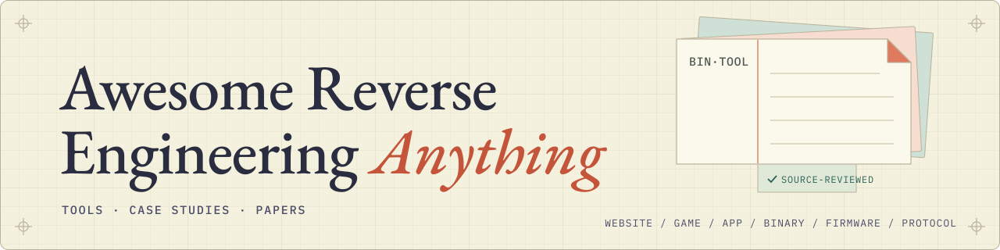

<h1 align="center"><a href="https://awesomerea.org/zh/"><picture><source media="(prefers-color-scheme: dark)" srcset="assets/brand/readme-banner-dark.svg"></picture></a></h1>

工具、案例与研究论文合集，涵盖网站、游戏、应用、原生二进制、固件和通信协议。

[English](README.md) · **简体中文**

**[网站搜索](https://awesomerea.org/zh/)** · **[浏览资源](https://awesomerea.org/zh/resources/)** · **[案例](https://awesomerea.org/zh/cases/)** · **[论文](https://awesomerea.org/zh/papers/)** · **[API](https://awesomerea.org/zh/api/)** · **[推荐资源](https://github.com/reacher-z/Awesome-REA/issues/new?template=resource.yml)** · **[参与贡献](#参与贡献)**

<!-- BEGIN GENERATED BADGES -->
<!-- Generated by scripts/build_readme.py from data/rea-resources.json, data/tool-resources.json and data/papers.json. Edit the source data and rerun the script; do not edit this block by hand. -->
    
<!-- END GENERATED BADGES -->

觉得有用？欢迎在 GitHub 上[点星支持本合集](https://github.com/reacher-z/Awesome-REA)，让更多人找到它。

[核查方法](https://awesomerea.org/zh/about/)

精选评测项目：

| 网站重建                                                                                                                                                                                                                                                                                                                                                                                                                                                                                                                                                              | 浏览器智能体                                                                                                                                                                                                                                                                                                                                                                                                                                                                                                                                                          |
| --------------------------------------------------------------------------------------------------------------------------------------------------------------------------------------------------------------------------------------------------------------------------------------------------------------------------------------------------------------------------------------------------------------------------------------------------------------------------------------------------------------------------------------------------------------------- | --------------------------------------------------------------------------------------------------------------------------------------------------------------------------------------------------------------------------------------------------------------------------------------------------------------------------------------------------------------------------------------------------------------------------------------------------------------------------------------------------------------------------------------------------------------------- |
| <a href="https://github.com/TIGER-AI-Lab/WebsiteBench"><picture><source media="(prefers-color-scheme: dark)" srcset="https://raw.githubusercontent.com/TIGER-AI-Lab/WebsiteBench/78f5558e8197bb91b3bab63428c12b92060ddc6f/assets/wordmark-dark.svg"></picture></a> AI 智能体能否通过浏览器探索重建网站？ <a href="https://github.com/TIGER-AI-Lab/WebsiteBench">★ 在 GitHub 上点星</a> | <a href="https://github.com/TIGER-AI-Lab/ClawBench"><picture><source media="(prefers-color-scheme: dark)" srcset="https://raw.githubusercontent.com/TIGER-AI-Lab/ClawBench/c8409629f4f2f9768731350d764aeb3035946c5d/assets/brand/wordmark-dark.svg"></picture></a> 面向日常任务的开源浏览器 AI 智能体基准。 <a href="https://github.com/TIGER-AI-Lab/ClawBench">★ 在 GitHub 上点星</a> |

**精选：** [Awesome Computer-Use Agents](https://github.com/reacher-z/Awesome-CUA) — 面向电脑操作智能体的论文、模型、数据集、评测基准与工具合集，每条资源保留原始来源。

## 目录

<!-- BEGIN GENERATED FINDER -->
<!-- Generated by scripts/build_readme.py from data/rea-resources.json, data/tool-resources.json, data/papers.json, data/source-index.json, data/source-scope.json and data/source-supplements/. Edit the source data and rerun the script; do not edit this block by hand. -->
5,191 项精选资源（4,025 个案例）· 442 篇论文 · 3,309 个已索引仓库 · 最近来源复核 2026-11-09。

<!-- END GENERATED FINDER -->

<!-- BEGIN GENERATED CONTENTS -->
<!-- Generated by scripts/build_readme.py from data/rea-resources.json, data/tool-resources.json, data/papers.json, data/source-index.json, data/source-scope.json and data/source-supplements/. Edit the source data and rerun the script; do not edit this block by hand. -->
- [按任务查找](#按任务查找)
- [使用数据](#使用数据)
- [资源](#资源) (5,188)
  - [网站](#website) (128) — 用于检查、反混淆和重建网站的工具与案例
  - [游戏](#game) (2,976) — 反编译、重编译、移植、引擎重新实现，以及分析工具与案例
  - [应用](#app) (370) — 面向 Android、.NET、JVM 和 Electron 应用的分析工具与案例
  - [原生二进制](#native-binary) (502) — 反汇编器、反编译器、调试器、二进制分析库、差异比较工具及原生二进制案例
  - [固件与硬件](#firmware) (260) — 固件提取与分析工具，以及硬件和设备镜像案例
  - [协议](#protocol) (720) — 面向通信数据格式、设备协议和抓包数据的工具与案例
  - [智能体与 MCP](#agents-and-mcp) (91) — REA 官方资料、MCP 服务器、集成与智能体工作流程，按其与 REA 的关系标注
  - [相关合集](#related-collections) (33) — 逆向工程及相关安全主题的其他精选合集
  - [文档与学习资源](#references-and-learning) (108) — 文档、分析指南、实验练习与学习资源
- [论文](#papers) (442) — 研究论文书目，列于自动生成的论文列表
  - [最新论文](#papers-recent) (10)
- [完整仓库索引](#完整仓库索引) (3,309) — 通过 README 扫描发现的公开仓库；未审核
- [关于](#关于)
- [Star 历史](#star-历史)
<!-- END GENERATED CONTENTS -->

**Agent 入口：** [仓库指令（英文）](AGENTS.md) · [如何投稿和提交 PR](docs/agent-contributing.zh-CN.md) · [贡献表单](https://awesomerea.org/zh/contribute/)

## 按任务查找

| 任务           | 去哪里找                                                                                                                                            |
| ------------ | ----------------------------------------------------------------------------------------------------------------------------------------------- |
| 检查网站或应用界面    | [网站资源](https://awesomerea.org/zh/resources/#heading-website) · [应用资源](https://awesomerea.org/zh/resources/#heading-app)                         |
| 重建游戏或检查代码匹配  | [游戏资源](https://awesomerea.org/zh/resources/#heading-game) · [游戏案例](https://awesomerea.org/zh/cases/#cases-game)                                 |
| 分析编译后代码或恢复符号 | [原生二进制资源](https://awesomerea.org/zh/resources/#heading-native-binary) · [智能体与 MCP](https://awesomerea.org/zh/resources/#heading-agents-and-mcp) |
| 研究固件或设备协议    | [固件资源](https://awesomerea.org/zh/resources/#heading-firmware) · [协议资源](https://awesomerea.org/zh/resources/#heading-protocol)                   |
| 比较方法与评测证据    | [综述中的对比分析](https://awesomerea.org/zh/survey/#comparative-studies)                                                                               |

## 使用数据

可通过以下公开文件和页面阅读目录、跟踪变更，或使用结构化数据。

- [llms.txt](https://awesomerea.org/llms.txt) - 供语言模型读取的网站地图。
- [llms-full.txt](https://awesomerea.org/llms-full.txt) - 汇集精选条目的单份 Markdown 文本。
- [API 索引](https://awesomerea.org/api/v1/index.json) - 资源、论文和分类的静态 JSON 与 CSV 导出文件，以及未经复核的候选条目。
- [catalog.json](https://awesomerea.org/catalog.json) - 汇集精选目录的单份 JSON 文件。
- [JSON Feed](https://awesomerea.org/feed.json) - 以 JSON Feed 格式列出新增和变更的条目。
- [Hugging Face 数据集](https://huggingface.co/datasets/TIGER-Lab/AwesomeREA) - 提供资源、论文、案例与发现记录的 Parquet 和 JSONL 导出。
- [目录格式](data/README.md) - 目录格式与字段定义。

## 资源

名称链接指向原始来源。每行列出说明首句、类型与关系；“完整条目”提供完整说明、使用前提、限制与核查来源。

每项资源按主要用途列出一次，案例复用这些条目；研究论文单独列出。

REA 标签指向单独维护的上游 CLI 与 MCP 项目，详见“关于”。

<!-- BEGIN GENERATED CATALOG -->
<!-- Generated by scripts/build_readme.py from data/rea-resources.json, data/tool-resources.json and site/translations.zh-CN.json. Edit the source data and rerun the script; do not edit this block by hand. -->
**标签：** REA 官方：由 REA 项目发布 · REA 社区：基于 REA 的第三方工作 · REA 维护者：REA 维护者整理的目录 · 独立 MCP、独立智能体、独立重建：未确认与 REA 有关联 · 混合工具流程：作者报告 REA 与其他工具并用 · Android、.NET、JVM、WebAssembly：平台 · 程序库：供编程调用的库 · 仅有类型：基础工具或学习资源。

### Website · 网站

**76 个案例**，下方列出最新的 10 个。[完整案例列表](docs/cases.zh-CN.md#website)

#### 案例

- [**canopy-dotmatrix：重建 davidluft.com 的点阵窗景**](https://github.com/isjiajia01/canopy-dotmatrix) - 项目依据 davidluft.com 的公开 JavaScript 文件和场景数据重建首页点阵窗景。 案例 · 独立重建 · [完整条目](https://awesomerea.org/zh/resources/canopy-dotmatrix-case/)
- [**Dih Pinterest：重建 Pinterest 搜索站点的页面与数据流**](https://github.com/Ikyletwar/dih-pinterest-replica) - Dih Pinterest 将 searchpinterest.vercel.app 的搜索界面和数据流重建为静态网页，可选配 Vercel 代理。 案例 · 独立重建 · [完整条目](https://awesomerea.org/zh/resources/dih-pinterest-case/)
- [**Drama Live：分析 Android 与网页客户端并重建 API 客户端**](https://github.com/barhomus10/dramalive-analysis) - Drama Live analysis 记录这款 IPTV 播放器的 Android APK 与网页 PWA，包括组件栈、接口路径和内容来源流程。 案例 · 独立重建 · 也适用：应用 · [完整条目](https://awesomerea.org/zh/resources/dramalive-analysis-case/)
- [**edgestash：重建 Vercel Blob 与 Upstash Redis API 行为**](https://github.com/devtechedge/edgestash) - edgestash 实现可自行托管的 Vercel Blob 与 Upstash Redis REST API 服务，让已发布的 SDK 改用其他端点。 案例 · 混合工具流程 · [完整条目](https://awesomerea.org/zh/resources/edgestash-case/)
- [**github-websocket-pipelines-api：探查 GitHub Actions 实时日志消息**](https://github.com/Hacksore/github-websocket-pipeline-api) - github-websocket-pipelines-api 探查 GitHub Actions 未公开的实时日志 WebSocket 接口。 案例 · 独立重建 · 也适用：协议 · [完整条目](https://awesomerea.org/zh/resources/github-websocket-pipelines-api-case/)
- [**Google Earth：重建三维卫星影像资源格式与访问方式**](https://github.com/retroplasma/earth-reverse-engineering) - earth-reverse-engineering 研究 Google Earth 的三维卫星影像模式，重建资源 URL 结构、八叉树元数据、Protobuf 资源格式以及网格和纹理解码步骤。 案例 · 独立重建 · [完整条目](https://awesomerea.org/zh/resources/earth-reverse-engineering-case/)
- [**Inception Chat：从设计与提示词采集结果重建聊天页面**](https://github.com/creativerezz/inception) - Inception Chat 根据 chat.inceptionlabs.ai 公开落地页的桌面与移动布局、已部署 CSS 变量及采集的推荐提示词重建界面。 案例 · 独立重建 · [完整条目](https://awesomerea.org/zh/resources/inception-chat-extraction-case/)
- [**LoreMaps：幻想地图图集的静态重写**](https://github.com/loremaps/loremaps) - 从该项目早先的 ASP.NET MVC 站点重写而来的 Astro 静态地图集。 案例 · 独立重建 · [完整条目](https://awesomerea.org/zh/resources/loremaps-atlas-case/)
- [**MAX Messenger：记录 WebSocket 与 TCP 消息格式**](https://github.com/pr0bel1230/max-api-docs) - MAX Messenger API Documentation 根据浏览器流量和直接请求实验，整理该通讯服务的 WebSocket JSON 与 TCP MessagePack 交互。 案例 · 独立重建 · 也适用：协议 · [完整条目](https://awesomerea.org/zh/resources/max-messenger-protocol-case/)
- [**muse-cli：重建 muse.ai 个人网关协议**](https://github.com/nikships/muse-cli) - muse-cli 根据 muse.ai 网页客户端代码实现个人网关的命令行客户端。 案例 · 独立重建 · 也适用：协议 · [完整条目](https://awesomerea.org/zh/resources/muse-cli-case/)

#### 工具、项目与集成

- [**webcrack**](https://github.com/j4k0xb/webcrack) - 识别支持的 JavaScript 混淆模式，并拆解 webpack/Browserify 打包文件，改善代码可读性。 工具 · 也适用：应用 · [完整条目](https://awesomerea.org/zh/resources/webcrack/)
- [**humanify JavaScript 标识符重命名工具**](https://github.com/jehna/humanify) - 借助 LLM 为压缩后的 JavaScript 标识符建议名称，并通过遵循作用域的 AST 改写完成重命名，程序结构保持不变。 工具 · [完整条目](https://awesomerea.org/zh/resources/humanify/)
- [**WABT**](https://github.com/WebAssembly/wabt) - WebAssembly 二进制与文本转换、节区检查、验证、解释执行及 C 转换工具集。 工具 · WebAssembly · 也适用：二进制 · [完整条目](https://awesomerea.org/zh/resources/wabt/)
- [**wasm-tools**](https://github.com/bytecodealliance/wasm-tools) - Bytecode Alliance 提供的 CLI 与 Rust 库，用于检查 WebAssembly 模块、元数据、组件和 WIT 接口。 工具 · WebAssembly · 也适用：二进制 · [完整条目](https://awesomerea.org/zh/resources/wasm-tools/)
- [**Chrome DevTools MCP**](https://github.com/ChromeDevTools/chrome-devtools-mcp) - 连接智能体与 Chrome，检查实时页面、调试网络并记录性能轨迹。 集成 · 独立 MCP · [完整条目](https://awesomerea.org/zh/resources/chrome-devtools-mcp/)
- [**mitmproxy**](https://github.com/mitmproxy/mitmproxy) - 通过交互代理、Web 界面或可脚本化命令行检查和记录 HTTP 流量。 工具 · 也适用：应用、协议 · [完整条目](https://awesomerea.org/zh/resources/mitmproxy/)
- [**Playwright MCP**](https://github.com/microsoft/playwright-mcp) - 通过结构化无障碍快照驱动浏览器交互，调查可复现的网页行为。 集成 · 独立 MCP · [完整条目](https://awesomerea.org/zh/resources/playwright-mcp/)
- [**Burp Suite MCP Server 扩展**](https://github.com/PortSwigger/mcp-server) - PortSwigger 官方 Burp Suite 扩展，提供 MCP 端点并附带 stdio 代理，使智能体可以查询代理中的 HTTP 与 WebSocket 历史记录、发送 HTTP/1.1 或 HTTP/2 请求，并打开 Repeater 或 Intruder 标签页。 集成 · 独立 MCP · 也适用：应用 · [完整条目](https://awesomerea.org/zh/resources/burp-suite-mcp-server/)
- [**Wakaru**](https://github.com/pionxzh/wakaru) - 通过还原已识别的压缩与转译模式，从发布后的 JavaScript 包中恢复可读模块，支持拆包与现代语法恢复，便于分析生产环境前端代码。 工具 · [完整条目](https://awesomerea.org/zh/resources/wakaru/)
- [**Spectral**](https://github.com/spectral-mcp/spectral) - 用 LLM 分析捕获的应用 HTTP 流量，生成 MCP 工具、OpenAPI 3.1 规范或 GraphQL 模式；完成抓包与认证配置后，生成的工具可直接调用已观察到的 API。 集成 · 独立智能体 · 也适用：应用、协议 · [完整条目](https://awesomerea.org/zh/resources/spectral-mcp/)
- [**jsdeob-workbench**](https://github.com/Owl4444/jsdeob-workbench) - 在查看 JavaScript AST 和变量作用域的同时，可视化编排 Babel 转换链；保存分析项目与可复用插件，逐步简化混淆脚本。 工具 · [完整条目](https://awesomerea.org/zh/resources/jsdeob-workbench/)
- [**Browser Reverse Engineering Toolkit 浏览器逆向工程工具集**](https://github.com/Dvurechensky/Browser.Reverse.Engineering.Toolkit) - 采集浏览器会话证据，在持久 Chromium 会话中抓取网站，并根据已保存的捕获数据生成离线架构／API 报告，以及 OpenAPI、SDK 和模拟服务器草稿。 工具 · [完整条目](https://awesomerea.org/zh/resources/browser-reverse-engineering-toolkit/)
- [**screenshot-to-code 截图转前端代码工具**](https://github.com/abi/screenshot-to-code) - 借助多模态模型，根据截图、设计稿、Figma 设计或屏幕录像生成 HTML/CSS、Tailwind、React、Vue、Bootstrap 或 Ionic 前端代码；可选的无头浏览器预览可让模型渲染并自查输出。 工具 · [完整条目](https://awesomerea.org/zh/resources/screenshot-to-code/)
- [**Dembrandt 网站设计系统提取工具**](https://github.com/dembrandt/dembrandt) - Node.js 命令行工具，通过 Playwright 驱动 Chromium 或 Firefox 渲染网站，并从 DOM 读取计算样式来提取其设计系统：标志、附带判定依据的颜色角色、字体排版、间距、边框、阴影、动效、断点，以及按钮、输入框等组件样式。 工具 · [完整条目](https://awesomerea.org/zh/resources/dembrandt/)
- [**shuji 源映射源码恢复工具**](https://github.com/paazmaya/shuji) - 命令行工具，可把源映射（source map）中内嵌的原始 JavaScript 和 CSS 源码重新写出为文件。 工具 · [完整条目](https://awesomerea.org/zh/resources/shuji/)
- [**Obfuscator.io 专用反混淆工具**](https://github.com/ben-sb/obfuscator-io-deobfuscator) - 专门处理 Obfuscator.io（javascript-obfuscator）所生成 JavaScript 的反混淆工具，README 称也能处理其大部分分支版本。 工具 · [完整条目](https://awesomerea.org/zh/resources/obfuscator-io-deobfuscator/)
- [**javascript-deobfuscator 通用 JavaScript 反混淆工具**](https://github.com/ben-sb/javascript-deobfuscator) - 通用的 JavaScript 反混淆工具，针对常见混淆手法，以 js-deobfuscator 之名发布在 npm 上，可作为库或命令行工具使用。 工具 · [完整条目](https://awesomerea.org/zh/resources/ben-sb-javascript-deobfuscator/)
- [**mitmproxy2swagger**](https://github.com/alufers/mitmproxy2swagger) - 命令行工具，从捕获的流量还原未公开的 REST API。 工具 · 也适用：协议 · [完整条目](https://awesomerea.org/zh/resources/mitmproxy2swagger/)
- [**JPEXS Flash 反编译器（FFDec）**](https://github.com/jindrapetrik/jpexs-decompiler) - 面向 Adobe Flash SWF 文件的 Java 桌面反编译与编辑工具。 工具 · 也适用：游戏 · [完整条目](https://awesomerea.org/zh/resources/jpexs-decompiler/)
- [**WasmLens：探索性 WebAssembly 检查**](https://github.com/alexandrmotologa/wasmlens) - 提供 WebAssembly 区段与函数签名检查、WAT 风格指令列表和有限 C 风格伪代码重建的 Python CLI。 工具 · WebAssembly · 也适用：二进制 · [完整条目](https://awesomerea.org/zh/resources/wasmlens/)

32 个工具未在此列出，见[本分区全部工具](docs/README-website.zh-CN.md).

### Game · 游戏

**2,832 个案例**，下方列出最新的 10 个。[完整案例列表](docs/cases.zh-CN.md#game)

**按重建方式：** [匹配反编译与反汇编](docs/cases.zh-CN.md#game-matching-decompilation) (583) · [非匹配反编译](docs/cases.zh-CN.md#game-decompilation) (343) · [静态重编译](docs/cases.zh-CN.md#game-static-recompilation) (761) · [基于重建源码的移植](docs/cases.zh-CN.md#game-port) (357) · [引擎重实现](docs/cases.zh-CN.md#game-engine-reimplementation) (467) · [其他方法与分析](docs/cases.zh-CN.md#game-other) (321)

#### 案例

- [**2ooM：为重制解码《Master of Orion II》的 LBX 数据**](https://sourceforge.net/projects/toom/) - 2ooM 的目标是重制《Master of Orion II》，运行时使用原版游戏的数据文件。 案例 · 独立重建 · [完整条目](https://awesomerea.org/zh/resources/2oom-master-of-orion-ii-case/)
- [**A-Team：带 PAL 转换的 Atari 2600 反汇编**](https://www.qotile.net/minidig/disassembly/a-team.asm) - 这份 Atari 2600 游戏 A-Team 的双 bank 6502 反汇编可用 DASM 汇编，也是其 PAL 转换的基础。 案例 · 独立重建 · [完整条目](https://awesomerea.org/zh/resources/a-team-atari-2600-disassembly-case/)
- [**ACEmulator：《Asheron's Call》服务端模拟器**](https://emulator.ac) - ACEmulator 用 C# 重建了 MMORPG《Asheron's Call》的服务端，目标是还原 2017 年 1 月官方服务器关闭时的游戏世界。 案例 · 独立重建 · 也适用：协议 · [完整条目](https://awesomerea.org/zh/resources/acemulator-case/)
- [**Air-Sea Battle：Atari 2600 游戏注释反汇编**](https://www.qotile.net/minidig/disassembly/air_sea_battle.asm) - MiniDig 网站上的这份 6502 汇编清单带有标签和注释，重建了 Atari 1977 年为 Atari 2600 推出的 Air-Sea Battle。 案例 · 独立重建 · [完整条目](https://awesomerea.org/zh/resources/air-sea-battle-disassembly-case/)
- [**Berzerk：带注释的 Atari 2600 反汇编**](https://www.qotile.net/minidig/disassembly/berzerk.asm) - 将 Atari 1982 年发行的 Atari 2600 游戏 Berzerk 整理为带标签和注释的 6502 汇编清单，可汇编出与原版完全一致的 ROM 映像，并可通过开关选择 NTSC 或 PAL 版本。 案例 · 独立重建 · [完整条目](https://awesomerea.org/zh/resources/berzerk-atari-2600-disassembly-case/)
- [**blackhack：runblack.exe 界面控件类反编译**](https://gitlab.com/bwrsandman/blackhack) - blackhack 用手工反编译的 C 代码重建 runblack.exe 的 SetupControl 界面控件类，涵盖按钮、大按钮与标签按钮、复选框、列表、滑块、输入框、取色器、图片和图表控件，并重建了部分 Lionhead lhlib 库。 案例 · 独立重建 · 也适用：二进制 · [完整条目](https://awesomerea.org/zh/resources/blackhack-case/)
- [**Combat：Atari 2600 游戏注释反汇编**](https://www.qotile.net/minidig/disassembly/dicombat.asm) - 这份带注释的 6502 汇编清单重建了 Atari 2600 坦克、双翼机与喷气机对战游戏 Combat，目标是讲清每条指令、每个内存地址和每张表的用途。 案例 · 独立重建 · [完整条目](https://awesomerea.org/zh/resources/combat-atari-2600-disassembly-case/)
- [**Cosmic Ark：带注释和 PAL 转换的 Atari 2600 反汇编**](https://www.qotile.net/minidig/disassembly/CosmicArk.asm) - 将 Imagic 1982 年的 Atari 2600 游戏 Cosmic Ark 整理为经过分析、带标签和注释的 6502 汇编清单，可构建 NTSC 和 PAL 版本。 案例 · 独立重建 · [完整条目](https://awesomerea.org/zh/resources/cosmic-ark-atari-2600-disassembly-case/)
- [**dataeast\_snddrv：《High Seas Havoc》声音驱动反汇编**](https://codeberg.org/techmetx11/dataeast_snddrv) - dataeast\_snddrv 是 Data East 在《High Seas Havoc》中所用声音驱动的反汇编，分为 68000 驱动代码、Z80 DAC 采样播放程序和频率表，使用 vasm 汇编。 案例 · 独立重建 · [完整条目](https://awesomerea.org/zh/resources/dataeast-snddrv-case/)
- [**Donkey Kong 64：N64 匹配反编译**](https://gitlab.com/dk64_decomp/dk64) - 这是任天堂 64 游戏《Donkey Kong 64》美版的匹配反编译，按启动段、全局代码以及 arcade、jetpac、bonus、boss、menu、minecart、multiplayer、race、critter 等 overlay 组织 C 源码并重建 ROM。 案例 · 独立重建 · [完整条目](https://awesomerea.org/zh/resources/dk64-decomp-case/)

#### 工具、项目与集成

- [**RenderDoc**](https://github.com/baldurk/renderdoc) - 检查自己游戏或图形应用的帧捕获、绘制调用、着色器和图形资源。 工具 · 也适用：应用 · [完整条目](https://awesomerea.org/zh/resources/renderdoc/)
- [**AssetRipper**](https://github.com/AssetRipper/AssetRipper) - 分析 Unity 游戏文件，检查资源依赖并将支持的资源转换为 Unity 工程格式。 工具 · [完整条目](https://awesomerea.org/zh/resources/assetripper/)
- [**Cpp2IL**](https://github.com/SamboyCoding/Cpp2IL) - 结合二进制与元数据分析，从 Unity IL2CPP 构建恢复托管表示；重建能力仍在开发中。 工具 · 也适用：应用、二进制 · [完整条目](https://awesomerea.org/zh/resources/cpp2il/)
- [**Il2CppDumper**](https://github.com/Perfare/Il2CppDumper) - 恢复 IL2CPP 元数据及占位程序集，为原生分析工具生成辅助脚本；不会还原方法代码。 工具 · 也适用：应用、二进制 · [完整条目](https://awesomerea.org/zh/resources/il2cppdumper/)
- [**RenderDoc MCP**](https://github.com/scarletfantasy/renderdoc-mcp) - 向智能体开放已有 RenderDoc 捕获文件，分步检查帧、管线、资源和着色器。 集成 · 独立 MCP · 也适用：应用 · [完整条目](https://awesomerea.org/zh/resources/renderdoc-mcp/)
- [**UndertaleModTool**](https://github.com/UnderminersTeam/UndertaleModTool) - 浏览和修改受支持的 GameMaker 数据文件、提取资源，以及反编译或编译 GML VM 代码；提供房间编辑、脚本化修改、CLI 和可复用的 UndertaleModLib 库。 工具 · [完整条目](https://awesomerea.org/zh/resources/undertalemodtool/)
- [**frida-il2cpp-bridge**](https://github.com/vfsfitvnm/frida-il2cpp-bridge) - 在运行中的进程里检查 IL2CPP 类、方法和字段，无需提供 global-metadata.dat 即可跟踪或拦截方法调用，为静态 IL2CPP 转储工具补充运行时观察能力。 工具 · 也适用：应用 · [完整条目](https://awesomerea.org/zh/resources/frida-il2cpp-bridge/)
- [**objdiff**](https://github.com/encounter/objdiff) - 比较参考目标文件与重新编译目标文件中的函数和数据，辅助匹配反编译；显示指令级差异、还原 C++ 符号，并可在源码变更时自动重新构建。 工具 · 也适用：二进制 · [完整条目](https://awesomerea.org/zh/resources/objdiff/)
- [**decomp-permuter**](https://github.com/simonlindholm/decomp-permuter) - 随机或系统地改写单个 C 函数，逐个重新编译变体并与目标文件评分对比，以寻找与原编译输出一致的写法。 工具 · 也适用：二进制 · [完整条目](https://awesomerea.org/zh/resources/decomp-permuter/)
- [**asm-differ**](https://github.com/simonlindholm/asm-differ) - 对比单个函数或 ROM 地址的原始汇编与重新编译后的汇编，辅助匹配反编译；监视模式可在源码变更时重新运行 make。 工具 · 也适用：二进制 · [完整条目](https://awesomerea.org/zh/resources/asm-differ/)
- [**UE Explorer**](https://github.com/UE-Explorer/UE-Explorer) - 通过类、属性与依赖树浏览 Unreal 包，反编译和导出 UnrealScript 类、检查字节码，并查看结构化二进制数据。 工具 · 也适用：二进制 · [完整条目](https://awesomerea.org/zh/resources/ue-explorer/)
- [**GARbro**](https://github.com/morkt/GARbro) - 像浏览文件夹一样查看已识别的视觉小说资源归档，预览内容，并在提取图像或音频时转换为常用格式。 工具 · [完整条目](https://awesomerea.org/zh/resources/garbro/)
- [**Godot 逆向工程工具**](https://github.com/GDRETools/gdsdecomp) - 从已导出的游戏中恢复受支持的 Godot 工程文件、GDScript 与导入资源，提供 PCK 检查与提取、脚本反编译及资源转换，便于分析和重建工程结构。 工具 · [完整条目](https://awesomerea.org/zh/resources/godot-re-tools/)
- [**UE4SS（虚幻引擎脚本系统）**](https://github.com/UE4SS-RE/RE-UE4SS) - 通过实时 UObject 属性视图、反射 C++ 头文件导出、属性映射和 Actor 转储分析虚幻引擎游戏；Lua 与 C++ API 可辅助实验和重建游戏结构。 工具 · [完整条目](https://awesomerea.org/zh/resources/ue4ss/)
- [**FModel 游戏资源浏览器**](https://github.com/4sval/FModel) - 基于 CUE4Parse 浏览虚幻引擎游戏归档，检查资源包和属性，预览并导出资源；2026 年夏季发行版新增 USD 世界导出，可辅助重建受支持的场景内容。 工具 · [完整条目](https://awesomerea.org/zh/resources/fmodel/)
- [**PSP Web Recomp 浏览器游戏重编译项目**](https://github.com/snuri00/psp-web-recomp) - 将 PSP MIPS 可执行文件转换为 C++ 与 WebAssembly，配合 PSP 高层仿真运行时和 WebGL2 渲染器；原生跟踪、画面捕获及音频工具可辅助调查游戏移植中缺失的行为。 项目 · 也适用：网站 · [完整条目](https://awesomerea.org/zh/resources/psp-web-recomp/)
- [**N64: Recompiled**](https://github.com/N64Recomp/N64Recomp) - 依据符号元数据将 N64 MIPS 二进制静态重编译为 C 函数，并生成函数查找与重定位宏，供运行时处理静态链接和可重定位的覆盖段。 工具 · 也适用：二进制 · [完整条目](https://awesomerea.org/zh/resources/n64recomp/)
- [**XenonRecomp**](https://github.com/hedge-dev/XenonRecomp) - 将 Xbox 360 PowerPC 可执行文件转换为可在其他平台编译的 C++ 代码，配套的 XenonAnalyse 负责检测跳转表和函数边界。 工具 · 也适用：二进制 · [完整条目](https://awesomerea.org/zh/resources/xenonrecomp/)
- [**decomp.me 协作匹配反编译平台**](https://decomp.me) - 面向匹配反编译的协作网站：其编译服务用选定平台的编译器编译候选源码，汇编目标汇编代码，并用 asm-differ 对比两个目标文件。 工具 · 也适用：二进制 · [完整条目](https://awesomerea.org/zh/resources/decomp-me/)
- [**splat 二进制拆分工具**](https://github.com/ethteck/splat) - 面向反编译与模组项目的二进制拆分工具：由 YAML 配置指定在何处、以何种方式把 N64 ROM 或 PSX、PS2、PSP 二进制切分为代码、数据和素材段。 工具 · 也适用：二进制 · [完整条目](https://awesomerea.org/zh/resources/splat/)

124 个工具未在此列出，见[本分区全部工具](docs/README-game.zh-CN.md).

### App · 应用

**233 个案例**，下方列出最新的 10 个。[完整案例列表](docs/cases.zh-CN.md#app)

#### 案例

- [**ag-psd：重建 PSD 文档读写功能**](https://github.com/Agamnentzar/ag-psd) - ag-psd 结合格式资料与反复试验，用 JavaScript 和 TypeScript 实现 Photoshop PSD 文档的读写。 案例 · 独立重建 · [完整条目](https://awesomerea.org/zh/resources/ag-psd-case/)
- [**AionLink Open：研究 GAC AION i60 的 ICCOA CarLink 连接**](https://github.com/codepdbh/aionlink-open) - AionLink Open 通过静态分析 Android APK 并编写独立客户端，研究 GAC AION i60 的 ICCOA CarLink 连接。 案例 · 独立重建 · 也适用：协议 · [完整条目](https://awesomerea.org/zh/resources/aionlink-open-case/)
- [**AirTray：重建 Elgin Air 云端控制客户端**](https://github.com/JoseAlexandreMeloPacheco/airtray) - AirTray 根据 Elgin Air 应用的行为重建 Windows 系统托盘客户端，用于控制兼容空调。 案例 · 独立重建 · [完整条目](https://awesomerea.org/zh/resources/airtray-case/)
- [**AvatarEditorRecomp：Kinect 预览版 Avatar Editor 的 PC 移植**](https://github.com/panedivitasei/AvatarEditorRecomp) - AvatarEditorRecomp 借助 ReXGlue，将 2010 年秋季 Kinect 预览版 Xbox 360 Avatar Editor 静态重编译为 PC 应用。 案例 · 独立重建 · [完整条目](https://awesomerea.org/zh/resources/avatar-editor-recomp-case/)
- [**baseus-desktop：还原 Baseus 耳机控制**](https://github.com/elaxptr/baseus-desktop) - baseus-desktop 在 Windows 和 Linux 桌面客户端中还原 Baseus 耳机控制。 案例 · 独立重建 · 也适用：协议 · [完整条目](https://awesomerea.org/zh/resources/baseus-desktop-case/)
- [**bline：解析 LINE 语音通话流量**](https://github.com/thebabush/bline) - bline 研究 LINE 早期的语音通话软件栈，并提供处理其自定义 ZLIB 压缩 SIP 数据的工具。 案例 · 独立重建 · 也适用：协议 · [完整条目](https://awesomerea.org/zh/resources/bline-line-voip-case/)
- [**cam-server：重建 Digicam Print Channel 后端**](https://github.com/WiiLink24/cam-server) - cam-server 为 Digicam Print Channel 实现后端，按客户端预期格式返回数据，并依据模板渲染图像。 案例 · 独立重建 · 也适用：协议 · [完整条目](https://awesomerea.org/zh/resources/cam-server-case/)
- [**caniOn Rebirth：重建 Mitsubishi ZEV CAN 客户端与协议**](https://github.com/linuxkafe/caniOn-rebirth) - caniOn Rebirth 重建 caniOn v152 Android 应用用于 i-MiEV、iOn 和 C-Zero 的 Mitsubishi ZEV CAN 协议。 案例 · 独立重建 · 也适用：协议 · [完整条目](https://awesomerea.org/zh/resources/canion-rebirth-case/)
- [**claude-peer：重建 Claude 本地对等通信机制**](https://github.com/nsozturk/claude-peer) - claude-peer 重建 Claude Code 与 Claude Desktop 使用的本地 Unix 套接字对等通信。 案例 · 独立重建 · 也适用：协议 · [完整条目](https://awesomerea.org/zh/resources/claude-peer-ipc-case/)
- [**Cordial：在 Linux 上运行 Roblox Android 客户端**](https://github.com/luohoa97/cordial) - Cordial 通过移植的 bionic 链接器、ELF 导入符号解析，以及 Android JNI 和框架调用的替代实现，在 Linux 上运行未修改的 Roblox Android 客户端。 案例 · 独立重建 · [完整条目](https://awesomerea.org/zh/resources/cordial-roblox-linux-case/)

#### 工具、项目与集成

- [**JADX-AI-MCP**](https://github.com/zinja-coder/jadx-ai-mcp) - 结合 JADX 插件与 Python MCP 服务，读取 Android 反编译代码、资源、交叉引用和调试上下文。 集成 · 独立 MCP · [完整条目](https://awesomerea.org/zh/resources/jadx-ai-mcp/)
- [**apktool-mcp-server Apktool MCP 服务**](https://github.com/zinja-coder/apktool-mcp-server) - 基于 Python 的 MCP 服务，调用本地安装的 Apktool，使智能体能够解码 APK，列出、读取、搜索和修改 smali 与资源文件，读取 AndroidManifest.xml 与 apktool.yml，并重新构建项目。 集成 · 独立 MCP · [完整条目](https://awesomerea.org/zh/resources/apktool-mcp-server/)
- [**frida-mcp (yfe404)**](https://github.com/yfe404/frida-mcp) - Frida MCP 服务，提供持久插桩会话、运行时检查和 Android 静态代码与动态现场之间的导航。 集成 · 独立 MCP · 也适用：游戏 · [完整条目](https://awesomerea.org/zh/resources/frida-mcp-yfe404/)
- [**Super Trouper**](https://github.com/crissyfield/super-trouper) - 单个可执行文件形式的 Frida MCP 服务，用于发现设备、管理进程会话和加载插桩脚本。 集成 · 独立 MCP · 也适用：游戏 · [完整条目](https://awesomerea.org/zh/resources/super-trouper/)
- [**Frida**](https://github.com/frida/frida) - 动态插桩工具，用脚本观察和分析运行中的原生及托管进程行为。 工具 · 也适用：游戏 · [完整条目](https://awesomerea.org/zh/resources/frida/)
- [**JADX**](https://github.com/skylot/jadx) - 将 Dex 反编译为 Java 的 CLI/GUI 工具，提供 Android 资源解码、代码导航和引用搜索。 工具 · Android · [完整条目](https://awesomerea.org/zh/resources/jadx/)
- [**Apktool**](https://github.com/iBotPeaches/Apktool) - 将 Android 资源与 smali 解码为项目目录，并支持重新构建修改后的安装包。 工具 · Android · [完整条目](https://awesomerea.org/zh/resources/apktool/)
- [**Androguard**](https://github.com/androguard/androguard) - 用于 APK/DEX 元数据、字节码及引用分析的 Python 工具集；v5 源码分支还提供智能体技能和 MCP 文档。 工具 · Android · [完整条目](https://awesomerea.org/zh/resources/androguard/)
- [**ILSpy**](https://github.com/icsharpcode/ILSpy) - .NET 程序集浏览器与 C# 反编译器，支持完整项目导出、元数据检查和命令行处理。 工具 · .NET · [完整条目](https://awesomerea.org/zh/resources/ilspy/)
- [**dnSpyEx**](https://github.com/dnSpyEx/dnSpy) - dnSpy 的社区延续项目，可在没有原始源码时调试和编辑 .NET 程序集。 工具 · .NET · [完整条目](https://awesomerea.org/zh/resources/dnspyex/)
- [**@electron/asar**](https://github.com/electron/asar) - Electron 官方归档工具，可列出和提取 ASAR 内容，便于检查打包后的 JavaScript 与应用资源。 工具 · 也适用：网站 · [完整条目](https://awesomerea.org/zh/resources/electron-asar/)
- [**Mobile Security Framework（MobSF）**](https://github.com/MobSF/Mobile-Security-Framework-MobSF) - 通过 Web 界面与 API 检查移动应用包，结合静态分析及受支持设备上的动态测试，分析运行时行为与网络流量。 工具 · Android · [完整条目](https://awesomerea.org/zh/resources/mobsf/)
- [**objection**](https://github.com/sensepost/objection) - 通过基于 Frida 的命令界面探索运行中的 Android 与 iOS 应用，检查应用存储、内存、运行时对象和插桩后的行为。 工具 · Android · [完整条目](https://awesomerea.org/zh/resources/objection/)
- [**Grapefruit 移动应用动态插桩工具**](https://github.com/ChiChou/grapefruit) - 通过基于 Frida 的 Web 界面检查并 Hook 运行中的 iOS 与 Android 应用，提供方法与加密 API 拦截、文件系统与 SQLite 浏览、iOS 钥匙串与界面层级查看，以及常见网络库的 HTTP 流量捕获。 工具 · [完整条目](https://awesomerea.org/zh/resources/grapefruit/)
- [**Blutter**](https://github.com/worawit/blutter) - 利用匹配的 Dart 运行时分析 Flutter Android ARM64 AOT 二进制，生成带符号的汇编、对象池转储及面向目标的 Frida 脚本模板，辅助研究编译后的 Dart 应用逻辑。 工具 · Android · 也适用：二进制 · [完整条目](https://awesomerea.org/zh/resources/blutter/)
- [**hermes-dec**](https://github.com/P1sec/hermes-dec) - 解析、反汇编并部分反编译 React Native 的 Hermes 字节码包，展示 HBC 文件头和指令，并生成伪代码以帮助理解编译后的应用逻辑。 工具 · Android · [完整条目](https://awesomerea.org/zh/resources/hermes-dec/)
- [**Recaf 字节码分析与编辑工具**](https://github.com/Col-E/Recaf) - 通过集成反编译器、字节码汇编、引用搜索、映射与去混淆工具检查和修改已编译的 JVM 应用；所审阅的 4.0 预览版还提供基础的只读 Android 字节码分析。 工具 · JVM · 也适用：二进制 · [完整条目](https://awesomerea.org/zh/resources/recaf/)
- [**nibkit 原生界面结构分析工具**](https://github.com/tokenbleed/nibkit) - 将已编译的 iOS/macOS 界面归档解码为对象树、Outlet／Action 连接、自定义类及导航关系，可导出 JSON 或 Mermaid 图，并通过 MCP 提供只读检查命令。 工具 · [完整条目](https://awesomerea.org/zh/resources/nibkit/)
- [**AOTopsy Flutter/Dart 静态分析工具**](https://github.com/BroNils/aotopsy) - 静态检查 Flutter/Dart AOT libapp.so 文件，恢复可用元数据、类结构、调用关系及伪代码，无需嵌入 Dart VM 或编译匹配的 SDK，提供 ARM64 与 x86\_64 分析路径。 工具 · Android · 也适用：二进制 · [完整条目](https://awesomerea.org/zh/resources/aotopsy/)
- [**hbctool Hermes 字节码汇编与反汇编工具**](https://github.com/bongtrop/hbctool) - 通过 HASM 文件反汇编和重新汇编受支持的 React Native Hermes 字节码包，为明确支持的旧版 HBC 提供字节码检查与修改能力。 工具 · Android · [完整条目](https://awesomerea.org/zh/resources/hbctool/)

117 个工具未在此列出，见[本分区全部工具](docs/README-app.zh-CN.md).

### Native Binary · 原生二进制

**64 个案例**，下方列出最新的 10 个。[完整案例列表](docs/cases.zh-CN.md#native-binary)

#### 案例

- [**8088 BIOS：反汇编 Tandy 与 IBM PC 固件映像**](https://github.com/ricardoquesada/bios-8088) - 该仓库反汇编 8088 机器的 BIOS 镜像：Tandy 1000、Tandy 1000A、Tandy 1000 HX、IBM PCjr 和 IBM PC 5150。 案例 · 独立重建 · [完整条目](https://awesomerea.org/zh/resources/bios-8088/)
- [**AGS Aging Cartridge：反汇编 7.0 版**](https://github.com/Normmatt/ags_aging) - 该项目以用户提供的 Game Boy Advance ROM 为输入，将 AGS Aging Cartridge 7.0 重建为汇编与 C 源码。 案例 · 独立重建 · [完整条目](https://awesomerea.org/zh/resources/ags-aging-cartridge-case/)
- [**Character Pipeline：2001 年 4 月版库反编译**](https://github.com/doldecomp/dolcp-apr2001) - Character Pipeline April 2001 Libraries 重建该组件已构建代码库的 C 源码，涵盖角色、动画、控制、几何调色板、光照、着色器和蒙皮库。 案例 · 独立重建 · [完整条目](https://awesomerea.org/zh/resources/character-pipeline-apr2001-decomp-case/)
- [**cod4map：重建 Call of Duty 4 的 BSP 编译器**](https://github.com/prd0nja/cod4map) - cod4map 根据 2007 年随 Call of Duty 4 模组工具发布的可执行文件重建 BSP 编译器。 案例 · 独立重建 · [完整条目](https://awesomerea.org/zh/resources/cod4map-reconstruction-case/)
- [**dargh：重建 Skyrim 的 Dynamic Animation Replacer**](https://github.com/noxsidereum/dargh) - dargh 根据对 Dynamic Animation Replacer 1.1.2 和 1.1.3 DLL 的分析，以 C++ 重建用于 Skyrim Special Edition 的替代 DLL。 案例 · 独立重建 · [完整条目](https://awesomerea.org/zh/resources/dargh-case/)
- [**DLSS 5 Neural Rendering：通过 DLL 分析重建运行时模型**](https://huggingface.co/inarikami/dlss5-nr-reverse-engineering) - DLSS 5 Neural Rendering 通过静态分析 NBA 2K27 附带的 nvngx\_dlssnr.dll 310.8.0.0，重建 NVIDIA 模型的部分结构。 案例 · 独立重建 · [完整条目](https://awesomerea.org/zh/resources/dlss5-nr-reverse-engineering-case/)
- [**dolnetbp：重建 GameCube 网络 SDK 库**](https://github.com/Cuyler36/dolnetbp) - dolnetbp 以 C 重建 GameCube Dolphin Network Base Package 的 eth、mdm 和 netcfg 库。 案例 · 独立重建 · [完整条目](https://awesomerea.org/zh/resources/dolnetbp-case/)
- [**Dolphin SDK 2004 Libraries：反编译 GameCube SDK 归档库**](https://github.com/doldecomp/dolsdk2004) - Dolphin SDK 2004 Libraries 将 2004 年 4 月 20 日版 Dolphin SDK 的已编译归档库重建为 C 与汇编源码。 案例 · 独立重建 · [完整条目](https://awesomerea.org/zh/resources/dolphin-sdk-2004-libraries-case/)
- [**dolsocketlibrary：重建 Dolphin 网络库**](https://github.com/Cuyler36/dolsocketlibrary) - dolsocketlibrary 以 C 重建 Dolphin Network Base Package 的 ip 和 dvdeth 库。 案例 · 独立重建 · [完整条目](https://awesomerea.org/zh/resources/dolsocketlibrary-case/)
- [**EGG Library：Wii 游戏共用库反编译**](https://github.com/vabold/EGG) - EGG Library 是一项仍在进行的 Wii 程序库反编译工作，目标是让多款游戏和应用共用一套源码。 案例 · 独立重建 · [完整条目](https://awesomerea.org/zh/resources/egg-wii-library-decomp-case/)

#### 工具、项目与集成

- [**Ghidra**](https://github.com/NationalSecurityAgency/ghidra) - 开源二进制分析套件，提供反汇编、反编译、图形分析及 Java/Python 自动化接口。 工具 · 也适用：游戏、固件 · [完整条目](https://awesomerea.org/zh/resources/ghidra/)
- [**radare2**](https://github.com/radareorg/radare2) - 可脚本化的命令行逆向框架，支持多架构二进制检查、反汇编、调试和修改。 工具 · 也适用：游戏 · [完整条目](https://awesomerea.org/zh/resources/radare2/)
- [**Cutter**](https://github.com/rizinorg/cutter) - 基于 Rizin 的图形逆向工作台，提供可扩展视图及 Ghidra 反编译器集成。 工具 · 也适用：游戏 · [完整条目](https://awesomerea.org/zh/resources/cutter/)
- [**Qiling**](https://github.com/qilingframework/qiling) - 在 CPU 仿真之上补充操作系统、文件系统和 API 行为的 Python 框架，用于可插桩的二进制分析。 工具 · 也适用：固件 · [完整条目](https://awesomerea.org/zh/resources/qiling/)
- [**Unicorn Engine**](https://github.com/unicorn-engine/unicorn) - 多架构 CPU 仿真引擎，可控制寄存器、内存和钩子，执行选定的指令片段。 工具 · 程序库 · 也适用：游戏、固件 · [完整条目](https://awesomerea.org/zh/resources/unicorn/)
- [**angr**](https://github.com/angr/angr) - 结合控制流恢复、符号执行、数据流分析和反编译的 Python 二进制分析框架。 工具 · 程序库 · [完整条目](https://awesomerea.org/zh/resources/angr/)
- [**LIEF**](https://github.com/lief-project/LIEF) - 对 ELF、PE、Mach-O 等可执行文件格式进行结构化解析与修改的库。 工具 · 程序库 · [完整条目](https://awesomerea.org/zh/resources/lief/)
- [**Capstone**](https://github.com/capstone-engine/capstone) - 提供统一 API 和指令细节的多架构反汇编库，适合构建自定义二进制分析流程。 工具 · 程序库 · [完整条目](https://awesomerea.org/zh/resources/capstone/)
- [**ImHex**](https://github.com/WerWolv/ImHex) - 带二进制模式语言、结构化数据检查及可视化功能的十六进制编辑器，适合理解文件格式。 工具 · 也适用：游戏、固件 · [完整条目](https://awesomerea.org/zh/resources/imhex/)
- [**x64dbg**](https://github.com/x64dbg/x64dbg) - Windows 二进制调试器，通过反汇编、内存视图和插件分析没有源码的程序。 工具 · [完整条目](https://awesomerea.org/zh/resources/x64dbg/)
- [**GDB**](https://sourceware.org/gdb/) - 支持本地与远程调试，可控制执行并检查运行中或崩溃后的程序状态。 工具 · [完整条目](https://awesomerea.org/zh/resources/gdb/)
- [**rr**](https://github.com/rr-debugger/rr) - 记录进程执行并在 GDB 下重放，便于重复检查现场和反向执行。 工具 · [完整条目](https://awesomerea.org/zh/resources/rr/)
- [**Diaphora**](https://github.com/joxeankoret/diaphora) - 基于 IDA 的二进制差异分析工具，可匹配函数并迁移名称、注释与类型信息。 工具 · 也适用：游戏 · [完整条目](https://awesomerea.org/zh/resources/diaphora/)
- [**BinDiff**](https://github.com/google/bindiff) - 比较反汇编后的二进制文件，定位不同版本中的对应函数与代码变化。 工具 · 也适用：游戏 · [完整条目](https://awesomerea.org/zh/resources/bindiff/)
- [**Detect It Easy**](https://github.com/horsicq/Detect-It-Easy) - 结合格式解析器、签名和可编程启发式规则进行文件识别与静态检查。 工具 · 也适用：游戏 · [完整条目](https://awesomerea.org/zh/resources/detect-it-easy/)
- [**r2frida**](https://github.com/nowsecure/r2frida) - 结合 radare2 命令与 Frida 插桩，检查桌面和移动目标中本地或远程进程的内存、符号、类及运行时调用。 工具 · 也适用：应用 · [完整条目](https://awesomerea.org/zh/resources/r2frida/)
- [**Kaitai Struct 二进制格式描述与解析工具**](https://github.com/kaitai-io/kaitai_struct) - 将已描述的二进制布局转换为可复用的文件与网络报文解析器；同一份 .ksy 规范可通过可视化工具检查，并编译为多种语言，便于把逆向获得的格式知识落实为可互操作的实现。 工具 · 程序库 · 也适用：固件、协议 · [完整条目](https://awesomerea.org/zh/resources/kaitai-struct/)
- [**GoReSym Go 符号恢复工具**](https://github.com/mandiant/GoReSym) - 从 Go 二进制中恢复构建元数据、函数名与地址范围、源文件和行号表、内嵌类型及字符串，也可处理已剥离符号以及部分经 UPX 等脱壳后结构异常的样本。 工具 · [完整条目](https://awesomerea.org/zh/resources/goresym/)
- [**rev.ng 二进制分析框架与反编译器**](https://github.com/revng/revng) - 开源反编译流水线：借助 QEMU 将 x86-64、AArch64、i386、ARM 和 MIPS 代码提升为与架构无关的表示，以 LLVM 进行分析，并输出以合法、可重新编译为设计目标的 C 代码。 工具 · [完整条目](https://awesomerea.org/zh/resources/revng/)
- [**Rizin 逆向工程框架**](https://github.com/rizinorg/rizin) - 源自 radare2 分支的命令行逆向工程框架。 工具 · 也适用：游戏 · [完整条目](https://awesomerea.org/zh/resources/rizin/)

418 个工具未在此列出，见[本分区全部工具](docs/README-native-binary.zh-CN.md).

### Firmware and Hardware · 固件与硬件

**175 个案例**，下方列出最新的 10 个。[完整案例列表](docs/cases.zh-CN.md#firmware)

#### 案例

- [**fdsboot：Famicom Disk System 启动 ROM 反汇编**](https://gitlab.com/segaloco/fdsboot) - fdsboot 是 Famicom Disk System 启动 ROM 的 6502 反汇编，按磁盘读写、PPU、手柄、计时器、声音、中断和随机数等例程拆分源码，并附带主机与 FDS 寄存器的定义文件。 案例 · 独立重建 · [完整条目](https://awesomerea.org/zh/resources/fdsboot-case/)
- [**gyx-decomp：Casio ES PLUS GYX 计算器固件反编译**](https://codeberg.org/gwetm/gyx-decomp) - gyx-decomp 是 Casio ES PLUS GYX 科学计算器固件的反编译项目，该固件运行在 ROHM nX-U8/100 微控制器上。 案例 · 独立重建 · [完整条目](https://awesomerea.org/zh/resources/gyx-decomp-case/)
- [**vmiv：View-Master Interactive Video 模拟器与格式笔记**](https://codeberg.org/Sprite_tm/vmiv) - vmiv 用 FFmpeg 解码录像带采集视频，从扫描线中提取按 UART 方式编码的数据字节和辅助音频，交给运行 VMI8802 ROM 的 8051 内核处理，同时模拟 TMS9128 显示芯片并用 SDL2 渲染，以此模拟 View-Master Interactive Video 系统。 案例 · 独立重建 · 也适用：协议 · [完整条目](https://awesomerea.org/zh/resources/vmiv-case/)
- [**6502 Model：重建 65C02 芯片的逐周期行为**](https://github.com/EmulationOnline/model_6502) - 6502 Model 用 Rust 根据实体 65C02 芯片运行程序时采集的外部总线跟踪记录，重建其逐周期行为。 案例 · 独立重建 · [完整条目](https://awesomerea.org/zh/resources/6502-model-case/)
- [**B3603：研究控制板行为并编写替代固件**](https://github.com/baruch/b3603) - B3603 研究降压模块的控制板，以编写 STM8 替代固件。 案例 · 独立重建 · [完整条目](https://awesomerea.org/zh/resources/b3603-case/)
- [**Band 9 表盘生成器：华为手环 9 HWT 表盘格式复现**](https://github.com/daiyuxiang520/band9-watchface-generator) - Band 9 表盘生成器通过观察公开的 HWT 包，归纳华为手环 9 表盘格式，并为 194 × 368 的 HWHD07 屏幕生成可安装的表盘包。 案例 · 独立重建 · [完整条目](https://awesomerea.org/zh/resources/band9-watchface-generator-case/)
- [**BCM5719 Firmware Reimplementation：重建网卡固件**](https://github.com/meklort/bcm5719-fw) - BCM5719 Firmware Reimplementation 根据 Ortega 规格重建 Broadcom BCM5719 网卡固件。 案例 · 独立重建 · [完整条目](https://awesomerea.org/zh/resources/bcm5719-firmware-reimplementation-case/)
- [**CamLink 4K：Elgato 采集卡的替代门级逻辑与固件**](https://github.com/enjoy-digital/camlink_4k) - CamLink 4K 为第一代 Elgato Cam Link 4K 重建视频采集链路：ECP5 FPGA 使用 LiteX 门级逻辑，FX3 控制器使用裸机 C 固件。 案例 · 独立重建 · [完整条目](https://awesomerea.org/zh/resources/camlink-4k-case/)
- [**canon\_cr3：解析佳能 CR3 相机文件格式**](https://github.com/lclevy/canon_cr3) - canon\_cr3 研究佳能相机图像文件，重点记录 CR3 容器及 CRX 图像结构。 案例 · 独立重建 · [完整条目](https://awesomerea.org/zh/resources/canon-cr3-format-case/)
- [**Capybara：重建运行 Tamagotchi Paradise 固件所需的 Sonix 硬件**](https://github.com/infinition/capybara) - Capybara 重建 Sonix SNC73410 硬件环境，使 Tamagotchi Paradise 的原厂固件可在电脑上运行。 案例 · 独立重建 · [完整条目](https://awesomerea.org/zh/resources/capybara-tamagotchi-paradise-case/)

#### 工具、项目与集成

- [**Binwalk**](https://github.com/ReFirmLabs/binwalk) - 识别固件中的嵌入格式并按需提取内容，辅以熵分析帮助初步分诊。 工具 · [完整条目](https://awesomerea.org/zh/resources/binwalk/)
- [**unblob**](https://github.com/onekey-sec/unblob) - 递归提取二进制数据中的归档与文件系统，同时报告数据块边界和未识别区域。 工具 · [完整条目](https://awesomerea.org/zh/resources/unblob/)
- [**Ghidra 固件工具集**](https://github.com/al3xtjames/ghidra-firmware-utils) - 面向 PCI Option ROM、UEFI 固件卷、Intel Flash Descriptor 和 coreboot 镜像的 Ghidra 加载器与辅助脚本。 工具 · [完整条目](https://awesomerea.org/zh/resources/ghidra-firmware-utils/)
- [**EMBA**](https://github.com/e-m-b-a/emba) - 提取固件，结合静态检查与仿真分析，整理软件组件清单，并生成 Web 报告和 SBOM，供进一步调查。 工具 · [完整条目](https://awesomerea.org/zh/resources/emba/)
- [**固件分析与比较工具（FACT）**](https://github.com/fkie-cad/FACT_core) - 通过可扩展平台解包和分析固件，使用 Web 界面与 HTTP API 搜索组件内容和分析结果，并比较不同样本。 工具 · [完整条目](https://awesomerea.org/zh/resources/fact-core/)
- [**OFRAK**](https://github.com/redballoonsecurity/ofrak) - 通过资源树图形界面与 Python API，递归识别、解包、分析、修改和重新打包固件及二进制格式，并可接入可选反汇编后端。 工具 · 也适用：二进制 · [完整条目](https://awesomerea.org/zh/resources/ofrak/)
- [**FirmAE**](https://github.com/pr0v3rbs/FirmAE) - 仿真路由器与 IP 摄像机固件，检查网络服务和运行时行为，提供自动仿真检查，以及独立的分析、运行和调试模式。 工具 · [完整条目](https://awesomerea.org/zh/resources/firmae/)
- [**PulseView 信号与协议分析工具**](https://github.com/sigrokproject/pulseview) - 通过 sigrok 的图形前端检查逻辑与模拟波形；协议解码器及分层解码可展示总线消息和更高层的设备操作，便于利用硬件通信记录开展固件与互操作性分析。 工具 · 也适用：协议 · [完整条目](https://awesomerea.org/zh/resources/pulseview/)
- [**UEFITool 固件镜像分析工具**](https://github.com/LongSoft/UEFITool) - 将 UEFI 固件镜像解析为可检查的树状结构，并检查其结构；配套的 UEFIExtract 与 UEFIFind 可提取解析后的内容、查找模式，辅助分析固件组件与厂商格式。 工具 · [完整条目](https://awesomerea.org/zh/resources/uefitool/)
- [**Glasgow Interface Explorer 数字接口探索工具**](https://github.com/GlasgowEmbedded/glasgow) - 借助基于 FPGA 的开源硬件和 Python 小程序（applet），读写 SPI 闪存、I2C EEPROM 及并行存储芯片，自动确定 JTAG 引脚，调试受支持的处理器，并分析实体设备上的 UART、SPI 和 QSPI 事务。 工具 · 也适用：协议 · [完整条目](https://awesomerea.org/zh/resources/glasgow-interface-explorer/)
- [**Penguin 固件重托管工具**](https://github.com/rehosting/penguin) - 以提取出的根文件系统为输入，生成可编辑的仿真变换配置来重托管嵌入式 Linux 固件，再借助客户机 root shell、转发到主机的网络服务和记录下的动态分析输出，逐步完善配置。 工具 · [完整条目](https://awesomerea.org/zh/resources/penguin/)
- [**ipsw Apple 固件研究工具包**](https://github.com/blacktop/ipsw) - 面向 Apple 固件研究与逆向工程的命令行工具包。 工具 · 也适用：应用、二进制 · [完整条目](https://awesomerea.org/zh/resources/ipsw/)
- [**avatar² 多目标固件动态分析编排框架**](https://github.com/avatartwo/avatar2) - 由 EURECOM S3 小组开发的 Python 框架，可协调模拟器、调试器和物理设备，对嵌入式固件进行动态分析。 工具 · [完整条目](https://awesomerea.org/zh/resources/avatar2/)
- [**efiXplorer UEFI 固件分析 IDA 插件**](https://github.com/REhints/efiXplorer) - 用于自动化 UEFI 固件静态分析的 IDA Pro 插件与加载器。 工具 · [完整条目](https://awesomerea.org/zh/resources/efixplorer/)
- [**vmlinux-to-elf 内核符号恢复工具**](https://github.com/marin-m/vmlinux-to-elf) - 通过定位并解码内嵌的 kallsyms 符号表，从 Linux 内核镜像重建带函数与变量符号、可供分析的 ELF 文件；输入可以是原始或压缩的 vmlinux、vmlinuz、zImage、bzImage 数据块，部分 Android boot.img 文件，或已去除符号的内核 ELF。 工具 · 也适用：二进制 · [完整条目](https://awesomerea.org/zh/resources/vmlinux-to-elf/)
- [**Sony-PMCA-RE Sony 数码相机逆向工具**](https://github.com/ma1co/Sony-PMCA-RE) - 基于逆向 Sony 数码相机而开发的 USB 工具。 工具 · 也适用：协议 · [完整条目](https://awesomerea.org/zh/resources/sony-pmca-re/)
- [**cpu\_rec CPU 指令集统计识别工具**](https://github.com/airbus-seclab/cpu_rec) - 对任意二进制文件（例如来历不明的固件镜像）中的 CPU 指令集进行统计识别：把字节的马尔可夫链统计与默认语料库比较，语料库涵盖数十种架构，从 6502、8051 到 ARM、MIPS、PowerPC、RISC-V、x86-64 和 WebAssembly。 工具 · 也适用：二进制 · [完整条目](https://awesomerea.org/zh/resources/cpu-rec/)
- [**ME Analyzer Intel 引擎与图形固件分析工具**](https://github.com/platomav/MEAnalyzer) - 解析 Intel 管理引擎 (CS)ME、TXE 和 SPS 固件、图形系统控制器（GSC）固件，以及与之配套的独立 PMC、PCHC、PHY 和 Option ROM 镜像，报告系列、版本、发布类型、SKU、平台、大小和健康状态。 工具 · [完整条目](https://awesomerea.org/zh/resources/me-analyzer/)
- [**CHIPSEC 平台安全评估框架**](https://github.com/chipsec/chipsec) - 平台安全评估框架（源码带有 Intel Corporation 版权声明），可在 Windows、Linux 或 UEFI Shell 中分析 PC 硬件配置、BIOS/UEFI 系统固件及平台组件。 工具 · [完整条目](https://awesomerea.org/zh/resources/chipsec/)
- [**binbloom 原始固件端序与基址分析工具**](https://github.com/quarkslab/binbloom) - Quarkslab 开发的命令行工具，通过对内容做简单统计来推断无文件头原始固件镜像的基本属性，因此 README 称其适用于所有架构。 工具 · [完整条目](https://awesomerea.org/zh/resources/binbloom/)

65 个工具未在此列出，见[本分区全部工具](docs/README-firmware.zh-CN.md).

### Protocol · 协议

**645 个案例**，下方列出最新的 10 个。[完整案例列表](docs/cases.zh-CN.md#protocol)

#### 案例

- [**433home：重建 REV 插座遥控信号**](https://github.com/jadeaffenjaeger/433home) - 433home 还原了 REV 无线插座的 433 MHz 控制信号。 案例 · 独立重建 · [完整条目](https://awesomerea.org/zh/resources/433home-case/)
- [**A-OK：重建 433.92 MHz 遥控协议**](https://github.com/akirjavainen/A-OK) - A-OK 实现 AC114-01B 卷帘及投影幕遥控器使用的 433.92 MHz 协议。 案例 · 独立重建 · [完整条目](https://awesomerea.org/zh/resources/a-ok-rf-protocol-case/)
- [**Acurite 00592TX Decoder：解析无线传感器消息**](https://github.com/trlafleur/Acurite-00592TX-Decoder-ESP32a) - Acurite 00592TX Decoder 解析 AcuRite 00592TX、06002M 和 06044 温度传感器的 433.92 MHz 消息。 案例 · 独立重建 · [完整条目](https://awesomerea.org/zh/resources/acurite-00592tx-decoder-case/)
- [**AcuRite 00592TX：解码无线温度帧**](https://github.com/bhunting/Acurite_00592TX_sniffer) - AcuRite 00592TX 项目使用 Arduino 捕获并解码 433 MHz 温度探头信号。 案例 · 独立重建 · [完整条目](https://awesomerea.org/zh/resources/acurite-00592tx-protocol-case/)
- [**aioharmony：Logitech Harmony Hub 协议记录与客户端**](https://github.com/Harmony-Libs/aioharmony) - aioharmony 记录 Logitech Harmony Hub 的身份验证与控制消息，并提供 asyncio 客户端。 案例 · 独立重建 · [完整条目](https://awesomerea.org/zh/resources/aioharmony-case/)
- [**AirDrop for Windows：研究 iPhone 发现流程与 AWDL 接收**](https://github.com/businessbaum/AirDrop-Windows) - AirDrop for Windows 研究 iPhone 如何发现接收设备并通过 AWDL 传文件。 案例 · 独立重建 · [完整条目](https://awesomerea.org/zh/resources/airdrop-windows-case/)
- [**AirVideo for Ruby：重建服务器通信协议**](https://github.com/jphastings/AirVideo) - AirVideo for Ruby 根据逆向研究的 AirVideo 服务器通信协议实现客户端。 案例 · 独立重建 · [完整条目](https://awesomerea.org/zh/resources/airvideo-ruby-protocol-case/)
- [**Ajazz AK820 Pro：在 Linux 上重建键盘灯光控制**](https://github.com/TaxMachine/ajazz-keyboard-software-linux) - Ajazz AK820 Pro Linux Software 根据 Wireshark 和 PCapUSB 采集的 USB 流量重建 Ajazz SONiX AK820 Pro 键盘灯光控制。 案例 · 独立重建 · [完整条目](https://awesomerea.org/zh/resources/ajazz-keyboard-software-linux-case/)
- [**AK·LINK：重建 AJAZZ AK820 Pro 的 HID 控制**](https://github.com/AaditPani-RVU/aklink) - AK·LINK 利用恢复的有线 HID 指令，在 Linux 上控制 AJAZZ AK820 Pro 的灯效、逐键 RGB 和 TFT 屏幕。 案例 · 混合工具流程 · [完整条目](https://awesomerea.org/zh/resources/aklink-case/)
- [**Apple Wi-Fi Password Sharing：重建 Wi-Fi 密码共享协议**](https://github.com/seemoo-lab/wifi-password-sharing) - Apple Wi-Fi Password Sharing 在 macOS 上重建 Apple Wi-Fi 密码共享协议的分享端和请求端行为。 案例 · 独立重建 · [完整条目](https://awesomerea.org/zh/resources/apple-wifi-password-sharing-case/)

#### 工具、项目与集成

- [**Wireshark 协议分析工具**](https://gitlab.com/wireshark/wireshark) - 将捕获的应用与设备流量解析为协议字段，支持过滤，并由 GUI 与 TShark 共用解析逻辑；自定义解析器可将新识别的报文格式固化下来，辅助比较协议实现。 工具 · 也适用：应用、固件 · [完整条目](https://awesomerea.org/zh/resources/wireshark/)
- [**Netzob 协议建模与推断框架**](https://github.com/netzob/netzob) - 对通信协议建模并从流量记录推断报文布局，通过配置主动学习来推断协议状态机。 工具 · [完整条目](https://awesomerea.org/zh/resources/netzob/)
- [**Scapy 报文分析与构造工具**](https://github.com/secdev/scapy) - 使用 Python 编写报文解析、构造、请求／响应匹配及捕获文件分析流程；自定义报文字段与层绑定可将已理解的线格式编码为可操作模型，辅助研究协议行为。 工具 · [完整条目](https://awesomerea.org/zh/resources/scapy/)
- [**Universal Radio Hacker（URH）无线协议分析工具**](https://github.com/jopohl/urh) - 解调并解码通过软件无线电捕获的信号，支持自动检测调制参数和自定义解码。 工具 · [完整条目](https://awesomerea.org/zh/resources/universal-radio-hacker/)
- [**SavvyCAN CAN 总线分析工具**](https://github.com/collin80/SavvyCAN) - 捕获或载入 CAN 总线流量，通过嗅探、绘图、文件比对及 ISO-TP／UDS 解码视图分析帧；借助载入或由分析者编辑的 DBC 文件，将原始字节映射为具名信号。 工具 · [完整条目](https://awesomerea.org/zh/resources/savvycan/)
- [**AALpy 自动机学习库**](https://github.com/DES-Lab/AALpy) - 通用的 Python 自动机学习库，可通过主动查询或被动轨迹数据，推断黑盒系统的确定性、非确定性、随机及下推自动机模型。 工具 · [完整条目](https://awesomerea.org/zh/resources/aalpy/)
- [**rtl\_433 ISM 频段设备无线协议解码器**](https://github.com/merbanan/rtl_433) - 接收并解码 ISM 频段设备（如气象传感器、遥控器、门铃和报警传感器）的无线传输，可使用 RTL-SDR 或 SoapySDR 接收机，也可读取录制的 I/Q 文件，并以 JSON、CSV、MQTT 等格式输出解码字段。 工具 · [完整条目](https://awesomerea.org/zh/resources/rtl-433/)
- [**Blackbox Protobuf 无定义 Protobuf 解码与重编码工具**](https://github.com/nccgroup/blackboxprotobuf) - NCC Group 推出的工具集，可在没有对应 .proto 定义的情况下解码并重新编码 Protocol Buffers 报文。 工具 · 也适用：应用 · [完整条目](https://awesomerea.org/zh/resources/blackbox-protobuf/)
- [**furiousMAC Apple Continuity 协议逆向与解析器**](https://github.com/furiousMAC/continuity) - 针对 Apple 专有 Continuity 蓝牙低功耗广播的逆向工程笔记与 Wireshark 解析器，是作者 PETS 2019 隐私研究的延续。 工具 · [完整条目](https://awesomerea.org/zh/resources/furiousmac-continuity/)
- [**opendbc 汽车 CAN 报文定义库**](https://github.com/commaai/opendbc) - comma.ai 维护的 DBC 文件库，描述多个汽车品牌的 CAN 报文与信号，并附带一个依据这些定义解析和构造 CAN 报文的 Python 库；其车型移植指南要求贡献者在 cabana 工具中利用行车记录逆向分析新的报文。 工具 · [完整条目](https://awesomerea.org/zh/resources/opendbc/)
- [**FISSURE 射频信号分析与协议发现框架**](https://github.com/ainfosec/FISSURE) - 基于 GNU Radio 的射频框架，可将信号从频谱巡查与检测，经 IQ 采集、检查、调理、特征提取和分类，一路带入协议发现流程。 工具 · [完整条目](https://awesomerea.org/zh/resources/fissure/)
- [**friTap TLS 密钥提取与流量解密工具**](https://github.com/fkie-cad/friTap) - 基于 Frida 的工具，在运行中的进程内挂钩 OpenSSL、BoringSSL、NSS、GnuTLS 等 TLS 库，输出 NSS 格式的密钥日志和解密后的 PCAP 明文，便于分析者在 Wireshark 中检查应用的加密流量。 工具 · 也适用：应用 · [完整条目](https://awesomerea.org/zh/resources/fritap/)
- [**pbtk Protobuf 逆向工具集**](https://github.com/marin-m/pbtk) - 从已编译程序中恢复 Protobuf 消息定义，并还原为可读的 .proto 文件。 工具 · 也适用：应用 · [完整条目](https://awesomerea.org/zh/resources/pbtk/)
- [**SteamKit Steam 网络协议库**](https://github.com/SteamRE/SteamKit) - 实现 Valve Steam 网络协议客户端的 .NET 库，涵盖连接管理服务器会话、身份验证、好友、统一服务消息与 Game Coordinator 消息、Web API 调用以及 CDN depot 下载。 工具 · 也适用：游戏 · [完整条目](https://awesomerea.org/zh/resources/steamkit/)
- [**protobuf-inspector 未知定义 Protobuf 解析工具**](https://github.com/mildsunrise/protobuf-inspector) - 无需对应的 .proto 定义即可解析 Protocol Buffers 数据块（proto2 或 proto3），按线路编码顺序以彩色输出字段；对每个长度限定的数据块，依次尝试解析为嵌套消息、打包数组、字符串，最后退回十六进制转储。 工具 · [完整条目](https://awesomerea.org/zh/resources/protobuf-inspector/)
- [**libimobiledevice iOS 设备协议库**](https://github.com/libimobiledevice/libimobiledevice) - 用 C 编写的库及命令行工具，无需 Apple 的专有库或越狱即可使用 iOS 设备的原生服务协议通信。 工具 · 也适用：应用 · [完整条目](https://awesomerea.org/zh/resources/libimobiledevice/)
- [**Sniffle 蓝牙低功耗嗅探器**](https://github.com/nccgroup/Sniffle) - NCC Group 推出的蓝牙 5 与 4.x 低功耗（BLE）嗅探器，由运行在 TI CC1352/CC26x2 射频板上的固件和 Python 主机工具组成。 工具 · [完整条目](https://awesomerea.org/zh/resources/sniffle/)
- [**Packetry USB 2.0 协议分析工具**](https://github.com/greatscottgadgets/packetry) - Great Scott Gadgets 推出的 USB 2.0 协议分析应用，可配合 Cynthion 分析仪实时捕获，也可浏览已捕获的流量，处理高速、全速和低速 USB 的物理层数据包。 工具 · [完整条目](https://awesomerea.org/zh/resources/packetry/)
- [**Caring Caribou 汽车 CAN 总线安全探索工具**](https://github.com/CaringCaribou/caringcaribou) - Python 编写的汽车安全探索工具，起源于 HEAVENS 研究项目；README 称它是一种无需预先了解目标的工具，可接入任意 CAN 网络并收集其中存在哪些服务的信息。 工具 · [完整条目](https://awesomerea.org/zh/resources/caringcaribou/)
- [**protodump Protobuf 定义恢复工具**](https://github.com/arkadiyt/protodump) - Go 编写的命令行工具，可从已编译的二进制或其他任意文件中恢复 Protocol Buffers 模式：它在原始字节中搜索生成代码嵌入的序列化 FileDescriptorProto 记录（借助其中的 .proto 文件名定位），并按原描述符路径将每条记录重新写成 .proto 源文件。 工具 · 也适用：二进制 · [完整条目](https://awesomerea.org/zh/resources/protodump/)

55 个工具未在此列出，见[本分区全部工具](docs/README-protocol.zh-CN.md).

### Agents and MCP · 智能体与 MCP

**其他分区中的智能体集成：** 网站：[Chrome DevTools MCP](https://awesomerea.org/zh/resources/chrome-devtools-mcp/)、[Playwright MCP](https://awesomerea.org/zh/resources/playwright-mcp/)、[Burp Suite MCP Server 扩展](https://awesomerea.org/zh/resources/burp-suite-mcp-server/)、[Spectral](https://awesomerea.org/zh/resources/spectral-mcp/) · 游戏：[RenderDoc MCP](https://awesomerea.org/zh/resources/renderdoc-mcp/)、[Cheat Engine MCP Bridge 进程内存分析桥接](https://awesomerea.org/zh/resources/cheatengine-mcp-bridge/) · 应用：[JADX-AI-MCP](https://awesomerea.org/zh/resources/jadx-ai-mcp/)、[apktool-mcp-server Apktool MCP 服务](https://awesomerea.org/zh/resources/apktool-mcp-server/)、[frida-mcp (yfe404)](https://awesomerea.org/zh/resources/frida-mcp-yfe404/)、[Super Trouper](https://awesomerea.org/zh/resources/super-trouper/)

- [**REA — Reverse Engineer Anything**](https://github.com/morluto/rea) - REA 官方 CLI 与 MCP 服务，连接分析工具并保留调查证据及限制。 项目 · REA 官方 · 目标：网站、游戏、应用、二进制、固件、协议 · [完整条目](https://awesomerea.org/zh/resources/rea-upstream/)
- [**官方 reverse-engineer-anything 技能**](https://github.com/morluto/rea/tree/main/.agents/skills/reverse-engineer-anything) - 官方面向使用者的调查技能，包含目标路由、连接恢复与证据工作流。 集成 · REA 官方 · 目标：网站、游戏、应用、二进制、固件、协议 · [完整条目](https://awesomerea.org/zh/resources/rea-official-skill/)
- [**dsh-mcp-rea**](https://github.com/Ersith/dsh-mcp-rea) - 社区 MCP 适配桥，以精选工具和 CLI 转发缩小宿主需要处理的工具面。 集成 · REA 社区 · 目标：网站、游戏、应用、二进制、固件 · [完整条目](https://awesomerea.org/zh/resources/dsh-mcp-rea/)
- [**rea-jev**](https://github.com/juan-viox/rea-jev) - Claude Code 社区插件，在固定版本 REA MCP 外增加 Jev 路由和证据检查。 集成 · REA 社区 · 目标：网站、应用 · [完整条目](https://awesomerea.org/zh/resources/rea-jev/)
- [**rea-casebook**](https://github.com/pablodiazjorge/rea-casebook) - Claude Code mod 汇集收到的 REA Evidence、追踪 unknown，并校验发现所引用的证据 ID。 集成 · REA 社区 · 目标：二进制 · [完整条目](https://awesomerea.org/zh/resources/rea-casebook/)
- [**Eleven**](https://github.com/Zfinix/eleven) - 以智能体为核心的桌面逆向工程应用，可打开 Mach-O、ELF、PE 二进制、Android 安装包和 GPU 内核，让任何支持 Agent Client Protocol 的智能体在同一窗口中阅读代码、重命名函数、添加笔记并提出补丁。 集成 · REA 社区 · 目标：应用、二进制 · [完整条目](https://awesomerea.org/zh/resources/eleven-agent-re-workbench/)
- [**Hermes Agent 的 REA 插件**](https://github.com/NousResearch/hermes-official-plugins/tree/main/rea) - Nous Research 在 Hermes Agent 官方插件库中发布的 REA 插件包。 集成 · REA 社区 · 目标：网站、应用、二进制、固件 · [完整条目](https://awesomerea.org/zh/resources/hermes-rea-plugin/)
- [**crashlens 崩溃分诊工具**](https://github.com/mingleiw/crashlens) - 崩溃分诊工具，将 Linux 核心转储、运行时 panic、异常堆栈和 sanitizer 报告整理为 Markdown 缺陷报告，指出崩溃类型、首个用户代码帧和稳定签名。 集成 · REA 社区 · 目标：二进制 · [完整条目](https://awesomerea.org/zh/resources/crashlens-rea-crash-triage/)
- [**REA 工作区模板**](https://github.com/dobest1024/rea-workspace-template) - 一个可直接克隆的中文工作区模板，用于在 Claude Code 或 Codex 中借助 REA，按“一个目标一个工作区”开展分析。 集成 · REA 社区 · 目标：网站、应用、二进制 · [完整条目](https://awesomerea.org/zh/resources/rea-workspace-template/)
- [**REA Reconstruction Companion 重建配套技能**](https://github.com/ShadowSwaps/REA-Reconstruction-Companion) - 第三方 Agent Skill，与 REA 自身的技能配合使用，把逆向分析证据整理成限定范围的需求、设计、分阶段实现与验证，范围可从单个功能或格式扩展到整个应用。 集成 · REA 社区 · 目标：应用、二进制 · [完整条目](https://awesomerea.org/zh/resources/rea-reconstruction-companion/)
- [**App X-Ray**](https://github.com/Eliot5566/app-xray) - 基于 REA 对应用包、原生构建元数据和模型文件的分析生成带证据链接的 HTML/JSON 报告、摘要卡片及差异；组件与配置发现来自静态输入，范围限于静态发现，未提供实测流量、完整安全审计或软件重建的结果。 集成 · REA 社区 · 目标：应用、二进制 · [完整条目](https://awesomerea.org/zh/resources/app-xray-rea-evidence-reports/)
- [**Decepticon：REA 逆向服务与子智能体工具**](https://github.com/BitterSecurity/Decepticon/blob/0647e8bd24110960a8c8e3654a8a944647bee3d0/docs/features/rea-reversing.md) - BitterSecurity 的 Decepticon 将 rea-agents 与 Ghidra 封装在独立的 HTTP/MCP 容器中，作为可选逆向工作负载向 reverser 子智能体暴露三个工具。 集成 · REA 社区 · 目标：二进制 · [完整条目](https://awesomerea.org/zh/resources/decepticon-rea-reverser/)
- [**Hex-Rays IDA MCP**](https://github.com/HexRaysSA/ida-mcp) - Hex-Rays 官方 MCP 服务，让智能体操作 IDA 数据库，支持无界面分析和可选 GUI 联动。 集成 · 独立 MCP · 目标：二进制 · [完整条目](https://awesomerea.org/zh/resources/hex-rays-ida-mcp/)
- [**GhidraMCP**](https://github.com/LaurieWired/GhidraMCP) - 通过 Ghidra 扩展和 MCP 桥接提供反编译、符号导航与重命名，支持 GUI 和无界面运行。 集成 · 独立 MCP · 目标：二进制 · [完整条目](https://awesomerea.org/zh/resources/ghidramcp/)
- [**Binary Ninja MCP（官方）**](https://docs.binary.ninja/guide/mcp.html) - Binary Ninja 自带的 MCP 接口向智能体提供函数、符号、反汇编、中间语言和反编译文本。 集成 · 独立 MCP · 目标：二进制 · [完整条目](https://awesomerea.org/zh/resources/binary-ninja-official-mcp/)
- [**Binary Ninja MCP（fosdickio）**](https://github.com/fosdickio/binary_ninja_mcp) - 社区维护的 Binary Ninja 插件与 MCP 桥接，支持在多个已打开的二进制目标间切换。 集成 · 独立 MCP · 目标：二进制 · [完整条目](https://awesomerea.org/zh/resources/binary-ninja-community-mcp/)
- [**IDA Pro MCP（mrexodia）**](https://github.com/mrexodia/ida-pro-mcp) - 已有工作流可参考的社区 IDA 集成；维护者目前推荐迁移到 Hex-Rays 官方 MCP 服务。 集成 · 独立 MCP · 目标：二进制 · [完整条目](https://awesomerea.org/zh/resources/ida-pro-mcp-community/)
- [**Radare2 MCP Server**](https://github.com/radareorg/radare2-mcp) - 基于 radare2 原生接口的 MCP 服务，提供二进制分析、会话复用和可配置的只读访问。 集成 · 独立 MCP · 目标：二进制 · [完整条目](https://awesomerea.org/zh/resources/radare2-mcp/)
- [**r2ai**](https://github.com/radareorg/r2ai) - 在 radare2 内使用本地或远程模型，辅助解释函数、改善命名和反编译结果。 集成 · 独立智能体 · 目标：二进制 · [完整条目](https://awesomerea.org/zh/resources/r2ai/)
- [**DAILA**](https://github.com/mahaloz/DAILA) - 跨 IDA、Ghidra、Binary Ninja 与 angr-management 的 AI 助手，用于函数摘要和命名辅助。 集成 · 独立智能体 · 目标：二进制 · [完整条目](https://awesomerea.org/zh/resources/daila/)

71 个工具未在此列出，见[本分区全部工具](docs/README-agents-and-mcp.zh-CN.md).

### Related Collections · 相关合集

- [**Awesome Reverse Engineering**](https://github.com/morluto/awesome-reverse-engineering) - REA 维护者整理的通用逆向资源目录，适合查找基础知识与相邻工具。 合集 · REA 维护者 · 目标：网站、游戏、应用、二进制、固件、协议 · [完整条目](https://awesomerea.org/zh/resources/morluto-awesome-re/)
- [**Awesome REA Cases**](https://github.com/songshikang0111/awesome-REA-cases) - 中英双语的 REA 与其他 AI 辅助逆向案例合集，附来源并区分作者报告、进行中的工作和复现状态。 合集 · REA 社区 · 目标：网站、游戏、应用、二进制、固件、协议 · [完整条目](https://awesomerea.org/zh/resources/awesome-rea-cases/)
- [**awesome-rea（yibie）：关注验证的项目与实践报告**](https://github.com/yibie/awesome-rea) - 围绕明确的验收检查整理 AI 辅助游戏反编译、原生移植、静态重编译和工具，并另设实践文章与讨论分类。 合集 · REA 社区 · 目标：游戏、二进制 · [完整条目](https://awesomerea.org/zh/resources/yibie-awesome-rea/)
- [**Reversed with AI：AI 辅助逆向项目目录**](https://reversedwithai.com/) - 经人工审核的网站目录，收录游戏、固件、文件格式、API 与协议、应用及旧软件领域的 AI 辅助逆向项目。 合集 · REA 社区 · 目标：游戏、应用、二进制、固件、协议 · [完整条目](https://awesomerea.org/zh/resources/reversed-with-ai-directory/)
- [**Awesome Malware Analysis 恶意软件分析合集**](https://github.com/rshipp/awesome-malware-analysis) - 长期维护的单 README 恶意软件分析工具与资源清单，分为 17 个一级章节，涵盖开源威胁情报、检测与分类、在线扫描器与沙箱、文档与 shellcode 分析、反混淆、调试与逆向、网络、内存取证、Windows 取证痕迹，以及书籍和其他参考资料。 合集 · 目标：二进制 · [完整条目](https://awesomerea.org/zh/resources/awesome-malware-analysis/)
- [**Awesome Connected Things Security 互联设备安全合集**](https://github.com/V33RU/awesome-connected-things-sec) - 面向 IoT、嵌入式、工业和汽车系统的单 README 安全研究资料清单，按章节组织，涵盖硬件攻击、无线协议（BLE、Zigbee/Z-Wave、LoRa、Matter/Thread、蜂窝、NFC/RFID、Wi-Fi、USB）、固件安全（含提取、静态与动态分析和安全启动）、网络与 Web 协议、云后端、移动应用，以及工业和汽车相关主题。 合集 · 目标：固件、协议 · [完整条目](https://awesomerea.org/zh/resources/awesome-connected-things-sec/)
- [**Awesome CAN Bus CAN 总线合集**](https://github.com/iDoka/awesome-canbus) - 面向汽车和嵌入式领域的单 README CAN 总线工具、硬件与资源清单，分为逆向工程工具、测试设备与模拟器、上层协议（OBD-II、UDS、ISO-TP、J1939、J2534）、通用与 Linux 实用工具、CAN 数据库格式（DBC、KCD）及转换器，以及面向 ARM、Arduino、ESP32、单板计算机和 FPGA 核心的硬件等章节。 合集 · 目标：固件、协议 · [完整条目](https://awesomerea.org/zh/resources/awesome-canbus/)
- [**Awesome CAN ID 汽车 CAN 报文标识符合集**](https://github.com/iDoka/awesome-automotive-can-id) - 以单个 README 维护的清单，把 CAN 报文标识符与载荷解码资料的链接汇集在一处，按车辆品牌和车型分组，涵盖约 30 个汽车品牌及品牌集团，另有 BMW、Ducati 和 KTM 摩托车。 合集 · 目标：协议 · [完整条目](https://awesomerea.org/zh/resources/awesome-automotive-can-id/)
- [**Awesome REA：用 AI 逆向一切（AIshihzong）**](https://github.com/AIshihzong/awesome-reverse-engineer-anything) - 一份非官方的中英双语 awesome 清单，收录 AI 智能体逆向分析并重建过的项目，并按各案例自身来源能否证明使用了 REA 加注标签。 合集 · REA 社区 · 目标：游戏、应用、二进制、协议 · [完整条目](https://awesomerea.org/zh/resources/aishihzong-awesome-reverse-engineer-anything/)
- [**AI Rebuilds：无源码重建软件与游戏的项目目录**](https://ai-rebuilds.com/) - 网站及 GitHub 列表，收录 81 个在没有原始源码的情况下重建现有软件或游戏的项目：由 AI 构建的净室应用（如 ArtCraft 套件）、借助编码智能体重写的软件、AI 辅助的游戏反编译、游戏引擎重新实现、由人主导的反编译与移植、Wine 和 ReactOS 等经典净室实现，以及重建工具。 合集 · REA 社区 · 目标：游戏、应用、二进制 · [完整条目](https://awesomerea.org/zh/resources/ai-rebuilds-directory/)
- [**awesome-game-decompilations 游戏反编译项目清单**](https://github.com/CharlotteCross1998/awesome-game-decompilations) - 以单个 README 维护的游戏反编译、重编译和反汇编项目清单，约 480 项，按主机平台分组，从 NES、Game Boy 到 Xbox 360、PC 和移动平台，另有规模较大的未分类部分。 合集 · 目标：游戏 · [完整条目](https://awesomerea.org/zh/resources/awesome-game-decompilations/)
- [**Awesome Decomp Games：附评分、每日刷新的游戏重建项目目录**](https://github.com/SubmitGame/awesome-decomp-games) - 自动生成并附评分的公开游戏重建项目索引，涵盖反编译、反汇编、静态重编译、源码移植、引擎重制及浏览器移植。 合集 · 目标：游戏 · [完整条目](https://awesomerea.org/zh/resources/submitgame-awesome-decomp-games/)
- [**awesome-unofficial-pc-ports 非官方 PC 移植清单**](https://github.com/Sebastrion/awesome-unofficial-pc-ports) - 以单个 README 维护的非官方 PC 移植指南，收录基于反编译或重编译、且便于玩家安装的主机游戏移植。 合集 · 目标：游戏 · [完整条目](https://awesomerea.org/zh/resources/awesome-unofficial-pc-ports/)
- [**awesome-decompilation 反编译阅读清单**](https://github.com/nforest/awesome-decompilation) - 篇幅不长、只列链接的机器码反编译阅读清单，最近一次更新在 2023 年。 合集 · 目标：二进制 · [完整条目](https://awesomerea.org/zh/resources/nforest-awesome-decompilation/)
- [**Remade 软件重新实现目录**](https://github.com/replicraft/remade) - remade.wiki 的源码仓库。 合集 · 目标：应用 · [完整条目](https://awesomerea.org/zh/resources/remade-reimplementation-directory/)
- [**Reverse Engineering resources 逆向工程资源清单（wtsxDev）**](https://github.com/wtsxDev/reverse-engineering) - 以单个 README 维护的 awesome 清单，2017 年 1 月创建，以 KaliTut 名义维护，共收录 139 个逆向工程链接，分为 16 个部分：书籍、课程、练习目标、十六进制编辑器、二进制格式工具、反汇编器、二进制分析、字节码分析、导入表重建、动态分析、调试、Mac 解密、文档分析、脚本、Android 和 YARA。 合集 · 目标：应用、二进制 · [完整条目](https://awesomerea.org/zh/resources/wtsxdev-reverse-engineering-list/)
- [**Awesome Android Reverse Engineering Android 逆向工程资源清单**](https://github.com/user1342/Awesome-Android-Reverse-Engineering) - James Stevenson 于 2023 年创建的 awesome 清单，收录 Android 逆向工程的培训、工具和资源，共 92 个单行条目，其中 16 个以星标注为优质且较新的资源。 合集 · 目标：应用 · [完整条目](https://awesomerea.org/zh/resources/awesome-android-reverse-engineering/)
- [**Awesome Frida Frida 资源清单**](https://github.com/dweinstein/awesome-frida) - David Weinstein 于 2016 年 5 月创建的 awesome 清单，收录基于或围绕动态插桩工具包 Frida 的程序库、脚本、工具、演讲和文章。 合集 · 目标：应用、二进制 · [完整条目](https://awesomerea.org/zh/resources/awesome-frida/)
- [**Awesome Ghidra Ghidra 资源清单**](https://github.com/AllsafeCyberSecurity/awesome-ghidra) - 由 GitHub 组织 Allsafe 自 2019 年 12 月起维护的 awesome 清单，收录 Ghidra 脚本、插件、扩展、学习资料和相关服务。 合集 · 目标：二进制 · [完整条目](https://awesomerea.org/zh/resources/awesome-ghidra/)
- [**PRE-list 网络协议逆向工程论文清单**](https://github.com/techge/PRE-list) - 以表格形式整理的网络协议自动化逆向工程研究清单，收录 71 篇论文，从 2004 年的 Protocol Informatics 项目到 2021 年的 NetPlier。 合集 · 目标：协议 · [完整条目](https://awesomerea.org/zh/resources/pre-list/)

13 个工具未在此列出，见[本分区全部工具](docs/README-related-collections.zh-CN.md).

### References and Learning · 文档与学习资源

- [**安装与客户端配置**](https://github.com/morluto/rea/blob/main/docs/getting-started/installation.md) - 安装、客户端配置、分析引擎依赖及按任务检查就绪状态的官方入口。 文档 · REA 官方 · 目标：网站、游戏、应用、二进制、固件 · [完整条目](https://awesomerea.org/zh/resources/rea-installation/)
- [**CLI 与 Evidence**](https://github.com/morluto/rea/blob/main/docs/getting-started/cli.md) - 保存完整 Evidence，再提取摘要或模块视图，适合脚本与可复现记录。 文档 · REA 官方 · 目标：网站、游戏、应用、二进制、固件 · [完整条目](https://awesomerea.org/zh/resources/rea-cli-evidence/)
- [**MCP 接口约定与生成目录**](https://github.com/morluto/rea/blob/main/docs/reference/mcp-contracts.md#generated-catalog) - 官方工具协议、能力发现和 Evidence 语义；适合集成与核对实际工具边界。 文档 · REA 官方 · 目标：网站、游戏、应用、二进制、固件 · [完整条目](https://awesomerea.org/zh/resources/rea-mcp-contracts/)
- [**原生二进制调查**](https://github.com/morluto/rea/blob/main/docs/guides/native/native-investigation.md) - 从函数清单到指令、伪代码和引用链的原生二进制调查流程。 文档 · REA 官方 · 目标：游戏、二进制 · [完整条目](https://awesomerea.org/zh/resources/rea-native-workflow/)
- [**跨层 JavaScript 应用工作流**](https://github.com/morluto/rea/blob/main/docs/guides/javascript/javascript-application-workflows.md) - 从 JavaScript 应用图追踪功能、比较版本，同时保留静态分析的不确定性。 文档 · REA 官方 · 目标：网站、应用 · [完整条目](https://awesomerea.org/zh/resources/rea-js-workflows/)
- [**Android APK 静态分析**](https://github.com/morluto/rea/blob/main/docs/guides/android/android-analysis.md) - 经 REA 的 JADX 集成检查 APK、类、方法与引用。 文档 · REA 官方 · 目标：应用 · [完整条目](https://awesomerea.org/zh/resources/rea-android-guide/)
- [**托管代码分析**](https://github.com/morluto/rea/blob/main/docs/guides/managed/managed-code-analysis.md) - 静态读取 .NET 元数据与 CIL，比较成员并检查声明的原生代码边界。 文档 · REA 官方 · 目标：应用 · [完整条目](https://awesomerea.org/zh/resources/rea-managed-guide/)
- [**历史网站网络记录**](https://github.com/morluto/rea/blob/main/docs/guides/web/web-network-captures.md) - 离线检查已有 HAR、SAZ 等网页流量记录；不会自动抓包或访问记录中的 URL。 文档 · REA 官方 · 目标：网站、应用、协议 · [完整条目](https://awesomerea.org/zh/resources/rea-web-captures/)
- [**固件分析**](https://github.com/morluto/rea/blob/main/docs/guides/firmware/firmware-analysis.md) - 用 Binwalk 检查固件区域、用 Unblob 显式提取，并记录工具与制品身份。 文档 · REA 官方 · 目标：固件 · [完整条目](https://awesomerea.org/zh/resources/rea-firmware-guide/)
- [**抓包记录检查**](https://github.com/morluto/rea/blob/main/docs/guides/data/packet-captures.md) - 用 TShark 字段、显示过滤器和 decode-as 规则检查已有的网络、USB 或蓝牙抓包，并可查询已安装的字段名；不抓取流量、不打开网络接口，也不控制设备。 文档 · REA 官方 · 目标：协议 · [完整条目](https://awesomerea.org/zh/resources/rea-packet-captures/)
- [**抓包摘要**](https://github.com/morluto/rea/blob/main/docs/guides/data/pcap-analysis.md) - 把已保存 pcap/pcapng 文件中的端点、DNS 查询与地址、TLS SNI、协议栈和 HTTP URI 汇总为可分页的 Evidence 视图；不抓取流量，也不访问记录中的目标。 文档 · REA 官方 · 目标：协议 · [完整条目](https://awesomerea.org/zh/resources/rea-pcap-summaries/)
- [**信号记录解码**](https://github.com/morluto/rea/blob/main/docs/guides/signals/signal-recordings.md) - 用调用方指定的 sigrok 协议解码器（如 UART、I2C）解码已有的逻辑信号记录，并保留带采样区间的注释文本；不采集样本，也不与硬件通信。 文档 · REA 官方 · 目标：固件、协议 · [完整条目](https://awesomerea.org/zh/resources/rea-signal-recordings/)
- [**浏览器观察指南**](https://rea.tools/guides/browser/) - 通过官方 Notes 示例关联用户点击、导出请求与下载结果；REA 负责观察。 文档 · REA 官方 · 目标：网站 · [完整条目](https://awesomerea.org/zh/resources/rea-browser-guide/)
- [**JavaScript 与 Electron：追踪 CSV 导出**](https://rea.tools/guides/javascript/) - 官方自建 Notes 样例，从 renderer、preload、IPC 到 CSV 导出建立证据链。 文档 · REA 官方 · 目标：应用 · [完整条目](https://awesomerea.org/zh/resources/rea-electron-guide/)
- [**rea-playbook**](https://github.com/jinshi666888/rea-playbook) - 提供 Electron 练习目标、Evidence 提取与 MCP 探测，区分离线展示和真正调用 REA。 学习资源 · REA 社区 · 目标：应用 · [完整条目](https://awesomerea.org/zh/resources/rea-playbook/)
- [**rea-lab**](https://github.com/pablodiazjorge/rea-lab) - Windows REA/Ghidra 实验室，提供已知答案挑战、公开研究、上游贡献与限制说明。 研究 · REA 社区 · 目标：二进制 · [完整条目](https://awesomerea.org/zh/resources/rea-lab/)
- [**Flutter 构建识别**](https://github.com/morluto/rea/blob/main/docs/guides/android/flutter-analysis.md) - 通过 REA 的纯解析命令行与 MCP 工具，识别 Flutter APK 的 Dart 快照哈希、各 ABI 库摘要与引擎构建来源，再检查单个 ABI 的 AOT 快照段。 文档 · REA 官方 · 目标：应用 · [完整条目](https://awesomerea.org/zh/resources/rea-flutter-guide/)
- [**HarmonyOS 应用包静态清点**](https://github.com/morluto/rea/blob/main/docs/guides/harmony/harmony-analysis.md) - 通过 REA 加固的 ZIP 读取器清点 HarmonyOS 的 HAP、HSP 与 App Pack 文件，并投影出无需执行的应用图：组件路径、ID 与哈希、Stage／FA 打包模型提示、运行时类别提示，以及基于路径的原生桥接假设。 文档 · REA 官方 · 目标：应用 · [完整条目](https://awesomerea.org/zh/resources/rea-harmony-guide/)
- [**通过 Ghidra 分析 MIPS ELF**](https://github.com/morluto/rea/blob/main/docs/providers/ghidra-mips.md) - 说明 REA 通过 Ghidra 分析 MIPS ELF 可执行文件、可重定位目标文件与 MIPS16 共享镜像的流程，包括为缺少 ABI 记录的旧式固件可执行文件固定 32 位语言，以免 Ghidra 将其按 64 位导入。 文档 · REA 官方 · 目标：二进制、固件 · [完整条目](https://awesomerea.org/zh/resources/rea-ghidra-mips-guide/)
- [**通过 Ghidra 静态分析 PSP ELF**](https://github.com/morluto/rea/blob/main/docs/providers/ghidra-psp.md) - 说明 REA 针对静态 PSP ELF 可执行文件的受限 Ghidra 配置：Allegrex 指令、PSP 加载与调用约定交由使用者安装的 ghidra-allegrex 扩展处理，同时沿用 REA 的命令行、MCP、证据与快照流程。 文档 · REA 官方 · 目标：游戏、二进制 · [完整条目](https://awesomerea.org/zh/resources/rea-ghidra-psp-guide/)

88 个工具未在此列出，见[本分区全部工具](docs/README-references-and-learning.zh-CN.md).
<!-- END GENERATED CATALOG -->

<!-- BEGIN GENERATED PAPERS -->
<!-- Generated by scripts/build_readme.py from data/papers.json. Edit the source data and rerun the script; do not edit this block by hand. -->

## 论文

**442 篇论文**，完整列表按主题分组，组内按年份从新到旧排列。下面列出最新的 10 篇；每行列出摘要首句、英文原题、发表场所、状态与第一作者，中文标题为译名。

[完整论文列表](docs/papers.zh-CN.md) · [完整书目 JSON](data/papers.json)

**按主题：** [智能体评测](docs/papers.zh-CN.md#papers-agent-evaluation) (14) · [反编译](docs/papers.zh-CN.md#papers-decompilation) (272) · [网站](docs/papers.zh-CN.md#papers-website-reconstruction) (31) · [游戏](docs/papers.zh-CN.md#papers-game-reconstruction) (15) · [应用](docs/papers.zh-CN.md#papers-app-reconstruction) (22) · [固件](docs/papers.zh-CN.md#papers-firmware-analysis) (55) · [协议](docs/papers.zh-CN.md#papers-protocol-analysis) (33)

每篇论文的“完整条目”提供完整摘要、研究范围与局限、全部作者和引文。

### 最新论文

- [**ICALL-BENCH：衡量大语言模型在二进制程序中的过程间推理**](https://arxiv.org/abs/2610.37871v1) - ICALL-BENCH 衡量语言模型和智能体能否把握编译后二进制中的过程间含义，并以间接调用目标恢复作为探针。 原题：*ICALL-BENCH: Benchmarking LLM Interprocedural Reasoning in Binary Programs* · arXiv 2026 · 预印本 · Shenglong Yao 等 · [PDF](https://arxiv.org/pdf/2610.37871v1) · [完整条目](https://awesomerea.org/zh/papers/paper-icall-bench/)
- [**BUSTA：教小型语言模型推理二进制代码的执行过程**](https://arxiv.org/abs/2610.36288) - BUSTA 训练小型语言模型，根据 x86-64 基本块和目标输出寄存器状态推断输入寄存器值，并将可推断寄存器的预测准确率与基础模型及前沿模型进行比较。 原题：*BUSTA: Teaching Small Language Models to Reason About Binary Execution* · arXiv 2026 · 预印本 · Ritika Poddar 等 · [PDF](https://arxiv.org/pdf/2610.36288) · [完整条目](https://awesomerea.org/zh/papers/paper-busta/)
- [**VulDec：通过神经反编译检测二进制程序中的漏洞**](https://arxiv.org/abs/2610.33716) - VulDec 将真实软件的汇编代码与 C 代码配对，标注 CWE，并利用神经反编译检测二进制程序中的漏洞。 原题：*VulDec: Vulnerability Detection in Binaries via Neural Decompilation* · arXiv 2026 · 预印本 · Francesco Crescenzo Grasso 等 · [PDF](https://arxiv.org/pdf/2610.33716) · [完整条目](https://awesomerea.org/zh/papers/paper-vuldec/)
- [**重新思考神经反编译：候选结果选择才是隐藏的瓶颈**](https://doi.org/10.1007/978-981-92-6837-5_38) - 论文比较了从 LLM4Decompile 生成的代码重建候选结果中进行选择的方法，并评估了在 OLLVM 混淆二进制数据集上的微调。 原题：*Rethinking Neural Decompilation: Candidate Selection as the Hidden Bottleneck* · ICICS 2026 · 会议论文 · Felix Mächtle 等 · [PDF](https://arxiv.org/pdf/2611.02788) · [代码](https://github.com/UzL-ITS/rethinking-neural-decompilation) · [完整条目](https://awesomerea.org/zh/papers/paper-rethinking-neural-decompilation/)
- [**SEMPRE：通过一致性驱动的联合优化进行语义感知的协议逆向工程**](https://arxiv.org/abs/2610.31844) - SEMPRE结合动态分析与大语言模型推理，恢复报文的层次化字段结构、推断字段类型和作用，并优化字段边界。 原题：*SEMPRE: Semantic-Aware Protocol Reverse Engineering via Consistency-Driven Joint Optimization* · arXiv 2026 · 预印本 · Yihua Xu 等 · [PDF](https://arxiv.org/pdf/2610.31844) · [完整条目](https://awesomerea.org/zh/papers/paper-sempre/)
- [**ATLAS：将二进制程序提升为规范编译器中间表示的多智能体框架**](https://arxiv.org/abs/2610.30877) - ATLAS 利用区域级检索和多智能体协作，将优化后的反汇编代码提升为规范的 LLVM 中间表示，并借助编译器诊断和运行时检查迭代修复结果。 原题：*ATLAS: A Multi-Agent Framework for Lifting Binary to Canonical Compiler IR* · arXiv 2026 · 预印本 · Xiaoao Zhu 等 · [PDF](https://arxiv.org/pdf/2610.30877) · [完整条目](https://awesomerea.org/zh/papers/paper-atlas/)
- [**VMSpec：一种对抗虚拟机混淆的反编译方法**](https://arxiv.org/abs/2610.29566) - VMSpec 自动构建虚拟机处理器规格，使反编译器能够恢复经过虚拟机混淆的程序行为。 原题：*VMSpec: A Decompiler-based Approach against Virtual Machine Obfuscation* · arXiv 2026 · 预印本 · Fabian Kilger 等 · [PDF](https://arxiv.org/pdf/2610.29566) · [完整条目](https://awesomerea.org/zh/papers/paper-vmspec/)
- [**ExeBench-FHD：解决反编译器评测中的保真度问题**](https://arxiv.org/abs/2610.28212) - 论文指出 ExeBench 中九项影响评测保真度的问题，并提出 ExeBench-FHD，加入汇编、数据段、测试包装器和警告标记等字段，以改进大语言模型反编译器的评测。 原题：*ExeBench-FHD: Addressing Fidelity Issues in Decompiler Evaluation* · arXiv 2026 · 预印本 · Akarsh Ashok 等 · [PDF](https://arxiv.org/pdf/2610.28212) · [完整条目](https://awesomerea.org/zh/papers/paper-exebench-fhd/)
- [**用于免编译补丁存在性检测的神经符号推理引擎**](https://arxiv.org/abs/2610.27871) - SyLares 将源代码和反编译伪代码转换为 SMT-LIB 等价性查询，由大语言模型对齐代码，再由 Z3 判断补丁是否存在。 原题：*A Neuro-Symbolic Reasoning Engine for Compilation-Free Patch Presence Testing* · arXiv 2026 · 预印本 · Siyuan Li 等 · [PDF](https://arxiv.org/pdf/2610.27871) · [完整条目](https://awesomerea.org/zh/papers/paper-sylares/)
- [**先定位再推理：剥离符号二进制中的端到端补丁存在性测试**](https://arxiv.org/abs/2610.25071) - 结合指令对齐检索及调用者／被调用者上下文，在剥离符号的二进制中定位补丁相关代码，再由 LLM 筛选候选匹配并对照漏洞版与修复版参考程序判断补丁特定行为。 原题：*Locate, Then Reason: End-to-End Patch Presence Testing in Stripped Binaries* · arXiv 2026 · 预印本 · Huaijin Wang 等 · [PDF](https://arxiv.org/pdf/2610.25071v1) · [完整条目](https://awesomerea.org/zh/papers/paper-patchalign/)
<!-- END GENERATED PAPERS -->

## 完整仓库索引

<!-- BEGIN REPOSITORY INDEX SUMMARY -->
<!-- Generated by scripts/build_repository_index.py from data/source-index.json, data/source-scope.json and data/source-supplements/. Edit the source data and rerun the script; do not edit this block by hand. -->
此发布选集包含 **3,500** 条已采集仓库记录，提供 **3,309** 个浏览条目。**187** 个范围排除条目及 **4** 个上游仓库已无法访问的条目保留在发布 JSON 中。 这些条目由自动发现，尚未审核。

[按分类在 GitHub 浏览](docs/repositories/README.zh-CN.md) · [网站搜索](https://awesomerea.org/zh/?view=source-index) · [完整双语索引 JSON](https://awesomerea.org/source-published.json)
<!-- END REPOSITORY INDEX SUMMARY -->

上面的资源清单依据一手来源整理。每个“完整条目”页面列出前置条件、原始来源与审阅日期。

## 参与贡献

欢迎完善条目或分享有用来源。请先阅读[中文贡献指南](CONTRIBUTING.zh-CN.md)（以[英文版](CONTRIBUTING.md)为准），再使用本页顶部的推荐资源表单、[推荐论文](https://github.com/reacher-z/Awesome-REA/issues/new?template=paper.yml)、[修正翻译](https://github.com/reacher-z/Awesome-REA/issues/new?template=translation.yml)或[报告过时条目](https://github.com/reacher-z/Awesome-REA/issues/new?template=broken-resource.yml)。

## 关于

<a href="https://github.com/morluto/rea">REA（Reverse Engineer Anything）</a> 是单独维护的上游 CLI 与 MCP 项目，本合集因其得名。条目标签及“REA 官方文档”等关系标注中的 REA 均指该项目。

原创说明和代码使用 [MIT 许可证](LICENSE)，外部项目保留各自的许可证。

引用本合集时，请使用其[引用元数据](CITATION.cff)。所列论文、工具及其他作品请按各自的一手来源引用；引用扫描统计数据时，请注明对应的提交或快照日期。

如需查找 AI 参与开发的软件，以及 Agent 训练和评测资料，可浏览 [AI Can What?](https://aicanwhat.com/zh/) 的游戏、网站和应用目录。

## Star 历史

[查看交互式 Star 历史图表](https://www.star-history.com/#reacher-z/Awesome-REA&Date)。

<a href="https://www.star-history.com/#reacher-z/Awesome-REA&amp;Date">
  <picture>
    <source media="(prefers-color-scheme: dark)" srcset="https://api.star-history.com/svg?repos=reacher-z/Awesome-REA&amp;type=Date&amp;theme=dark">
    <source media="(prefers-color-scheme: light)" srcset="https://api.star-history.com/svg?repos=reacher-z/Awesome-REA&amp;type=Date">
    
  </picture>
</a>

---

[目录格式](data/README.md) · [扫描方法](docs/source-scan.md) · [构建状态](https://github.com/reacher-z/Awesome-REA/actions/workflows/validate.yml) · [返回顶部](#readme)
