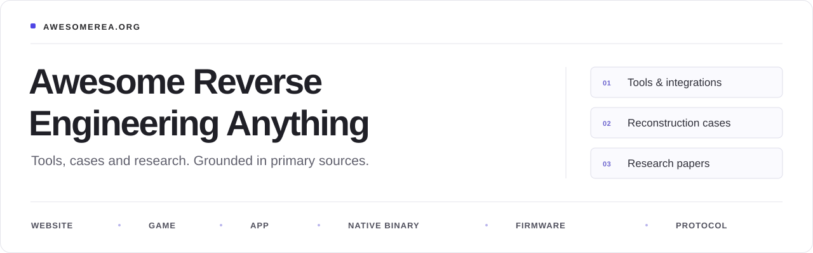

# Awesome Reverse Engineering Anything

独立整理的工具、案例与研究论文合集，涵盖网站、游戏、应用、原生二进制、固件和通信协议。

[English](README.md) · **简体中文**

<!-- BEGIN GENERATED BADGES -->
<!-- Generated by scripts/build_readme.py from data/rea-resources.json, data/tool-resources.json and data/papers.json. Edit the source data and rerun the script; do not edit this block by hand. -->
    
<!-- END GENERATED BADGES -->

**[搜索与筛选](https://awesomerea.org/zh/)** · **[浏览案例](https://awesomerea.org/zh/cases/)** · **[研究论文](https://awesomerea.org/zh/papers/)** · **[HTML 综述](https://awesomerea.org/zh/survey/)** · **[推荐资源](https://github.com/reacher-z/Awesome-REA/issues/new?template=resource.yml)** · **[参与贡献](#参与贡献)**

**来源核查不代表运行验证。** [核查方法](https://awesomerea.org/zh/about/)

## 目录

**Agent 入口：** [仓库指令（英文）](AGENTS.md) · [如何投稿和提交 PR](docs/agent-contributing.zh-CN.md) · [贡献表单](https://awesomerea.org/zh/contribute/)

<!-- BEGIN GENERATED CONTENTS -->
<!-- Generated by scripts/build_readme.py from data/rea-resources.json, data/tool-resources.json, data/papers.json, data/source-index.json, data/source-scope.json and data/source-supplements/. Edit the source data and rerun the script; do not edit this block by hand. -->
803 项精选资源（298 个案例）· 203 篇论文 · 3,309 个已索引仓库 · 最近来源复核 2026-11-01。其中 3 项仅列于论文部分，因此各分区计数合计 800。

- [按任务查找](#按任务查找)
- [资源](#资源) (800)
  - [网站](#website) (41)
  - [游戏](#game) (253)
  - [应用](#app) (123)
  - [原生二进制](#native-binary) (137)
  - [固件与硬件](#firmware) (53)
  - [协议](#protocol) (49)
  - [智能体与 MCP](#agents-and-mcp) (61)
  - [相关合集](#related-collections) (28)
  - [文档与学习资源](#references-and-learning) (55)
- [论文](#papers) (203)
  - [最新论文](#papers-recent) (10)
- [完整仓库索引](#完整仓库索引) (3,309)
- [贡献者](#贡献者)
- [关于](#关于)

本页还有：[参与贡献](#参与贡献)
<!-- END GENERATED CONTENTS -->

## 按任务查找

| 任务           | 相关分类                                                                              |
| ------------ | --------------------------------------------------------------------------------- |
| 检查网站或应用界面    | [网站](#website) · [应用](#app)                                                       |
| 重建游戏或检查代码匹配  | [游戏](#game) · [游戏案例](https://awesomerea.org/zh/cases/#cases-game)                 |
| 分析编译后代码或恢复符号 | [原生二进制](#native-binary) · [智能体与 MCP](#agents-and-mcp)                             |
| 研究固件或设备协议    | [固件](#firmware) · [协议](#protocol)                                                 |
| 比较方法与评测证据    | [论文](#papers) · [综述中的对比分析](https://awesomerea.org/zh/survey/#comparative-studies) |

## 资源

名称链接指向原始来源。每行列出说明首句、类型与关系；“完整条目”提供完整说明、使用前提、限制与核查来源。

每项资源按主要用途列出一次，案例复用这些条目；[研究论文单独列出](#papers)。[浏览精选资源目录](https://awesomerea.org/zh/resources/)。

REA 标签指向单独维护的[上游 CLI 与 MCP 项目](https://github.com/morluto/rea)，收录不代表已接入 REA。[关于本独立合集](#关于)。

<!-- BEGIN GENERATED CATALOG -->
<!-- Generated by scripts/build_readme.py from data/rea-resources.json, data/tool-resources.json and site/translations.zh-CN.json. Edit the source data and rerun the script; do not edit this block by hand. -->
**标签：** REA 官方：由 REA 项目发布 · REA 社区：基于 REA 的第三方工作 · REA 维护者：REA 维护者整理的目录 · 独立 MCP、独立智能体、独立重建：未确认与 REA 有关联 · 混合工具流程：作者报告 REA 与其他工具并用 · Android、.NET、JVM、WebAssembly：平台 · 程序库：供编程调用的库 · 仅有类型：基础工具或学习资源。

### Website · 网站

[↑ 返回目录](#目录)

#### 案例

- [**恐龙跑酷：恢复一条加速规则**](https://github.com/morluto/rea/blob/c360cfcd6d7901514b16dd6113eba2e0b0fdf422/website/evidence/calculator-and-dino.md#dinosaur-speed) - REA 的教学案例检查 HTTP 版 t-rex-runner，并重建其速度更新规则。 案例 · REA 官方 · 也适用：游戏 · [完整条目](https://awesomerea.org/zh/resources/rea-dinosaur-speed-case/)
- [**rauchg.com：根据捕获的 Flight 输出重建 RSC 博客**](https://github.com/boyang-hu/website-rebuild-skill/blob/ac60c9d8a2ab40045a89b5403c3457f1404e92b3/skills/website-rebuild/references/rsc-reconstruction.md) - 记录 website-rebuild-skill 的一个案例：解码浏览器收到的 React 服务端组件 Flight 流，重建可构建的 Next 项目，再与捕获站点的输出比较。 案例 · 独立重建 · [完整条目](https://awesomerea.org/zh/resources/rauchg-rsc-reconstruction-case/)
- [**BaoCut Slides：交互式网页编辑器改编**](https://github.com/JimLiu/baocut/tree/b8585e0c8d7a82bdee9f0ed019cf6edb075e41c1/packages/slides-runtime) - 记录 BaoCut 交互式幻灯片编辑器，作者称其实现借鉴自 Claude Slides。 案例 · 独立重建 · 也适用：应用 · [完整条目](https://awesomerea.org/zh/resources/baocut-slides-editor-case/)
- [**Claude Code 中的 REA：隔离配置下的静态分析 A/B 试验**](https://zenn.dev/keigoly/articles/8738d8d241b5a1) - 一篇日文实践报告在单独的项目目录中把 REA 6.4.0 接入 Claude Code，屏蔽其 170 个工具中的 43 个以及常见的命令行启动方式，并在两个真实任务上比较启用与禁用 REA 的运行：一个 Electron 终端的分发文件，以及一份保存的 HAR 通信记录。 案例 · 混合工具流程 · 也适用：应用 · [完整条目](https://awesomerea.org/zh/resources/rea-claude-code-isolated-ab-case/)
- [**恐龙跑酷：经 REA 检查、由 Codex 重建的速度规则**](https://github.com/zhxunzh84/rea-dino-reverse-engineering) - 作者使用 REA 的 MCP 浏览器工具被动捕获 wayou 开源 T-Rex Runner 页面已加载的 JavaScript，再由 Codex 在一个自包含的 HTML5 Canvas 游戏中重建其加速规则。 案例 · 混合工具流程 · 也适用：游戏 · [完整条目](https://awesomerea.org/zh/resources/rea-dino-runner-community-case/)
- [**Terminal：参考 TradingView 图表研究的 Rust 终端**](https://github.com/michaelshimeles/terminal) - 独立 Rust 市场界面参考 REA 对公开、未登录 TradingView 图表交互的场景研究；笔记保留观察、文档、推断及未知标签，产物使用自己的图表引擎和数据源，而非恢复 TradingView 或 Bloomberg 服务端软件。 案例 · 混合工具流程 · 也适用：应用 · [完整条目](https://awesomerea.org/zh/resources/terminal-tradingview-rea-chart-case/)
- [**BaoCut Design：移植重建的设计稿与设计系统编辑器**](https://github.com/JimLiu/baocut/tree/7aa049e82e1367da013b7aba80f0b79033fa04ad/packages/design-runtime) - 记录 BaoCut 的设计稿（画布）与设计系统编辑器；项目称其按 1:1 移植自 Claude Design 编辑器的 TypeScript 重建，并在智能体会话中提供标注与导出。 案例 · 独立重建 · 也适用：应用 · [完整条目](https://awesomerea.org/zh/resources/baocut-design-canvas-case/)
- [**whatsapp-web-reveng：记录旧版 WhatsApp Web 协议**](https://github.com/sigalor/whatsapp-web-reveng) - 记录并重新实现 WhatsApp Web 在浏览器会话镜像已配对手机时期使用的 WebSocket 协议：二维码配对、Curve25519/HKDF 密钥建立、经 AES/HMAC 保护的二进制报文、基于字符串令牌表的节点编码，以及端到端媒体加密。 案例 · 独立重建 · 也适用：协议 · [完整条目](https://awesomerea.org/zh/resources/whatsapp-web-reveng-legacy-protocol-case/)
- [**Ruffle：用 Rust 重新实现的 Adobe Flash Player**](https://github.com/ruffle-rs/ruffle) - 用 Rust 重新实现 Adobe Flash Player，使从 ActionScript 1/2（AVM1）到 ActionScript 3（AVM2）的 SWF 内容能在原生桌面播放器中运行，或通过 WebAssembly 以自托管脚本或浏览器扩展的形式在浏览器中运行。 案例 · 独立重建 · 也适用：游戏 · [完整条目](https://awesomerea.org/zh/resources/ruffle-flash-player-case/)
- [**Littlebird.ai 静态首页重建**](https://github.com/AkashNaickar/crdb-sample-frontend) - 依据捕获的标记与资源，用原生 HTML/CSS/JavaScript 重建 Littlebird.ai 首页；源码实现移动导航、FAQ 展开、滚动显现及随操作系统变化的按钮展示。 案例 · 独立重建 · [完整条目](https://awesomerea.org/zh/resources/littlebird-static-rebuild-case/)

#### 工具、项目与集成

- [**webcrack**](https://github.com/j4k0xb/webcrack) - 识别支持的 JavaScript 混淆模式，并拆解 webpack/Browserify 打包文件，改善代码可读性。 工具 · 也适用：应用 · [完整条目](https://awesomerea.org/zh/resources/webcrack/)
- [**humanify JavaScript 标识符重命名工具**](https://github.com/jehna/humanify) - 借助 LLM 为压缩后的 JavaScript 标识符建议名称，并通过遵循作用域的 AST 改写完成重命名，程序结构保持不变。 工具 · [完整条目](https://awesomerea.org/zh/resources/humanify/)
- [**WABT**](https://github.com/WebAssembly/wabt) - WebAssembly 二进制与文本转换、节区检查、验证、解释执行及 C 转换工具集。 工具 · WebAssembly · 也适用：二进制 · [完整条目](https://awesomerea.org/zh/resources/wabt/)
- [**wasm-tools**](https://github.com/bytecodealliance/wasm-tools) - Bytecode Alliance 提供的 CLI 与 Rust 库，用于检查 WebAssembly 模块、元数据、组件和 WIT 接口。 工具 · WebAssembly · 也适用：二进制 · [完整条目](https://awesomerea.org/zh/resources/wasm-tools/)
- [**Chrome DevTools MCP**](https://github.com/ChromeDevTools/chrome-devtools-mcp) - 连接智能体与 Chrome，检查实时页面、调试网络并记录性能轨迹。 集成 · 独立 MCP · [完整条目](https://awesomerea.org/zh/resources/chrome-devtools-mcp/)
- [**mitmproxy**](https://github.com/mitmproxy/mitmproxy) - 通过交互代理、Web 界面或可脚本化命令行检查和记录 HTTP 流量。 工具 · 也适用：应用、协议 · [完整条目](https://awesomerea.org/zh/resources/mitmproxy/)
- [**Playwright MCP**](https://github.com/microsoft/playwright-mcp) - 通过结构化无障碍快照驱动浏览器交互，调查可复现的网页行为。 集成 · 独立 MCP · [完整条目](https://awesomerea.org/zh/resources/playwright-mcp/)
- [**Burp Suite MCP Server 扩展**](https://github.com/PortSwigger/mcp-server) - PortSwigger 官方 Burp Suite 扩展，提供 MCP 端点并附带 stdio 代理，使智能体可以查询代理中的 HTTP 与 WebSocket 历史记录、发送 HTTP/1.1 或 HTTP/2 请求，并打开 Repeater 或 Intruder 标签页。 集成 · 独立 MCP · 也适用：应用 · [完整条目](https://awesomerea.org/zh/resources/burp-suite-mcp-server/)
- [**Wakaru**](https://github.com/pionxzh/wakaru) - 通过还原已识别的压缩与转译模式，从发布后的 JavaScript 包中恢复可读模块，支持拆包与现代语法恢复，便于分析生产环境前端代码。 工具 · [完整条目](https://awesomerea.org/zh/resources/wakaru/)
- [**Spectral**](https://github.com/spectral-mcp/spectral) - 用 LLM 分析捕获的应用 HTTP 流量，生成 MCP 工具、OpenAPI 3.1 规范或 GraphQL 模式；完成抓包与认证配置后，生成的工具可直接调用已观察到的 API。 集成 · 独立智能体 · 也适用：应用、协议 · [完整条目](https://awesomerea.org/zh/resources/spectral-mcp/)
- [**jsdeob-workbench**](https://github.com/Owl4444/jsdeob-workbench) - 在查看 JavaScript AST 和变量作用域的同时，可视化编排 Babel 转换链；保存分析项目与可复用插件，逐步简化混淆脚本。 工具 · [完整条目](https://awesomerea.org/zh/resources/jsdeob-workbench/)
- [**Browser Reverse Engineering Toolkit 浏览器逆向工程工具集**](https://github.com/Dvurechensky/Browser.Reverse.Engineering.Toolkit) - 采集浏览器会话证据，在持久 Chromium 会话中抓取网站，并根据已保存的捕获数据生成离线架构／API 报告，以及 OpenAPI、SDK 和模拟服务器草稿。 工具 · [完整条目](https://awesomerea.org/zh/resources/browser-reverse-engineering-toolkit/)
- [**screenshot-to-code 截图转前端代码工具**](https://github.com/abi/screenshot-to-code) - 借助多模态模型，根据截图、设计稿、Figma 设计或屏幕录像生成 HTML/CSS、Tailwind、React、Vue、Bootstrap 或 Ionic 前端代码；可选的无头浏览器预览可让模型渲染并自查输出。 工具 · [完整条目](https://awesomerea.org/zh/resources/screenshot-to-code/)
- [**Dembrandt 网站设计系统提取工具**](https://github.com/dembrandt/dembrandt) - Node.js 命令行工具，通过 Playwright 驱动 Chromium 或 Firefox 渲染网站，并从 DOM 读取计算样式来提取其设计系统：标志、附带判定依据的颜色角色、字体排版、间距、边框、阴影、动效、断点，以及按钮、输入框等组件样式。 工具 · [完整条目](https://awesomerea.org/zh/resources/dembrandt/)
- [**shuji 源映射源码恢复工具**](https://github.com/paazmaya/shuji) - 命令行工具，可把源映射（source map）中内嵌的原始 JavaScript 和 CSS 源码重新写出为文件。 工具 · [完整条目](https://awesomerea.org/zh/resources/shuji/)
- [**Obfuscator.io 专用反混淆工具**](https://github.com/ben-sb/obfuscator-io-deobfuscator) - 专门处理 Obfuscator.io（javascript-obfuscator）所生成 JavaScript 的反混淆工具，README 称也能处理其大部分分支版本。 工具 · [完整条目](https://awesomerea.org/zh/resources/obfuscator-io-deobfuscator/)
- [**javascript-deobfuscator 通用 JavaScript 反混淆工具**](https://github.com/ben-sb/javascript-deobfuscator) - 通用的 JavaScript 反混淆工具，针对常见混淆手法，以 js-deobfuscator 之名发布在 npm 上，可作为库或命令行工具使用。 工具 · [完整条目](https://awesomerea.org/zh/resources/ben-sb-javascript-deobfuscator/)
- [**mitmproxy2swagger**](https://github.com/alufers/mitmproxy2swagger) - 命令行工具，从捕获的流量还原未公开的 REST API。 工具 · 也适用：协议 · [完整条目](https://awesomerea.org/zh/resources/mitmproxy2swagger/)
- [**JPEXS Flash 反编译器（FFDec）**](https://github.com/jindrapetrik/jpexs-decompiler) - 面向 Adobe Flash SWF 文件的 Java 桌面反编译与编辑工具。 工具 · 也适用：游戏 · [完整条目](https://awesomerea.org/zh/resources/jpexs-decompiler/)
- [**WasmLens：探索性 WebAssembly 检查**](https://github.com/alexandrmotologa/wasmlens) - 提供 WebAssembly 区段与函数签名检查、WAT 风格指令列表和有限 C 风格伪代码重建的 Python CLI。 工具 · WebAssembly · 也适用：二进制 · [完整条目](https://awesomerea.org/zh/resources/wasmlens/)
- [**synchrony JavaScript 反混淆工具**](https://github.com/relative/synchrony) - 主要面向 javascript-obfuscator（obfuscator.io）输出的 JavaScript 清理与反混淆工具。 工具 · [完整条目](https://awesomerea.org/zh/resources/synchrony/)
- [**sourcemapper 源映射源码还原工具**](https://github.com/denandz/sourcemapper) - Go 编写的命令行工具，可根据 webpack 等打包工具生成的源映射（source map）重建网站前端原有的 JavaScript 源码目录树，并把映射中内嵌的每个源文件写到其记录的路径下。 工具 · [完整条目](https://awesomerea.org/zh/resources/sourcemapper/)
- [**ngrev Angular 应用结构分析工具**](https://github.com/mgechev/ngrev) - 一款 Electron 桌面应用，对 Angular 项目的 TypeScript 源码做静态分析，以交互式图形展示其中的 NgModule、组件、指令、管道和服务提供者及其依赖关系，无需运行该应用。 工具 · [完整条目](https://awesomerea.org/zh/resources/ngrev/)
- [**jsluice JavaScript 静态提取工具**](https://github.com/BishopFox/jsluice) - Bishop Fox 推出的 Go 库与命令行工具，借助 tree-sitter 解析 JavaScript，还原脚本所调用的接口地址；它依据代码如何使用某个值来判断，而不仅仅依靠正则表达式。 工具 · [完整条目](https://awesomerea.org/zh/resources/jsluice/)
- [**REstringer JavaScript 反混淆工具**](https://github.com/HumanSecurity/restringer) - HUMAN Security 推出的 Node.js JavaScript 反混淆工具。 工具 · [完整条目](https://awesomerea.org/zh/resources/restringer/)
- [**CRX Viewer 浏览器扩展源码查看器**](https://github.com/Rob--W/crxviewer) - Rob Wu 开发的浏览器扩展及网页版工具，无需安装即可查看已打包的浏览器扩展。 工具 · [完整条目](https://awesomerea.org/zh/resources/crxviewer/)
- [**har-to-openapi：从 HAR 抓包推断 OpenAPI 文档**](https://github.com/jonluca/har-to-openapi) - TypeScript 库及命令行工具，可根据 HTTP 流量的 HAR 抓包记录推断 OpenAPI 3.0 或 3.1 文档，大致基于 har2openapi 改写。 工具 · [完整条目](https://awesomerea.org/zh/resources/har-to-openapi/)
- [**decode-js JavaScript 反混淆 AST 工具**](https://github.com/echo094/decode-js) - 基于 Babel AST 的处理工具，可把混淆过的 JavaScript 还原为可读源码，每次运行选择一个目标：javascript-obfuscator（obfuscator.io）、JS-Confuser 2.x（直至 high 预设）、sojson 及其面向 jsjiami.com.v7 的 v7 变体、sojson 风格的 jjencode，以及处理不可达代码、嵌套代码块和常量表达式的通用目标。 工具 · [完整条目](https://awesomerea.org/zh/resources/decode-js/)
- [**javascript-deobfuscator Obfuscator.io 字符串还原网页工具（LostMyCode）**](https://github.com/LostMyCode/javascript-deobfuscator) - 基于浏览器的 Vue 应用，用于还原 Obfuscator.io 藏在字符串数组查找背后的 JavaScript 字符串。 工具 · [完整条目](https://awesomerea.org/zh/resources/lostmycode-javascript-deobfuscator/)
- [**minusone 脚本去混淆引擎**](https://github.com/airbus-cert/minusone) - Airbus CERT 开发的 Rust 脚本去混淆引擎：用 tree-sitter 解析 PowerShell 或 JavaScript，应用一组推断语法树节点取值的规则，再输出化简后的脚本。 工具 · [完整条目](https://awesomerea.org/zh/resources/minusone-script-deobfuscator/)
- [**JS-Deobfuscator（0x1Avram）Obfuscator.io 反混淆工具**](https://github.com/0x1Avram/js-deobfuscator) - 面向 Timofey Kachalov 的 javascript-obfuscator（亦以 obfuscator.io 提供）所生成 JavaScript 的 Node.js 反混淆工具。 工具 · [完整条目](https://awesomerea.org/zh/resources/0x1avram-js-deobfuscator/)

### Game · 游戏

[↑ 返回目录](#目录)

#### 案例

- [**DX-Ball：重建声音声像计算**](https://rea.tools/showcase/dx-ball/) - 根据指令与常量重建单个声像函数；上游报告 3,205 例与 63 字节匹配。 案例 · REA 官方 · 也适用：二进制 · [完整条目](https://awesomerea.org/zh/resources/rea-dxball-case/)
- [**TH04：恢复 DOS 子弹环辅助函数**](https://rea.tools/showcase/th04/) - 检查 PC-98 DOS 的 16 位弹幕角度辅助函数，并关联固定版本重建与历史编译器检查。 案例 · REA 官方 · 也适用：二进制 · [完整条目](https://awesomerea.org/zh/resources/rea-th04-case/)
- [**Super Mario 64 DS：带重定位核对的匹配反编译**](https://github.com/tangosdev/sm64ds-decomp) - 将 Super Mario 64 DS 函数重建为 C/C++ 和规则允许的汇编原语，并将编译结果与用户提供的卡带转储对比。 案例 · 独立重建 · [完整条目](https://awesomerea.org/zh/resources/sm64ds-decomp-case/)
- [**GoldenEye 007：基于反编译成果的智能体辅助原生移植**](https://github.com/jkdansereau/goldeneye-pc-port) - 在已有 GoldenEye 007 反编译成果之上构建原生 PC 移植，提供宿主平台适配层，并从用户自己的 ROM 提取资产。 案例 · 独立重建 · [完整条目](https://awesomerea.org/zh/resources/goldeneye-pc-port-case/)
- [**ssbu-recomp：明确玩法边界的静态重编译**](https://github.com/Denkishi/ssbu-recomp) - 将 Super Smash Bros. Ultimate 13.0.4 的 AArch64 代码提前转换，并提供带 Vulkan/OpenGL 渲染的 Windows 运行时。 案例 · 独立重建 · [完整条目](https://awesomerea.org/zh/resources/ssbu-recomp-case/)
- [**KartPad：Mario Kart Wii 重编译的平台集成**](https://github.com/chrissotraidis/kartpad) - 围绕 WiiCompiled 对 Mario Kart Wii 的提前转换实现 Apple 与 Android 平台集成，提供原生图形、输入及可选 Retro Rewind 支持。 案例 · 独立重建 · [完整条目](https://awesomerea.org/zh/resources/kartpad-case/)
- [**BattleShip：AI 辅助的 Super Smash Bros. 原生移植**](https://github.com/JRickey/BattleShip) - 使用 libultraship 和 Torch 移植已有的 Super Smash Bros. N64 反编译成果。 案例 · 独立重建 · [完整条目](https://awesomerea.org/zh/resources/battleship-port-case/)
- [**智能体反编译：字节匹配验收复盘**](https://momo5502.com/posts/2026-10-09-game-decompilation/) - Maurice Heumann 介绍如何用基于编译器的函数、重定位、数据和类型检查，取代看似合理的智能体输出。 案例 · 独立重建 · [完整条目](https://awesomerea.org/zh/resources/agent-decompilation-oracle-case/)
- [**Snowboard Kids 2：大模型辅助的 N64 匹配反编译**](https://github.com/cdlewis/snowboardkids2-decomp) - N64 游戏 Snowboard Kids 2 的公开匹配反编译项目，2024 年借助社区反编译工具启动。 案例 · 独立重建 · [完整条目](https://awesomerea.org/zh/resources/snowboardkids2-decomp-case/)
- [**IsaacRecomp：将 Flash 游戏字节码转换为原生 C++**](https://github.com/whylurking/IsaacRecomp) - 将 The Binding of Isaac 的 Flash AVM1 字节码转换为 C++ 函数，并提供原生渲染与输入运行时。 案例 · 独立重建 · [完整条目](https://awesomerea.org/zh/resources/isaacrecomp-case/)
- [**Nanolathe：附研究文档的 Total Annihilation 引擎重实现**](https://github.com/nanolathe-gg/nanolathe) - 用 Go 重实现兼容 Total Annihilation 的策略游戏引擎，公开文件格式研究并提供不同玩法配置。 案例 · 独立重建 · [完整条目](https://awesomerea.org/zh/resources/nanolathe-case/)
- [**TH08：精确源码重建与单独验证的移植**](https://github.com/N0zoM1z0/th08) - 依据原二进制和原编译器重建日版 Touhou 8 的 1.00d 版本，再将恢复的代码适配到其他平台。 案例 · 独立重建 · [完整条目](https://awesomerea.org/zh/resources/th08-reconstruction-case/)
- [**Zelda 64: Recompiled：无需完整源码反编译的《姆吉拉的假面》原生移植**](https://github.com/Zelda64Recomp/Zelda64Recomp) - 通过 N64Recomp 将《姆吉拉的假面》转为原生应用，并使用 RT64 渲染。 案例 · 独立重建 · [完整条目](https://awesomerea.org/zh/resources/zelda64recomp-case/)
- [**OpenGOAL：恢复 GOAL 代码并重建 Jak 系列游戏**](https://github.com/open-goal/jak-project) - 从 Jak 原二进制重建可读的 GOAL 代码，再用新编写的 GOAL 编译器为现代 PC 编译。 案例 · 独立重建 · [完整条目](https://awesomerea.org/zh/resources/opengoal-jak-case/)
- [**LEGO Island：源码重建与单独记录的精确重构建**](https://github.com/isledecomp/isle) - 针对英文版 LEGO Island 1.1 的原始 32 位 Windows 目标重建源码。 案例 · 独立重建 · [完整条目](https://awesomerea.org/zh/resources/lego-island-decomp-case/)
- [**Snowball War：范围明确的 REA 辅助小游戏重建**](https://github.com/tuunanet/rea-ski-or-die-reconstruction) - 作者通过 REA 的 Ghidra 工作流调查 DOS 版 Ski or Die 二进制，记录 Snowball War 的规则，再用 Rust 与 SDL2 重建这一小游戏。 案例 · 混合工具流程 · [完整条目](https://awesomerea.org/zh/resources/snowball-war-rea-case/)
- [**SpaceCadetPinball：将反编译游戏逻辑适配到 SDL2**](https://github.com/k4zmu2a/SpaceCadetPinball) - 将逆向分析后的 Space Cadet 弹球游戏转为可编译的 C++，面向桌面平台。 案例 · 独立重建 · [完整条目](https://awesomerea.org/zh/resources/space-cadet-pinball-case/)
- [**Super Mario 64：带明确比较开关的 ROM 重建**](https://github.com/n64decomp/sm64) - 为日版、北美版、欧洲版、Shindou 版和 iQue 版 Super Mario 64 重建源码。 案例 · 独立重建 · [完整条目](https://awesomerea.org/zh/resources/sm64-decomp-case/)
- [**Unleashed Recompiled：转换 Xbox 360 游戏代码与着色器**](https://github.com/hedge-dev/UnleashedRecomp) - 使用 XenonRecomp 静态重编译 Xbox 360 PowerPC 代码，并用 XenosRecomp 转换 Xenos 着色器，构建非官方 Sonic Unleashed PC 移植。 案例 · 独立重建 · [完整条目](https://awesomerea.org/zh/resources/unleashed-recompiled-case/)
- [**OpenMW：复用原内容并替代 Morrowind 引擎**](https://github.com/OpenMW/openmw) - 提供用于运行 Morrowind 的独立引擎和替代编辑器 OpenMW-CS，通过自己的运行时加载原游戏内容，并记录脚本及模组兼容性差异。 案例 · 独立重建 · [完整条目](https://awesomerea.org/zh/resources/openmw-engine-case/)
- [**REDRIVER2：借助 PlayStation 兼容层重建 Driver 2**](https://github.com/OpenDriver2/REDRIVER2) - 将逆向分析的 Driver 2 MIPS 例程转为 C/C++，并用 Psy-X/Psy-Cross 将 PlayStation 接口适配到桌面系统。 案例 · 独立重建 · [完整条目](https://awesomerea.org/zh/resources/redriver2-case/)
- [**DevilutionX：移植重建后的 Diablo 引擎**](https://github.com/diasurgical/DevilutionX) - 基于 Devilution 重建成果提供现代平台上的 Diablo 与 Hellfire 移植，加入平台支持、错误修复及可选便利功能。 案例 · 独立重建 · [完整条目](https://awesomerea.org/zh/resources/devilutionx-case/)
- [**东方 Project 重建：贯穿三款游戏的智能体驱动方法**](https://rea.tools/blog/touhou-reconstruction/) - REA 网站发表的一篇文章及其固定版本的证据说明，介绍一位作者以智能体驱动重建 TH08、TH095 与 TH04 的过程。 案例 · REA 官方 · 也适用：二进制 · [完整条目](https://awesomerea.org/zh/resources/rea-touhou-reconstruction-method-case/)
- [**TicTacToe-AI：REA 分叉对单个游戏方法的有限重建**](https://github.com/heaven-hm/re-agent/tree/develop/benchmarks/tictactoe) - 作者的 REA 分叉（发帖时名为 rea-engine，后更名为 RE-Agent）反编译 GPL 许可的 TicTacToe-AI 游戏所发布的 .NET 可执行文件，重新编译恢复出的 C# 与资源，并依据原始 IL 修复一处反编译错误。 案例 · 混合工具流程 · [完整条目](https://awesomerea.org/zh/resources/rea-engine-tictactoe-case/)
- [**UltraSunnyMoon：以 REA 主导的部分《宝可梦 究极之日》重建**](https://github.com/tylergraydev/UltraSunnyMoon) - 作者使用固定版本的 REA 与 Ghidra，分析使用者自备的《宝可梦 究极之日》基础版可执行文件，由拆分出的对象逐字节重建该文件，并替换进两个编译后的小型 C 运行时例程。 案例 · 混合工具流程 · [完整条目](https://awesomerea.org/zh/resources/ultrasunnymoon-rea-case/)
- [**DX-Ball：借助 REA 并由 Codex 完成的函数级重建**](https://github.com/N0zoM1z0/dx-ball) - 作者让 Codex 通过 REA 的 Ghidra 工具检查英文版 DX-Ball 1.07 可执行文件并恢复为带类型的 C/C++，再用同时代的 Visual C++ 4.0 编译每个函数，在映射重定位后与原文件逐字节比较。 案例 · 混合工具流程 · 也适用：二进制 · [完整条目](https://awesomerea.org/zh/resources/dx-ball-rea-reconstruction-case/)
- [**re2ds：Resident Evil 2 的原生 Nintendo DS 引擎**](https://github.com/eray1605/re2ds) - 在原生 Nintendo DS 引擎中重新实现 Resident Evil 2 PS1 版的游戏规则，并用转换工具把使用者自有光盘中的数据转为 DS 格式。 案例 · 混合工具流程 · [完整条目](https://awesomerea.org/zh/resources/re2ds-nds-engine-case/)
- [**Horizon：借助 REA 字节码查询的 Minecraft: Java Edition 26.3 Rust 重写**](https://github.com/ludovic111/horizon) - 以原生 Rust 客户端、专用服务器和启动器重写 Minecraft: Java Edition 26.3，资源均由使用者自有的游戏副本生成。 案例 · 混合工具流程 · [完整条目](https://awesomerea.org/zh/resources/horizon-minecraft-rust-rewrite-case/)
- [**Untangle：基于 REA 与 Ghidra 证据的浏览器重建**](https://github.com/az9713/untangle-rebuild) - 作者记录了以 REA/Ghidra 调查已发布的 Untangle Windows 二进制，产出单页可玩重建与逐项判定的证据收据，并分开保留冻结发现、后取的源码答案及先验知识审计。 案例 · 混合工具流程 · 也适用：二进制 · [完整条目](https://awesomerea.org/zh/resources/untangle-rea-evidence-rebuild-case/)
- [**OpenBattlefield2：尚未完成的 Refractor 2 引擎重实现**](https://github.com/Moxnatiy/OpenBattlefield2) - C++20 重实现 Battlefield 2 的 Refractor 2 引擎，读取原始游戏数据，记录菜单渲染、关卡载入及服务器互通；公开的准星研究引用 REA/Ghidra 证据 ID 和二进制地址，主要玩法系统仍未完成。 案例 · 混合工具流程 · 也适用：二进制 · [完整条目](https://awesomerea.org/zh/resources/openbattlefield2-refractor-engine-case/)
- [**keen-clone：Commander Keen 1 的 C/SDL2 移植**](https://github.com/carlhako/keen-clone) - Linux 原生与浏览器移植面向 Commander Keen 第一章，作者记录以 REA/Ghidra 对 KEEN1.EXE 逐函数研究并重建 C/SDL2 游戏，附带公开分析资料；范围仅为第一章，并非全系列。 案例 · 混合工具流程 · 也适用：二进制 · [完整条目](https://awesomerea.org/zh/resources/keen-clone-rea-commander-keen-case/)
- [**samp-client-re：局部重建的 SA-MP 客户端**](https://github.com/NathanKanaeru/samp-client-re) - REA/Ghidra 调查将 SA-MP 0.3.DL-R1 客户端子系统映射到新的 C++ DLL、加载器和冒烟测试程序，产物属于架构重建，网络与图形行为仍有明确未知项，未建立零售版兼容性。 案例 · 混合工具流程 · 也适用：二进制 · [完整条目](https://awesomerea.org/zh/resources/samp-client-rea-partial-reconstruction-case/)
- [**Desktop Games Nostalgia：macOS 与浏览器移植**](https://github.com/ucodia/desktop-games-nostalgia) - Swift/macOS 与 JavaScript/浏览器移植在截图上重现 Desktop Games 的桌面破坏玩具；作者记录 Claude 与 REA/Ghidra 对 Peter 解释器的研究、反编译程序树及提取素材，并明确列出视觉差异和未提供项目许可。 案例 · 混合工具流程 · 也适用：二进制 · [完整条目](https://awesomerea.org/zh/resources/desktop-games-nostalgia-rea-port-case/)
- [**GunZRs：GunZ: The Duel 的 Rust 重实现**](https://github.com/OpenRsG/GunZRs) - Rust/Bevy 移植从用户安装中读取 GunZ: The Duel 数据，提供原生发布包、浏览器构建工具、截图及 REA/Ghidra 调查框架；自有局域网协议和推断的移动行为不代表兼容零售服务器或已证明玩法一致。 案例 · 混合工具流程 · [完整条目](https://awesomerea.org/zh/resources/gunzrs-rea-rust-reimplementation-case/)
- [**逆向工程需要更大的模型吗？东方 Project 重建中的通用模型与专用模型**](https://rea.tools/blog/reverse-engineering-models/) - REA 网站上 N0zoM1z0 的一篇文章（2026 年 10 月 13 日）依据注明日期的东方 Project 重建提交，探讨精确的函数匹配究竟需要更大的通用模型、针对编译器的专用模型，还是更好的检索。 案例 · REA 官方 · 也适用：二进制 · [完整条目](https://awesomerea.org/zh/resources/rea-bigger-model-essay-case/)
- [**LASRecomp：《织梦岛》静态重编译案例**](https://github.com/peiikai/LASRecomp) - 通过静态重编译，将 2019 年 Switch 版《塞尔达传说：织梦岛》重建为原生桌面程序。 案例 · 独立重建 · [完整条目](https://awesomerea.org/zh/resources/lasrecomp/)
- [**ArkWeb：双游戏动作与碰撞桥接实验**](https://github.com/luki-1/ArkWeb) - 同时运行《漫威蜘蛛侠：重制版》与《蝙蝠侠：阿卡姆骑士》，将哥谭碰撞数据传入蜘蛛侠的物理世界，再将其渲染画面合成到阿卡姆中。 案例 · 独立重建 · [完整条目](https://awesomerea.org/zh/resources/arkweb-two-game-case/)
- [**Perfect Dark：生成一致 ROM 的 Nintendo 64 反编译重建**](https://github.com/n64decomp/perfect_dark) - 重建 Perfect Dark 的 Nintendo 64 代码，并提供生成一致 ROM 的构建流程。 案例 · 独立重建 · [完整条目](https://awesomerea.org/zh/resources/perfect-dark-matching-decomp-case/)
- [**Super Mario Sunshine：基于 AI 辅助反编译的原生 PC 移植**](https://github.com/chasem-dev/sms-pc-port) - 以固定版本的一致性反编译分支为基础，构建 Super Mario Sunshine 北美版的原生 PC 移植，并为图形、光盘、音频、输入和系统服务提供宿主平台层。 案例 · 独立重建 · [完整条目](https://awesomerea.org/zh/resources/sms-pc-port-case/)
- [**《姆吉拉的假面》：生成一致美版 N64 ROM 的反编译重建**](https://github.com/zeldaret/mm) - 依据游戏内信息和静态或动态分析，为《塞尔达传说：姆吉拉的假面》重建 C 源码库，并重新构建美版 Nintendo 64 ROM。 案例 · 独立重建 · [完整条目](https://awesomerea.org/zh/resources/zelda-mm-decomp-case/)
- [**DLSSNR-AMD：为 RDNA4 重新实现 DLSS 5 神经渲染**](https://github.com/mochizuki0323/DLSSNR-AMD) - 将 NVIDIA DLSS 5 库中的神经渲染网络重新实现为面向 AMD RX 9000（RDNA4）显卡的 Vulkan 计算着色器，并通过兼容 NGX 的核心模块以及 ReShade 或 Vulkan 层等途径提供给游戏。 案例 · 独立重建 · 也适用：二进制 · [完整条目](https://awesomerea.org/zh/resources/dlssnr-amd-neural-rendering-case/)
- [**《旷野之息》：Switch 主程序的逐函数一致性反编译**](https://github.com/zeldaret/botw) - 以 C++ 重新实现《塞尔达传说 旷野之息》Switch v1.5.0 主程序的部分代码，并逐个函数与原始机器码比对。 案例 · 独立重建 · [完整条目](https://awesomerea.org/zh/resources/botw-decomp-case/)
- [**《天空之剑》：以哈希校验重新链接的 Wii 版反编译**](https://github.com/zeldaret/ss) - 以使用者自备的 NTSC-U 1.0（SOUE01）光盘文件为起点，为《塞尔达传说 天空之剑》Wii 版的 main.dol 和 REL 模块重建 C++ 源码。 案例 · 独立重建 · [完整条目](https://awesomerea.org/zh/resources/skyward-sword-decomp-case/)
- [**2 Ship 2 Harkinian：基于反编译的《姆吉拉的假面》原生移植**](https://github.com/2ship2harkinian/2ship2harkinian) - 以改编自 zeldaret/mm 反编译的源码为基础，构建《塞尔达传说：姆吉拉的假面》的原生 Windows、Linux 和 macOS 版本，并由 libultraship 重新实现 N64 SDK 函数。 案例 · 独立重建 · [完整条目](https://awesomerea.org/zh/resources/2ship2harkinian-mm-port-case/)
- [**Ship of Harkinian：基于反编译源码的《时之笛》原生移植**](https://github.com/HarbourMasters/Shipwright) - 以《时之笛》反编译项目的源码为基础，将游戏构建为原生 PC 程序，用 libultraship 替代 N64 的 libultra SDK，并以 DirectX 11、OpenGL 或 Metal 渲染。 案例 · 独立重建 · [完整条目](https://awesomerea.org/zh/resources/ship-of-harkinian-oot-port-case/)
- [**《缩小帽》：面向五个 ROM 的 GBA 反编译重建**](https://github.com/zeldaret/tmc) - 依据游戏内信息和静态或动态分析，为《塞尔达传说：缩小帽》重建 C 源码库，可构建美版、欧版、日版及两个演示版共五个 Game Boy Advance ROM。 案例 · 独立重建 · [完整条目](https://awesomerea.org/zh/resources/zelda-tmc-decomp-case/)
- [**《时之笛》：16 个版本均以 MD5 校验 ROM 构建的反编译**](https://github.com/zeldaret/oot) - 借助游戏本身的信息以及静态与动态分析，为《时之笛》重建 C 源码库，可重新构建 Nintendo 64、GameCube 和 iQue Player 共 16 个 ROM 版本。 案例 · 独立重建 · [完整条目](https://awesomerea.org/zh/resources/ocarina-of-time-decomp-case/)
- [**Project Arwing：由一致性反汇编重编译的 Star Fox**](https://github.com/carlosrmz009/arwing) - 依据运行覆盖率和递归下降反汇编 Star Fox 的 65816 与 SuperFX 代码，重新汇编出与原 ROM 一致的文件，再静态翻译为 C，运行于从零编写的 SNES 运行时，支持 Windows、macOS 和 Linux。 案例 · 独立重建 · [完整条目](https://awesomerea.org/zh/resources/project-arwing-star-fox-recomp-case/)
- [**Project Arwing (2)：由一致性反汇编重编译的 Star Fox 2**](https://github.com/carlosrmz009/arwing2) - 从以运行覆盖率为种子的 65816 与 SuperFX 反汇编重建 Star Fox 2：反汇编可重新汇编为与原 ROM 一致的文件，再静态翻译为 C，生成原生 Windows、macOS 和 Linux 版本。 案例 · 独立重建 · [完整条目](https://awesomerea.org/zh/resources/project-arwing-2-star-fox-2-recomp-case/)
- [**Little Planet：由一致性反汇编重编译的 Sonic CD**](https://github.com/carlosrmz009/littleplanet) - 依据运行覆盖率和递归下降，反汇编 Sonic CD 光盘上的全部可执行文件并逐字节一致地重新汇编，再将代码静态翻译为 C，运行于从零编写、以高层实现替代 BIOS 的 Mega-CD 运行时。 案例 · 独立重建 · [完整条目](https://awesomerea.org/zh/resources/little-planet-sonic-cd-recomp-case/)
- [**vf2-decomp：经差分验证的 Virtua Fighter 2 代码恢复**](https://github.com/celsowm/vf2-decomp) - 将 Virtua Fighter 2 Version 2.1 的 Sega Model 2A i960 程序恢复为可移植、非一致性的 C17 代码，每条恢复路径须在受控边界上与参考 i960 执行器一致才被接受。 案例 · 独立重建 · [完整条目](https://awesomerea.org/zh/resources/vf2-decomp-differential-recovery-case/)
- [**z2rs：以模拟器对照逐步重建《塞尔达传说 II》的 Rust 项目**](https://github.com/troyedwardsjr/z2rs) - 以 Rust 重建 NES 游戏《塞尔达传说 II：林克的冒险》，逐个替换游戏的 6502 例程，可运行于桌面、浏览器和 Android。 案例 · 独立重建 · [完整条目](https://awesomerea.org/zh/resources/z2rs-zelda2-reconstruction-case/)
- [**sm64ex：基于反编译成果的 Super Mario 64 增强版 PC 移植**](https://github.com/sm64pc/sm64ex) - 基于反编译源码构建原生 Super Mario 64 可执行文件，在 n64decomp 重建成果的 sm64-port 分支之上，增加渲染器、输入、视角、存档格式和外部数据等选项。 案例 · 独立重建 · [完整条目](https://awesomerea.org/zh/resources/sm64ex-pc-port-case/)
- [**Ghostship：基于 libultraship 的 Super Mario 64 原生移植**](https://github.com/HarbourMasters/Ghostship) - 将反编译风格的游戏源码编译到 libultraship 平台库上，把 Super Mario 64 构建为原生 PC、Switch 和 Android 程序。 案例 · 独立重建 · [完整条目](https://awesomerea.org/zh/resources/ghostship-sm64-port-case/)
- [**Super Mario Sunshine：仍在推进的 GameCube 一致性反编译重建**](https://github.com/doldecomp/sms) - 重建 Super Mario Sunshine 的 C++ 源码，目标是让原版 Metrowerks 编译器为四个 GameCube 发行版本及 Switch 版 3D All-Stars 生成逐字节一致的目标文件。 案例 · 独立重建 · [完整条目](https://awesomerea.org/zh/resources/sms-matching-decomp-case/)
- [**Dusklight：基于反编译的《黄昏公主》原生移植**](https://github.com/TwilitRealm/dusklight) - 以 zeldaret/tp 反编译项目和 Aurora GameCube／Wii 兼容层为基础，将《塞尔达传说 黄昏公主》重新实现为桌面与移动平台的原生应用。 案例 · 独立重建 · [完整条目](https://awesomerea.org/zh/resources/dusklight-twilight-princess-port-case/)
- [**Metaforce：在反编译之上重建的《密特罗德 Prime》引擎重实现**](https://github.com/AxioDL/metaforce) - Metaforce 于 2015 年作为《密特罗德 Prime》引擎的逆向重实现项目启动，现已在 PrimeDecomp 一致性反编译之上重写。 案例 · 独立重建 · [完整条目](https://awesomerea.org/zh/resources/metaforce-metroid-prime-case/)
- [**Super Mario Sunshine（美版）：AI 辅助的一致性反编译分支**](https://github.com/chasem-dev/sms-english) - 将 doldecomp 的 Super Mario Sunshine 反编译工作扩展到北美 GMSE01 版本。 案例 · 独立重建 · [完整条目](https://awesomerea.org/zh/resources/sms-english-gmse01-decomp-case/)
- [**Donkey Kong 64: Recompiled：基于 N64Recomp 的原生移植**](https://github.com/Rainchus/Donkey-Kong-64-Recompiled) - 使用 N64Recomp 将美版 Nintendo 64《大金刚 64》静态重编译为原生移植版，并以 RT64 作为渲染器。 案例 · 独立重建 · [完整条目](https://awesomerea.org/zh/resources/dk64-recompiled-case/)
- [**《黄昏公主》：GameCube 版代码完全一致的反编译**](https://github.com/zeldaret/tp) - 重建《塞尔达传说 黄昏公主》的源码，使其能重新编译出与原版一致的二进制文件；GameCube、Wii 与 Nvidia Shield 各版本通过条件编译共用同一套代码。 案例 · 独立重建 · [完整条目](https://awesomerea.org/zh/resources/twilight-princess-decomp-case/)
- [**Castlevania: Symphony of the Night：覆盖 PlayStation、PSP 与 Saturn 版本的一致性反编译**](https://github.com/Xeeynamo/sotn-decomp) - 从《恶魔城 月下夜想曲》的 PlayStation、PSP 和 Saturn 版二进制重建 C 源码，目标是逐字节编译出与原游戏文件一致的产物。 案例 · 独立重建 · [完整条目](https://awesomerea.org/zh/resources/sotn-matching-decomp-case/)
- [**LEGO Island 可移植版：反编译源码的多平台移植**](https://github.com/isledecomp/isle-portable) - 将 LEGO Island 反编译源码改造为可在桌面、移动设备、游戏主机、DOS 及 Web 上构建的移植版本。 案例 · 独立重建 · [完整条目](https://awesomerea.org/zh/resources/lego-island-portable-case/)
- [**c1：PlayStation 版《古惑狼》的 C 语言移植**](https://github.com/wurlyfox/c1) - 将 PlayStation 版《古惑狼》的原始游戏代码逐函数移植为 C 语言；其编码规范要求为函数标注原实现的地址。 案例 · 独立重建 · [完整条目](https://awesomerea.org/zh/resources/crash-bandicoot-c1-port-case/)
- [**Metroid Prime Port：AI 辅助完成的 PrimeDecomp 反编译原生移植**](https://github.com/Odrannnn/MetroidPrimePort) - 将 PrimeDecomp 对《密特罗德 Prime》游戏与引擎代码的反编译结果编译为原生 C++20 程序，支持 Linux、Windows 和 Android，另有实验性 macOS 版本。 案例 · 独立重建 · [完整条目](https://awesomerea.org/zh/resources/metroid-prime-port-case/)
- [**《风之杖》：以哈希校验重新链接的 GameCube 版反编译**](https://github.com/zeldaret/tww) - 为《塞尔达传说 风之杖》GameCube 版的可执行文件和 REL 模块重建源码，涵盖美版／韩版、PAL 版、日版及日本体验版。 案例 · 独立重建 · [完整条目](https://awesomerea.org/zh/resources/wind-waker-decomp-case/)
- [**Sonic Mania：面向 RSDKv5 引擎的游戏代码反编译重建**](https://github.com/RSDKModding/Sonic-Mania-Decompilation) - 以 C 重建《索尼克狂欢》的游戏代码，并与另行反编译的 RSDKv5 或 RSDKv5U 引擎一起构建，支持 Windows、Linux、Switch 和 Android。 案例 · 独立重建 · [完整条目](https://awesomerea.org/zh/resources/sonic-mania-decomp-case/)
- [**MediEvil Recomp：PlayStation 游戏静态重编译为 C#**](https://github.com/BlackLabelHQ/MediEvilRecomp) - 使用 RecompOne 重编译器及运行时，将北美版 PlayStation《MediEvil》静态重编译为 C# 代码。 案例 · 独立重建 · [完整条目](https://awesomerea.org/zh/resources/medievil-recomp-case/)
- [**Crash Bandicoot 2 Recompiled：基于 PSXRecomp 的原生构建**](https://github.com/Zumbo06/Crash2Recomp) - 一个 Windows 启动器，借助 PSXRecomp 重编译器与运行时，将用户自备的《古惑狼 2》光盘转换为 C 代码并在本地编译，使游戏以原生代码配合模拟的 PlayStation 硬件层运行。 案例 · 独立重建 · [完整条目](https://awesomerea.org/zh/resources/crash2recomp-case/)
- [**Petari：Super Mario Galaxy 一致性反编译重建**](https://github.com/SMGCommunity/Petari) - 将 Super Mario Galaxy 的 Wii 代码重建为 C++，并以使用者从自有日版、北美版、PAL 版或韩版光盘中提取的 main.dol 为目标，逐个目标文件重建。 案例 · 独立重建 · [完整条目](https://awesomerea.org/zh/resources/petari-smg-decomp-case/)
- [**Wind Waker HD Recomp：通过静态重编译实现的 Wii U 游戏原生移植**](https://github.com/ZeldaWWHDRecomp/ZeldaWWHDRecomp) - 将《塞尔达传说 风之杖 HD》Wii U 版的 PowerPC 代码预先静态重编译为 C，原生重新实现游戏所用的 Cafe OS 库，并在 Metal 或 Vulkan 上实现 GX2 图形，生成无需 Cemu 运行时的 macOS、Linux、Windows 和 Android 原生版本。 案例 · 独立重建 · [完整条目](https://awesomerea.org/zh/resources/wind-waker-hd-recomp-case/)
- [**Castlevania 64: Recompiled：测试版静态重编译移植**](https://github.com/RevoSucks/CV64Recomp) - 使用 N64Recomp 将 Nintendo 64 版 Castlevania 美版 1.0 静态重编译为原生 PC 移植，并以 RT64 渲染。 案例 · 独立重建 · [完整条目](https://awesomerea.org/zh/resources/cv64-recompiled-case/)
- [**RSDKv5 Decompilation：重建 Retro Engine v5 与 v5U**](https://github.com/RSDKModding/RSDKv5-Decompilation) - 重建 Retro Engine（RSDK）v5 及 v5 Ultimate 运行时，即运行《索尼克狂欢》游戏代码的引擎，可构建 Windows、Linux、Switch 和 Android 版本。 案例 · 独立重建 · [完整条目](https://awesomerea.org/zh/resources/rsdkv5-engine-decomp-case/)
- [**C2C：《古惑狼 2》的混合重编译与手工反编译**](https://github.com/ughman/c2c) - 一个早期的 PlayStation《古惑狼 2》逆向工程项目：把引擎的 MIPS 机器码直接转换为一个体量巨大的 C 文件，并调用改造后的 PCSX-R 模拟器库处理硬件 I/O。 案例 · 独立重建 · [完整条目](https://awesomerea.org/zh/resources/c2c-crash2-hybrid-recompilation-case/)
- [**MediEvil 反编译：早期阶段、以校验值把关的 PlayStation 项目**](https://github.com/MediEvilDecompilation/medievil-decomp) - 将美版 PlayStation《MediEvil》逐步反编译为 C 源码，目标是重新生成其主程序、游戏程序及 26 个覆盖模块。 案例 · 独立重建 · [完整条目](https://awesomerea.org/zh/resources/medievil-decomp-case/)
- [**Conker's Bad Fur Day: Recompiled：基于 N64Recomp 的原生移植**](https://github.com/sciaschi/CBFD-Recompiled) - 使用 N64Recomp 将美版 Nintendo 64《Conker's Bad Fur Day》静态重编译为基于 N64ModernRuntime 和 RT64 的原生 Windows、Linux 与 macOS 移植版。 案例 · 独立重建 · [完整条目](https://awesomerea.org/zh/resources/cbfd-recompiled-case/)
- [**ProjectCane：《Sly Cooper and the Thievius Raccoonus》原生 PC 移植**](https://github.com/theclub654/ProjectCane) - 将 PlayStation 2 版《Sly Cooper and the Thievius Raccoonus》美版重建为 Windows 和 Linux 上的原生 C++ 游戏，运行时使用从玩家自有光盘镜像中提取的数据。 案例 · 独立重建 · [完整条目](https://awesomerea.org/zh/resources/projectcane-sly1-pc-port-case/)
- [**Firefighter：将反编译的 DOS 游戏移植为 Rust**](https://gitlab.com/esr/firefighter) - Eric S. Raymond 将 Eben Sprinsock 于 1985 年发布的 DOS 共享软件游戏 Firefighter 移植为终端游戏。 案例 · 独立重建 · [完整条目](https://awesomerea.org/zh/resources/firefighter-rust-port-case/)
- [**Kingdom Hearts 358/2 Days：基于一致性反编译的原生 PC 移植**](https://github.com/Yokimitsuro/khdays-port) - 将 khdays-decomp 一致性反编译的 C 代码编译为 Windows x64 程序，并以原生平台层替代 Nintendo DS 硬件、SDK 服务及声音驱动。 案例 · 独立重建 · [完整条目](https://awesomerea.org/zh/resources/khdays-native-pc-port-case/)
- [**ico-pc：由 PS2 反编译源码编译而成的《ICO》原生移植**](https://github.com/nathanialf/ico-pc) - 将 PlayStation 2 游戏《ICO》的反编译 C 源码原生编译到 Windows、Linux、Android、iPhone 及 Apple 芯片 Mac 上，并以宿主代码替代 PS2 硬件和 Sony 函数库。 案例 · 独立重建 · [完整条目](https://awesomerea.org/zh/resources/ico-pc-port-case/)
- [**Sly Cooper and the Thievius Raccoonus：PlayStation 2 一致性反编译**](https://github.com/TheOnlyZac/sly1) - 将《Sly Cooper and the Thievius Raccoonus》PlayStation 2 美版可执行文件 SCUS\_971.98 重建为源码，属于进行中的一致性反编译。 案例 · 独立重建 · [完整条目](https://awesomerea.org/zh/resources/sly1-matching-decomp-case/)
- [**《宝可梦 绿宝石》：生成一致 ROM 的 Game Boy Advance 反编译重建**](https://github.com/pret/pokeemerald) - 为 Game Boy Advance 版《宝可梦 绿宝石》重建可构建的 C 源码，游戏脚本和数据以汇编指令形式保存。 案例 · 独立重建 · [完整条目](https://awesomerea.org/zh/resources/pokemon-emerald-decomp-case/)
- [**Paper Mario：覆盖四个版本的一致性 Nintendo 64 反编译**](https://github.com/pmret/papermario) - 将 Paper Mario 的 Nintendo 64 代码重建为 C 源码，可重新构建美版、日版、PAL 版和 iQue 版 ROM。 案例 · 独立重建 · [完整条目](https://awesomerea.org/zh/resources/paper-mario-matching-decomp-case/)
- [**Budokai Tenkaichi 3：基于一致性反编译的原生 PC 移植**](https://github.com/z3xox/Tenkaichi3Decomp) - 将 Dragon Ball Z: Budokai Tenkaichi 3（PS2 美版 SLUS-21678）的反编译代码编译到 PC，运行在新的渲染、音频、输入和平台层上，而非借助模拟器。 案例 · 独立重建 · [完整条目](https://awesomerea.org/zh/resources/tenkaichi3-pc-port-case/)
- [**D2R Mobile：在 Apple 设备上重新托管 Diablo II: Resurrected 的 Switch 程序**](https://github.com/jhaizhou-ops/d2r-mobile) - 在 iPhone、iPad 和 Apple 芯片 Mac 上原生运行 Nintendo Switch 版自身的 aarch64 程序，仅改写依赖 Horizon 内核的指令，并以 Metal 提供其系统服务与 NVN 图形 API。 案例 · 独立重建 · [完整条目](https://awesomerea.org/zh/resources/d2r-mobile-switch-rehost-case/)
- [**Ratchet &amp; Clank：记录了代理流程的 PS2 一致性反编译**](https://github.com/OpenRAC/rac1-decomp) - 为 2002 年《Ratchet &amp; Clank》PlayStation 2 欧版 v2.00 可执行文件 SCES\_509.16 重建 C 源码，每个函数都链接在零售版的原地址。 案例 · 独立重建 · [完整条目](https://awesomerea.org/zh/resources/rac1-matching-decomp-case/)
- [**Banjo: Recompiled：基于 N64Recomp 的《Banjo-Kazooie》原生移植**](https://github.com/BanjoRecomp/BanjoRecomp) - 使用 N64Recomp 将美版 1.0 Nintendo 64《Banjo-Kazooie》静态重编译为基于 N64ModernRuntime 的原生移植版，由 RT64 渲染并加入模组支持。 案例 · 独立重建 · [完整条目](https://awesomerea.org/zh/resources/banjo-recompiled-case/)
- [**《宝可梦 火红／叶绿》：生成一致 ROM 的 Game Boy Advance 反编译重建**](https://github.com/pret/pokefirered) - 为 Game Boy Advance 英文版《宝可梦 火红／叶绿》重建可构建的 C 源码，游戏脚本和数据以汇编指令形式保存。 案例 · 独立重建 · [完整条目](https://awesomerea.org/zh/resources/pokemon-firered-leafgreen-decomp-case/)
- [**PaperBoat：基于反编译成果的 Paper Mario 原生移植**](https://github.com/HarbourMasters/PaperBoat) - 以 pmret 和 Paper Mario DX 项目为基础，将 Paper Mario 反编译源码编译为基于 libultraship 的原生美版应用。 案例 · 独立重建 · [完整条目](https://awesomerea.org/zh/resources/paperboat-paper-mario-port-case/)
- [**Halo 2：智能体辅助的 LTCG Xbox 版一致性反编译**](https://github.com/kirklandsig/halo2-decompiled) - Halo 2（初代 Xbox）的进行中一致性反编译：贡献者编写 C 与 C++ 代码，由原时代编译器以链接时代码生成方式构建整个程序，须逐函数还原出零售版可执行文件的字节。 案例 · 独立重建 · [完整条目](https://awesomerea.org/zh/resources/halo2-matching-decomp-case/)
- [**DiabloWeb：基于 Devilution 的 WebAssembly 浏览器移植**](https://github.com/d07RiV/diabloweb) - 将社区重建 Diablo 原始源码的 Devilution 精简分支编译为 WebAssembly，并配合 React 前端，使 Diablo 可在网页浏览器中运行。 案例 · 独立重建 · [完整条目](https://awesomerea.org/zh/resources/diabloweb-devilution-wasm-port-case/)
- [**pokered：一致构建的《精灵宝可梦 红／蓝》反汇编**](https://github.com/pret/pokered) - 以 RGBDS 汇编重建 Game Boy 游戏《精灵宝可梦 红／蓝》，图像和数据以可编辑的源文件保存。 案例 · 独立重建 · [完整条目](https://awesomerea.org/zh/resources/pokered-disassembly-case/)
- [**Lighthouse：基于反编译项目的《Banjo-Kazooie》PC 移植**](https://github.com/HarbourMasters/Lighthouse) - 一个面向 Windows、Linux 和 macOS 的《Banjo-Kazooie》原生移植，将游戏 C 源码（其中许多标注了《Banjo-Kazooie》反编译项目中的文件路径）与重新实现 N64 SDK 的 libultraship 一起编译。 案例 · 独立重建 · [完整条目](https://awesomerea.org/zh/resources/lighthouse-banjo-kazooie-port-case/)
- [**Lost Odyssey Recomp：将 Xbox 360 角色扮演游戏静态重编译为原生移植**](https://github.com/freefrank/LostOdysseyRecomp) - 使用打过补丁的 XenonRecomp 工具转换 Lost Odyssey 的 Xbox 360 PowerPC 可执行文件，并在原生运行时上运行生成代码，经 Direct3D 12、Vulkan 或 Metal 渲染。 案例 · 独立重建 · [完整条目](https://awesomerea.org/zh/resources/lost-odyssey-recomp-case/)
- [**Super Smash Bros. Melee：可移位构建的 GameCube 一致性反编译**](https://github.com/doldecomp/melee) - Super Smash Bros. Melee 美版 1.02（GALE01）的一致性反编译：使用原版 Metrowerks 编译器从 C 代码重建 main.dol，并与零售版的 SHA-1 比对。 案例 · 独立重建 · [完整条目](https://awesomerea.org/zh/resources/melee-matching-decomp-case/)
- [**pokecrystal：一致构建的《精灵宝可梦 水晶》反汇编**](https://github.com/pret/pokecrystal) - 以 RGBDS 汇编重建 Game Boy Color 游戏《精灵宝可梦 水晶》，图像、地图和数据以可编辑的源文件保存。 案例 · 独立重建 · [完整条目](https://awesomerea.org/zh/resources/pokecrystal-disassembly-case/)
- [**《宝可梦 心金／魂银》：校验一致的进行中 DS 反汇编项目**](https://github.com/pret/pokeheartgold) - 以进行中的反汇编项目重建美版 Nintendo DS《宝可梦 心金／魂银》，其中部分代码已反编译为 C。 案例 · 独立重建 · [完整条目](https://awesomerea.org/zh/resources/pokemon-heartgold-soulsilver-disassembly-case/)
- [**FFTARecomp：Final Fantasy Tactics Advance 的静态重编译**](https://github.com/Jorge262007/FFTARecomp) - 基于 JRickey 的 gba-recomp 工具链，将使用者自有的 Final Fantasy Tactics Advance（美版）Game Boy Advance ROM 预先重编译为可在 Windows、Linux 和 Steam Deck 上运行的原生代码。 案例 · 独立重建 · [完整条目](https://awesomerea.org/zh/resources/fftarecomp-gba-static-recomp-case/)
- [**SymphonyRecomp：用 RecompOne 静态重编译《恶魔城：月下夜想曲》**](https://github.com/BlackLabelHQ/SymphonyRecomp) - 使用 BlackLabelHQ 的 RecompOne 将北美 PlayStation 版《恶魔城：月下夜想曲》静态重编译为 C#；其运行时模拟 BIOS、内存映射 I/O、GPU 和光驱，使游戏无需主机 BIOS 即可原生运行。 案例 · 独立重建 · [完整条目](https://awesomerea.org/zh/resources/symphonyrecomp-case/)
- [**The Two Towers Recompiled：初代 Xbox 静态重编译移植**](https://github.com/Gumpolas/TooTawersRecomp) - 使用随附的 xboxrecomp 工具包，将《The Lord of the Rings: The Two Towers》（Xbox 美版，2002）的 x86 代码静态重编译为 C，生成原生 Windows、Linux 及实验性 macOS 构建。 案例 · 独立重建 · [完整条目](https://awesomerea.org/zh/resources/two-towers-recompiled-case/)
- [**Melee Unlocked：Melee 的 Windows 源码移植与静态重编译**](https://github.com/Hero88go/melee-unlocked) - Super Smash Bros. Melee（NTSC 1.02）的 Windows 测试版构建，包含两套引擎：源码移植将 doldecomp 反编译编译为原生库，静态重编译则将零售版 DOL 的 PowerPC 代码及 Slippi 的 Gecko 代码转换为 C++。 案例 · 独立重建 · [完整条目](https://awesomerea.org/zh/resources/melee-unlocked-case/)
- [**pokeruby：一致构建的《精灵宝可梦 红宝石／蓝宝石》反编译**](https://github.com/pret/pokeruby) - 以 C 源码重建 Game Boy Advance 游戏《精灵宝可梦 红宝石／蓝宝石》，使用 pret 的 agbcc 编译器构建，并附有汇编数据脚本和可编辑图像。 案例 · 独立重建 · [完整条目](https://awesomerea.org/zh/resources/pokeruby-decomp-case/)
- [**Vandal Hearts：基于一致性反编译的原生 PC 移植**](https://github.com/HalmyLyseas/VandalHearts-PcPort) - 以 shao113 的 PlayStation 版 Vandal Hearts 一致性反编译为基础，新增日版一致性代码树，并将两者延伸为原生 Windows 与 Linux 移植。 案例 · 独立重建 · [完整条目](https://awesomerea.org/zh/resources/vandal-hearts-pc-port-case/)
- [**《宝可梦 白金》：校验一致的 Nintendo DS 反编译重建**](https://github.com/pret/pokeplatinum) - 将美版 Nintendo DS《宝可梦 白金》重建为 C 源码，默认重建修订版 1，也可按需构建修订版 0。 案例 · 独立重建 · [完整条目](https://awesomerea.org/zh/resources/pokemon-platinum-decomp-case/)
- [**Saints Reborn：基于 ReXGlue 的 Saints Row 静态重编译**](https://github.com/whompay/SaintsReborn) - Saints Row（Xbox 360，2006）的非官方原生 Windows 移植：借助 ReXGlue SDK 将游戏的 PowerPC 可执行文件静态重编译为面向 x86-64 的 C++ 代码，该 SDK 还重新实现了主机的内核、GPU（基于 Direct3D 12）、音频与输入。 案例 · 独立重建 · [完整条目](https://awesomerea.org/zh/resources/saints-reborn-recomp-case/)
- [**Pokémon Platinum PC Port：基于 pret 反编译的原生移植**](https://github.com/cybervisi0n/pokeplatinum) - 基于 pret 反编译项目的分支，为《宝可梦 白金》构建原生 64 位 Windows 和 Linux 可执行文件，并以作者的 libntr 库替代 NitroSDK；同一源码树仍保留 DS ROM 构建和实验性的 Switch 目标。 案例 · 独立重建 · [完整条目](https://awesomerea.org/zh/resources/pokemon-platinum-pc-port-case/)
- [**MikuPan：基于 Himuro 反编译的 Fatal Frame 原生 PC 移植**](https://github.com/Mikompilation/MikuPan) - 将 PS2 游戏 Fatal Frame（《零》）移植为无需模拟器的原生 PC 版本；仓库简介称其基于 Himuro 反编译项目。 案例 · 独立重建 · [完整条目](https://awesomerea.org/zh/resources/mikupan-fatal-frame-port-case/)
- [**Starfox 64: Recompiled：基于 N64Recomp 的静态重编译移植**](https://github.com/sonicdcer/Starfox64Recomp) - 使用 N64: Recompiled 将 Nintendo 64 版 Star Fox 64 美版 1.1（Rev A）静态重编译为面向 Windows、Linux 和 macOS 的原生移植，并以 RT64 渲染。 案例 · 独立重建 · [完整条目](https://awesomerea.org/zh/resources/starfox64-recompiled-case/)
- [**Syphon Filter: The Omega Strain：可逐字节重建 PS2 可执行文件的一致性反编译**](https://github.com/zm2283145/syphon-filter-omega-strain-decomp) - 将 Syphon Filter: The Omega Strain 北美版 PlayStation 2 可执行文件的大部分代码重建为 C；其余函数保留为拆分出的汇编，整体构建可逐字节重现零售版 SCUS\_972.64。 案例 · 独立重建 · [完整条目](https://awesomerea.org/zh/resources/syphon-filter-omega-strain-decomp-case/)
- [**Animal Crossing：基于 GameCube 反编译成果的原生 PC 移植**](https://github.com/flyngmt/ACGC-PC-Port) - 让 Animal Crossing 反编译所得的 GameCube C 代码在 32 位 x86 上原生运行，用转换层把 GX 图形 API 映射到 OpenGL 3.3，并以基于 SDL2 的平台代码替代主机服务。 案例 · 独立重建 · [完整条目](https://awesomerea.org/zh/resources/animal-crossing-pc-port-case/)
- [**GoldenEye 007：覆盖三个版本的一致性 Nintendo 64 反编译**](https://github.com/n64decomp/007) - 将 GoldenEye 007 的 Nintendo 64 代码重建为 C 源码，可重新构建美版、日版和 PAL 版 ROM。 案例 · 独立重建 · [完整条目](https://awesomerea.org/zh/resources/goldeneye-007-matching-decomp-case/)
- [**Starship：基于反编译的 Star Fox 64 PC 移植**](https://github.com/HarbourMasters/Starship) - Star Fox 64 的原生 PC 移植：将游戏的反编译 C 代码与 libultraship 一同编译，该 N64 移植库重新实现了 libultra，并通过 Fast3D 渲染。 案例 · 独立重建 · [完整条目](https://awesomerea.org/zh/resources/starship-sf64-pc-port-case/)
- [**CTR Turbocharged：基于 Crash Team Racing 反编译成果的 PC 移植**](https://github.com/CameronRedmore/Crash-Team-Racing-Turbocharged) - 在 Crash Team Racing: High Octane 移植版基础上扩展而成；High Octane 源自基于 CTR-ModSDK PlayStation 反编译成果的 CTR Native 移植。 案例 · 独立重建 · [完整条目](https://awesomerea.org/zh/resources/ctr-turbocharged-port-case/)
- [**The Darkness Recomp：配有原生 D3D11 渲染器的 Xbox 360 静态重编译**](https://github.com/portingpete/The-Darkness-Recomp) - 使用打过补丁的 XenonRecomp 将 Xbox 360 可执行文件提前转换为 C++，构建 The Darkness 的原生 Windows x64 移植。 案例 · 独立重建 · [完整条目](https://awesomerea.org/zh/resources/the-darkness-recomp-case/)
- [**MarioKart 64: Recompiled：通过 N64Recomp 静态重编译实现的原生移植**](https://github.com/sonicdcer/MarioKart64Recomp) - 使用 N64Recomp 将北美版 Nintendo 64《马力欧卡丁车 64》静态重编译为 Windows、Linux 与 macOS 原生应用，并通过 RT64 渲染。 案例 · 独立重建 · [完整条目](https://awesomerea.org/zh/resources/mariokart64-recompiled-case/)
- [**Animal Crossing：生成一致产物的 GameCube 反编译重建**](https://github.com/ACreTeam/ac-decomp) - 将 Animal Crossing 的 GameCube 代码重建为 C 与 C++ 源码，可重新构建美版的主可执行文件及 foresta.rel 模块。 案例 · 独立重建 · [完整条目](https://awesomerea.org/zh/resources/animal-crossing-gamecube-decomp-case/)
- [**《王国之心 358/2 Days》：逐字节一致的 Nintendo DS 反编译重建**](https://github.com/Yokimitsuro/khdays-decomp) - 将 Nintendo DS 欧版《王国之心 358/2 Days》的 ARM9 程序及覆盖模块重建为 C 源码，以 CodeWarrior 重新编译后逐字节一致。 案例 · 独立重建 · [完整条目](https://awesomerea.org/zh/resources/kingdom-hearts-days-matching-decomp-case/)
- [**TonyWasAProSkater：派生自一致性反编译的 THPS1 原生移植**](https://github.com/LANCommander/TonyWasAProSkater) - 从一个仍在进行中的零售版可执行文件一致性反编译项目派生分支，将 Tony Hawk’s Pro Skater（PlayStation 美版）移植为原生 Windows 与 Linux 程序。 案例 · 独立重建 · [完整条目](https://awesomerea.org/zh/resources/thps1-decomp-native-port-case/)
- [**P.T. PC 版：基于行为重新实现、读取 PS4 数据的引擎**](https://github.com/LoreanXavier/pt-pc) - 在新的 Vulkan 引擎上用 C++ 重新实现 P.T. 的游戏逻辑，运行时从使用者自有的 PS4 版本读取关卡、模型、贴图、声音、脚本和过场动画。 案例 · 独立重建 · [完整条目](https://awesomerea.org/zh/resources/pt-pc-port-case/)
- [**SpaghettiKart：基于反编译源码的《马力欧卡丁车 64》原生移植**](https://github.com/HarbourMasters/SpaghettiKart) - 基于沿用《马力欧卡丁车 64》反编译项目文件结构的源码，构建适用于 Windows、Linux、macOS 和 Switch 的原生移植，运行在 libultraship 重新实现的 N64 SDK 之上。 案例 · 独立重建 · [完整条目](https://awesomerea.org/zh/resources/spaghettikart-mk64-port-case/)
- [**Animal Crossing: Wild World：附差分运行检查的韩版 DS 一致性反编译重建**](https://github.com/banatic/acww-decomp) - 将 Animal Crossing: Wild World 韩版 DS 游戏的 ARM9 游戏代码重建为每个函数一个 C 或 C++ 源文件，并用原版 Metrowerks 编译器和链接器对照使用者自己的 ROM 校验。 案例 · 独立重建 · [完整条目](https://awesomerea.org/zh/resources/animal-crossing-wild-world-decomp-case/)
- [**King Kong Recompiled：由 AI 开发的 Xbox 360 静态重编译**](https://github.com/TekRantGaming/king-kong-recompiled) - 借助 ReXGlue 静态重编译 SDK，将 Xbox 360 版 Peter Jackson's King Kong 转译为原生 Windows 代码，并加入启动器以及显示、操控和图形选项。 案例 · 独立重建 · [完整条目](https://awesomerea.org/zh/resources/king-kong-recompiled-case/)
- [**Mario Party 4：美版 GameCube 一致性反编译重建**](https://github.com/mariopartyrd/marioparty4) - 将 Mario Party 4 的 GameCube 主程序和 REL 模块重建为 C 源码，可重新构建两个美版发行版本。 案例 · 独立重建 · [完整条目](https://awesomerea.org/zh/resources/mario-party-4-decomp-case/)
- [**SpeedBreaker：对 Xbox 360 版《极品飞车：最高通缉》的静态重编译**](https://github.com/SpeedBreakerProject/speedbreaker) - 使用打过补丁的 XenonRecomp 将 Xbox 360 版《极品飞车：最高通缉》（2005）的可执行文件转换为原生 C++，并在项目自建的运行时上执行，由运行时代替主机的内核、Xenos GPU、XMA 音频和控制器。 案例 · 独立重建 · [完整条目](https://awesomerea.org/zh/resources/speedbreaker-nfs-most-wanted-case/)
- [**The Sims: Bustin' Out：AI 驱动的部分 GBA 一致性反编译重建**](https://github.com/DaBrown95/tsbodp) - 逐字节重建 The Sims: Bustin' Out 的 Game Boy Advance 美欧版，并逐步用 agbcc 编译、结果一致的 C 代码替换 ROM 区域。 案例 · 独立重建 · [完整条目](https://awesomerea.org/zh/resources/sims-bustin-out-gba-decomp-case/)
- [**Destiny 2 build 86657：Sunrise／Dawn 重建研究报告**](https://github.com/isinternets/d2-research) - 一份注明版本日期的研究报告，记录已归档 Destiny 2 build 86657 客户端的 Sunrise／Dawn 重建：在本地模拟平台登录与所考察的 Bungie 服务契约，并补充重建的任务主机策略。 案例 · 独立重建 · 也适用：协议 · [完整条目](https://awesomerea.org/zh/resources/destiny2-build-86657-reconstruction-report-case/)
- [**SVR2011-Recomp：借助 ReXGlue 重编译 WWE SmackDown vs. Raw 2011**](https://github.com/shaneomac1337/SVR2011-Recomp) - 借助 ReXGlue 将 WWE SmackDown vs. Raw 2011 的 Xbox 360 可执行文件提前转换为 C++，并在源自 Xenia 的 Vulkan 运行时上构建为 Windows 程序。 案例 · 独立重建 · [完整条目](https://awesomerea.org/zh/resources/svr2011-recomp-case/)
- [**Snap64 Recomp：Pokémon Snap 的静态重编译移植**](https://github.com/JackandBeans/Snap64Recomp) - 使用 N64Recomp 将 Pokémon Snap 美版 Nintendo 64 发行版静态重编译为原生 Windows、Linux、Steam Deck 和 macOS 移植，由 RT64 负责渲染。 案例 · 独立重建 · [完整条目](https://awesomerea.org/zh/resources/snap64-recomp-case/)
- [**Dead Rising 2: Case Zero：Xbox 360 XBLA 游戏的静态重编译移植**](https://github.com/wivi514/Dead_Rising_2_Case_Zero_Xenon_Recomp) - 使用打过补丁的 XenonRecomp 静态重编译 Xbox 360 代码，并用打过补丁的 XenosRecomp 转换着色器，为 XBLA 游戏 Dead Rising 2: Case Zero 构建可在 Windows、Linux、Steam Deck 和 Apple Silicon Mac 上运行的原生移植。 案例 · 独立重建 · [完整条目](https://awesomerea.org/zh/resources/dead-rising-2-case-zero-recomp-case/)
- [**OpenRA：重新诠释早期 Westwood 即时战略游戏的引擎重新实现**](https://github.com/OpenRA/OpenRA) - 为早期 Westwood 即时战略游戏提供以 C# 编写的引擎，并以模组形式重新诠释 Command &amp; Conquer: Red Alert、Tiberian Dawn 和 Dune 2000。 案例 · 独立重建 · [完整条目](https://awesomerea.org/zh/resources/openra-engine-case/)
- [**Dead Rising 2: Case West：同系列的 Xbox 360 XBLA 静态重编译移植**](https://github.com/wivi514/Dead_Rising_2_Case_West_Xenon_Recomp) - 使用打过补丁的 XenonRecomp 静态重编译 Xbox 360 代码，并用打过补丁的 XenosRecomp 转换着色器，为 XBLA 尾声篇 Dead Rising 2: Case West 构建可在 Windows、Linux、Steam Deck 和 Apple Silicon Mac 上运行的原生移植。 案例 · 独立重建 · [完整条目](https://awesomerea.org/zh/resources/dead-rising-2-case-west-recomp-case/)
- [**The Simpsons Wrestling Recompiled：基于 psxrecomp 的 PlayStation 静态重编译**](https://github.com/TekRantGaming/simpsons-wrestling-recompiled) - 借助固定版本的 psxrecomp 分支，将这款 PlayStation 游戏的 MIPS 代码转换为 C，并基于其模拟硬件行为的运行时构建 Windows 与 Linux 程序，另附启动器和专用插件。 案例 · 独立重建 · [完整条目](https://awesomerea.org/zh/resources/simpsons-wrestling-recompiled-case/)
- [**OpenRCT2：RollerCoaster Tycoon 2 的开源重新实现**](https://github.com/OpenRCT2/OpenRCT2) - 以 C++ 引擎重新实现原本用 x86 汇编编写的 RollerCoaster Tycoon 2，并在原游戏数据上运行。 案例 · 独立重建 · [完整条目](https://awesomerea.org/zh/resources/openrct2-engine-case/)
- [**Touhou 6：重建东方红魔乡 1.02h 版源码**](https://github.com/GensokyoClub/th06) - 为 Touhou 6：东方红魔乡 1.02h 版的 Windows 可执行文件重建 C++ 源码，目标是用原版 Visual Studio .NET 2002 与 DirectX 8 工具链精确重新构建。 案例 · 独立重建 · [完整条目](https://awesomerea.org/zh/resources/th06-decomp-case/)
- [**Driver Recompiled：在本地构建游戏的 psxrecomp 安装宿主**](https://github.com/alexbeavs-ps1-ports/driver-recomp) - 将 Driver（PlayStation 美版）的 psxrecomp 静态重编译项目打包为“安装宿主”：发布包含重编译器、运行时和 recomp-ui 启动器，再由玩家电脑依据使用者自备的光盘镜像生成并编译游戏。 案例 · 独立重建 · [完整条目](https://awesomerea.org/zh/resources/driver-recomp-setup-host-case/)
- [**Himuro：Fatal Frame（《零》）PS2 一致性反编译**](https://github.com/Mikompilation/Himuro) - 将 Fatal Frame（《零》）PS2 可执行文件的美版、欧版和日版重建为 C，使用原始的 EE-GCC 2.9 工具链构建，并以使用者自备可执行文件的 SHA-1 校验结果。 案例 · 独立重建 · [完整条目](https://awesomerea.org/zh/resources/himuro-fatal-frame-decomp-case/)
- [**DOAXVB Native PC Port：对《Dead or Alive Xtreme Beach Volleyball》的静态重编译**](https://github.com/NoRain211/doaxvb-re) - 借助 xboxrecomp 的分支将原版 Xbox《Dead or Alive Xtreme Beach Volleyball》可执行文件提升为 C 代码，并与手写运行时链接，由运行时替代内核导入、音频以及关键的 Direct3D 8 和 DirectSound API。 案例 · 独立重建 · [完整条目](https://awesomerea.org/zh/resources/doaxvb-native-port-case/)
- [**TH08 Web：基于重建源码的 WebAssembly 移植**](https://github.com/N0zoM1z0/th08-web) - 使用 Emscripten 将日版 Touhou 8 1.00d 的重建 C++ 源码编译为 WebAssembly，并在游戏原有的 D3D8、DirectSound 与 DirectInput 形态接口之后接入 WebGL 2 渲染、Web Audio、浏览器输入和 IndexedDB 存档。 案例 · 独立重建 · [完整条目](https://awesomerea.org/zh/resources/th08-web-wasm-port-case/)
- [**OpenXcom：X-COM: UFO Defense 与 Terror from the Deep 的开源克隆**](https://github.com/OpenXcom/OpenXcom) - 以 C++/SDL 引擎重新实现 MicroProse 的 UFO: Enemy Unknown（X-COM: UFO Defense）与 X-COM: Terror from the Deep，并在使用者自己的原游戏资源上运行。 案例 · 独立重建 · [完整条目](https://awesomerea.org/zh/resources/openxcom-engine-case/)
- [**Skate 3 Recomp：通过 ReXGlue 实现的 Xbox 360 原生重编译**](https://github.com/mchughalex/skate3recomp) - 借助 ReXGlue SDK 的 Skate 专用分支，将 Xbox 360 版《Skate 3》重编译为 Windows、Linux 与 macOS 原生版本。 案例 · 独立重建 · [完整条目](https://awesomerea.org/zh/resources/skate3-recomp-case/)
- [**《神秘海域：内森·德雷克合集》原生 Windows 移植**](https://github.com/bc160201983/Uncharted-The-Nathan-Drake-Collection-PC-port) - 在 Windows 上原生运行 PS4 版《神秘海域：内森·德雷克合集》自身的 x86-64 可执行文件：由运行时提供 PS4 系统库，并以源自 shadPS4 的 Vulkan 渲染器执行 GPU 工作。 案例 · 独立重建 · [完整条目](https://awesomerea.org/zh/resources/uncharted-collection-pc-port-case/)
- [**TH095：东方文花帖 1.02a 的函数级重建**](https://github.com/N0zoM1z0/th095) - 为日版 Touhou 9.5：东方文花帖 1.02a 原可执行文件重建源码；只有使用固定版本 Visual C++ .NET 2003 构建、并与单一经哈希核验的目标进行可复现字节比较后，才认定函数级一致。 案例 · 独立重建 · [完整条目](https://awesomerea.org/zh/resources/th095-reconstruction-case/)
- [**CorsixTH：Theme Hospital 的开源重新实现**](https://github.com/CorsixTH/CorsixTH) - 重新实现 Bullfrog 1997 年游戏 Theme Hospital 的引擎：游戏逻辑以 Lua 编写，图形、声音、影片和寻路由 C++ 处理，并建立在原游戏数据文件之上。 案例 · 独立重建 · [完整条目](https://awesomerea.org/zh/resources/corsixth-engine-case/)
- [**OpenRiseOfNations：原生 macOS 引擎重新实现**](https://github.com/ben-wright-1/OpenRiseOfNations) - 以原生 macOS 应用重新实现 Rise of Nations: Extended Edition 引擎，包含 Metal 渲染器、确定性模拟、电脑对手，以及兼容的 BigHugeScript 编译器与虚拟机；美术、地图、规则和脚本均从使用者自有的 Windows 版安装目录读取。 案例 · 独立重建 · [完整条目](https://awesomerea.org/zh/resources/openriseofnations-engine-case/)
- [**TH04：从源码重建东方幻想乡的四个 PC-98 程序**](https://github.com/N0zoM1z0/th04) - 为日版 PC-98 Touhou 4：东方幻想乡重建源码，并在 Wine 下用固定版本的 Borland 工具链重新构建全部四个 DOS 程序：MAIN.EXE、OP.EXE、MAINE.EXE 和 ZUN.COM。 案例 · 独立重建 · [完整条目](https://awesomerea.org/zh/resources/th04-reconstruction-case/)
- [**《声名狼藉：次子》原生 PC 移植**](https://github.com/HayatoG/iss_pc) - 在 Windows 与 Linux 上原生运行 PS4 版《声名狼藉：次子》自身的 x86-64 代码：由运行时重新实现游戏所用的 PS4 系统库，并以源自 shadPS4 的核心将其 GPU 命令与着色器转换为 Vulkan。 案例 · 独立重建 · [完整条目](https://awesomerea.org/zh/resources/infamous-second-son-pc-port-case/)
- [**xoreos：BioWare Aurora 引擎家族的开源重新实现**](https://github.com/xoreos/xoreos) - 以可移植的 C++ 引擎重新实现 BioWare 的 Aurora 引擎及其后续衍生版本，在使用者已安装的游戏数据上运行，目标涵盖从《无冬之夜》到《龙腾世纪 II》的九款游戏。 案例 · 独立重建 · [完整条目](https://awesomerea.org/zh/resources/xoreos-aurora-engine-case/)
- [**librw：RenderWare Graphics 引擎的重新实现**](https://github.com/aap/librw) - 以可移植的 C++ 库重新实现 RenderWare Graphics 中间件 API 的大部分内容，可读写其 PS2、D3D8、D3D9 和 Xbox 平台的 DFF 模型与 TXD 纹理文件，并旨在于各平台格式之间转换。 案例 · 独立重建 · [完整条目](https://awesomerea.org/zh/resources/librw-renderware-reimplementation-case/)
- [**《超级马力欧 奥德赛》：Switch 主程序的逐函数一致性反编译**](https://github.com/MonsterDruide1/OdysseyDecomp) - 为《超级马力欧 奥德赛》Switch 1.0 版主程序重建 C++ 源码，并用共享的 nx-decomp-tools 检查器逐个函数与原始 AArch64 机器码比对。 案例 · 独立重建 · [完整条目](https://awesomerea.org/zh/resources/odyssey-decomp-case/)
- [**《星际火狐 64》：完整的 Nintendo 64 版一致性反编译**](https://github.com/sonicdcer/sf64) - 为 Nintendo 64 版《星际火狐 64》美版 1.1（Rev A）重建 C 源码；借助静态重编译运行的 IDO 编译器编译后，可重建出 MD5 与公布值一致的 ROM，README 徽章显示全部 2,951 个函数均已一致。 案例 · 独立重建 · [完整条目](https://awesomerea.org/zh/resources/sf64-matching-decomp-case/)
- [**《密特罗德 Prime》：PrimeDecomp 的 GameCube 版一致性反编译**](https://github.com/PrimeDecomp/prime) - 为《密特罗德 Prime》GameCube 版的可执行文件及其 NES 模拟器模块重建 C++ 源码，使 CodeWarrior 编译结果与原文件一致，涵盖美版、韩版、PAL 版与日版，另有针对体验版光盘和三个 Wii 版本的早期配置。 案例 · 独立重建 · [完整条目](https://awesomerea.org/zh/resources/primedecomp-metroid-prime-decomp-case/)
- [**Batla 3D 服务端模拟器（2015 年客户端）**](https://github.com/Serega25511s/Batla-3D-server-emu) - 面向 Batla 3D 2015 年 Steam 客户端的 C# 服务端模拟器，涵盖账户、商店、房间 HTTP 服务与 Lidgren UDP 对战。 案例 · 独立重建 · 也适用：协议 · [完整条目](https://awesomerea.org/zh/resources/batla-3d-server-emulator-case/)
- [**RSDKv4 Decompilation：Retro Engine v4 与《索尼克》1、2（2013）菜单的反编译**](https://github.com/RSDKModding/RSDKv4-Decompilation) - 反编译 Retro Engine（RSDK）v4——《索尼克》与《索尼克 2》（2013）所用的引擎——以及两款游戏中以原生代码实现的菜单，可构建 Windows、Linux 与 Android 版本。 案例 · 独立重建 · [完整条目](https://awesomerea.org/zh/resources/rsdkv4-sonic-1-2-decomp-case/)
- [**OpenRW：《侠盗猎车手 III》引擎的开源重新实现**](https://github.com/rwengine/openrw) - 以跨平台 C++ 引擎重新实现 Rockstar Games 的《侠盗猎车手 III》（2001），在正版 PC 游戏的数据上运行。 案例 · 独立重建 · [完整条目](https://awesomerea.org/zh/resources/openrw-gta3-engine-case/)
- [**CoD4 Rewrite：Rust/Bevy 游戏重建**](https://github.com/Nilbong/COD4-Rewrite) - 以 Rust/Bevy 重建《使命召唤4》的多人游戏系统，使用本地游戏安装中的素材。 案例 · 独立重建 · 也适用：二进制 · [完整条目](https://awesomerea.org/zh/resources/cod4-rewrite-reconstruction-case/)
- [**libd2：《暗黑破坏神II》1.14d 引擎组件库**](https://github.com/jaenster/libd2) - 以 Zig 库重建《暗黑破坏神II》1.14d 的种子地图、物品生成、存档、模拟规则和网络格式。 案例 · 独立重建 · 也适用：二进制、协议 · [完整条目](https://awesomerea.org/zh/resources/libd2-engine-core-reconstruction-case/)
- [**Underworld Exhumed：重建 Ultima Underworld I 与 II**](https://github.com/abedegno/underworld-exhumed) - 将 Ultima Underworld I 与 II 的 DOS 源码重建与原生移植结合。 案例 · 独立重建 · 也适用：二进制 · [完整条目](https://awesomerea.org/zh/resources/underworld-exhumed-case/)
- [**LineWars II：可移植的 SDL3 重建版**](https://github.com/fredangstadt-lang/LineWarsII-SDL) - 为 1994 年 DOS 游戏的可移植 C 重建提供 SDL3 后端。 案例 · 独立重建 · 也适用：二进制 · [完整条目](https://awesomerea.org/zh/resources/linewars-ii-sdl-case/)
- [**BFM-decomp：Brave Fencer Musashi 匹配反编译**](https://github.com/Druthulu/BFM-decomp) - 记录美版 PlayStation 游戏的智能体辅助重建，使用固定编译器及完整二进制 SHA-1 检查。 案例 · 独立重建 · 也适用：二进制 · [完整条目](https://awesomerea.org/zh/resources/bfm-decomp-case/)
- [**Snowboard Kids：智能体辅助的 N64 匹配反编译**](https://github.com/cdlewis/snowboardkids-decomp) - 原版 Nintendo 64 游戏 Snowboard Kids 的匹配反编译，利用使用者自备的 ROM 重新构建 SHA1 一致的北美版与日版 ROM。 案例 · 独立重建 · [完整条目](https://awesomerea.org/zh/resources/snowboardkids-matching-decomp-case/)
- [**Sonic Advance 3：AI 辅助匹配单个敌人模块**](https://gambiconf.substack.com/p/development-journey-on-game-decompilation) - Macabeus 在注明日期的研究文章中，介绍了如何把汇编、相似的已反编译函数和结构体放进提示词，让 Claude Sonnet 3.5 与 DeepSeek R1 为社区 Sonic Advance 3 GBA 反编译项目中的敌人模块 Marun 编写匹配的 C 代码。 案例 · 独立重建 · [完整条目](https://awesomerea.org/zh/resources/sa3-marun-ai-decomp-case/)
- [**pw：Pokéwalker 固件的一致性反编译重建**](https://github.com/lumirth/pw) - 以 C 语言重建 Pokéwalker 的固件。 案例 · 独立重建 · 也适用：固件 · [完整条目](https://awesomerea.org/zh/resources/pokewalker-matching-decomp-case/)
- [**wii-ipl：Wii Menu（System Menu 4.3）的反编译重建**](https://github.com/koopthekoopa/wii-ipl) - Wii Menu（即主机的 System Menu，IPL）的反编译重建，仍在进行中，针对 4.3 版的美、欧、日、韩四个版本。 案例 · 独立重建 · 也适用：固件 · [完整条目](https://awesomerea.org/zh/resources/wii-menu-ipl-decomp-case/)
- [**sead：Nintendo 第一方 C++ 标准库的反编译重建**](https://github.com/open-ead/sead) - 反编译 sead，即 Nintendo 静态链接进其第一方游戏的 C++ 标准库，涵盖容器、堆、字符串、数学、文件设备、线程、游戏框架和图形等模块。 案例 · 独立重建 · [完整条目](https://awesomerea.org/zh/resources/sead-nintendo-library-decomp-case/)
- [**《动物之森》：进行中的 N64 一致性反编译**](https://github.com/zeldaret/af) - 将从 ROM 逆向得到的 C 代码与从使用者自备 ROM 中提取的素材和汇编结合，重建日版 Nintendo 64《动物之森》（どうぶつの森）。 案例 · 独立重建 · [完整条目](https://awesomerea.org/zh/resources/animal-forest-n64-decomp-case/)
- [**《幻影沙漏》：早期阶段的 Nintendo DS 一致性反编译**](https://github.com/zeldaret/ph) - 通过手工反编译，为《塞尔达传说 幻影沙漏》的欧版与美版 Nintendo DS 重建 C++ 源码：借助 dsd 工具集从使用者自备的 ROM 中拆分代码，再重新构建 ROM。 案例 · 独立重建 · [完整条目](https://awesomerea.org/zh/resources/phantom-hourglass-ds-decomp-case/)
- [**Kinoko：为精确回放幽灵记录而重新实现 Mario Kart Wii 物理引擎**](https://github.com/vabold/Kinoko) - 以 C++ 将 Mario Kart Wii 的物理引擎重新实现为命令行模拟器，延续 stblr/Hanachan 的目标：完全准确地回放计时赛幽灵记录。 案例 · 独立重建 · [完整条目](https://awesomerea.org/zh/resources/kinoko-mkwii-physics-reimplementation-case/)
- [**《马力欧卡丁车：双重冲刺!!》：调试版 GameCube 一致性反编译**](https://github.com/doldecomp/mkdd) - 《马力欧卡丁车：双重冲刺!!》的进行中 1:1 反编译：用原版 Metrowerks 编译器从 C 与 C++ 源码重建美版调试构建（MarioClub\_us）的 GameCube main.dol，并与仓库保存的 SHA-1 比对。 案例 · 独立重建 · [完整条目](https://awesomerea.org/zh/resources/mario-kart-double-dash-decomp-case/)
- [**3S Decomp：逐字比对的《街头霸王 III：3rd Strike》PS2 反编译重建**](https://github.com/crowded-street/3s-decomp) - 将 Street Fighter Anniversary Collection 中《街头霸王 III：3rd Strike》的 PlayStation 2 可执行文件反编译为 C 源码，用当年的 Metrowerks 与 EE GCC 编译器重新构建，再将重建出的可执行文件与使用者自备的原文件逐字比较。 案例 · 独立重建 · [完整条目](https://awesomerea.org/zh/resources/sfiii-3rd-strike-ps2-decomp-case/)
- [**Halo: Combat Evolved：逐步重新实现并修补进原版 Xbox 可执行文件**](https://github.com/halo-re/halo) - 一个以 C 语言逐个函数重新实现初代 Xbox 版 Halo: Combat Evolved 的研究项目。 案例 · 独立重建 · [完整条目](https://awesomerea.org/zh/resources/halo-ce-xbox-reimplementation-case/)
- [**《纸片马力欧 RPG》：早期阶段的 GameCube 一致性反编译**](https://github.com/doldecomp/ttyd) - 《纸片马力欧 RPG》（Paper Mario: The Thousand-Year Door）的进行中一致性反编译，目标为日版 Rev 0 GameCube 版本（G8MJ01）：用原版 Metrowerks 编译器重建 MarioSt.dol 和 31 个 REL 模块，并逐一与仓库保存的 SHA-1 比对。 案例 · 独立重建 · [完整条目](https://awesomerea.org/zh/resources/paper-mario-ttyd-decomp-case/)
- [**3SX：延续 PS2 反编译的《街头霸王 III：3rd Strike》原生移植**](https://github.com/crowded-street/3sx) - 延续 3s-decomp 的 PS2 反编译成果，将《街头霸王 III：3rd Strike》构建为可在 Windows、macOS 和 Linux 上运行的原生 C 程序，以 SDL3 处理画面、输入和声音，以 GekkoNet 实现回滚联机。 案例 · 独立重建 · [完整条目](https://awesomerea.org/zh/resources/3sx-third-strike-native-port-case/)
- [**re4：Resident Evil 4 GameCube 调试版的字节一致反编译**](https://github.com/adonis-singh/re4) - 为 Resident Evil 4 的双光盘 GameCube 调试原型版（G4BE08）重建 C 与 C++ 源码，并用 README 所列编译器重新构建 main.dol 及全部 114 个 REL 覆盖模块，逐一与 SHA-1 清单比对。 案例 · 独立重建 · [完整条目](https://awesomerea.org/zh/resources/re4-gamecube-debug-decomp-case/)
- [**《任天堂明星大乱斗X》：早期阶段的 Wii 一致性反编译**](https://github.com/doldecomp/brawl) - 《任天堂明星大乱斗X》（Super Smash Bros. Brawl）的进行中一致性反编译，目标为美版 Rev 2 Wii 版本（RSBE01\_02）：从使用者自备的光盘镜像中拆分 main.dol 和 126 个 REL 模块，并按仓库保存的 SHA-1 校验重建出的二进制。 案例 · 独立重建 · [完整条目](https://awesomerea.org/zh/resources/smash-bros-brawl-decomp-case/)
- [**re-plants-vs-zombies：反编译并现代化改造 Plants vs. Zombies 年度版**](https://github.com/Patoke/re-plants-vs-zombies) - 以 PopCap 开源的 SexyAppFramework 为基础重建 Plants vs. Zombies 的 C++ 源码：起点是社区早先对 0.9.9 版的反编译，再补入从年度版（GOTY）逆向得到的功能，并以 GOTY 版地址标注函数。 案例 · 独立重建 · [完整条目](https://awesomerea.org/zh/resources/re-plants-vs-zombies-decomp-case/)
- [**《索尼克 Advance》1 与 2：一致性 GBA 反编译及宽屏移植**](https://github.com/SAT-R/sa2) - 将 Game Boy Advance 版《索尼克 Advance》和《索尼克 Advance 2》重建为 C 源码，借助 SAT-R 的 agbcc 分支重新构建六个列有哈希值的 ROM，同一套代码还可编译为面向 Linux、macOS 和 Windows 的宽屏 SDL 移植版，以及 PSP 和 PS2 版本。 案例 · 独立重建 · [完整条目](https://awesomerea.org/zh/resources/sonic-advance-1-2-decomp-port-case/)
- [**Paleblood：带自有运行时的 Bloodborne 功能等价反编译**](https://github.com/Yharnam-Hunters/Paleblood) - 将 Bloodborne PS4 可执行文件（CUSA03173，含 1.09 更新）的代码逐个函数改写为可读的 C++，目标是在项目以净室方式自行编写的运行时上实现原生 PC 源码移植。 案例 · 独立重建 · [完整条目](https://awesomerea.org/zh/resources/paleblood-bloodborne-functional-decomp-case/)
- [**《皮克敏2》：覆盖五个版本、已完全匹配的 GameCube 反编译**](https://github.com/projectPiki/pikmin2) - 由爱好者进行的《皮克敏2》反编译项目：用原版 Metrowerks 编译器为五个 GameCube 版本（美版零售版、两个美版体验版、PAL 版和日版）重建 main.dol，并逐一与仓库保存的 SHA-1 比对。 案例 · 独立重建 · [完整条目](https://awesomerea.org/zh/resources/pikmin-2-matching-decomp-case/)
- [**Gran Turismo 4：借助智能体的 PS2 引擎匹配反编译**](https://github.com/gustavocanepa/gt4-decomp) - 将 Gran Turismo 4（《GT 赛车 4》）的 PS2 引擎可执行文件（CORE.GT4，NTSC-U v1.01）按每个函数一个 C 或 C++ 源文件反编译，面向 Sony 的 ee-gcc 2.96，并用 newlib、Expat 等公开库自身的源码匹配其函数。 案例 · 独立重建 · [完整条目](https://awesomerea.org/zh/resources/gran-turismo-4-matching-decomp-case/)
- [**《马力欧卡丁车 Wii》：进行中的 PAL 版一致性反编译**](https://github.com/snailspeed3/mkw) - 《马力欧卡丁车 Wii》的进行中一致性反编译，目标为 PAL 版（RMCP01）：用 Metrowerks 编译器从 C 与 C++ 源码重建 main.dol 和 StaticR.rel 模块，并与仓库保存的 SHA-1 比对。 案例 · 独立重建 · [完整条目](https://awesomerea.org/zh/resources/mario-kart-wii-decomp-case/)
- [**Pinyon Shift：以 ShiftGlue 将 Forza Horizon 静态重编译到 PC**](https://github.com/arcanite24/pinyon-shift) - 使用作者对 ReXGlue 的分支 ShiftGlue，将 Xbox 360 版 Forza Horizon 的 PowerPC 可执行文件提前转换为 C++，并依玩家自有光盘在其电脑上编译，构建原生移植版。 案例 · 独立重建 · [完整条目](https://awesomerea.org/zh/resources/pinyon-shift-forza-horizon-recomp-case/)
- [**Touhou 7：重建东方妖妖梦 1.00b 版源码**](https://github.com/some100/th07) - 为 Touhou 7：东方妖妖梦 1.00b 版的 Windows 可执行文件及其 custom.exe 设置工具重建 C++ 源码，使用原版 Visual Studio .NET 2002 与 DirectX 8 工具链构建，并通过 reccmp 与使用者自备的原程序逐函数比较。 案例 · 独立重建 · [完整条目](https://awesomerea.org/zh/resources/th07-decomp-case/)
- [**DKC1Recomp：《大金刚国度》的静态重编译**](https://github.com/elliotttate/DKC1Recomp) - 借助固定版本的 snesrecomp 分支，将 SNES 版《大金刚国度》北美 v1.0 静态重编译为 Windows、macOS 与 iOS 原生程序；该框架把 65816 代码转译为 C，并链接到模拟 SNES 硬件的运行时。 案例 · 独立重建 · [完整条目](https://awesomerea.org/zh/resources/dkc1-recomp-case/)
- [**San Andreas Unity：在 Unity 中重新实现的《侠盗猎车手：圣安地列斯》引擎**](https://github.com/in0finite/SanAndreasUnity) - 在 Unity（C#）中重新实现《侠盗猎车手：圣安地列斯》的引擎，从使用者自有的 PC 版安装中读取归档、RenderWare 模型与纹理、碰撞、动画、音频、文本和物品定义。 案例 · 独立重建 · [完整条目](https://awesomerea.org/zh/resources/san-andreas-unity-engine-case/)
- [**MinecraftLCE：处于早期阶段的 Minecraft: Nintendo Switch Edition 反编译**](https://github.com/GRAnimated/MinecraftLCE) - 将 Legacy Console Edition 系列中的 Minecraft: Nintendo Switch Edition v1.0.17 反编译为 C++，借助打过补丁的 Clang 4.0.1 和 open-ead 的 Switch 反编译工具，与原可执行文件逐函数比较。 案例 · 独立重建 · [完整条目](https://awesomerea.org/zh/resources/minecraft-lce-switch-decomp-case/)
- [**Final Fantasy VII：PlayStation 版一致性反编译**](https://github.com/Xeeynamo/ff7-decomp) - 为 Final Fantasy VII 美版 PlayStation 发行版重建 C 源码，目标是让代码重新编译出原版主可执行文件及各游戏覆盖段（overlay）。 案例 · 独立重建 · [完整条目](https://awesomerea.org/zh/resources/ff7-ps1-matching-decomp-case/)
- [**Mega Man X Recompiled：基于 snesrecomp 的静态重编译**](https://github.com/mstan/MegaManXSNESRecomp) - 借助 snesrecomp 框架，将 SNES 版《洛克人 X》（美版 Rev 1）的 65816 CPU 代码静态转译为 C；PPU、音频、DMA 等硬件由框架运行时处理，静态分析无法证明的部分则交给源自 LakeSnes 的解释器执行。 案例 · 独立重建 · [完整条目](https://awesomerea.org/zh/resources/megaman-x-snes-recomp-case/)
- [**OpenSC4：SimCity 4 的早期开源重新实现**](https://github.com/OpenSC4-org/OpenSC4) - 以 Godot 项目和 GDScript 重新实现 SimCity 4，从使用者自有的 SimCity 4 安装目录读取 DBPF 归档、区域文件夹和城市存档。 案例 · 独立重建 · [完整条目](https://awesomerea.org/zh/resources/opensc4-simcity-4-reimplementation-case/)
- [**R.E.L.I.V.E.：Oddworld: Abe’s Oddysee 与 Abe’s Exoddus 引擎的重新实现**](https://github.com/AliveTeam/alive_reversing) - 以开源的替代可执行文件重新实现 Oddworld: Abe’s Oddysee 与 Abe’s Exoddus 的引擎，在使用者自己的游戏目录中运行。 案例 · 独立重建 · [完整条目](https://awesomerea.org/zh/resources/relive-oddworld-abe-engine-case/)
- [**Age of Empires Free Software Remake：基于原版数据的重新实现**](https://github.com/FolkertVanVerseveld/aoe) - 以基于 SDL2 和 OpenGL 的跨平台 C++17 引擎重新实现 Microsoft 的《帝国时代》及其资料片《罗马复兴》，载入原版游戏的 DRS 归档和 language.dll 资源。 案例 · 独立重建 · [完整条目](https://awesomerea.org/zh/resources/aoe-free-software-remake-case/)
- [**《战神》PS2 静态重编译：基于 PS2Recomp 的 Windows 原生移植**](https://github.com/KIexster/god-of-war-recomp) - 使用 PS2Recomp 将 PlayStation 2 版《战神》美版（SCUS-97399）可执行文件中的 MIPS R5900 代码静态重编译为 C++，并构建为 Windows 原生程序。 案例 · 独立重建 · [完整条目](https://awesomerea.org/zh/resources/god-of-war-ps2-recomp-case/)
- [**RaceWave46：AI 辅助的《Wave Race 64》Windows 重编译**](https://github.com/DomazinUS/RaceWave46) - 使用 N64Recomp 与 RSPRecomp，在经修改的 N64ModernRuntime、RecompFrontend 和 RT64 之上，将 Nintendo 64 版《Wave Race 64》美版 Rev 1 重编译为 Windows 原生程序。 案例 · 独立重建 · [完整条目](https://awesomerea.org/zh/resources/racewave46-wave-race-64-recomp-case/)
- [**Jazz² Resurrection：《爵士兔 2》的原生 C++ 重新实现**](https://github.com/deathkiller/jazz2-native) - 以原生 C++ 在深度修改的 nCine 引擎上重新实现《爵士兔 2》（Jazz Jackrabbit 2，1998），首次启动时把使用者的原版游戏文件转换为自己的缓存。 案例 · 独立重建 · [完整条目](https://awesomerea.org/zh/resources/jazz2-resurrection-engine-case/)
- [**LBA2 Remake：以 TypeScript 和 Three.js 重新实现 Little Big Adventure 1 与 2**](https://github.com/LBALab/lba2remake) - 用 TypeScript、Three.js 和 React 重新实现 Little Big Adventure 2 的引擎，现在也涵盖 Little Big Adventure 1，在浏览器中运行，资源从使用者自有的游戏中导入。 案例 · 独立重建 · [完整条目](https://awesomerea.org/zh/resources/lba2remake-little-big-adventure-case/)
- [**OpenAWE：Remedy 的 Alan Wake 引擎的开源重新实现**](https://github.com/OpenAWE-Project/OpenAWE) - 以 C++ 和 OpenGL 重新实现 Remedy Entertainment 的 Alan Wake 引擎（后来称为 Northlight），目标是借助使用者自己的游戏数据，以可移植方式运行《心灵杀手》和《心灵杀手：美国梦魇》，并把《量子破碎》乃至《控制》列为后续目标。 案例 · 独立重建 · [完整条目](https://awesomerea.org/zh/resources/openawe-alan-wake-engine-case/)
- [**CPS-2 Recomp：Capcom CPS-2 与 CPS-1 街机游戏的静态重编译**](https://github.com/tmcleroy/cps2recomp) - 将 Capcom 街机基板上的 68000 游戏程序与 Z80 声音程序预先转译为 C++，并在为本项目编写的机器模型上运行，尚未转译的代码则交给解释器执行。 案例 · 独立重建 · [完整条目](https://awesomerea.org/zh/resources/cps2recomp-arcade-static-recomp-case/)
- [**impacto：MAGES. 视觉小说引擎的重新实现**](https://github.com/CommitteeOfZero/impacto) - 以 C++ 和 OpenGL 重新实现《科学冒险》系列和《告别回忆》系列所用的 MAGES. 视觉小说引擎，通过按游戏划分的 Lua 配置，在同一个程序中运行使用者原版数据文件里的受支持作品。 案例 · 独立重建 · [完整条目](https://awesomerea.org/zh/resources/impacto-mages-engine-case/)
- [**《风之杖 HD》反编译：与重编译的 Wii U 版逐函数比对验证**](https://github.com/ZeldaWWHDDecomp/wwhd) - 将 Wii U 美版《塞尔达传说 风之杖 HD》逐个函数反编译为 zeldaret/tww 风格的可读 C++，并让每个函数与由使用者自有副本静态重编译得到的原版函数并排运行，在生成输入和录制输入上比较返回值、内存写入和函数调用，同时检查覆盖率并进行变异测试。 案例 · 独立重建 · [完整条目](https://awesomerea.org/zh/resources/wind-waker-hd-decomp-case/)
- [**SiegeFX：处于 alpha 阶段的 Dungeon Siege 引擎重实现**](https://github.com/codingncaffeine/SiegeFX) - C#/.NET 10 引擎加载 Dungeon Siege 原始归档、脚本与模型，提供 alpha 构建和审计/一致性清单，并附带 SiegeSmith 模组工具；项目仍记录保真度和通关行为风险。 案例 · 独立重建 · [完整条目](https://awesomerea.org/zh/resources/siegefx-dungeon-siege-engine-case/)
- [**Legend of Legaia：Rust 移植与本地读盘的浏览器工具**](https://github.com/AndrewAltimit/legend-of-legaia-re) - 从零编写的 Rust 移植面向北美 PlayStation 版 Legend of Legaia，附带原生/浏览器游玩、素材提取及光盘补丁工具；作者记录 Ghidra/模拟器研究与全流程测试阶梯，项目不是匹配反编译或静态重编译。 案例 · 独立重建 · [完整条目](https://awesomerea.org/zh/resources/legend-of-legaia-rust-port-case/)
- [**RSDKv3 Decompilation：在重建的 Retro Engine v3 上运行 Sonic CD（2011）**](https://github.com/RSDKModding/RSDKv3-Decompilation) - 重建 Retro Engine v3，即 2011 年 Sonic CD 重制版所用的引擎，作为可在 Windows、Linux、macOS 和 Android 上运行的原生 C++ 源码移植。 案例 · 独立重建 · [完整条目](https://awesomerea.org/zh/resources/rsdkv3-sonic-cd-decomp-case/)
- [**《ICO》反编译：逐字节一致的 PAL 与日版 PlayStation 2 启动 ELF**](https://github.com/nathanialf/ico) - 以同一套源码和游戏原用的编译器版本，重建《ICO》PAL 版（SCES-50760）与日版（SCPS-11003）PlayStation 2 光盘的启动 ELF，并检查载入的每个字节以及整个 ELF 文件都与光盘的 SHA-1 一致。 案例 · 独立重建 · [完整条目](https://awesomerea.org/zh/resources/ico-matching-decomp-case/)
- [**game-and-watch-patch：任天堂 Game &amp; Watch 自定义固件**](https://github.com/BrianPugh/game-and-watch-patch) - 面向马里奥和塞尔达两款 Game &amp; Watch 掌机的自定义固件：把新编写的 C 代码修补进使用者自己的原厂固件备份，使原厂固件可与 retro-go 模拟器并存。 案例 · 独立重建 · 也适用：固件 · [完整条目](https://awesomerea.org/zh/resources/game-and-watch-patch-cfw-case/)
- [**IW4L：用使用者已安装的游戏运行《现代战争 2》的 Rust 运行时**](https://github.com/vladtrc/iw4L) - 以 Rust 基于 Bevy 和 wgpu 实现《使命召唤：现代战争 2》（2009）的独立运行时：通过原生 FastFile 读取器从使用者已安装的游戏中载入地图、模型、纹理和武器，并将其 Direct3D 9 着色器转换为 WGSL。 案例 · 独立重建 · [完整条目](https://awesomerea.org/zh/resources/iw4l-mw2-rust-runtime-case/)
- [**Skate 3 Rust Engine：基于《Skate 3》逆向研究的 Bevy 重写**](https://github.com/SK8-ENGINE/skate-3-rust-engine) - 在新的 Rust 与 Bevy 引擎中重新实现《Skate 3》的滑行、技巧、擦边滑行和下板移动，运行时使用从使用者自有 Xbox 360 版游戏转换得到的素材，并加入难度设置和 .skate 自定义地图格式。 案例 · 独立重建 · [完整条目](https://awesomerea.org/zh/resources/skate-3-rust-engine-case/)
- [**Bravo：逆向实现的 Minecraft 服务端**](https://github.com/bravoserver/bravo) - 以 Python 基于 Twisted 重新实现 Minecraft Alpha 与 Beta 时期多人游戏的服务端；其文档称这是从零编写的逆向实现，致谢了网络流量转储的提供者，并说明通用的 Minecraft 资料已贡献给社区 wiki。 案例 · 独立重建 · 也适用：协议 · [完整条目](https://awesomerea.org/zh/resources/bravo-minecraft-server-case/)

#### 工具、项目与集成

- [**RenderDoc**](https://github.com/baldurk/renderdoc) - 检查自己游戏或图形应用的帧捕获、绘制调用、着色器和图形资源。 工具 · 也适用：应用 · [完整条目](https://awesomerea.org/zh/resources/renderdoc/)
- [**AssetRipper**](https://github.com/AssetRipper/AssetRipper) - 分析 Unity 游戏文件，检查资源依赖并将支持的资源转换为 Unity 工程格式。 工具 · [完整条目](https://awesomerea.org/zh/resources/assetripper/)
- [**Cpp2IL**](https://github.com/SamboyCoding/Cpp2IL) - 结合二进制与元数据分析，从 Unity IL2CPP 构建恢复托管表示；重建能力仍在开发中。 工具 · 也适用：应用、二进制 · [完整条目](https://awesomerea.org/zh/resources/cpp2il/)
- [**Il2CppDumper**](https://github.com/Perfare/Il2CppDumper) - 恢复 IL2CPP 元数据及占位程序集，为原生分析工具生成辅助脚本；不会还原方法代码。 工具 · 也适用：应用、二进制 · [完整条目](https://awesomerea.org/zh/resources/il2cppdumper/)
- [**RenderDoc MCP**](https://github.com/scarletfantasy/renderdoc-mcp) - 向智能体开放已有 RenderDoc 捕获文件，分步检查帧、管线、资源和着色器。 集成 · 独立 MCP · 也适用：应用 · [完整条目](https://awesomerea.org/zh/resources/renderdoc-mcp/)
- [**UndertaleModTool**](https://github.com/UnderminersTeam/UndertaleModTool) - 浏览和修改受支持的 GameMaker 数据文件、提取资源，以及反编译或编译 GML VM 代码；提供房间编辑、脚本化修改、CLI 和可复用的 UndertaleModLib 库。 工具 · [完整条目](https://awesomerea.org/zh/resources/undertalemodtool/)
- [**frida-il2cpp-bridge**](https://github.com/vfsfitvnm/frida-il2cpp-bridge) - 在运行中的进程里检查 IL2CPP 类、方法和字段，无需提供 global-metadata.dat 即可跟踪或拦截方法调用，为静态 IL2CPP 转储工具补充运行时观察能力。 工具 · 也适用：应用 · [完整条目](https://awesomerea.org/zh/resources/frida-il2cpp-bridge/)
- [**objdiff**](https://github.com/encounter/objdiff) - 比较参考目标文件与重新编译目标文件中的函数和数据，辅助匹配反编译；显示指令级差异、还原 C++ 符号，并可在源码变更时自动重新构建。 工具 · 也适用：二进制 · [完整条目](https://awesomerea.org/zh/resources/objdiff/)
- [**decomp-permuter**](https://github.com/simonlindholm/decomp-permuter) - 随机或系统地改写单个 C 函数，逐个重新编译变体并与目标文件评分对比，以寻找与原编译输出一致的写法。 工具 · 也适用：二进制 · [完整条目](https://awesomerea.org/zh/resources/decomp-permuter/)
- [**asm-differ**](https://github.com/simonlindholm/asm-differ) - 对比单个函数或 ROM 地址的原始汇编与重新编译后的汇编，辅助匹配反编译；监视模式可在源码变更时重新运行 make。 工具 · 也适用：二进制 · [完整条目](https://awesomerea.org/zh/resources/asm-differ/)
- [**UE Explorer**](https://github.com/UE-Explorer/UE-Explorer) - 通过类、属性与依赖树浏览 Unreal 包，反编译和导出 UnrealScript 类、检查字节码，并查看结构化二进制数据。 工具 · 也适用：二进制 · [完整条目](https://awesomerea.org/zh/resources/ue-explorer/)
- [**GARbro**](https://github.com/morkt/GARbro) - 像浏览文件夹一样查看已识别的视觉小说资源归档，预览内容，并在提取图像或音频时转换为常用格式。 工具 · [完整条目](https://awesomerea.org/zh/resources/garbro/)
- [**Godot 逆向工程工具**](https://github.com/GDRETools/gdsdecomp) - 从已导出的游戏中恢复受支持的 Godot 工程文件、GDScript 与导入资源，提供 PCK 检查与提取、脚本反编译及资源转换，便于分析和重建工程结构。 工具 · [完整条目](https://awesomerea.org/zh/resources/godot-re-tools/)
- [**UE4SS（虚幻引擎脚本系统）**](https://github.com/UE4SS-RE/RE-UE4SS) - 通过实时 UObject 属性视图、反射 C++ 头文件导出、属性映射和 Actor 转储分析虚幻引擎游戏；Lua 与 C++ API 可辅助实验和重建游戏结构。 工具 · [完整条目](https://awesomerea.org/zh/resources/ue4ss/)
- [**FModel 游戏资源浏览器**](https://github.com/4sval/FModel) - 基于 CUE4Parse 浏览虚幻引擎游戏归档，检查资源包和属性，预览并导出资源；2026 年夏季发行版新增 USD 世界导出，可辅助重建受支持的场景内容。 工具 · [完整条目](https://awesomerea.org/zh/resources/fmodel/)
- [**PSP Web Recomp 浏览器游戏重编译项目**](https://github.com/snuri00/psp-web-recomp) - 将 PSP MIPS 可执行文件转换为 C++ 与 WebAssembly，配合 PSP 高层仿真运行时和 WebGL2 渲染器；原生跟踪、画面捕获及音频工具可辅助调查游戏移植中缺失的行为。 项目 · 也适用：网站 · [完整条目](https://awesomerea.org/zh/resources/psp-web-recomp/)
- [**N64: Recompiled**](https://github.com/N64Recomp/N64Recomp) - 依据符号元数据将 N64 MIPS 二进制静态重编译为 C 函数，并生成函数查找与重定位宏，供运行时处理静态链接和可重定位的覆盖段。 工具 · 也适用：二进制 · [完整条目](https://awesomerea.org/zh/resources/n64recomp/)
- [**XenonRecomp**](https://github.com/hedge-dev/XenonRecomp) - 将 Xbox 360 PowerPC 可执行文件转换为可在其他平台编译的 C++ 代码，配套的 XenonAnalyse 负责检测跳转表和函数边界。 工具 · 也适用：二进制 · [完整条目](https://awesomerea.org/zh/resources/xenonrecomp/)
- [**decomp.me 协作匹配反编译平台**](https://decomp.me) - 面向匹配反编译的协作网站：其编译服务用选定平台的编译器编译候选源码，汇编目标汇编代码，并用 asm-differ 对比两个目标文件。 工具 · 也适用：二进制 · [完整条目](https://awesomerea.org/zh/resources/decomp-me/)
- [**splat 二进制拆分工具**](https://github.com/ethteck/splat) - 面向反编译与模组项目的二进制拆分工具：由 YAML 配置指定在何处、以何种方式把 N64 ROM 或 PSX、PS2、PSP 二进制切分为代码、数据和素材段。 工具 · 也适用：二进制 · [完整条目](https://awesomerea.org/zh/resources/splat/)
- [**m2c 匹配反编译器**](https://github.com/matt-kempster/m2c) - 面向匹配反编译项目的反编译器，将 GNU as 格式的 32 位 MIPS、ARM、PowerPC 和 SuperH 汇编转换为 C 代码初稿，并部分支持 C++。 工具 · 也适用：二进制 · [完整条目](https://awesomerea.org/zh/resources/m2c/)
- [**decomp-toolkit GameCube/Wii 反编译工具包**](https://github.com/encounter/decomp-toolkit) - 面向 GameCube/Wii 匹配反编译的工具包：分析 DOL 和 REL 可执行文件，按项目配置将其拆分为可重定位目标文件，并为 CodeWarrior 链接器生成 ldscript.lcf，使反编译出的目标文件可逐个替换原有部分，同时将重新链接的二进制与原版核对。 工具 · 也适用：二进制 · [完整条目](https://awesomerea.org/zh/resources/decomp-toolkit/)
- [**Cheat Engine MCP Bridge 进程内存分析桥接**](https://github.com/miscusi-peek/cheatengine-mcp-bridge) - 通过 Lua 桥接脚本和 Python MCP 服务器把 MCP 客户端连接到 Cheat Engine，使智能体能够检查用户在 Cheat Engine 下运行的进程：读取内存与扫描数值、解析指针链、剖析结构体、识别 RTTI 类名、反汇编、查找交叉引用，以及设置硬件或 DBVM 断点。 集成 · 独立 MCP · 也适用：二进制 · [完整条目](https://awesomerea.org/zh/resources/cheatengine-mcp-bridge/)
- [**ido-static-recomp IRIX IDO 编译器静态重编译工具**](https://github.com/decompals/ido-static-recomp) - 将 SGI IDO 5.3 与 7.1 C 工具链中的 IRIX MIPS 程序（如 cc、cfe、uopt、ugen 和 as1）静态重编译为原生 Linux、macOS 和 Windows 可执行文件，使匹配式反编译项目能在现代主机上以原始编译器代码进行构建。 工具 · 也适用：二进制 · [完整条目](https://awesomerea.org/zh/resources/ido-static-recomp/)
- [**PS2Recomp PlayStation 2 静态重编译器**](https://github.com/ran-j/PS2Recomp) - 实验性的静态重编译器，将 PlayStation 2 ELF 可执行文件中的 MIPS R5900 代码转换为 C++，并与随附的运行时链接。 工具 · 也适用：二进制 · [完整条目](https://awesomerea.org/zh/resources/ps2recomp/)
- [**Xenosaga I 反编译兼容性工具包**](https://github.com/LinuxJessi/decomp-compat-kit) - 在匹配反编译项目自身的构建之外进行检查：用未打补丁的原版 ee-gcc 2.96 及汇编器重新编译其 C 代码，再逐函数与原程序逐字节比较，并按可能的工具链原因对每处差异分类。 工具 · 也适用：二进制 · [完整条目](https://awesomerea.org/zh/resources/decomp-compat-kit/)
- [**GB Recompiled Game Boy 静态重编译器**](https://github.com/arcanite24/gb-recompiled) - 将 Game Boy 和 Game Boy Color ROM 转换为可移植 C 项目的静态重编译器：它解码并分析分 bank 的 LR35902 代码，生成 C 代码及机器可读的元数据，再与共享的 SDL2 运行时链接，由运行时处理视频、音频、输入、存档和硬件时序。 工具 · 也适用：二进制 · [完整条目](https://awesomerea.org/zh/resources/gb-recompiled/)
- [**dtk-template GameCube/Wii 反编译项目模板**](https://github.com/encounter/dtk-template) - 用于围绕 decomp-toolkit 创建 GameCube 和 Wii 匹配反编译仓库的项目模板。 工具 · [完整条目](https://awesomerea.org/zh/resources/dtk-template/)
- [**N64ModernRuntime N64 重编译运行时**](https://github.com/N64Recomp/N64ModernRuntime) - 供 N64Recomp 静态重编译项目和传统源码移植使用的 N64 游戏运行时，由两个库组成。 工具 · [完整条目](https://awesomerea.org/zh/resources/n64modernruntime/)
- [**REDscript《赛博朋克 2077》脚本编译与反编译工具集**](https://github.com/jac3km4/redscript) - REDscript 的编译器与反编译器工具集。 工具 · [完整条目](https://awesomerea.org/zh/resources/redscript/)
- [**Spice86 实模式 DOS 逆向与重写模拟器**](https://github.com/OpenRakis/Spice86) - 用于执行、逆向分析并重写无源码实模式 DOS 程序的 PC 模拟器。 工具 · 也适用：二进制 · [完整条目](https://awesomerea.org/zh/resources/spice86/)
- [**PS2 Web Recomp 浏览器游戏重编译工具**](https://github.com/snuri00/ps2-web-recomp) - 将 PlayStation 2 游戏静态重编译后在浏览器中运行：eerecomp 把游戏启动程序中的 Emotion Engine 代码转换为 C++，再编译为 WebAssembly；运行时负责仿真主机的其余部分，包括高层仿真的 EE 内核、以解释器运行光盘 IRX 模块的 I/O 处理器、向量单元、SPU2 音频，以及基于 WebGPU 计算着色器的 Graphics Synthesizer。 工具 · 也适用：二进制 · [完整条目](https://awesomerea.org/zh/resources/ps2-web-recomp/)
- [**xboxrecomp 初代 Xbox 静态重编译工具包**](https://github.com/sp00nznet/xboxrecomp) - 面向初代 Xbox 游戏的静态重编译工具包：Python 流水线解析零售版 XBE，进行反汇编、识别库函数、恢复调用约定，并将每个 x86 函数提升为 C 代码。 工具 · 也适用：二进制 · [完整条目](https://awesomerea.org/zh/resources/xboxrecomp/)
- [**PCSX-Redux PlayStation 1 调试模拟器**](https://github.com/grumpycoders/pcsx-redux) - 基于 PCSX 分支、面向开发与逆向工程的 PlayStation 1 模拟器，提供解释器与动态重编译器、软件和 OpenGL 渲染器、MIPS 调试器、显存查看器、SPU 与 GPU 调试工具，以及内置 GDB 服务器；其文档说明了如何用 gdb、IDA Pro 和 Ghidra 调试器连接它。 工具 · 也适用：二进制 · [完整条目](https://awesomerea.org/zh/resources/pcsx-redux/)
- [**Il2CppInspector Unity IL2CPP 静态分析工具**](https://github.com/djkaty/Il2CppInspector) - 面向 Unity IL2CPP 应用的静态分析工具：读取 IL2CPP 二进制及其 global-metadata.dat，将应用的类型结构和方法地址输出为 C# 存根代码、供 ILSpy 和 dnSpy 等反编译器使用的 .NET 程序集垫片 DLL、为 IDA 和 Ghidra 套用符号与类型的 Python 脚本、C++ 类型脚手架以及 JSON 地址映射。 工具 · 也适用：应用、二进制 · [完整条目](https://awesomerea.org/zh/resources/il2cppinspector/)
- [**MelonLoader Unity 游戏模组加载器**](https://github.com/LavaGang/MelonLoader) - 面向 Mono 和 IL2CPP 两种运行时 Unity 游戏的模组加载器，从本地安装游戏目录中的文件夹加载插件和模组；在 Windows 上通过代理 DLL（默认为 version.dll）随游戏一同启动。 工具 · [完整条目](https://awesomerea.org/zh/resources/melonloader/)
- [**BepInEx Unity/.NET 游戏插件与修补框架**](https://github.com/BepInEx/BepInEx) - 面向 Unity Mono、Unity IL2CPP 以及 XNA、FNA、MonoGame 等 .NET Framework 游戏的插件与修补框架，可将模组和分析插件加载到本地安装的游戏中。 工具 · [完整条目](https://awesomerea.org/zh/resources/bepinex/)
- [**ReXGlue Xbox 360 静态重编译 SDK**](https://github.com/rexglue/rexglue-sdk) - 实验性 SDK，可将 Xbox 360 可执行文件静态重编译为可移植的 C++23 代码，在 Windows、Linux 和 macOS 上原生运行。 工具 · 也适用：二进制 · [完整条目](https://awesomerea.org/zh/resources/rexglue-sdk/)
- [**ps3recomp PS3 静态重编译工具包**](https://github.com/sp00nznet/ps3recomp) - 用于将 PlayStation 3 游戏静态重编译为原生可执行文件的工具包与运行时。 工具 · 也适用：二进制 · [完整条目](https://awesomerea.org/zh/resources/ps3recomp/)
- [**Nebula（NebulaFD）Clickteam Fusion 反编译器**](https://github.com/AITYunivers/NebulaFD) - 面向 Clickteam Fusion 2.5 游戏的反编译器，仍在开发中，也针对更早的 Multimedia Fusion 1.5 文件做了修复。 工具 · [完整条目](https://awesomerea.org/zh/resources/nebulafd/)
- [**swe1r-assets-unity：Racer 模型块编辑器样例**](https://github.com/akopetsch/swe1r-assets-unity) - 尚在开发中的 Unity 编辑器样例，可导入和修改《星球大战：极速飞车》的模型块，再通过 swe1r-assets 序列化回原格式。 工具 · [完整条目](https://awesomerea.org/zh/resources/swe1r-assets-unity/)
- [**LuaJIT Decompiler v2 字节码反编译器**](https://github.com/marsinator358/luajit-decompiler-v2) - 将 LuaJIT 字节码文件反编译回 Lua 源码，作为旧版 Python LuaJIT 反编译器的替代品编写。 工具 · 也适用：二进制 · [完整条目](https://awesomerea.org/zh/resources/luajit-decompiler-v2/)
- [**NTRGhidra Nintendo DS 程序 Ghidra 加载器**](https://github.com/pedro-javierf/NTRGhidra) - 面向 Nintendo DS 程序的 Ghidra 加载器与插件。 工具 · [完整条目](https://awesomerea.org/zh/resources/ntrghidra/)
- [**mgbdis Game Boy ROM 反汇编器**](https://github.com/mattcurrie/mgbdis) - 用 Python 编写的反汇编器，可把 Game Boy 或 Game Boy Color ROM（包括多存储体 ROM）转换为与 RGBDS 兼容的汇编代码，并生成用于重新汇编的 Makefile，以便将重建出的 ROM 与输入文件比对。 工具 · 也适用：二进制 · [完整条目](https://awesomerea.org/zh/resources/mgbdis/)
- [**ghidra-allegrex PSP Allegrex 处理器模块**](https://github.com/kotcrab/ghidra-allegrex) - 面向 PlayStation Portable 所用 Allegrex CPU 的 Ghidra 处理器模块，由 Ghidra 的 MIPS 模块衍生而来。 工具 · 也适用：二进制、固件 · [完整条目](https://awesomerea.org/zh/resources/ghidra-allegrex/)
- [**GM8Decompiler GameMaker 8 游戏反编译器**](https://github.com/OpenGMK/GM8Decompiler) - 命令行工具，可把用 GameMaker 8.0 或 8.1 构建的游戏还原为可编辑的 .gmk 或 .gm81 项目文件。 工具 · [完整条目](https://awesomerea.org/zh/resources/gm8decompiler/)
- [**UELib Unreal 包文件解析与反编译库**](https://github.com/EliotVU/Unreal-Library) - 读取 Unreal Engine 1、2、3 包文件（如 .u、.upk 和 .udk）的 C# 库，可自动识别匹配的游戏构建，并反序列化其中的导出、导入对象和属性。 工具 · [完整条目](https://awesomerea.org/zh/resources/uelib-unreal-package-library/)
- [**DiztinGUIsh Super NES ROM 反汇编工具**](https://github.com/DizTools/DiztinGUIsh) - 面向 Super NES ROM 的 Windows 反汇编工具：使用者把字节标记为代码或数据，逐步跟踪 65816 代码，工具同时记录 M、X 标志位以及数据库（data bank）和直接页寄存器；使用者添加标签和注释后，可导出供 asar 汇编器使用的汇编代码，README 称其能重新编译回原始二进制。 工具 · [完整条目](https://awesomerea.org/zh/resources/diztinguish/)

### App · 应用

[↑ 返回目录](#目录)

#### 案例

- [**Aegis：追踪登录验证码计算**](https://rea.tools/showcase/aegis/) - 追踪 Aegis APK 的 TOTP 计算，官方公开目标指纹与选取的调查证据。 案例 · REA 官方 · [完整条目](https://awesomerea.org/zh/resources/rea-aegis-case/)
- [**Notion：追踪剪贴板桥接**](https://rea.tools/showcase/notion/) - 结合 REA 发现与独立源码阅读追踪剪贴板桥；动态包装器仍有明确限制。 案例 · REA 官方 · [完整条目](https://awesomerea.org/zh/resources/rea-notion-case/)
- [**PicoPrint：LX-D02 打印机调查**](https://github.com/bigtower17/picoprint) - 作者报告以 REA 开始 Android 调查，再借助独立 Hermes 工具实现 Windows BLE 打印。 案例 · 混合工具流程 · 也适用：协议 · [完整条目](https://awesomerea.org/zh/resources/picoprint-rea-investigation/)
- [**ReaCut：视频编辑器重建案例**](https://github.com/Xiangyu-CAS/rea-capcut) - 独立视频编辑器，作者公开了利用 REA 研究剪映／CapCut 行为与项目格式的过程。 案例 · 混合工具流程 · [完整条目](https://awesomerea.org/zh/resources/reacut-reconstruction/)
- [**CF632BLE：基于体脂秤协议研究的本地客户端**](https://github.com/guyru/cf632ble) - 根据对厂商 Unique Health 安卓应用的研究，重实现 CF632BLE 体脂秤的 BLE 协议和体成分计算。 案例 · 独立重建 · 也适用：协议 · [完整条目](https://awesomerea.org/zh/resources/cf632ble-case/)
- [**zee-rp：重建 Axure RP 11 的受支持文档操作**](https://github.com/LilZeeCN/zee-rp) - 通过二进制记录编解码、考虑引用关系的克隆和受约束的交互写入器，读取并修改受支持的 Axure RP 11 原生文档。 案例 · 独立重建 · [完整条目](https://awesomerea.org/zh/resources/zee-rp-case/)
- [**Virtual Desktop Streamer：在 Linux 上重建平台适配层**](https://github.com/cudanexus/vd-streamer-linux) - 作者报告通过 Claude Code 与 REA，将 macOS 串流端的捕获、编码、音频和输入层替换为 Linux 实现，同时复用厂商协议库。 案例 · 混合工具流程 · [完整条目](https://awesomerea.org/zh/resources/vd-streamer-linux-case/)
- [**Open Claude UI：基于 REA 调查的界面参考组件**](https://github.com/Caho1/open-claude-ui) - 发布 React 组件、动效辅助模块和设计系统笔记，作者将其归因于使用 REA 调查 Claude Desktop。 案例 · 混合工具流程 · [完整条目](https://awesomerea.org/zh/resources/open-claude-ui-case/)
- [**PlxNative：重建原生 webOS 媒体客户端接口**](https://github.com/GLinnik21/plx-native) - 作者用 Ghidra 和编程智能体调查 LG webOS 原生媒体接口后构建的非官方 Plex 客户端。 案例 · 独立重建 · [完整条目](https://awesomerea.org/zh/resources/plx-native-case/)
- [**Windows Calculator：重建百分比规则**](https://github.com/morluto/rea/blob/c360cfcd6d7901514b16dd6113eba2e0b0fdf422/website/evidence/calculator-and-dino.md#windows-calculator) - REA 案例追踪已安装 Windows Calculator 的模型 DLL，解释乘除运算与其他运算中不同的百分比行为。 案例 · REA 官方 · 也适用：二进制 · [完整条目](https://awesomerea.org/zh/resources/rea-calculator-percent-case/)
- [**飞书：作者报告的隔离第二应用实例**](https://benx.ai/blog/posts/rea-reverse-engineer-feishu-dual-instance/) - 作者报告借助 Codex 与 REA 分析，修改独立的 macOS 飞书副本，为其设置不同的应用身份、数据目录和单实例锁。 案例 · 混合工具流程 · [完整条目](https://awesomerea.org/zh/resources/feishu-dual-instance-case/)
- [**PhotoCraft：编辑流程重建与 PSD 往返边界**](https://github.com/storytold/photocraft) - 作者将这款 Rust 图像编辑器描述为 Photoshop 风格流程的净室重实现。 案例 · 独立重建 · [完整条目](https://awesomerea.org/zh/resources/photocraft-case/)
- [**WordCraft：文档流程重建与有限范围 DOCX 兼容**](https://github.com/storytold/wordcraft) - 作者将 WordCraft 描述为以 Rust 净室重实现熟悉的 Microsoft Word 流程。 案例 · 独立重建 · [完整条目](https://awesomerea.org/zh/resources/wordcraft-case/)
- [**GridCraft：电子表格流程重建与 XLSX 往返边界**](https://github.com/storytold/gridcraft) - 作者将 GridCraft 描述为以 Rust 净室重实现 Excel 风格的电子表格流程。 案例 · 独立重建 · [完整条目](https://awesomerea.org/zh/resources/gridcraft-case/)
- [**DeckCraft：演示文稿流程重建与有限范围 PPTX 交换**](https://github.com/storytold/deckcraft) - 作者将 DeckCraft 描述为以 Rust 净室重实现 PowerPoint 风格的演示文稿流程。 案例 · 独立重建 · [完整条目](https://awesomerea.org/zh/resources/deckcraft-case/)
- [**Ledger Reborn：基于 QuickBooks 研究的独立记账实现**](https://github.com/lxistired/ledger-reborn) - 维护者报告使用 REA 与 Ghidra 研究 QuickBooks Desktop for Mac 的选定行为，随后独立实现本地记账应用。 案例 · 混合工具流程 · [完整条目](https://awesomerea.org/zh/resources/ledger-reborn-accounting-case/)
- [**Pocket Tasks：重建任务状态与持久保存行为**](https://github.com/ShadowSwaps/REA-Reconstruction-Companion/tree/main/evals/reference/reconstruction) - 此教学案例明确披露作者先前接触过源码，将一次 REA 辅助的小型命令行应用调查推进为另行编写的 Node 实现。 案例 · 混合工具流程 · [完整条目](https://awesomerea.org/zh/resources/pocket-tasks-reconstruction-case/)
- [**Open Scrantic：重建 Johnny Castaway 屏幕保护程序引擎**](https://github.com/glauberlima/open-scrantic) - 以 Rust 重建 Johnny Castaway 屏幕保护程序引擎，作者明确披露使用 REA 与 Claude Code。 案例 · 混合工具流程 · [完整条目](https://awesomerea.org/zh/resources/open-scrantic-screensaver-case/)
- [**Screen Studio：作者报告的 REA 自动缩放规则研究**](https://x.com/i/article/2109834677343432704) - 作者报告借助 REA 梳理 Screen Studio 的 Electron 安装包，在 Claude Code 协助下从混淆代码中读出六条自动缩放与光标规则，再让 Claude Code 依据这些规则编写独立的录屏和渲染程序。 案例 · 混合工具流程 · [完整条目](https://awesomerea.org/zh/resources/screen-studio-auto-zoom-case/)
- [**Claude Code 背景动画实验室：基于 REA 调查的桌面动画重新实现**](https://github.com/Henry-fan88/claude-code-background) - 将 Claude 桌面应用中 Claude Code“新会话”界面的字符风场背景，重新实现为可离线运行的 WebGL2 页面，并附带 38 个滑块的控制面板。 案例 · 混合工具流程 · [完整条目](https://awesomerea.org/zh/resources/claude-code-background-lab-case/)
- [**Notes CSV 导出：作者报告的 REA 重建验收器检查**](https://x.com/i/article/2110962506604929025) - 一篇中文文章把复刻 REA 自带 Notes 教学应用的 Python CSV 导出器故意改坏三个版本，展示简单的“导出再读回”测试能让三者全部通过，而以官方 JavaScript 格式化函数为参照、在 215 组固定输入上逐字节比较则能逐一识破。 案例 · 混合工具流程 · [完整条目](https://awesomerea.org/zh/resources/rea-notes-csv-oracle-mutation-case/)
- [**Sofa TV Browser：面向遥控操作的 BrowseHere 替代应用**](https://github.com/sonalder-darlene/sofa-tv-browser) - Android TV 浏览器以自己的实现沿用 BrowseHere 的遥控交互设计；作者报告先用 REA 检查 BrowseHere APK，再用 Claude 构建 Sofa，仓库提供 APK 发布、截图及当前功能限制。 案例 · 混合工具流程 · [完整条目](https://awesomerea.org/zh/resources/sofa-tv-browser-browsehere-case/)
- [**FastView-REA：Fast View 5 的 Rust 重建**](https://github.com/dmytrobsp/fastview-rea) - Rust 桌面重建以 REA 与 Ghidra 的研究复现 Mekhanotronika Fast View 5 的录波分析和继电保护特性视图，公开行为规格、事实索引、截图及跨平台构建，并列明格式与视觉保真度缺口。 案例 · 混合工具流程 · [完整条目](https://awesomerea.org/zh/resources/fastview-rea-relay-analysis-rebuild-case/)
- [**DiskLens：基于 WinDirStat 研究的磁盘用量分析器**](https://github.com/KarlssonChristoffer/DiskLens) - Rust/Tauri 磁盘分析器结合 REA/Ghidra 对 WinDirStat 2.5.0 的调查及其树图、色彩算法的源码移植；文档区分二进制核对结果与源码来源，并列明多项文件操作和 Windows 集成尚未经实机测试。 案例 · 混合工具流程 · 也适用：二进制 · [完整条目](https://awesomerea.org/zh/resources/disklens-windirstat-rea-case/)
- [**SoundConnect Desktop：复用已调查耳机引擎的 Windows 客户端**](https://github.com/B-Howell/soundconnect-desktop) - Windows 索尼耳机客户端在 REA 辅助二进制清点及源码检查后采用既有 libmdr/libmdr-bt 引擎 DLL，桌面界面参考 Sound Connect；协议实现和设备支持来自上游复用，并非本项目重新恢复。 案例 · 混合工具流程 · 也适用：二进制 · [完整条目](https://awesomerea.org/zh/resources/soundconnect-desktop-rea-engine-case/)
- [**rec-rs：参考 OBS 架构的 Rust macOS 录制器**](https://github.com/michaelshimeles/rec-rs) - macOS 录制器参考 OBS 架构，研究结合 REA 软件包检查、平台工具及公开源码资料；提供屏幕/摄像头录制和推流，但场景、输入源功能范围更小，研究笔记明确记录原生分析引擎不可用。 案例 · 混合工具流程 · [完整条目](https://awesomerea.org/zh/resources/rec-rs-obs-rea-recorder-case/)
- [**Sketch：基于 Paper 壳层研究的原生 Rust 画布**](https://github.com/michaelshimeles/sketch) - Rust 画布在 REA 调查 Paper Desktop 壳层后参考其编辑行为；没有恢复托管编辑器，研究区分已观察的壳层集成与推断的编辑器功能，新几何文档模型也不同于 Paper 的 HTML/CSS。 案例 · 混合工具流程 · [完整条目](https://awesomerea.org/zh/resources/sketch-paper-rea-canvas-case/)
- [**LSX II 音量修正器：重建音量行为**](https://github.com/roberdorfer/kef-lsx-volume) - 根据实测 USB 音量行为，通过 macOS 音频代理将音量键映射到 KEF LSX II 的局域网控制。 案例 · 独立重建 · [完整条目](https://awesomerea.org/zh/resources/kef-lsx-volume-case/)
- [**Linux 上的 UU 远程：非官方协议实现**](https://github.com/VallierDev/uu-remote-linux) - 实现网易 UU 远程的非官方原生 Linux 被控端；维护者称协议行为来自对官方客户端流量及已发布程序的调查。 案例 · 独立重建 · 也适用：协议 · [完整条目](https://awesomerea.org/zh/resources/uu-remote-linux-protocol-case/)
- [**TCLimate：重建选定的 TCL Home 云端控制**](https://github.com/umarz317/TCLimate) - 在原生 macOS 菜单栏应用中实现选定的 TCL Home 空调控制与用电量报告。 案例 · 独立重建 · 也适用：协议 · [完整条目](https://awesomerea.org/zh/resources/tclimate-cloud-controls-case/)
- [**Browserbase 插件：将 Claude in Chrome 浏览器桥接转接到云端**](https://github.com/browserbase/claude-code-plugin) - 在 Claude Code 本地浏览器桥接中替代 Claude in Chrome 扩展一端，把请求的操作交给 Browserbase 云端浏览器执行。 案例 · 独立重建 · 也适用：协议 · [完整条目](https://awesomerea.org/zh/resources/browserbase-claude-chrome-bridge-case/)
- [**Visor：独立的 Ray-Ban Meta 眼镜客户端**](https://github.com/macedonga/visor) - 实现可替代 Meta AI 配套应用的 Android 客户端：直接使用 Ray-Ban Meta 眼镜自有的蓝牙与 Wi-Fi Direct 协议，导入媒体、提供设置，并用用户选择的模型回应“Hey Meta”。 案例 · 独立重建 · 也适用：协议 · [完整条目](https://awesomerea.org/zh/resources/visor-ray-ban-meta-client-case/)
- [**wine-uwp：在修改版 Wine 上运行打包的 Windows 商店应用**](https://github.com/designgears/wine-uwp) - 扩展 Wine 11.17，使已签名的 MSIX 商店应用（主要目标为 Shapr3D）无需源码或符号即可在 Linux 上安装运行。 案例 · 独立重建 · [完整条目](https://awesomerea.org/zh/resources/wine-uwp-store-apps-case/)
- [**RKD Telemetry Extractor：解读 Race-Keeper 赛道日录制数据**](https://github.com/sam-dumont/rkd-telemetry-extractor) - 记录 Race-Keeper “Instant Video” 记录仪所写的专有 .rkd 遥测格式（随附播放器仅支持 Windows），并以结果一致的 Python 与 Go 解析器把 GPS 和 IMU 通道导出为 Telemetry Overlay CSV 与 GPX。 案例 · 独立重建 · [完整条目](https://awesomerea.org/zh/resources/rkd-telemetry-extractor-case/)
- [**Elgato HDR：为 Elgato 4K X 的 10 位模式提供用户态采集通路**](https://github.com/talkaboutdesign/elgato-hdr) - 一款原生 macOS 应用，用于获取 Elgato 4K X 采集卡的 10 位 P010 视频模式；项目称苹果内置的摄像头驱动不会向应用开放该模式。 案例 · 独立重建 · 也适用：协议 · [完整条目](https://awesomerea.org/zh/resources/elgato-hdr-uvc-capture-case/)
- [**LGwebOS-menubar：LG webOS 电视的原生 macOS 遥控器**](https://github.com/gabrielgreco1/TVmenubar-MacOS) - 一款原生 macOS 菜单栏应用，通过 LG webOS 电视在局域网内的加密 WebSocket 接口完成配对，可启动应用、切换输入源、调节音量和画面设置、发送指针输入并投放所选媒体。 案例 · 独立重建 · [完整条目](https://awesomerea.org/zh/resources/lgwebos-menubar-remote-case/)
- [**Galaxy Buds Client：基于三星耳机协议的非官方管理器**](https://github.com/timschneeb/GalaxyBudsClient) - 在跨平台桌面与 Android 管理器中，通过三星 Galaxy Buds 专有的 RFCOMM 串口协议重新实现耳机控制。 案例 · 独立重建 · 也适用：协议 · [完整条目](https://awesomerea.org/zh/resources/galaxy-buds-client-protocol-case/)
- [**Wino Mail：重建 Windows 邮件与日历体验**](https://github.com/bkaankose/Wino-Mail) - 原生 Windows 客户端，以重建 Windows 邮件与日历的功能、保留熟悉的使用体验为目标。 案例 · 独立重建 · [完整条目](https://awesomerea.org/zh/resources/wino-mail-case/)
- [**ScooterLink：重建 Honda RoadSync 车把按键协议**](https://github.com/gdorgian/ScooterLink) - 以一个 iOS 应用替代 Honda RoadSync 仅支持 Apple Music 的媒体控制：通过低功耗蓝牙与 Honda PCX 2025 的 TFT 仪表配对，把车把按键转换为对任意播放器生效的系统级命令。 案例 · 独立重建 · 也适用：协议 · [完整条目](https://awesomerea.org/zh/resources/scooterlink-honda-roadsync-case/)
- [**iX500 Scan：基于逆向 ScanSnap Wi-Fi 协议的 macOS 客户端**](https://github.com/jonaswagnr/ix500-scan) - 在 macOS 上以 SwiftUI 应用和 Python 后台服务替代 ScanSnap Home，为富士通／PFU ScanSnap iX500 提供扫描：Wi-Fi 经由社区逆向的 VENS 协议，USB 经由 SANE，输出可搜索的 PDF。 案例 · 独立重建 · 也适用：协议 · [完整条目](https://awesomerea.org/zh/resources/ix500-scan-scansnap-wifi-case/)
- [**WristBeam：为 Mac 配套应用重建佳明手表协议**](https://github.com/kongdayan/wristbeam) - 以原生 macOS 菜单栏应用实现佳明手表的配套客户端：通过蓝牙配对，接收实时健康通知和原始 FIT 文件，并可上传至 Garmin Connect。 案例 · 独立重建 · 也适用：协议 · [完整条目](https://awesomerea.org/zh/resources/wristbeam-garmin-watch-protocol-case/)
- [**usque：Cloudflare WARP MASQUE 模式的开源再实现**](https://github.com/Diniboy1123/usque) - 用 Go 重新实现 Cloudflare WARP 客户端的 MASQUE 模式：通过基于 QUIC/HTTP/3 的 Connect-IP（RFC 9484）隧道传输 IP 流量，并以原生 TUN 设备、SOCKS5 或 HTTP 代理、仅 TCP 的 L4 代理或端口转发等形式提供。 案例 · 独立重建 · 也适用：协议 · [完整条目](https://awesomerea.org/zh/resources/usque-warp-masque-client-case/)
- [**Webamp：在浏览器中重新实现 Winamp 2**](https://github.com/captbaritone/webamp) - 用 HTML5 和 JavaScript 重新实现 Winamp 2 的主窗口、均衡器和播放列表窗口，借助 Web Audio 实现播放、音量、声道平衡和均衡器，并渲染原有的经典 .wsz 皮肤，其文档称渲染效果与 Winamp 2.9 逐像素一致；Milkdrop 预设通过 Butterchurn 的 WebGL 移植版运行。 案例 · 独立重建 · [完整条目](https://awesomerea.org/zh/resources/webamp-winamp-reimplementation-case/)
- [**NOOP：基于蓝牙协议研究构建的离线 WHOOP 手环客户端**](https://github.com/ryanbr/noop) - 以离线的 macOS、Android 和 iOS 客户端取代 WHOOP 官方配套应用：通过蓝牙与 WHOOP 4.0 及 5.0/MG 手环配对，解析其厂商自定义 GATT 帧，将手环中的历史数据转存到本地 SQLite，并在设备上计算恢复度、负荷、HRV 和睡眠。 案例 · 独立重建 · 也适用：协议 · [完整条目](https://awesomerea.org/zh/resources/noop-whoop-ble-client-case/)
- [**NiimBlue：NIIMBOT 标签打印机的独立网页客户端**](https://github.com/MultiMote/niimblue) - 以浏览器客户端替代 NIIMBOT 官方标签应用，可设计标签并通过 Web Bluetooth 或 Web Serial 打印，同一界面另有 Android（Capacitor）和 Windows（Tauri）版本。 案例 · 独立重建 · 也适用：协议 · [完整条目](https://awesomerea.org/zh/resources/niimblue-niimbot-printer-client-case/)
- [**open\_oura：基于逆向 BLE 协议、无需云端的 Oura Ring 客户端**](https://github.com/Th0rgal/open_oura) - 用一组 Rust crate 和 oura 命令行客户端重新实现 Oura Ring 第 3/4/5 代的低功耗蓝牙协议，可直接与戒指配对、认证并同步数据，无需 Oura 账户或云服务。 案例 · 独立重建 · 也适用：协议 · [完整条目](https://awesomerea.org/zh/resources/open-oura-ring-protocol-case/)
- [**Sony Headphones Client：Sony 耳机控制协议的桌面客户端**](https://github.com/Plutoberth/SonyHeadphonesClient) - 把 Sony 仅限手机的 Headphones 应用的部分功能重建为 Windows、Linux 和 macOS 桌面客户端，通过蓝牙 RFCOMM 连接已配对的耳机，调整降噪、环境声和虚拟音效设置。 案例 · 独立重建 · 也适用：协议 · [完整条目](https://awesomerea.org/zh/resources/sony-headphones-client-case/)
- [**cbyge：重建 C by GE 智能灯泡云端协议**](https://github.com/unixpickle/cbyge) - 以 Go 库和一个可自行部署的小型网页应用，重新实现 C by GE（现名 Cync）智能灯泡应用的云端控制通道。 案例 · 独立重建 · 也适用：协议 · [完整条目](https://awesomerea.org/zh/resources/cbyge-c-by-ge-protocol-case/)

#### 工具、项目与集成

- [**JADX-AI-MCP**](https://github.com/zinja-coder/jadx-ai-mcp) - 结合 JADX 插件与 Python MCP 服务，读取 Android 反编译代码、资源、交叉引用和调试上下文。 集成 · 独立 MCP · [完整条目](https://awesomerea.org/zh/resources/jadx-ai-mcp/)
- [**apktool-mcp-server Apktool MCP 服务**](https://github.com/zinja-coder/apktool-mcp-server) - 基于 Python 的 MCP 服务，调用本地安装的 Apktool，使智能体能够解码 APK，列出、读取、搜索和修改 smali 与资源文件，读取 AndroidManifest.xml 与 apktool.yml，并重新构建项目。 集成 · 独立 MCP · [完整条目](https://awesomerea.org/zh/resources/apktool-mcp-server/)
- [**frida-mcp (yfe404)**](https://github.com/yfe404/frida-mcp) - Frida MCP 服务，提供持久插桩会话、运行时检查和 Android 静态代码与动态现场之间的导航。 集成 · 独立 MCP · 也适用：游戏 · [完整条目](https://awesomerea.org/zh/resources/frida-mcp-yfe404/)
- [**Super Trouper**](https://github.com/crissyfield/super-trouper) - 单个可执行文件形式的 Frida MCP 服务，用于发现设备、管理进程会话和加载插桩脚本。 集成 · 独立 MCP · 也适用：游戏 · [完整条目](https://awesomerea.org/zh/resources/super-trouper/)
- [**Frida**](https://github.com/frida/frida) - 动态插桩工具，用脚本观察和分析运行中的原生及托管进程行为。 工具 · 也适用：游戏 · [完整条目](https://awesomerea.org/zh/resources/frida/)
- [**JADX**](https://github.com/skylot/jadx) - 将 Dex 反编译为 Java 的 CLI/GUI 工具，提供 Android 资源解码、代码导航和引用搜索。 工具 · Android · [完整条目](https://awesomerea.org/zh/resources/jadx/)
- [**Apktool**](https://github.com/iBotPeaches/Apktool) - 将 Android 资源与 smali 解码为项目目录，并支持重新构建修改后的安装包。 工具 · Android · [完整条目](https://awesomerea.org/zh/resources/apktool/)
- [**Androguard**](https://github.com/androguard/androguard) - 用于 APK/DEX 元数据、字节码及引用分析的 Python 工具集；v5 源码分支还提供智能体技能和 MCP 文档。 工具 · Android · [完整条目](https://awesomerea.org/zh/resources/androguard/)
- [**ILSpy**](https://github.com/icsharpcode/ILSpy) - .NET 程序集浏览器与 C# 反编译器，支持完整项目导出、元数据检查和命令行处理。 工具 · .NET · [完整条目](https://awesomerea.org/zh/resources/ilspy/)
- [**dnSpyEx**](https://github.com/dnSpyEx/dnSpy) - dnSpy 的社区延续项目，可在没有原始源码时调试和编辑 .NET 程序集。 工具 · .NET · [完整条目](https://awesomerea.org/zh/resources/dnspyex/)
- [**@electron/asar**](https://github.com/electron/asar) - Electron 官方归档工具，可列出和提取 ASAR 内容，便于检查打包后的 JavaScript 与应用资源。 工具 · 也适用：网站 · [完整条目](https://awesomerea.org/zh/resources/electron-asar/)
- [**Mobile Security Framework（MobSF）**](https://github.com/MobSF/Mobile-Security-Framework-MobSF) - 通过 Web 界面与 API 检查移动应用包，结合静态分析及受支持设备上的动态测试，分析运行时行为与网络流量。 工具 · Android · [完整条目](https://awesomerea.org/zh/resources/mobsf/)
- [**objection**](https://github.com/sensepost/objection) - 通过基于 Frida 的命令界面探索运行中的 Android 与 iOS 应用，检查应用存储、内存、运行时对象和插桩后的行为。 工具 · Android · [完整条目](https://awesomerea.org/zh/resources/objection/)
- [**Grapefruit 移动应用动态插桩工具**](https://github.com/ChiChou/grapefruit) - 通过基于 Frida 的 Web 界面检查并 Hook 运行中的 iOS 与 Android 应用，提供方法与加密 API 拦截、文件系统与 SQLite 浏览、iOS 钥匙串与界面层级查看，以及常见网络库的 HTTP 流量捕获。 工具 · [完整条目](https://awesomerea.org/zh/resources/grapefruit/)
- [**Blutter**](https://github.com/worawit/blutter) - 利用匹配的 Dart 运行时分析 Flutter Android ARM64 AOT 二进制，生成带符号的汇编、对象池转储及面向目标的 Frida 脚本模板，辅助研究编译后的 Dart 应用逻辑。 工具 · Android · 也适用：二进制 · [完整条目](https://awesomerea.org/zh/resources/blutter/)
- [**hermes-dec**](https://github.com/P1sec/hermes-dec) - 解析、反汇编并部分反编译 React Native 的 Hermes 字节码包，展示 HBC 文件头和指令，并生成伪代码以帮助理解编译后的应用逻辑。 工具 · Android · [完整条目](https://awesomerea.org/zh/resources/hermes-dec/)
- [**Recaf 字节码分析与编辑工具**](https://github.com/Col-E/Recaf) - 通过集成反编译器、字节码汇编、引用搜索、映射与去混淆工具检查和修改已编译的 JVM 应用；所审阅的 4.0 预览版还提供基础的只读 Android 字节码分析。 工具 · JVM · 也适用：二进制 · [完整条目](https://awesomerea.org/zh/resources/recaf/)
- [**nibkit 原生界面结构分析工具**](https://github.com/tokenbleed/nibkit) - 将已编译的 iOS/macOS 界面归档解码为对象树、Outlet／Action 连接、自定义类及导航关系，可导出 JSON 或 Mermaid 图，并通过 MCP 提供只读检查命令。 工具 · [完整条目](https://awesomerea.org/zh/resources/nibkit/)
- [**AOTopsy Flutter/Dart 静态分析工具**](https://github.com/BroNils/aotopsy) - 静态检查 Flutter/Dart AOT libapp.so 文件，恢复可用元数据、类结构、调用关系及伪代码，无需嵌入 Dart VM 或编译匹配的 SDK，提供 ARM64 与 x86\_64 分析路径。 工具 · Android · 也适用：二进制 · [完整条目](https://awesomerea.org/zh/resources/aotopsy/)
- [**hbctool Hermes 字节码汇编与反汇编工具**](https://github.com/bongtrop/hbctool) - 通过 HASM 文件反汇编和重新汇编受支持的 React Native Hermes 字节码包，为明确支持的旧版 HBC 提供字节码检查与修改能力。 工具 · Android · [完整条目](https://awesomerea.org/zh/resources/hbctool/)
- [**Vineflower Java 反编译器**](https://github.com/Vineflower/vineflower) - 源自 Fernflower 的 Java 及其他 JVM 语言反编译器，延续了 ForgeFlower、Fabric 和 Quiltflower 等分支的工作，注重输出质量和对现代 Java 的支持，包括 Java 21+ 的记录、密封类、switch 表达式和模式匹配。 工具 · JVM · [完整条目](https://awesomerea.org/zh/resources/vineflower/)
- [**Droid ASC Android 反编译器**](https://github.com/MG1937/ASC) - 用 Python 编写的 Android 反编译器，直接对 APK 执行查询，而不必先解包并建立索引。 工具 · Android · [完整条目](https://awesomerea.org/zh/resources/droid-asc/)
- [**APKEditor**](https://github.com/REAndroid/APKEditor) - 基于 ARSCLib 的命令行 APK 编辑器，不依赖 aapt 与 aapt2，可将 APK 的二进制资源与 DEX 解码为可编辑的 JSON、XML 或 smali 并重新构建安装包。 工具 · Android · [完整条目](https://awesomerea.org/zh/resources/apkeditor/)
- [**jnitrace**](https://github.com/chame1eon/jnitrace) - 基于 Frida 的动态分析工具，用于跟踪 Android 应用对 JNI API 的调用，类似 frida-trace 或 strace，但面向 Java 本地接口。 工具 · Android · [完整条目](https://awesomerea.org/zh/resources/jnitrace/)
- [**AsmResolver PE 与 .NET 模块编辑库**](https://github.com/Washi1337/AsmResolver) - 用于读取、修改和重建 PE（可移植可执行）文件的 C# 库，既支持 Windows 原生映像，也支持带 .NET 元数据的映像。 工具 · .NET · 也适用：二进制 · [完整条目](https://awesomerea.org/zh/resources/asmresolver/)
- [**CodemerxDecompile .NET 反编译器**](https://github.com/codemerx/CodemerxDecompile) - 由 JustDecompile 原班开发者维护的跨平台桌面 .NET 反编译器，是其 JustDecompile 引擎的延续，基于 Mono.Cecil 并采用 Avalonia 界面。 工具 · .NET · [完整条目](https://awesomerea.org/zh/resources/codemerxdecompile/)
- [**wxapkg 微信小程序解包工具**](https://github.com/wux1an/wxapkg) - 基于 Wails 构建的 Windows 与 macOS 桌面图形工具，用于解包微信小程序 .wxapkg 包以供研究。 工具 · [完整条目](https://awesomerea.org/zh/resources/wux1an-wxapkg/)
- [**React Native 反编译器**](https://github.com/numandev1/react-native-decompiler) - 处于 Alpha 阶段的 Node.js 命令行工具，可把 React Native 的 JavaScript 包（index.android.bundle 或 main.jsbundle）、未打包应用的 js-modules 目录，或 Webpack 入口包与分块包拆分为每个模块一个、便于阅读的文件。 工具 · [完整条目](https://awesomerea.org/zh/resources/react-native-decompiler/)
- [**hermes-decomp Hermes 字节码反编译器**](https://github.com/SymbioticSec/hermes-decomp) - 面向 Hermes 字节码（.hbc）的 Rust 反编译与分析工具包；.hbc 是 React Native 应用为 Hermes 引擎打包的编译格式，README 列出支持 HBC 40 至 99 版本。 工具 · Android · [完整条目](https://awesomerea.org/zh/resources/hermes-decomp/)
- [**MEDUSA**](https://github.com/Ch0pin/medusa) - 基于 Frida 的模块化框架，用于对分析者有权测试的 Android 与 iOS 应用进行运行时分析。 工具 · Android · [完整条目](https://awesomerea.org/zh/resources/medusa-framework/)
- [**Android Unpinner**](https://github.com/mitmproxy/android-unpinner) - 来自 mitmproxy 项目的工具，可在无需 root 的情况下移除使用者拥有或有权测试的 Android APK 的证书固定。 工具 · Android · 也适用：协议 · [完整条目](https://awesomerea.org/zh/resources/android-unpinner/)
- [**apk-mitm**](https://github.com/niklashigi/apk-mitm) - 命令行工具，为使用者拥有或有权测试的 Android APK 准备 HTTPS 流量检查。 工具 · Android · 也适用：协议 · [完整条目](https://awesomerea.org/zh/resources/apk-mitm/)
- [**Frida 移动端拦截脚本**](https://github.com/httptoolkit/frida-interception-and-unpinning) - 来自 HTTP Toolkit 的一组 Frida 脚本，用于在分析自有或经授权测试的应用时检查移动应用的 HTTPS 流量。 工具 · Android · 也适用：协议 · [完整条目](https://awesomerea.org/zh/resources/frida-interception-and-unpinning/)
- [**reFlutter**](https://github.com/Impact-I/reFlutter) - 面向分析者有权检查的应用的 Flutter 逆向框架。 工具 · Android · 也适用：协议 · [完整条目](https://awesomerea.org/zh/resources/reflutter/)
- [**ddc Android DEX 反编译器**](https://github.com/ejfkdev/ddc) - 用 Rust 编写的反编译器，可将 APK、多 DEX 应用以及 XAPK/APKS/APKM 容器中 035 至 041 版本的 Android DEX 字节码转换为 Java，把 lambda 和字符串拼接还原为 Java 语法，并按 jadx 的风格为局部变量命名。 工具 · Android · [完整条目](https://awesomerea.org/zh/resources/ddc/)
- [**Simplify Android 反混淆工具**](https://github.com/CalebFenton/simplify) - 基于 smalivm 的通用 Android 反混淆工具。 工具 · Android · [完整条目](https://awesomerea.org/zh/resources/simplify-android-deobfuscator/)
- [**GDA Android 反编译器**](https://github.com/charles2gan/GDA-android-reversing-Tool) - 以 C++ 编写、原生运行于 Windows 的 Dalvik 反编译器与 Android 分析工作台，无需安装即可打开 APK、DEX、ODEX、OAT、JAR、AAR 和 class 文件。 工具 · Android · [完整条目](https://awesomerea.org/zh/resources/gda-android-decompiler/)
- [**APKLab Android 逆向工作台**](https://github.com/APKLab/APKLab) - 把 VS Code 变成 Android 逆向工作台的扩展，整合 Apktool、Jadx、smali-lsp 和 uber-apk-signer。 工具 · Android · [完整条目](https://awesomerea.org/zh/resources/apklab/)
- [**Fernflower Java 反编译器**](https://github.com/JetBrains/fernflower) - JetBrains 的分析型反编译器，可将 Java class 文件还原为 Java 源码；IntelliJ IDEA 内置了它，用于在调试或浏览 class 文件时显示代码。 工具 · JVM · [完整条目](https://awesomerea.org/zh/resources/fernflower/)
- [**Bytecode Viewer Java/Android 逆向工程套件**](https://github.com/Konloch/bytecode-viewer) - 用于检查已编译 Java 与 Android 程序的桌面套件：拖入 class、JAR、WAR、APK、DEX、XAPK 或 APKM 文件即可浏览其中的类和资源，并可并排显示最多三个反编译器或反汇编器视图。 工具 · JVM · [完整条目](https://awesomerea.org/zh/resources/bytecode-viewer/)
- [**Logic-Lens：实验性 JavaScript 源码理解工具**](https://github.com/Abdoulrazack1/Logic-Lens) - 实验性 JavaScript 源码分析工具：本地训练后将 AST token 序列归入预设公式类别，并生成启发式结构、调用图和意图报告。 工具 · [完整条目](https://awesomerea.org/zh/resources/logic-lens/)
- [**Android Security Toolkit：APK 静态初步分析**](https://github.com/abhirampatel/android-security-toolkit) - 本地 Python APK 初步分析工具，调用 apktool 与 strings 检查清单配置、源码及原生库字符串，输出 TXT／JSON 结果供人工核验。 工具 · Android · [完整条目](https://awesomerea.org/zh/resources/android-security-toolkit/)
- [**ilspy-cli：面向 Agent 的定向 .NET 反编译**](https://github.com/akiselev/ilspy-cli) - 通过进程内托管的 ILSpy C# 桥接层，提供程序集、类型和指定方法的反编译、源码搜索及结构化 JSON 输出的 Rust CLI；独立的 PE 头检测器无需加载 .NET 运行时即可识别托管程序集。 工具 · .NET · [完整条目](https://awesomerea.org/zh/resources/akiselev-ilspy-cli/)
- [**React-Decode**](https://github.com/alexandra-seredkina/React-Decode) - 面向已构建 React JavaScript 的静态分析 CLI，可输出更易读的代码，以及推断的 API 请求、路由和应用常量报告；存在 source map 内嵌源码时可将其提取。 工具 · 也适用：网站 · [完整条目](https://awesomerea.org/zh/resources/react-decode/)
- [**abc-decompiler 鸿蒙方舟字节码反编译器**](https://github.com/ohos-decompiler/abc-decompiler) - 面向鸿蒙方舟字节码（.abc）的反编译工具；HarmonyOS 应用包中的 modules.abc 即为此格式。 工具 · Android · [完整条目](https://awesomerea.org/zh/resources/abc-decompiler/)
- [**slicer 浏览器端 Java 逆向工具**](https://github.com/katana-project/slicer) - 基于浏览器的 Java 逆向工程工具：可加载 class 文件和 JAR/ZIP 归档，使用编译为可在浏览器中运行的 Vineflower（默认）、CFR、Procyon 或 JASM 进行反汇编或反编译，另有自带的字节码反汇编器。 工具 · JVM · [完整条目](https://awesomerea.org/zh/resources/slicer/)
- [**APK Studio Android 逆向 IDE**](https://github.com/vaibhavpandeyvpz/apkstudio) - 基于 Qt6 的桌面前端，在 IDE 式工作区中调用 Apktool、JADX、uber-apk-signer 和 ADB 处理 Android 安装包。 工具 · Android · [完整条目](https://awesomerea.org/zh/resources/apk-studio/)
- [**APKiD Android 加壳与混淆识别工具**](https://github.com/rednaga/APKiD) - RedNaga 推出的 Android 安装包识别工具，类似 PEiD。 工具 · Android · [完整条目](https://awesomerea.org/zh/resources/apkid/)
- [**dex2jar Android DEX 转换工具集**](https://github.com/pxb1988/dex2jar) - 用 Java 编写的工具集，可将 Android DEX 字节码（包括 APK 内的 DEX 文件）转换为打包成 jar 的 JVM .class 文件，供 Java 反编译器和字节码工具使用。 工具 · Android · [完整条目](https://awesomerea.org/zh/resources/dex2jar/)
- [**apk.sh Android 应用分析脚本**](https://github.com/ax/apk.sh) - 一个 Bash 脚本，围绕 apktool 自动完成 Android 应用分析中的重复性工作：从设备或模拟器拉取已安装的应用包、解码资源并反汇编 dex 代码，以及将解码后的目录重新构建为 APK。 工具 · Android · [完整条目](https://awesomerea.org/zh/resources/apk-sh/)
- [**FIRERPA（lamda）Android 自动化与动态分析平台**](https://github.com/firerpa/lamda) - 采用客户端／服务器架构的 Android 自动化与动态分析平台，用于分析者有权测试的设备。 工具 · Android · [完整条目](https://awesomerea.org/zh/resources/firerpa-lamda/)
- [**Binder Trace Android Binder 消息拦截与解析工具**](https://github.com/foundryzero/binder-trace) - 基于 Frida 的终端工具，作者称其为“Binder 版 Wireshark”，用于拦截 Android 进程发出的 Binder IPC 事务，并解析每条消息及其回复。 工具 · Android · 也适用：协议 · [完整条目](https://awesomerea.org/zh/resources/binder-trace/)
- [**Quark-Engine Android 恶意软件分析引擎**](https://github.com/ev-flow/quark-engine) - 基于规则分析可疑 Android 应用的引擎：载入 APK 的 Dalvik 字节码，用 JSON 行为规则逐条检查；每条规则列出若干权限和一对框架 API 调用，并按五个置信阶段判定，从申请了该权限、调用了其中一个 API，到两个调用在同一方法中按顺序出现并传递同一寄存器。 工具 · Android · [完整条目](https://awesomerea.org/zh/resources/quark-engine/)
- [**Dexcalibur（Reversense）Android 逆向分析平台**](https://github.com/reversenseorg/dexcalibur) - 结合静态分析与基于 Frida 的动态插桩的 Android 逆向分析平台；master 分支是重写后的 Reversense（Dexcalibur 2.0），以 Node.js Web 服务形式运行，支持多人协作项目。 工具 · Android · [完整条目](https://awesomerea.org/zh/resources/dexcalibur/)
- [**vdexExtractor Vdex 字节码提取工具**](https://github.com/anestisb/vdexExtractor) - C 语言命令行工具，用于从 ART 的 dex2oat 编译器自 Android 8.0（API 26）起在 Oat 文件旁生成的 Vdex 容器中提取 Dex 字节码，并默认撤销 ART 的 dex-to-dex quickening 优化，使输出重新成为普通 Dex。 工具 · Android · [完整条目](https://awesomerea.org/zh/resources/vdexextractor/)
- [**Garlic APK/Java 反编译器**](https://github.com/neocanable/garlic) - 用 C 语言编写的 Java 与 Android 反编译器，可多线程地从 class、JAR、WAR、DEX 和 APK 文件还原 Java 源码；还能输出类似 javap 或 dexdump 的类信息，将 APK 和 DEX 转换为 smali，用正则表达式搜索其中的字符串，并为 DEX 和 APK 生成调用图。 工具 · Android · [完整条目](https://awesomerea.org/zh/resources/garlic-decompiler/)
- [**Android-Disassembler 安卓端反汇编应用**](https://github.com/yhs0602/Android-Disassembler) - 基于 Capstone 的 Android 设备端反汇编器与二进制查看器，可打开从存储中选取或从已安装应用中选择的 ELF 共享库与可执行文件、目标文件、Windows PE 文件、.NET 程序集、dex 文件和 APK。 工具 · Android · 也适用：二进制 · [完整条目](https://awesomerea.org/zh/resources/android-disassembler/)
- [**XAPKDetector APK/DEX 检测工具**](https://github.com/horsicq/XAPKDetector) - 由 Detect-It-Easy 作者 hors 开发的 APK 与 DEX 检测工具，借助 Detect-It-Easy 系列的扫描引擎和签名库，报告在 Android 软件包中识别出的构建工具、库和保护措施。 工具 · Android · [完整条目](https://awesomerea.org/zh/resources/xapkdetector/)
- [**Jsxer JSXBIN 反编译器**](https://github.com/AngeloD2022/jsxer) - 面向 JSXBIN 的 C++ 反编译器。 工具 · [完整条目](https://awesomerea.org/zh/resources/jsxer/)
- [**jni\_helper JNI 函数签名提取工具**](https://github.com/evilpan/jni_helper) - evilpan 开发的 Android JNI 代码静态逆向辅助工具。 工具 · Android · 也适用：二进制 · [完整条目](https://awesomerea.org/zh/resources/jni-helper/)
- [**ReArk 鸿蒙与移动应用逆向分析工作台**](https://github.com/lkimuk/ReArk) - 面向 HarmonyOS NEXT 安装包（.hap、.app 和 .abc）的桌面逆向与 AI 辅助分析工作台，其二进制发行版还加入了 Android .apk/.aab、iOS .ipa 以及独立 PE、ELF 和 Mach-O 文件的分析。 工具 · Android · 也适用：二进制 · [完整条目](https://awesomerea.org/zh/resources/reark/)
- [**ARSCLib Android 二进制资源读写库**](https://github.com/REAndroid/ARSCLib) - 参照 AOSP androidfw 中 ResourceTypes.h 的结构开发、旨在取代 aapt/aapt2 的 Java 库，可读取、写入、修改和创建 Android 资源表（resources.arsc）以及 AndroidManifest.xml 等二进制 XML 文件。 工具 · Android · [完整条目](https://awesomerea.org/zh/resources/arsclib/)
- [**Pithus（bazaar）Android 应用分析平台**](https://github.com/Pithus/bazaar) - Pithus Android 应用分析服务背后的可自托管 Django 平台，README 称其面向活动人士、记者、非政府组织和研究人员。 工具 · Android · [完整条目](https://awesomerea.org/zh/resources/pithus-bazaar/)
- [**House Android 运行时分析工具**](https://github.com/nccgroup/house) - NCC Group 基于 Python 和 Flask 开发的网页界面，用于借助 Frida 对 Android 应用进行运行时分析，旨在简化 Frida 脚本的编写。 工具 · Android · [完整条目](https://awesomerea.org/zh/resources/house/)
- [**ABCDE OpenHarmony 逆向工具包**](https://github.com/Yricky/abcde) - 使用 Kotlin 编写的 OpenHarmony 逆向工具包，可解析方舟字节码（.abc）文件，即 HarmonyOS 应用包中 modules.abc 的格式，也能解析 HAP 包和资源索引（.index）文件。 工具 · Android · [完整条目](https://awesomerea.org/zh/resources/abcde/)
- [**de4js JavaScript 反混淆与解包工具**](https://github.com/lelinhtinh/de4js) - 在浏览器中运行的 JavaScript 反混淆与解包工具，以 Jekyll 网站形式构建，也可作为渐进式 Web 应用离线使用。 工具 · 也适用：网站 · [完整条目](https://awesomerea.org/zh/resources/de4js/)
- [**DexKit 混淆 DEX 代码检索库**](https://github.com/LuckyPray/DexKit) - 以 C++ 实现的 DEX 解析库，提供 Kotlin 与 Java API，可加载 APK、DEX 字节数据或应用的类加载器，并按特征而非混淆后的名称查找类、方法和字段。 工具 · Android · [完整条目](https://awesomerea.org/zh/resources/dexkit/)
- [**bun-demincer Bun 可执行文件 JavaScript 还原工具**](https://github.com/vicnaum/bun-demincer) - 从 Bun 编译的独立可执行文件中恢复可读 JavaScript 的 Node.js 流程。 工具 · 也适用：二进制 · [完整条目](https://awesomerea.org/zh/resources/bun-demincer/)
- [**dex-oracle Dalvik 反混淆工具**](https://github.com/CalebFenton/dex-oracle) - 基于模式匹配的 Dalvik 反混淆工具，可处理 APK、DEX 文件或 Smali 目录：先用 baksmali 反汇编，再由各插件在 Smali 代码中查找混淆模式。 工具 · Android · [完整条目](https://awesomerea.org/zh/resources/dex-oracle/)
- [**arkdecompiler 鸿蒙 NEXT 反编译器**](https://github.com/jd-opensource/arkdecompiler) - 面向 HarmonyOS NEXT（纯血鸿蒙）应用的反编译器，发布于 jd-opensource GitHub 组织下，可将 Panda 二进制文件（.abc 方舟字节码）还原为 ArkTS 源码。 工具 · Android · [完整条目](https://awesomerea.org/zh/resources/arkdecompiler/)
- [**JNIAnalyzer Ghidra 扩展**](https://github.com/Ayrx/JNIAnalyzer) - Terry Chia（Ayrx）编写的 Ghidra 扩展，包含用于分析 Android NDK 应用原生库的脚本。 工具 · Android · 也适用：二进制 · [完整条目](https://awesomerea.org/zh/resources/jnianalyzer/)
- [**Android Reverse 设备端逆向套件**](https://github.com/UltraSina/androidReverse) - 一款仅以发布版 APK 形式提供的 Android 应用，把 APK 逆向工作流全部放在手机上完成，涵盖安装包提取、Java 反编译、原生代码分析、编辑和重新打包。 工具 · Android · [完整条目](https://awesomerea.org/zh/resources/ultrasina-android-reverse/)
- [**jsc-decompile-mozjs-34 SpiderMonkey 字节码反编译器**](https://github.com/irelance/jsc-decompile-mozjs-34) - 用 PHP 编写的 SpiderMonkey 34 JavaScript 字节码解码与反编译工具，README 称它可能可以处理 cocos2d-x 编译生成的 .jsc 文件。 工具 · 也适用：游戏 · [完整条目](https://awesomerea.org/zh/resources/jsc-decompile-mozjs-34/)
- [**Andromeda Android 应用交互式逆向工具**](https://github.com/secrary/Andromeda) - Lasha Khasaia 开发的交互式命令行工具，用于对 Android APK 做初步逆向分析，以 C/C++ 编写以求速度。 工具 · Android · [完整条目](https://awesomerea.org/zh/resources/andromeda/)
- [**Dex-Editor-Android 设备端 DEX 编辑器**](https://github.com/developer-krushna/Dex-Editor-Android) - 一款仍在开发中的 Android 应用，用于在设备上编辑 DEX 文件，构建在仓库内经修改的 Google smali、baksmali 和 dexlib2 副本之上。 工具 · Android · [完整条目](https://awesomerea.org/zh/resources/dex-editor-android/)

### Native Binary · 原生二进制

[↑ 返回目录](#目录)

#### 案例

- [**DownUnderCTF：masked-squares 校验器**](https://rea.tools/showcase/ctf/) - 官方教育 CTF 案例：从检查函数得到方程，并记录原程序验证过程。 案例 · REA 官方 · [完整条目](https://awesomerea.org/zh/resources/rea-ctf-case/)
- [**Show Your Work：对 REA 证据架构的实测剖析**](https://no-flag.com/2026/10/18/REA-paper/) - 一篇非官方的实测研究：先阅读 REA 源码，再在 27 类分析对象上对运行中的服务器发出 1,012 次有记录的调用，测量其按内容寻址的 Evidence 记录、按修订串联的未知项台账、带类型的拒绝、冷启动及响应上限。 案例 · 混合工具流程 · [完整条目](https://awesomerea.org/zh/resources/noflag-rea-evidence-architecture-study/)
- [**Windows 加载器：借助 REA 与 Codex 的静态恶意软件分析**](https://codegeeksai.github.io/en/blog/static-malware-analysis-rea-codex/) - Fedele Mantuano 报告在离线 Docker 实验环境中让 Codex 借助 REA，对一个公开的 Windows 恶意软件样本做静态分析，全程不执行样本。 案例 · 混合工具流程 · [完整条目](https://awesomerea.org/zh/resources/windows-loader-static-analysis-case/)
- [**OpenBSD netcat：REA 与 Ghidra 静态调查**](https://github.com/NullLabTests/OpenBSD_netcat_REA) - REA/Ghidra 报告研究 Ubuntu netcat-openbsd 1.234-1 ELF 二进制，公开证据封套、反编译函数及函数清单；产物是静态调查，而非重建后的 netcat 应用。 案例 · 混合工具流程 · [完整条目](https://awesomerea.org/zh/resources/netcat-openbsd-rea-static-case/)

#### 工具、项目与集成

- [**Ghidra**](https://github.com/NationalSecurityAgency/ghidra) - 开源二进制分析套件，提供反汇编、反编译、图形分析及 Java/Python 自动化接口。 工具 · 也适用：游戏、固件 · [完整条目](https://awesomerea.org/zh/resources/ghidra/)
- [**radare2**](https://github.com/radareorg/radare2) - 可脚本化的命令行逆向框架，支持多架构二进制检查、反汇编、调试和修改。 工具 · 也适用：游戏 · [完整条目](https://awesomerea.org/zh/resources/radare2/)
- [**Cutter**](https://github.com/rizinorg/cutter) - 基于 Rizin 的图形逆向工作台，提供可扩展视图及 Ghidra 反编译器集成。 工具 · 也适用：游戏 · [完整条目](https://awesomerea.org/zh/resources/cutter/)
- [**Qiling**](https://github.com/qilingframework/qiling) - 在 CPU 仿真之上补充操作系统、文件系统和 API 行为的 Python 框架，用于可插桩的二进制分析。 工具 · 也适用：固件 · [完整条目](https://awesomerea.org/zh/resources/qiling/)
- [**Unicorn Engine**](https://github.com/unicorn-engine/unicorn) - 多架构 CPU 仿真引擎，可控制寄存器、内存和钩子，执行选定的指令片段。 工具 · 程序库 · 也适用：游戏、固件 · [完整条目](https://awesomerea.org/zh/resources/unicorn/)
- [**angr**](https://github.com/angr/angr) - 结合控制流恢复、符号执行、数据流分析和反编译的 Python 二进制分析框架。 工具 · 程序库 · [完整条目](https://awesomerea.org/zh/resources/angr/)
- [**LIEF**](https://github.com/lief-project/LIEF) - 对 ELF、PE、Mach-O 等可执行文件格式进行结构化解析与修改的库。 工具 · 程序库 · [完整条目](https://awesomerea.org/zh/resources/lief/)
- [**Capstone**](https://github.com/capstone-engine/capstone) - 提供统一 API 和指令细节的多架构反汇编库，适合构建自定义二进制分析流程。 工具 · 程序库 · [完整条目](https://awesomerea.org/zh/resources/capstone/)
- [**ImHex**](https://github.com/WerWolv/ImHex) - 带二进制模式语言、结构化数据检查及可视化功能的十六进制编辑器，适合理解文件格式。 工具 · 也适用：游戏、固件 · [完整条目](https://awesomerea.org/zh/resources/imhex/)
- [**x64dbg**](https://github.com/x64dbg/x64dbg) - Windows 二进制调试器，通过反汇编、内存视图和插件分析没有源码的程序。 工具 · [完整条目](https://awesomerea.org/zh/resources/x64dbg/)
- [**GDB**](https://sourceware.org/gdb/) - 支持本地与远程调试，可控制执行并检查运行中或崩溃后的程序状态。 工具 · [完整条目](https://awesomerea.org/zh/resources/gdb/)
- [**rr**](https://github.com/rr-debugger/rr) - 记录进程执行并在 GDB 下重放，便于重复检查现场和反向执行。 工具 · [完整条目](https://awesomerea.org/zh/resources/rr/)
- [**Diaphora**](https://github.com/joxeankoret/diaphora) - 基于 IDA 的二进制差异分析工具，可匹配函数并迁移名称、注释与类型信息。 工具 · 也适用：游戏 · [完整条目](https://awesomerea.org/zh/resources/diaphora/)
- [**BinDiff**](https://github.com/google/bindiff) - 比较反汇编后的二进制文件，定位不同版本中的对应函数与代码变化。 工具 · 也适用：游戏 · [完整条目](https://awesomerea.org/zh/resources/bindiff/)
- [**Detect It Easy**](https://github.com/horsicq/Detect-It-Easy) - 结合格式解析器、签名和可编程启发式规则进行文件识别与静态检查。 工具 · 也适用：游戏 · [完整条目](https://awesomerea.org/zh/resources/detect-it-easy/)
- [**r2frida**](https://github.com/nowsecure/r2frida) - 结合 radare2 命令与 Frida 插桩，检查桌面和移动目标中本地或远程进程的内存、符号、类及运行时调用。 工具 · 也适用：应用 · [完整条目](https://awesomerea.org/zh/resources/r2frida/)
- [**Kaitai Struct 二进制格式描述与解析工具**](https://github.com/kaitai-io/kaitai_struct) - 将已描述的二进制布局转换为可复用的文件与网络报文解析器；同一份 .ksy 规范可通过可视化工具检查，并编译为多种语言，便于把逆向获得的格式知识落实为可互操作的实现。 工具 · 程序库 · 也适用：固件、协议 · [完整条目](https://awesomerea.org/zh/resources/kaitai-struct/)
- [**GoReSym Go 符号恢复工具**](https://github.com/mandiant/GoReSym) - 从 Go 二进制中恢复构建元数据、函数名与地址范围、源文件和行号表、内嵌类型及字符串，也可处理已剥离符号以及部分经 UPX 等脱壳后结构异常的样本。 工具 · [完整条目](https://awesomerea.org/zh/resources/goresym/)
- [**rev.ng 二进制分析框架与反编译器**](https://github.com/revng/revng) - 开源反编译流水线：借助 QEMU 将 x86-64、AArch64、i386、ARM 和 MIPS 代码提升为与架构无关的表示，以 LLVM 进行分析，并输出以合法、可重新编译为设计目标的 C 代码。 工具 · [完整条目](https://awesomerea.org/zh/resources/revng/)
- [**Rizin 逆向工程框架**](https://github.com/rizinorg/rizin) - 源自 radare2 分支的命令行逆向工程框架。 工具 · 也适用：游戏 · [完整条目](https://awesomerea.org/zh/resources/rizin/)
- [**Decompiler Explorer 反编译器对比服务**](https://dogbolt.org) - 位于 dogbolt.org 的网络服务：将上传的单个小型可执行文件交给多款反编译器处理，并排显示它们输出的类 C 代码，自称“反向的 Compiler Explorer”。 工具 · [完整条目](https://awesomerea.org/zh/resources/decompiler-explorer/)
- [**pwndbg GDB/LLDB 调试增强插件**](https://github.com/pwndbg/pwndbg) - 可加载到 GDB 中、或作为 LLDB 外层 REPL 运行的 Python 插件，使运行中程序的状态更易检查。 工具 · [完整条目](https://awesomerea.org/zh/resources/pwndbg/)
- [**DynamoRIO 动态二进制插桩框架**](https://github.com/DynamoRIO/dynamorio) - 运行时代码操作系统，用于构建在未修改程序运行期间观察或变换其任意部分的动态工具。 工具 · [完整条目](https://awesomerea.org/zh/resources/dynamorio/)
- [**Decompyle++（pycdc）Python 字节码反编译器**](https://github.com/zrax/pycdc) - 用 C++ 编写的 Python 字节码反汇编器与反编译器，目标是支持任意 Python 版本的字节码。 工具 · 也适用：应用 · [完整条目](https://awesomerea.org/zh/resources/pycdc/)
- [**cwe\_checker 二进制漏洞模式检查工具**](https://github.com/fkie-cad/cwe_checker) - Fraunhofer FKIE 开发的静态分析工具，在二进制可执行文件（主要是 Linux 和 Unix 的 ELF 文件）中查找符合通用缺陷枚举（CWE）漏洞类别的代码路径，例如缓冲区溢出、释放后使用与重复释放、空指针解引用、格式化字符串和整数溢出。 工具 · 也适用：固件 · [完整条目](https://awesomerea.org/zh/resources/cwe-checker/)
- [**FLARE-VM 恶意软件分析虚拟机安装工具**](https://github.com/mandiant/flare-vm) - Mandiant FLARE 团队的安装脚本，用于搭建并维护一台面向逆向工程和恶意软件分析的 Windows 虚拟机。 工具 · [完整条目](https://awesomerea.org/zh/resources/flare-vm/)
- [**B2R2 二进制分析框架**](https://github.com/B2R2-org/B2R2) - KAIST SoftSec 实验室开发的二进制分析框架，以 F# 编写、运行于 .NET。 工具 · 程序库 · [完整条目](https://awesomerea.org/zh/resources/b2r2/)
- [**rz-ghidra Rizin 的 Ghidra 反编译器插件**](https://github.com/rizinorg/rz-ghidra) - Rizin 插件，内嵌 Ghidra 的 C++ 反编译器和 Sleigh 反汇编器，因此无需安装 Java 版 Ghidra。 工具 · [完整条目](https://awesomerea.org/zh/resources/rz-ghidra/)
- [**dewolf 研究型反编译器**](https://github.com/fkie-cad/dewolf) - 由 Fraunhofer FKIE 与新加坡 DSO 国家实验室在 2019 至 2021 年合作研发的研究型反编译器，以 Binary Ninja 插件形式运行，并以 Binary Ninja 的中级中间语言（Medium Level IL）为起点。 工具 · [完整条目](https://awesomerea.org/zh/resources/dewolf/)
- [**decomp2dbg 反编译器-调试器符号同步工具**](https://github.com/mahaloz/decomp2dbg) - 连通反编译器与调试器的桥接工具：通过 XML-RPC 连接，把 IDA Pro、Binary Ninja、Ghidra 或 angr-management 中的函数名、全局变量、栈变量与寄存器变量名以及反编译代码提供给 GDB。 工具 · [完整条目](https://awesomerea.org/zh/resources/decomp2dbg/)
- [**E9Patch 静态二进制重写工具**](https://github.com/GJDuck/e9patch) - 面向 x86-64 Linux ELF 可执行文件和共享库的静态二进制重写工具，无需恢复控制流即可插入插桩代码，并生成可直接替换原文件的二进制，方法源自 PLDI 2020 论文《无需控制流恢复的二进制重写》。 工具 · [完整条目](https://awesomerea.org/zh/resources/e9patch/)
- [**Rellic LLVM bitcode 转 C 反编译器**](https://github.com/lifting-bits/rellic) - Trail of Bits 对 No More Gotos 论文中模式无关结构化算法的实现，可把 LLVM bitcode 转换为不含 goto 的 C 代码，定位为小巧、易于修改且能与 LLVM 和 Remill 互操作的反编译器后端。 工具 · 程序库 · [完整条目](https://awesomerea.org/zh/resources/rellic/)
- [**ghidra-delinker-extension Ghidra 目标文件反链接扩展**](https://github.com/boricj/ghidra-delinker-extension) - Ghidra 扩展，可把程序中选定的部分“反链接”回可重定位目标文件。 工具 · 也适用：游戏 · [完整条目](https://awesomerea.org/zh/resources/ghidra-delinker-extension/)
- [**BinExport 反汇编导出插件**](https://github.com/google/binexport) - BinDiff 的导出组件：为 IDA Pro 和 Binary Ninja 提供插件、为 Ghidra 提供扩展，把已分析的反汇编结果写成 BinDiff 所需的 Protocol Buffer 格式。 工具 · [完整条目](https://awesomerea.org/zh/resources/binexport/)
- [**Karta 开源库匹配插件**](https://github.com/CheckPointSW/Karta) - Check Point Research 开发的源码辅助 IDA Python 插件，用于在大型二进制和固件中查找并匹配编译进去的开源库。 工具 · 也适用：固件 · [完整条目](https://awesomerea.org/zh/resources/karta/)
- [**VTIL-Core 虚拟机翻译中间语言核心库**](https://github.com/vtil-project/VTIL-Core) - VTIL（Virtual-machine Translation Intermediate Language，虚拟机翻译中间语言）项目的 C++20 核心库。 工具 · 程序库 · [完整条目](https://awesomerea.org/zh/resources/vtil-core/)
- [**Frida Workbench VS Code 扩展**](https://github.com/ChiChou/vscode-frida) - 非官方的 Visual Studio Code 扩展，用于 Frida 相关工作。 工具 · 也适用：应用 · [完整条目](https://awesomerea.org/zh/resources/vscode-frida/)
- [**ghidriff Ghidra 二进制差异分析引擎**](https://github.com/clearbluejar/ghidriff) - 命令行二进制差异分析引擎，通过 pyghidra 以无界面方式驱动 Ghidra：导入并分析新旧两个版本的二进制，列出新增、删除和修改的函数，主要用于补丁比对。 工具 · 也适用：固件 · [完整条目](https://awesomerea.org/zh/resources/ghidriff/)
- [**Ddisasm Datalog 可重汇编反汇编器**](https://github.com/GrammaTech/ddisasm) - GrammaTech 开发的 Datalog 反汇编器，可将 x86-32、x86-64、ARM32、ARM64 和 MIPS32 架构的 ELF 与 PE 二进制转换为 GTIRB 中间表示。 工具 · [完整条目](https://awesomerea.org/zh/resources/ddisasm/)
- [**PINCE GDB 前端与内存分析工具**](https://github.com/korcankaraokcu/PINCE) - 面向 Linux 的 GNU 调试器（GDB）前端，以游戏为主要对象，也可用于其他逆向工程；名称意为“PINCE is not Cheat Engine”。 工具 · 也适用：游戏 · [完整条目](https://awesomerea.org/zh/resources/pince/)
- [**uncompyle6 跨版本 Python 字节码反编译器**](https://github.com/rocky/python-uncompyle6) - 跨版本的 Python 反编译器，可把 Python 字节码还原为等价的 Python 源码，支持 Python 1.0 至 3.8 的字节码，以及部分 PyPy 字节码和 Dropbox 的 Python 2.5 字节码。 工具 · 也适用：应用 · [完整条目](https://awesomerea.org/zh/resources/uncompyle6/)
- [**ret-sync 调试器与反汇编器同步插件**](https://github.com/bootleg/ret-sync) - ret-sync 即“逆向工程工具同步”：一组插件，让 IDA、Ghidra 或 Binary Ninja 的图形与反编译视图跟随运行中的 WinDbg、GDB、LLDB、OllyDbg 1.10/2 或 x64dbg 调试会话，并实时重定基址，使 ASLR 不影响地址对应。 工具 · [完整条目](https://awesomerea.org/zh/resources/ret-sync/)
- [**PyInstaller Extractor（pyinstxtractor）PyInstaller 程序提取工具**](https://github.com/extremecoders-re/pyinstxtractor) - 单文件 Python 脚本，用于提取由 PyInstaller 构建的可执行文件的内容，Linux ELF 构建也无需借助其他工具即可提取。 工具 · 也适用：应用 · [完整条目](https://awesomerea.org/zh/resources/pyinstxtractor/)
- [**BAP 二进制分析平台**](https://github.com/BinaryAnalysisPlatform/bap) - 卡内基梅隆大学开发的 OCaml 二进制分析平台。 工具 · 程序库 · [完整条目](https://awesomerea.org/zh/resources/bap/)
- [**Reko 通用反编译器**](https://github.com/uxmal/reko) - 通用反编译器：加载可执行文件或原始镜像，把机器码扫描转换为与机器无关的寄存器传输语言，再归并为过程并反编译为高级 C 代码。 工具 · 也适用：固件 · [完整条目](https://awesomerea.org/zh/resources/reko/)
- [**Dyninst 二进制插桩与分析库**](https://github.com/dyninst/dyninst) - 源自 Paradyn 项目的二进制插桩、分析与修改库。 工具 · [完整条目](https://awesomerea.org/zh/resources/dyninst/)
- [**goblin 二进制格式解析库**](https://github.com/m4b/goblin) - 以零拷贝、感知字节序的方式解析二进制格式的 Rust crate，支持 ELF32/64、32/64 位 Mach-O 及多架构 fat 容器、PE32/PE32+、COFF 目标文件、Terse Executable（TE）镜像以及 Unix/BSD 归档；Object::parse 根据魔数自动识别格式。 工具 · 程序库 · [完整条目](https://awesomerea.org/zh/resources/goblin/)
- [**FLOSS 混淆字符串提取工具**](https://github.com/mandiant/flare-floss) - Mandiant FLARE 团队的恶意软件字符串提取工具，用法与 strings.exe 相同，但还能还原混淆字符串。 工具 · [完整条目](https://awesomerea.org/zh/resources/flare-floss/)
- [**Zydis x86 反汇编与代码生成库**](https://github.com/zyantific/zydis) - 轻量级 C11 x86/x86-64 反汇编与代码生成库。 工具 · 程序库 · [完整条目](https://awesomerea.org/zh/resources/zydis/)
- [**QBDI 动态二进制插桩框架**](https://github.com/QBDI/QBDI) - Quarkslab 开发的模块化动态二进制插桩（DBI）框架：在目标进程内部按基本块对程序进行 JIT 重编译，使插桩工具可以在指令执行前后、内存读写以及虚拟机事件上注册回调。 工具 · 也适用：应用 · [完整条目](https://awesomerea.org/zh/resources/qbdi/)
- [**binsider ELF 二进制分析终端界面**](https://github.com/orhun/binsider) - 用于查看 ELF 二进制的终端用户界面。 工具 · [完整条目](https://awesomerea.org/zh/resources/binsider/)
- [**iced x86 指令解码与汇编库**](https://github.com/icedland/iced) - 面向 16、32 和 64 位 x86 代码的指令库，可解码、格式化、汇编和编码指令，输出支持 masm、nasm、GNU AT&amp;T 和 Intel XED 语法。 工具 · 程序库 · [完整条目](https://awesomerea.org/zh/resources/iced/)
- [**hrtng IDA 反编译增强插件**](https://github.com/KasperskyLab/hrtng) - Kaspersky 发布的 IDA 插件，为 Hex-Rays 反编译器加入了作者在包括恶意软件分析在内的逆向工作中积累的各类工具。 工具 · [完整条目](https://awesomerea.org/zh/resources/hrtng/)
- [**BinCAT 二进制静态分析工具包**](https://github.com/airbus-seclab/bincat) - 面向逆向工程人员的二进制代码静态分析工具包。 工具 · [完整条目](https://awesomerea.org/zh/resources/bincat/)
- [**GEF GDB 增强扩展**](https://github.com/hugsy/gef) - 单文件 Python 扩展 gef.py，为 GDB 增加动态分析命令。 工具 · [完整条目](https://awesomerea.org/zh/resources/gef/)
- [**Triton 动态二进制分析库**](https://github.com/JonathanSalwan/Triton) - 面向 x86、x86-64、ARM32、AArch64 和 RISC-V 32/64 代码动态二进制分析的 C++ 库，提供 Python 绑定。 工具 · 程序库 · [完整条目](https://awesomerea.org/zh/resources/triton/)
- [**PyLingual Python 字节码反编译器**](https://github.com/syssec-utd/pylingual) - 面向 Python 3.6 及以后版本 CPython 字节码的研究型反编译器，将按版本训练的 Transformer 模型与控制流重建相结合。 工具 · 也适用：应用 · [完整条目](https://awesomerea.org/zh/resources/pylingual/)
- [**Miasm 逆向工程框架**](https://github.com/cea-sec/miasm) - 用于分析、修改和生成二进制程序的 Python 逆向工程框架。 工具 · 程序库 · [完整条目](https://awesomerea.org/zh/resources/miasm/)
- [**HyperDbg 虚拟化辅助调试器**](https://github.com/HyperDbg/HyperDbg) - 借助虚拟化技术的 Windows 调试器：利用 Intel VT-x 和扩展页表（EPT）将正在运行的系统虚拟化，从而调试内核态和用户态代码；既可在本机作为跟踪与内省工具运行，也可从宿主机通过串行连接附加到客户虚拟机进行调试。 工具 · [完整条目](https://awesomerea.org/zh/resources/hyperdbg/)
- [**Kuna 智能体优先反编译器**](https://github.com/Noelo-Lab/kuna) - 以智能体为核心、用 Rust 编写的反编译器，最初移植自 Ghidra 的 C++ 反编译器和 SLEIGH 编译器，此后加入了可按选项开关的功能（部分移植自 angr），已与上游分化。 工具 · [完整条目](https://awesomerea.org/zh/resources/kuna/)
- [**Binary Ninja 公开 API**](https://github.com/Vector35/binaryninja-api) - Vector 35 为 Binary Ninja 公开的 C++、Python 和 Rust API，附带文档、示例以及基于这些 API 的开源插件。 工具 · 也适用：固件 · [完整条目](https://awesomerea.org/zh/resources/binary-ninja-api/)
- [**capa 可执行文件功能识别工具**](https://github.com/mandiant/capa) - Mandiant FLARE 团队的工具，将 YAML 规则集与从 PE、ELF、.NET 文件或 32/64 位 shellcode 中提取的 API 调用、导入、字符串和常量等特征进行匹配，报告可执行文件具备哪些功能。 工具 · [完整条目](https://awesomerea.org/zh/resources/capa/)
- [**RetDec 可重定向机器码反编译器**](https://github.com/avast/retdec) - Avast 推出的基于 LLVM 的可重定向机器码反编译器。 工具 · [完整条目](https://awesomerea.org/zh/resources/retdec/)
- [**REDasm 反汇编器**](https://github.com/redasm-dev/redasm) - 跨平台交互式反汇编器，第 4 版以纯 C 重写：由 C17 引擎库、保留在本仓库中的 Qt6 图形界面，以及以共享库形式加载的加载器、处理器和分析器插件组成。 工具 · 也适用：游戏 · [完整条目](https://awesomerea.org/zh/resources/redasm/)
- [**Lighthouse 代码覆盖率浏览插件**](https://github.com/gaasedelen/lighthouse) - 面向 IDA Pro 和 Binary Ninja 的代码覆盖率浏览插件，载入原生程序的执行轨迹，并在反汇编器的各个视图中为已执行代码着色，无需符号或源码。 工具 · [完整条目](https://awesomerea.org/zh/resources/lighthouse/)
- [**BinAbsInspector 二进制漏洞静态扫描工具**](https://github.com/KeenSecurityLab/BinAbsInspector) - 腾讯科恩实验室开发的二进制静态漏洞扫描工具，以 Ghidra 扩展或无界面脚本方式运行，在 Ghidra 的 P-code 而非汇编上进行抽象解释，支持 x86、x64、ARMv7 和 AArch64 二进制。 工具 · [完整条目](https://awesomerea.org/zh/resources/binabsinspector/)
- [**VulHunt 社区版漏洞挖掘框架**](https://github.com/vulhunt-re/vulhunt) - Binarly REsearch 团队 VulHunt 引擎的开源社区版，用于在 x86 和 ARM 架构的 POSIX 二进制和 UEFI 固件中挖掘漏洞。 工具 · 也适用：固件 · [完整条目](https://awesomerea.org/zh/resources/vulhunt/)
- [**BinSync 协同逆向插件**](https://github.com/binsync/binsync) - 用于协同逆向工程的反编译器插件，把每位分析者的工作记录在共享 Git 仓库中（每位用户一个分支），队友可在 IDA Pro、Binary Ninja、Ghidra 和 angr-management 之间拉取、推送或自动推送更改。 工具 · [完整条目](https://awesomerea.org/zh/resources/binsync/)
- [**class-dump Objective-C 头文件生成工具**](https://github.com/nygard/class-dump) - 一款命令行工具，读取 Mach-O 可执行文件、框架和 bundle 中的 Objective-C 运行时元数据，并将其中的类、类别和协议输出为常规的 Objective-C 声明；信息与 otool -ov 所显示的相同，但形式更紧凑。 工具 · 也适用：应用 · [完整条目](https://awesomerea.org/zh/resources/class-dump/)
- [**Lucid Hex-Rays 微码浏览器**](https://github.com/gaasedelen/lucid) - Markus Gaasedelen 开发的 IDA Pro 插件，用于研究 Hex-Rays 反编译器如何逐步变换其微码（microcode）中间语言。 工具 · [完整条目](https://awesomerea.org/zh/resources/lucid-microcode-explorer/)
- [**r2dec radare2 反编译插件**](https://github.com/wargio/r2dec-js) - radare2 的反编译插件，通过 pdd 命令把已分析函数的反汇编转换为伪 C 代码。 工具 · [完整条目](https://awesomerea.org/zh/resources/r2dec/)
- [**Runtime Mobile Security（RMS）移动应用运行时分析界面**](https://github.com/m0bilesecurity/RMS-Runtime-Mobile-Security) - 基于 Frida 的 Web 界面，用于在测试设备上观察运行中的 Android 与 iOS 应用。 工具 · 也适用：应用 · [完整条目](https://awesomerea.org/zh/resources/rms-runtime-mobile-security/)
- [**Pharos 二进制静态分析框架**](https://github.com/cmu-sei/pharos) - 卡内基梅隆大学软件工程研究所（SEI）推出的二进制程序自动化静态分析工具框架，基于劳伦斯利弗莫尔国家实验室的 ROSE 编译器基础设施完成反汇编、控制流分析和指令语义建模。 工具 · [完整条目](https://awesomerea.org/zh/resources/pharos/)
- [**heimdall-rs EVM 字节码分析工具包**](https://github.com/Jon-Becker/heimdall-rs) - Jonathan Becker 用 Rust 编写的 EVM 智能合约字节码分析工具包，尤其适用于未公开验证源码的合约。 工具 · [完整条目](https://awesomerea.org/zh/resources/heimdall-rs/)
- [**PE-bear PE 文件分析工具**](https://github.com/hasherezade/pe-bear) - 用于查看和编辑 Windows 可移植可执行（PE）文件的 Qt 图形工具，旨在为恶意软件分析人员提供快速的初步查看，并能稳定处理畸形的 PE32 与 PE64 文件。 工具 · [完整条目](https://awesomerea.org/zh/resources/pe-bear/)
- [**PE-sieve 进程内存植入扫描工具**](https://github.com/hasherezade/pe-sieve) - hasherezade 开发的 Windows 进程扫描工具，可在单个运行中的进程里发现并转储植入内容：被替换或注入的 PE 模块、shellcode、内联钩子与 IAT 钩子以及其他内存补丁；README 列出的可检测技术包括 Process Hollowing、Process Doppelgänging 和反射式 DLL 注入。 工具 · [完整条目](https://awesomerea.org/zh/resources/pe-sieve/)
- [**oletools Office 文档与 OLE 文件分析工具集**](https://github.com/decalage2/oletools) - Philippe Lagadec 开发的 Python 工具包，用于分析 Microsoft OLE2（复合文件二进制格式）文件，如 Office 97–2003 文档、MSI 文件和 Outlook 邮件，也支持 RTF 与 OpenXML 文档，主要面向恶意软件分析、取证和调试。 工具 · [完整条目](https://awesomerea.org/zh/resources/oletools/)
- [**MonkeyDev iOS 应用插桩开发工具包**](https://github.com/AloneMonkey/MonkeyDev) - MonkeyDev 基于 iOSOpenDev，为 Xcode 增加 MonkeyApp 工程模板，用于对开发者有权分析的 iOS 应用进行插桩。 工具 · 也适用：应用 · [完整条目](https://awesomerea.org/zh/resources/monkeydev/)
- [**Hollows Hunter 进程内存植入扫描器**](https://github.com/hasherezade/hollows_hunter) - hasherezade 开发的 Windows 命令行内存扫描器，把 PE-sieve 引擎从单个 PID 扩展到多个进程乃至整个系统。 工具 · [完整条目](https://awesomerea.org/zh/resources/hollows-hunter/)
- [**restore-symbol iOS 符号表恢复工具**](https://github.com/tobefuturer/restore-symbol) - 运行于 macOS 的命令行工具，为已剥离符号的 iOS 应用 Mach-O 可执行文件重建符号表并输出新文件，使 lldb 等调试器能按 Objective-C 方法名设置断点并显示名称。 工具 · 也适用：应用 · [完整条目](https://awesomerea.org/zh/resources/restore-symbol/)
- [**FakeNet-NG 动态网络分析工具**](https://github.com/mandiant/flare-fakenet-ng) - Mandiant FLARE 团队面向恶意软件分析人员的动态网络分析工具，是原版 Fakenet 的后继。 工具 · 也适用：协议 · [完整条目](https://awesomerea.org/zh/resources/fakenet-ng/)
- [**Joern 代码属性图分析平台**](https://github.com/joernio/joern) - 静态代码分析平台，将源代码、JVM 字节码和可执行文件解析为代码属性图并存入图数据库，可在交互式 shell 或服务器模式下用基于 Scala 的查询语言检索。 工具 · 也适用：应用 · [完整条目](https://awesomerea.org/zh/resources/joern/)
- [**Speakeasy Windows 恶意软件仿真框架**](https://github.com/mandiant/speakeasy) - Mandiant 的 Windows 恶意软件仿真框架，借助 Unicorn CPU 仿真器，在模拟的 Windows 运行环境（而非完整虚拟机）中运行 PE 可执行文件、DLL、内核驱动和原始 x86/amd64 shellcode。 工具 · [完整条目](https://awesomerea.org/zh/resources/speakeasy/)
- [**LazyIDA：IDA 便捷操作插件**](https://github.com/L4ys/LazyIDA) - 最初为 CTF 解题编写的单文件 IDA 便捷操作插件。 工具 · [完整条目](https://awesomerea.org/zh/resources/lazyida/)
- [**Tiny Tracer API 调用跟踪工具**](https://github.com/hasherezade/tiny_tracer) - hasherezade 开发的 Intel Pin 插桩工具，在 Windows 或 Linux 上跟踪运行中的 32 位或 64 位程序，记录 API 调用（对监视的函数还会记录参数和返回值）、指定的本地函数和静态链接库函数、内联系统调用、RDTSC、CPUID 和 INT 指令，以及被跟踪模块各节区之间的跳转，有助于找到加壳模块的原始入口点。 工具 · [完整条目](https://awesomerea.org/zh/resources/tiny-tracer/)
- [**Ponce IDA 符号执行与污点分析插件**](https://github.com/illera88/Ponce) - IDA Pro 插件，仓库简介称其获得 2016 年 IDA 插件大赛冠军，它把 Triton 框架的污点分析和符号执行引入 IDA 调试器，适用于 x86 和 x64 程序。 工具 · [完整条目](https://awesomerea.org/zh/resources/ponce/)
- [**DRAKVUF Sandbox 虚拟机监控器级恶意软件分析沙箱**](https://github.com/CERT-Polska/drakvuf-sandbox) - CERT Polska 基于 DRAKVUF 引擎构建的自动化黑盒恶意软件分析系统，借助虚拟机自省从 Xen 虚拟机监控器一侧观察 Windows 客户机，无需在客户机中安装代理。 工具 · [完整条目](https://awesomerea.org/zh/resources/drakvuf-sandbox/)
- [**HexRaysPyTools 结构体重建插件**](https://github.com/igogo-x86/HexRaysPyTools) - 面向 IDA Pro Hex-Rays 反编译器的 IDAPython 插件，帮助根据伪代码重建结构体和类。 工具 · [完整条目](https://awesomerea.org/zh/resources/hexrayspytools/)
- [**CAPEv2 恶意软件沙箱**](https://github.com/kevoreilly/CAPEv2) - 源自 Cuckoo v1 的恶意软件沙箱，在隔离的 Windows 客户机中运行样本，记录 API 挂钩行为、创建和修改的文件、PCAP 网络流量、屏幕截图和内存转储。 工具 · [完整条目](https://awesomerea.org/zh/resources/capev2/)
- [**LuaDec：Lua 字节码反编译器**](https://github.com/viruscamp/luadec) - Lua 字节码反编译器，可把编译后的代码块还原为 Lua 源码，提供反汇编模式，可按编号只处理某个嵌套函数，并能推测局部变量声明，推测结果也可手动指定。 工具 · 也适用：游戏 · [完整条目](https://awesomerea.org/zh/resources/luadec/)
- [**xpcspy XPC 消息拦截工具**](https://github.com/ab-rizk/xpcspy) - 基于 Frida 的命令行工具，可双向观察 iOS 和 macOS 上进程之间交换的 XPC 消息，用于理解 Apple 平台的应用与服务如何通过 XPC 通信。 工具 · 也适用：应用、协议 · [完整条目](https://awesomerea.org/zh/resources/xpcspy/)
- [**de4py Python 反混淆与分析工具包**](https://github.com/Fadi002/de4py) - 带 PySide6 图形界面和命令行模式的 Python 反混淆与分析工具包，面向分析被混淆或打包的 Python 程序的人员。 工具 · 也适用：应用 · [完整条目](https://awesomerea.org/zh/resources/de4py/)
- [**Dwarf 基于 Frida 的多平台调试器**](https://github.com/iGio90/Dwarf) - 基于 Frida 构建的 PyQt5 调试器，可附加或启动 Android、iOS 设备、本机或远程 Frida 服务器上的进程。 工具 · 也适用：应用 · [完整条目](https://awesomerea.org/zh/resources/dwarf-debugger/)
- [**bddisasm x86/x64 指令解码库**](https://github.com/bitdefender/bddisasm) - Bitdefender 开发的 x86/x64 指令解码库，以 C 编写且无外部依赖，可报告显式与隐式操作数及其访问方式、CPUID 特性标志、标志位访问和有效模式，并输出 Intel／MASM 风格的反汇编文本。 工具 · 程序库 · [完整条目](https://awesomerea.org/zh/resources/bddisasm/)
- [**decompyle3 Python 3.7–3.8 字节码反编译器**](https://github.com/rocky/python-decompile3) - uncompyle6 作者对该项目的重构版本，可把 Python 3.7 和 3.8 的字节码（包括部分 PyPy 3.7 和 3.8 字节码）还原为等价的 Python 源码；更早版本的字节码仍由 uncompyle6 处理。 工具 · 也适用：应用 · [完整条目](https://awesomerea.org/zh/resources/decompyle3/)
- [**DRAKVUF 虚拟化黑盒二进制分析系统**](https://github.com/tklengyel/drakvuf) - 由 Tamas K Lengyel 开发的基于虚拟化、无需代理的黑盒二进制分析系统：它运行在 Xen 虚拟机监控器上并借助 LibVMI，跟踪 Windows 和 Linux 客户机中从内核函数到用户态代码的执行过程，且无需在被分析的虚拟机内安装任何软件。 工具 · [完整条目](https://awesomerea.org/zh/resources/drakvuf/)
- [**ViperMonkey VBA 恶意宏仿真分析引擎**](https://github.com/decalage2/ViperMonkey) - VBA 解析与仿真引擎，由 Philippe Lagadec 创建，自 2017 年起主要由 Kirk Sayre 及其他贡献者开发，用于分析和去混淆 Microsoft Office 文件（如 Word、Excel、PowerPoint 和 Publisher 文档）中的恶意宏，也可处理 VBScript 文件和内含 VBScript 的 HTA 文件。 工具 · [完整条目](https://awesomerea.org/zh/resources/vipermonkey/)
- [**BREAD BIOS 实模式调试器**](https://github.com/Theldus/bread) - 可注入的 x86 实模式调试器，用于在真实硬件或虚拟机上调试传统 BIOS 代码、引导代码和 DOS 程序。 工具 · 也适用：固件 · [完整条目](https://awesomerea.org/zh/resources/bread-bios-debugger/)
- [**Mergen 反混淆 LLVM IR 提升器**](https://github.com/NaC-L/Mergen) - 函数级提升器：对 Windows PE 二进制中的单个 x86-64 函数进行符号化提升，生成 LLVM IR，再反复运行 LLVM 与自定义优化 pass 直至收敛，使经混淆或虚拟化的代码化简为更清晰的控制流和语义，便于分析。 工具 · [完整条目](https://awesomerea.org/zh/resources/mergen/)
- [**readpe（原名 pev）PE 文件分析工具集**](https://github.com/mentebinaria/readpe) - 命令行工具集（原名 pev），用于分析 32 位和 64 位 Windows PE 文件。 工具 · [完整条目](https://awesomerea.org/zh/resources/readpe/)
- [**malware-jail JavaScript 恶意代码沙箱**](https://github.com/HynekPetrak/malware-jail) - 用于半自动分析 JavaScript 恶意代码的 Node.js 沙箱：在 Node 的 vm 模块中运行样本，并模拟 Windows Script Host 与 ActiveX 对象，例如 WScript.Shell、MSXML2.XMLHTTP、ADODB.Stream、Scripting.FileSystemObject 和 WMI，另有可选择浏览器配置的部分浏览器环境。 工具 · 也适用：网站 · [完整条目](https://awesomerea.org/zh/resources/malware-jail/)
- [**gxpc XPC 通信嗅探工具**](https://github.com/ReverseApple/gxpc) - 受 xpcspy 启发的 macOS 命令行 XPC 嗅探工具：把 Frida 代理注入已附加或新启动的进程，记录其收发的 XPC 消息，并标出对应的 libxpc 函数、连接名、对端 PID 与进程名。 工具 · 也适用：应用、协议 · [完整条目](https://awesomerea.org/zh/resources/gxpc/)
- [**Manticore 符号执行工具**](https://github.com/trailofbits/manticore) - Trail of Bits 开发、现已归档的符号执行工具，可分析 x86、x86-64、AArch64 和 ARMv7 上的 Linux ELF 二进制、以 EVM 字节码表示的以太坊智能合约以及 WebAssembly 模块。 工具 · 程序库 · [完整条目](https://awesomerea.org/zh/resources/manticore/)
- [**Ghidra Ninja Ghidra 脚本合集**](https://github.com/ghidraninja/ghidra_scripts) - Thomas Roth（Ghidra Ninja）编写的 Ghidra Python 脚本合集，脚本会出现在 Script Manager 的 Ghidra Ninja 分类下。 工具 · [完整条目](https://awesomerea.org/zh/resources/ghidra-ninja-scripts/)
- [**FindCrypt Ghidra 版密码常量识别脚本**](https://github.com/d3v1l401/FindCrypt-Ghidra) - 移植自 Ilfak Guilfanov 为 IDA 编写的 FindCrypt 插件的 Ghidra 脚本，在程序内存或当前选区中查找密码算法与压缩算法的常量。 工具 · [完整条目](https://awesomerea.org/zh/resources/findcrypt-ghidra/)
- [**Binary Refinery 二进制数据转换工具集**](https://github.com/binref/refinery) - 由大量可组合的 Python 命令行单元组成的二进制数据转换工具集，涵盖编码、压缩、加密、归档与可执行文件格式提取、数据切割（carving）和模式搜索。 工具 · [完整条目](https://awesomerea.org/zh/resources/binary-refinery/)
- [**AngryGhidra Ghidra 符号执行插件**](https://github.com/Nalen98/AngryGhidra) - 在 CodeBrowser 面板中调用 angr 符号执行的 Ghidra 扩展。 工具 · [完整条目](https://awesomerea.org/zh/resources/angryghidra/)
- [**fpicker Frida 插桩与覆盖率采集套件**](https://github.com/ttdennis/fpicker) - 基于 Frida 的闭源程序模糊测试套件，本条目收录的是其进程内插桩与覆盖率采集部分。 工具 · 也适用：应用 · [完整条目](https://awesomerea.org/zh/resources/fpicker/)
- [**RetroWrite 静态二进制改写框架**](https://github.com/HexHive/retrowrite) - HexHive 开发的静态二进制改写工具，面向 x64 与 aarch64 的 Linux ELF 二进制：将二进制转换为符号化、可重新汇编的汇编代码，从而无需源码、也不依赖启发式规则即可插入插桩。 工具 · [完整条目](https://awesomerea.org/zh/resources/retrowrite/)
- [**Interruptor 系统调用跟踪库**](https://github.com/FrenchYeti/interruptor) - 源自 Dexcalibur 项目的 Frida 库，借助 Frida 的 Stalker 跟踪进程的系统调用，输出类似 strace 的记录，标明调用线程、模块与偏移，解码标志位取值，并根据文件描述符还原文件路径。 工具 · 也适用：应用 · [完整条目](https://awesomerea.org/zh/resources/interruptor/)
- [**dyld\_cache\_extract dyld 共享缓存提取工具**](https://github.com/macmade/dyld_cache_extract) - macOS 应用及命令行工具，可读取 macOS 或 iOS 的 dyld\_shared\_cache 文件，显示其头部、映射区和镜像列表，并将单个或全部动态库复制到指定目录。 工具 · 也适用：应用 · [完整条目](https://awesomerea.org/zh/resources/dyld-cache-extract/)
- [**FLARE IDA Pro 实用脚本合集**](https://github.com/mandiant/flare-ida) - Mandiant FLARE 团队已归档的 IDAPython 插件与脚本合集，用于在 IDA Pro 中分析恶意软件和原生代码。 工具 · [完整条目](https://awesomerea.org/zh/resources/flare-ida/)
- [**Binlex 二进制特征词法框架**](https://github.com/c3rb3ru5d3d53c/binlex) - 二进制特征词法框架，从可执行文件中提取指令、基本块和函数，并输出可检索的 JSON 特征，用于相似度分析、威胁狩猎和签名工作。 工具 · 程序库 · [完整条目](https://awesomerea.org/zh/resources/binlex/)
- [**Driver Buddy Reloaded Windows 内核驱动分析插件**](https://github.com/VoidSec/DriverBuddyReloaded) - 用于分诊 Windows 内核驱动的 IDA Pro Python 插件，在 NCC Group 最初的 DriverBuddy 基础上发展而来。 工具 · [完整条目](https://awesomerea.org/zh/resources/driver-buddy-reloaded/)
- [**FA（Firmware Analysis）符号定位自动化工具**](https://github.com/doronz88/fa) - 一个主要以 IDA 插件形式使用的 Python 框架，把定位符号时的手工步骤（例如查找字符串、跟随交叉引用、跳到函数起始处）写成可复用的签名。 工具 · 也适用：固件 · [完整条目](https://awesomerea.org/zh/resources/fa-firmware-analysis/)
- [**pyinstxtractor-ng 新一代 PyInstaller 程序提取工具**](https://github.com/pyinstxtractor/pyinstxtractor-ng) - PyInstaller Extractor（pyinstxtractor）的同一作者所做的分支版本，可从 PyInstaller 构建的 Linux ELF 和 Windows PE 可执行文件中提取打包的 CArchive 文件和 PYZ 模块，并输出修复了文件头的 .pyc 文件，供另行使用的字节码反编译器处理。 工具 · 也适用：应用 · [完整条目](https://awesomerea.org/zh/resources/pyinstxtractor-ng/)
- [**CoBRA 混合布尔-算术表达式化简器**](https://github.com/trailofbits/CoBRA) - Trail of Bits 开发的 C++23 混合布尔-算术（MBA）表达式化简器。 工具 · 程序库 · [完整条目](https://awesomerea.org/zh/resources/cobra-mba-simplifier/)
- [**ollvm-unflattener OLLVM 控制流平坦化去混淆工具**](https://github.com/cdong1012/ollvm-unflattener) - 针对 Obfuscator-LLVM（OLLVM）控制流平坦化的 Python 命令行去混淆工具。 工具 · [完整条目](https://awesomerea.org/zh/resources/ollvm-unflattener/)
- [**GolangAnalyzerExtension Ghidra Go 分析扩展**](https://github.com/mooncat-greenpy/Ghidra_GolangAnalyzerExtension) - Ghidra 扩展，其 Golang Analyzer 读取 go1.6 至 go1.27 所编译 Go 二进制中的运行时头部和模块数据，用以识别 Go 版本、重命名函数、修正参数、以注释标出源文件与行号，把 Go 类型加入数据类型管理器，并标注 Go 字符串。 工具 · [完整条目](https://awesomerea.org/zh/resources/ghidra-golanganalyzerextension/)
- [**IDA iOS Helper iOS 逆向辅助插件**](https://github.com/yoavst/ida-ios-helper) - 一款 IDA Pro 插件，用于清理 Hex-Rays 伪代码，并为 iOS 用户态二进制和 kernelcache 提供导航辅助，会根据所加载的文件启用相应组件。 工具 · 也适用：应用 · [完整条目](https://awesomerea.org/zh/resources/ida-ios-helper/)
- [**MAMBO 动态二进制修改框架**](https://github.com/beehive-lab/mambo) - 曼彻斯特大学开发的动态二进制修改框架，可在 32 位 Arm（A32/T32）、AArch64 和 RV64GC RISC-V 上运行未经修改的 Linux 用户态程序，并在执行过程中把代码翻译到代码缓存里运行。 工具 · [完整条目](https://awesomerea.org/zh/resources/mambo/)
- [**Class Informer MSVC RTTI 类信息插件**](https://github.com/kweatherman/IDA_ClassInformer_PlugIn) - 一款 IDA Pro 插件，借助 C++ 运行时类型信息（RTTI）扫描 Microsoft Visual C++ 编译的二进制中的虚函数表（vftable），为找到的虚函数表命名、添加标签和注释，定义 RTTI 数据结构，并识别各类层次结构中的单继承、多继承和虚继承。 工具 · [完整条目](https://awesomerea.org/zh/resources/class-informer/)
- [**Kam1n0 汇编代码克隆搜索平台**](https://github.com/McGill-DMaS/Kam1n0-Community) - McGill 大学数据挖掘与安全实验室开发的服务端平台，可把大量已反汇编的二进制建立索引、存入可共享的仓库，并在其中搜索克隆的汇编函数。 工具 · [完整条目](https://awesomerea.org/zh/resources/kam1n0/)
- [**iblessing iOS 应用与 Mach-O 分析工具集**](https://github.com/Soulghost/iblessing) - 用于分析 iOS 应用和 arm64 Mach-O 二进制的工具集，基于 Capstone、Unicorn 与 Keystone 构建。 工具 · 也适用：应用 · [完整条目](https://awesomerea.org/zh/resources/iblessing/)
- [**SiMBA 线性 MBA 表达式化简工具**](https://github.com/DenuvoSoftwareSolutions/SiMBA) - Denuvo 发布的研究工具，用于化简线性混合布尔-算术（MBA）表达式；这类表达式混合使用位运算和整数运算，常见于代码混淆。 工具 · [完整条目](https://awesomerea.org/zh/resources/simba-mba-simplifier/)
- [**GTIRB 二进制中间表示**](https://github.com/GrammaTech/gtirb) - GrammaTech 开发的二进制中间表示，用于在各类二进制工具之间传递反汇编、分析与改写结果，其定位参照 LLVM-IR 在编译器中的作用。 工具 · 程序库 · [完整条目](https://awesomerea.org/zh/resources/gtirb/)
- [**Quokka 二进制导出工具**](https://github.com/quarkslab/quokka) - Quarkslab 的二进制导出工具，受 BinExport 启发，把反汇编器的分析结果保存为 protobuf 格式的 .quokka 文件，此后无需反汇编器即可使用其中的函数、基本块、数据、交叉引用、段以及可选的反编译代码。 工具 · [完整条目](https://awesomerea.org/zh/resources/quokka-binary-exporter/)
- [**knife 静态逆向工程工具包**](https://github.com/bl4ckr0ss3/knife) - 以 Rust 编写的静态逆向工程工具包，安装后为 knife 命令，可在不运行目标的情况下解析 PE、ELF、Mach-O 和 WebAssembly 文件。 工具 · [完整条目](https://awesomerea.org/zh/resources/knife/)
- [**BARF 二进制分析与逆向工程框架**](https://github.com/programa-stic/barf-project) - 一个 Python 二进制分析框架：加载 ELF 和 PE 程序，借助 Capstone 反汇编 32 位与 64 位 x86 及 32 位 ARM 代码，并将其翻译为 REIL 中间语言，使各项分析不依赖源架构。 工具 · 程序库 · [完整条目](https://awesomerea.org/zh/resources/barf/)
- [**rabbitizer MIPS 指令解码器**](https://github.com/Decompollaborate/rabbitizer) - 使用 C 编写、完全不在堆上分配内存的 MIPS 指令解码器，同一仓库还提供 Python、C++ 和 Rust 绑定，目标是生成可匹配的汇编。 工具 · 程序库 · 也适用：游戏 · [完整条目](https://awesomerea.org/zh/resources/rabbitizer/)
- [**ghidrecomp 命令行 Ghidra 批量反编译工具**](https://github.com/clearbluejar/ghidrecomp) - 通过 pyghidra 驱动 Ghidra 的 Python 命令行反编译工具：把二进制中的所有函数分别反编译为独立的 C 文件，或借助 Ghidra 的 C++ 导出器生成一个 C 文件和头文件，并保留 Ghidra 项目以便后续运行复用分析结果。 工具 · [完整条目](https://awesomerea.org/zh/resources/ghidrecomp/)
- [**Vivisect 二进制分析与调试框架**](https://github.com/vivisect/vivisect) - 纯 Python 编写的逆向工程框架，集成了 vivisect 静态分析器、vtrace 调试库和 vdb 调试器。 工具 · 也适用：固件 · [完整条目](https://awesomerea.org/zh/resources/vivisect/)
- [**r2pipe radare2 多语言脚本接口**](https://github.com/radareorg/radare2-r2pipe) - radare2 官方的脚本接口，同一仓库内收录了二十多种语言的实现。 工具 · [完整条目](https://awesomerea.org/zh/resources/r2pipe/)

### Firmware and Hardware · 固件与硬件

[↑ 返回目录](#目录)

#### 案例

- [**ThinkPad IMX471：为 Linux 恢复相机调校信息**](https://github.com/cschalle/mipi-fixes-x1-aura) - 从 Intel Windows 驱动包中恢复选定的相机调校结构，用于修复一个 ThinkPad 型号在 Linux 下的图像采集。 案例 · 独立重建 · [完整条目](https://awesomerea.org/zh/resources/thinkpad-imx471-camera-case/)
- [**MXQ PRO RK3229：Android 固件调查与 Linux 改造**](https://github.com/bigtower17/mxqpro-rk3229) - 设备所有者记录了 RK3229 电视盒的硬件识别、原厂 Android ROM 调查、用户态手柄驱动及 Armbian 改造；REA 用于 ADB 清点和 Android 分析引擎引导，APK 分析与设备修改属于混合工作流，并非固件重建。 案例 · 混合工具流程 · [完整条目](https://awesomerea.org/zh/resources/mxqpro-rk3229-rea-repurposing-case/)
- [**iCSee LocalMod：保留原厂固件的摄像头控制扩展**](https://github.com/Vittuu/icsee-localmod) - XM530V200 摄像头所有者授权案例以 REA/Ghidra 调查原生 Sofia 命令处理器，再添加本地控制及 Home Assistant 集成，保留原厂驱动和录像；源码扩展明确区分静态、模拟协议及实机证据。 案例 · 混合工具流程 · 也适用：二进制、协议 · [完整条目](https://awesomerea.org/zh/resources/icsee-localmod-rea-camera-case/)
- [**flipper-telink：Tuya Zigbee 遥控器的替换固件**](https://github.com/ngxson/flipper-telink) - 一款 Flipper Zero 应用，以位操作驱动 Telink 的 SWire 调试接口，用于转储并重刷 TLSR825x Zigbee 设备；仓库还附有对转储固件的静态分析笔记，以及为其中两款设备全新编写的固件。 案例 · 独立重建 · [完整条目](https://awesomerea.org/zh/resources/flipper-telink-tuya-remote-firmware-case/)
- [**Supermodel：Real3D Pro-1000 图像生成器的初步模拟**](https://github.com/trzy/Supermodel) - 为 Supermodel 街机模拟器加入对 Real3D Pro-1000 的模拟。 案例 · 独立重建 · [完整条目](https://awesomerea.org/zh/resources/supermodel-real3d-pro1000-emulation-case/)
- [**OpenDMCUFirm：重新实现的 Wii U DMCU 显示固件**](https://github.com/GaryOderNichts/OpenDMCUFirm) - 用 C 语言重新实现 Wii U 的 DMCU 固件。 案例 · 独立重建 · [完整条目](https://awesomerea.org/zh/resources/opendmcufirm-wii-u-dmcu-firmware-case/)
- [**reflecticon-224：在模拟硬件上运行 Lexicon 224 混响器固件**](https://github.com/joelanders/reflecticon-224) - 模拟 Lexicon 224、224X 与 224XL 数字混响器，使其原厂固件能在浏览器页面或 JUCE 插件中运行。 案例 · 独立重建 · [完整条目](https://awesomerea.org/zh/resources/reflecticon-224-lexicon-emulation-case/)
- [**TeddyCloud：可自托管的 Toniebox 云端替代服务器**](https://github.com/toniebox-reverse-engineering/teddycloud) - 以可自托管的 C 服务器重新实现 Toniebox 所连接的 Boxine 云服务，使盒子能在本地获取音频、设置和无线下发内容，同时由用户控制哪些数据发往厂商。 案例 · 独立重建 · 也适用：协议 · [完整条目](https://awesomerea.org/zh/resources/teddycloud-toniebox-server-case/)
- [**Valetudo：扫地机器人厂商云的本地替代**](https://github.com/Hypfer/Valetudo) - 用运行在已 root 机器人上、与厂商固件并存的本地服务取代受支持扫地机器人的厂商云，并模拟固件所期待的云端接口，包括 miio 模拟云（dummycloud）以及对应 Midea MSmart 协议的实现。 案例 · 独立重建 · 也适用：协议 · [完整条目](https://awesomerea.org/zh/resources/valetudo-robot-cloud-replacement-case/)
- [**EchoMuse：把第二代 Echo Dot 变成 Home Assistant 语音终端的替换软件**](https://github.com/wilbowes/EchoMuse) - 替换已解锁的第二代 Amazon Echo Dot（2016 年款，代号 biscuit）上的软件，使其通过 ESPHome API 成为本地 Home Assistant 语音终端：EchoMuse 自己的 Go 固件驱动麦克风、扬声器、LED 灯环和按键，局域网中的控制器负责唤醒词、设备管理和仪表盘。 案例 · 独立重建 · [完整条目](https://awesomerea.org/zh/resources/echomuse-echo-dot-voice-satellite-case/)

#### 工具、项目与集成

- [**Binwalk**](https://github.com/ReFirmLabs/binwalk) - 识别固件中的嵌入格式并按需提取内容，辅以熵分析帮助初步分诊。 工具 · [完整条目](https://awesomerea.org/zh/resources/binwalk/)
- [**unblob**](https://github.com/onekey-sec/unblob) - 递归提取二进制数据中的归档与文件系统，同时报告数据块边界和未识别区域。 工具 · [完整条目](https://awesomerea.org/zh/resources/unblob/)
- [**Ghidra 固件工具集**](https://github.com/al3xtjames/ghidra-firmware-utils) - 面向 PCI Option ROM、UEFI 固件卷、Intel Flash Descriptor 和 coreboot 镜像的 Ghidra 加载器与辅助脚本。 工具 · [完整条目](https://awesomerea.org/zh/resources/ghidra-firmware-utils/)
- [**EMBA**](https://github.com/e-m-b-a/emba) - 提取固件，结合静态检查与仿真分析，整理软件组件清单，并生成 Web 报告和 SBOM，供进一步调查。 工具 · [完整条目](https://awesomerea.org/zh/resources/emba/)
- [**固件分析与比较工具（FACT）**](https://github.com/fkie-cad/FACT_core) - 通过可扩展平台解包和分析固件，使用 Web 界面与 HTTP API 搜索组件内容和分析结果，并比较不同样本。 工具 · [完整条目](https://awesomerea.org/zh/resources/fact-core/)
- [**OFRAK**](https://github.com/redballoonsecurity/ofrak) - 通过资源树图形界面与 Python API，递归识别、解包、分析、修改和重新打包固件及二进制格式，并可接入可选反汇编后端。 工具 · 也适用：二进制 · [完整条目](https://awesomerea.org/zh/resources/ofrak/)
- [**FirmAE**](https://github.com/pr0v3rbs/FirmAE) - 仿真路由器与 IP 摄像机固件，检查网络服务和运行时行为，提供自动仿真检查，以及独立的分析、运行和调试模式。 工具 · [完整条目](https://awesomerea.org/zh/resources/firmae/)
- [**PulseView 信号与协议分析工具**](https://github.com/sigrokproject/pulseview) - 通过 sigrok 的图形前端检查逻辑与模拟波形；协议解码器及分层解码可展示总线消息和更高层的设备操作，便于利用硬件通信记录开展固件与互操作性分析。 工具 · 也适用：协议 · [完整条目](https://awesomerea.org/zh/resources/pulseview/)
- [**UEFITool 固件镜像分析工具**](https://github.com/LongSoft/UEFITool) - 将 UEFI 固件镜像解析为可检查的树状结构，并检查其结构；配套的 UEFIExtract 与 UEFIFind 可提取解析后的内容、查找模式，辅助分析固件组件与厂商格式。 工具 · [完整条目](https://awesomerea.org/zh/resources/uefitool/)
- [**Glasgow Interface Explorer 数字接口探索工具**](https://github.com/GlasgowEmbedded/glasgow) - 借助基于 FPGA 的开源硬件和 Python 小程序（applet），读写 SPI 闪存、I2C EEPROM 及并行存储芯片，自动确定 JTAG 引脚，调试受支持的处理器，并分析实体设备上的 UART、SPI 和 QSPI 事务。 工具 · 也适用：协议 · [完整条目](https://awesomerea.org/zh/resources/glasgow-interface-explorer/)
- [**Penguin 固件重托管工具**](https://github.com/rehosting/penguin) - 以提取出的根文件系统为输入，生成可编辑的仿真变换配置来重托管嵌入式 Linux 固件，再借助客户机 root shell、转发到主机的网络服务和记录下的动态分析输出，逐步完善配置。 工具 · [完整条目](https://awesomerea.org/zh/resources/penguin/)
- [**ipsw Apple 固件研究工具包**](https://github.com/blacktop/ipsw) - 面向 Apple 固件研究与逆向工程的命令行工具包。 工具 · 也适用：应用、二进制 · [完整条目](https://awesomerea.org/zh/resources/ipsw/)
- [**avatar² 多目标固件动态分析编排框架**](https://github.com/avatartwo/avatar2) - 由 EURECOM S3 小组开发的 Python 框架，可协调模拟器、调试器和物理设备，对嵌入式固件进行动态分析。 工具 · [完整条目](https://awesomerea.org/zh/resources/avatar2/)
- [**efiXplorer UEFI 固件分析 IDA 插件**](https://github.com/REhints/efiXplorer) - 用于自动化 UEFI 固件静态分析的 IDA Pro 插件与加载器。 工具 · [完整条目](https://awesomerea.org/zh/resources/efixplorer/)
- [**vmlinux-to-elf 内核符号恢复工具**](https://github.com/marin-m/vmlinux-to-elf) - 通过定位并解码内嵌的 kallsyms 符号表，从 Linux 内核镜像重建带函数与变量符号、可供分析的 ELF 文件；输入可以是原始或压缩的 vmlinux、vmlinuz、zImage、bzImage 数据块，部分 Android boot.img 文件，或已去除符号的内核 ELF。 工具 · 也适用：二进制 · [完整条目](https://awesomerea.org/zh/resources/vmlinux-to-elf/)
- [**Sony-PMCA-RE Sony 数码相机逆向工具**](https://github.com/ma1co/Sony-PMCA-RE) - 基于逆向 Sony 数码相机而开发的 USB 工具。 工具 · 也适用：协议 · [完整条目](https://awesomerea.org/zh/resources/sony-pmca-re/)
- [**cpu\_rec CPU 指令集统计识别工具**](https://github.com/airbus-seclab/cpu_rec) - 对任意二进制文件（例如来历不明的固件镜像）中的 CPU 指令集进行统计识别：把字节的马尔可夫链统计与默认语料库比较，语料库涵盖数十种架构，从 6502、8051 到 ARM、MIPS、PowerPC、RISC-V、x86-64 和 WebAssembly。 工具 · 也适用：二进制 · [完整条目](https://awesomerea.org/zh/resources/cpu-rec/)
- [**ME Analyzer Intel 引擎与图形固件分析工具**](https://github.com/platomav/MEAnalyzer) - 解析 Intel 管理引擎 (CS)ME、TXE 和 SPS 固件、图形系统控制器（GSC）固件，以及与之配套的独立 PMC、PCHC、PHY 和 Option ROM 镜像，报告系列、版本、发布类型、SKU、平台、大小和健康状态。 工具 · [完整条目](https://awesomerea.org/zh/resources/me-analyzer/)
- [**CHIPSEC 平台安全评估框架**](https://github.com/chipsec/chipsec) - 平台安全评估框架（源码带有 Intel Corporation 版权声明），可在 Windows、Linux 或 UEFI Shell 中分析 PC 硬件配置、BIOS/UEFI 系统固件及平台组件。 工具 · [完整条目](https://awesomerea.org/zh/resources/chipsec/)
- [**binbloom 原始固件端序与基址分析工具**](https://github.com/quarkslab/binbloom) - Quarkslab 开发的命令行工具，通过对内容做简单统计来推断无文件头原始固件镜像的基本属性，因此 README 称其适用于所有架构。 工具 · [完整条目](https://awesomerea.org/zh/resources/binbloom/)
- [**m1n1 Apple Silicon 引导与硬件研究工具**](https://github.com/AsahiLinux/m1n1) - Asahi Linux 面向 Apple Silicon Mac 的引导程序与硬件研究环境。 工具 · [完整条目](https://awesomerea.org/zh/resources/m1n1/)
- [**SVD-Loader：Ghidra CMSIS-SVD 外设映射脚本**](https://github.com/leveldown-security/SVD-Loader-Ghidra) - leveldown security 发布的 Ghidra 脚本，读取 CMSIS-SVD 文件（描述微控制器内存映射外设及其寄存器的 XML 格式），并将其应用到已载入 Ghidra 的固件上。 工具 · [完整条目](https://awesomerea.org/zh/resources/svd-loader-ghidra/)
- [**UEFI Firmware Parser 固件结构解析工具**](https://github.com/theopolis/uefi-firmware-parser) - Python 库及 uefi-firmware-parser 命令行工具，用于识别、解析和提取 PC 固件镜像：UEFI 固件卷、胶囊（capsule）、固件文件系统、文件与节（section），以及 Intel PCH Flash Descriptor、Intel ME 模块和 Dell PFS 更新包。 工具 · [完整条目](https://awesomerea.org/zh/resources/uefi-firmware-parser/)
- [**ESP32 Bit Pirate 多协议硬件工具固件**](https://github.com/geo-tp/ESP32-Bit-Pirate) - 开源固件，可把 ESP32-S3 开发板变成受 Bus Pirate 启发的多协议硬件工具，通过 USB 串口终端、Wi-Fi 网页命令行，或直接用 M5 Cardputer 自带的键盘和屏幕操作。 工具 · 也适用：协议 · [完整条目](https://awesomerea.org/zh/resources/esp32-bit-pirate/)
- [**FAT 固件分析工具包**](https://github.com/attify/firmware-analysis-toolkit) - Attify 的固件安全研究工具包，第 2 版改写为以单个镜像项目为中心的 Rust 命令行工具。 工具 · 也适用：二进制 · [完整条目](https://awesomerea.org/zh/resources/attify-firmware-analysis-toolkit/)
- [**FujiHack：Fujifilm 相机固件逆向研究项目**](https://github.com/fujihack/fujihack) - 以逆向 Fujifilm 相机为目标的研究代码库，使自定义代码能够在打过补丁的固件下于相机上运行。 工具 · [完整条目](https://awesomerea.org/zh/resources/fujihack/)
- [**efiSeek UEFI 模块 Ghidra 分析器**](https://github.com/DSecurity/efiSeek) - Digital Security 开发的 Ghidra 分析器扩展，面向单个 UEFI 模块，在自动分析带 EFI 子系统的 x86 和 x64 PE 映像时默认启用。 工具 · [完整条目](https://awesomerea.org/zh/resources/efiseek/)
- [**FwAnalyzer 固件文件系统规则检查工具**](https://github.com/cruise-automation/fwanalyzer) - 针对固件中文件系统镜像的规则检查工具：读取 ext2/3/4、FAT/VFAT、SquashFS 和 UBIFS 镜像、cpio 归档或目录，并以 JSON 报告列出所有违反 TOML 配置规则的文件。 工具 · [完整条目](https://awesomerea.org/zh/resources/fwanalyzer/)
- [**FwHunt 社区版 UEFI 固件规则扫描器**](https://github.com/binarly-io/fwhunt-scan) - Binarly 推出的 Python 扫描器，用 FwHunt 规则检查 UEFI 固件模块；FwHunt 是针对已知 UEFI 固件漏洞的 YAML 检测规则格式，规则本身存放在独立的 fwhunt 仓库中。 工具 · [完整条目](https://awesomerea.org/zh/resources/fwhunt-scan/)
- [**sniffROM 串行闪存被动嗅探重建工具**](https://github.com/alainiamburg/sniffROM) - 通过被动总线抓包重建串行闪存内容的 Python 工具：它解析 Saleae Logic 的 SPI 或 I²C 分析器导出文件（这些数据记录了设备读写自身闪存芯片的过程），并把观察到的数据按原始内存地址写入二进制镜像。 工具 · 也适用：协议 · [完整条目](https://awesomerea.org/zh/resources/sniffrom/)
- [**Pawn Intel 平台 BIOS 固件提取工具**](https://github.com/google/pawn) - Google 发布的 Linux 命令行工具，可从基于 Intel 平台的工作站和笔记本电脑的 SPI 闪存中读出 BIOS/UEFI 固件镜像。 工具 · [完整条目](https://awesomerea.org/zh/resources/google-pawn/)
- [**EMBArk EMBA 固件扫描 Web 平台**](https://github.com/e-m-b-a/embark) - EMBA 固件安全扫描器的 Web 企业级界面，会安装 EMBA 并将其作为扫描后端运行。 工具 · [完整条目](https://awesomerea.org/zh/resources/embark/)
- [**IDAPython Embedded Toolkit 嵌入式固件分析脚本集**](https://github.com/maddiestone/IDAPythonEmbeddedToolkit) - Maddie Stone 编写的 IDAPython 脚本集，用于在 IDA Pro 中对嵌入式设备固件镜像进行初步梳理和标注，曾于 2017 年在 RECON Montreal 和 DerbyCon 上介绍。 工具 · 也适用：应用 · [完整条目](https://awesomerea.org/zh/resources/idapython-embedded-toolkit/)
- [**fiano UEFI 固件解析与修改工具集**](https://github.com/linuxboot/fiano) - LinuxBoot 项目用 Go 编写的 UEFI 固件镜像解析与修改工具及库。 工具 · [完整条目](https://awesomerea.org/zh/resources/fiano/)
- [**Pyrrha 固件测绘工具**](https://github.com/quarkslab/pyrrha) - Quarkslab 的固件“测绘”工具，将已提取的固件文件系统编入数据库，再用 NumbatUI（Quarkslab 基于 Sourcetrail 代码浏览器的分支）浏览。 工具 · 也适用：二进制 · [完整条目](https://awesomerea.org/zh/resources/pyrrha/)
- [**RETracker Polyend Tracker 逆向工程框架**](https://github.com/patois/RETracker) - 面向 Polyend Tracker 音乐设备的 Python 逆向工程框架：为厂商原版固件打补丁，用自己的命令处理程序替换一个未使用的 USB RAWHID 处理程序。 工具 · [完整条目](https://awesomerea.org/zh/resources/retracker/)
- [**Quarkslab Titan M 安全芯片研究工具**](https://github.com/quarkslab/titanm) - Quarkslab 发布的 Google Pixel 手机 Titan M 安全芯片研究工具：包括用于 Titan M（Citadel）固件文件的 Ghidra 加载器；可在 Android 上跟踪并发送芯片基于 protobuf 的命令的 nosclient，内含基于 libprotobuf-mutator 的黑盒模糊测试器；sigrok SPI 抓包解析器；以及把固件镜像转换为芯片 SPI rescue 功能所用 rec 文件的脚本。 工具 · 也适用：协议 · [完整条目](https://awesomerea.org/zh/resources/quarkslab-titanm-tools/)
- [**uefi\_retool UEFI 固件逆向工具**](https://github.com/yeggor/uefi_retool) - 用于 UEFI 固件逆向工程的 Python 命令行工具及 IDA Pro 插件。 工具 · [完整条目](https://awesomerea.org/zh/resources/uefi-retool/)
- [**Shannon 基带镜像 IDA Pro 加载器**](https://github.com/alexander-pick/shannon_modem_loader) - 用于 IDA Pro 的加载器和后处理脚本，处理带 TOC 头的三星 Exynos“Shannon”基带调制解调器镜像，也支持崩溃转储。 工具 · [完整条目](https://awesomerea.org/zh/resources/shannon-modem-loader/)
- [**IMSProg EEPROM／闪存芯片编程器**](https://github.com/bigbigmdm/IMSProg) - 基于 Qt 的桌面编程器，通过低成本的 CH341A、CH347T 和 FT232H USB 编程器读取、写入、擦除和校验 I2C、SPI 与 MicroWire EEPROM、FeRAM、DataFlash 以及 SPI NOR/NAND 闪存芯片。 工具 · [完整条目](https://awesomerea.org/zh/resources/imsprog/)
- [**rbasefind 固件基址搜索工具**](https://github.com/sgayou/rbasefind) - 一个多线程 Rust 命令行工具，以暴力搜索推算平面 32 位固件镜像的加载基址，是 mncoppola 的 basefind.py 和 rsaxvc 的 basefind.cpp 的重新实现。 工具 · [完整条目](https://awesomerea.org/zh/resources/rbasefind/)
- [**Aptio V UEFI 设置编辑器**](https://github.com/BoringBoredom/UEFI-Editor) - 在浏览器中运行的 AMI Aptio V UEFI 固件设置菜单编辑器，作为 AMIBCP 的替代工具。 工具 · [完整条目](https://awesomerea.org/zh/resources/aptio-v-uefi-editor/)
- [**FirmLoader 微控制器固件内存布局 IDA 插件**](https://github.com/Accenture/FirmLoader) - 为原始微控制器固件镜像套用芯片内存布局的 IDA 插件：分析者选定 MCU 型号后，它会创建 RAM 等内存段，添加带有寄存器命名的外设段，并在描述文件包含中断向量表时标注各表项，把它们指向的处理程序创建为函数。 工具 · [完整条目](https://awesomerea.org/zh/resources/firmloader/)

### Protocol · 协议

[↑ 返回目录](#目录)

#### 案例

- [**open-appleremote：Siri Remote 协议重建**](https://github.com/a-funk/open-appleremote) - 重建第一代 Siri Remote 在 Linux 上的蓝牙报告，解析按键、触摸与 tvOS 风格手势。 案例 · 独立重建 · [完整条目](https://awesomerea.org/zh/resources/open-appleremote-case/)
- [**GAMEKB-K17：重建宏键盘配置协议**](https://github.com/dvdarkin/gamekb-k17) - 实现 GAMEKB-K17/HCY-K017 宏键盘的厂商 HID 配置协议，写入按键映射、固件宏和 RGB 设置后再读回核对。 案例 · 独立重建 · [完整条目](https://awesomerea.org/zh/resources/gamekb-k17-case/)
- [**cooler-lcd：Thermalright 显示屏协议实现**](https://github.com/kristjaningi/cooler-lcd) - 为 Thermalright Vision 散热器显示屏实现 USB 图像传输驱动，并用 Rust 仪表盘替代厂商显示应用。 案例 · 独立重建 · [完整条目](https://awesomerea.org/zh/resources/cooler-lcd-case/)
- [**NJFE：用于电脑检查的 Soulear 相机协议桥接**](https://github.com/WildweaselMS/NJFE) - 在 ESP32-C3 桥接器与 Python 电脑查看器中复用 otoscope 经逆向得到的 i4season／Soulear 协议。 案例 · 独立重建 · [完整条目](https://awesomerea.org/zh/resources/njfe-ear-camera-bridge-case/)
- [**hw-harness：扫描仪 USB 协议调查**](https://github.com/cschalle/hw-harness) - 记录作者报告的扫描仪调查：比较厂商驱动的 USB 控制传输与 Linux 驱动的记录，推断初始化、时序及分辨率参数。 案例 · 独立重建 · [完整条目](https://awesomerea.org/zh/resources/hw-harness-reference-case/)
- [**Roborock Local Server：自托管替代 Roborock 扫地机云端**](https://github.com/Python-roborock/local_roborock_server) - 运行一套本地 HTTPS 与 MQTT 服务来替代 Roborock 云端，使受支持的扫地机在隔离网络中无需 root 或改装硬件即可保留实时地图与控制。 案例 · 独立重建 · [完整条目](https://awesomerea.org/zh/resources/roborock-local-server-cloud-case/)
- [**pypush：Apple 推送协议的 Python 客户端**](https://github.com/JJTech0130/pypush) - 以与平台无关的 Python 重新实现 Apple 私有推送通知服务（APNs）协议的客户端：它以 Apple 设备身份完成激活，连接 APNs courier 服务器，生成限定于应用的令牌并接收推送通知。 案例 · 独立重建 · [完整条目](https://awesomerea.org/zh/resources/pypush-apns-protocol-case/)
- [**PixMob 红外逆向工程：在家控制活动手环**](https://github.com/danielweidman/pixmob-ir-reverse-engineering) - 从在演唱会和球赛现场用 Flipper Zero 录下的信号出发，把录音重放给手环，恢复出足以在家中点亮 PixMob 活动手环的部分红外协议。 案例 · 独立重建 · [完整条目](https://awesomerea.org/zh/resources/pixmob-ir-protocol-case/)
- [**OpenDrop：Apple AirDrop 的开源重新实现**](https://github.com/seemoo-lab/opendrop) - 基于 SEEMOO 实验室逆向研究、用 Python 编写的 Apple AirDrop 协议命令行重新实现。 案例 · 独立重建 · [完整条目](https://awesomerea.org/zh/resources/opendrop-airdrop-reimplementation-case/)
- [**bluefluff：逆向分析 Furby Connect 的蓝牙低功耗协议**](https://github.com/Jeija/bluefluff) - 记录 Hasbro 玩具 Furby Connect 的蓝牙低功耗（BLE）接口；据其说明，这些内容来自对配套应用原生库的分析、BLE 流量嗅探和反复试验。 案例 · 独立重建 · [完整条目](https://awesomerea.org/zh/resources/bluefluff-furby-connect-ble-case/)
- [**pyatv：逆向工程实现的 Apple TV 与 AirPlay 协议客户端**](https://github.com/postlund/pyatv) - 基于 asyncio 的 Python 库和命令行工具，通过重新实现 DMAP/DACP、Media Remote Protocol、Companion Link、AirPlay 和 RAOP 协议，充当 Apple TV 与 AirPlay 设备的独立客户端；其协议文档称这些协议均经逆向工程得出。 案例 · 独立重建 · [完整条目](https://awesomerea.org/zh/resources/pyatv-apple-tv-airplay-protocols-case/)
- [**BudsPro-Headtracking：通过 Samsung 串口协议获取 Galaxy Buds Pro 头部追踪数据**](https://github.com/timschneeb/BudsPro-Headtracking) - 用一个小型 Python 脚本重新实现 Samsung Galaxy Buds Pro 专有的空间音频消息，使电脑能实时获取耳机的头部追踪数据。 案例 · 独立重建 · [完整条目](https://awesomerea.org/zh/resources/budspro-headtracking-case/)
- [**Even G2 协议：逆向分析 Even Realities G2 智能眼镜的 BLE 通信**](https://github.com/i-soxi/even-g2-protocol) - 记录 Even 应用与 Even Realities G2 智能眼镜之间的低功耗蓝牙协议，依据抓取的通信流量推断得出：包括 GATT 特征 UUID、含序号、分包和双字节服务 ID 字段的 8 字节传输头、针对载荷计算的 CRC-16/CCITT，以及 protobuf 编码的载荷和初步的 .proto 定义。 案例 · 独立重建 · [完整条目](https://awesomerea.org/zh/resources/even-g2-ble-protocol-case/)
- [**fuji-cam-wifi-tool：重建 Fujifilm X 系列相机 Wi-Fi 遥控协议**](https://github.com/hkr/fuji-cam-wifi-tool) - 以 C++ 库和交互式命令行客户端重新实现 Fujifilm X 系列相机的 Wi-Fi 遥控协议，客户端需接入相机自建的无线接入点。 案例 · 独立重建 · [完整条目](https://awesomerea.org/zh/resources/fuji-cam-wifi-tool-protocol-case/)
- [**Gymnasticon：将专有健身单车数据转为标准骑行传感器信号**](https://github.com/ptx2/gymnasticon) - 一个 Node.js 桥接程序：从官方应用或服务已停用或不开放的健身单车读取功率和踏频，再以标准的低功耗蓝牙 Cycling Power、Cycling Speed and Cadence 传感器及 ANT+ 自行车功率配置文件重新广播，使 Zwift、TrainerRoad、码表和运动手表能够使用这辆单车。 案例 · 独立重建 · [完整条目](https://awesomerea.org/zh/resources/gymnasticon-exercise-bike-bridge-case/)
- [**garmin-ble：Garmin 手表 GFDI 协议的 Python 客户端**](https://github.com/gwerneckp/garmin-ble) - 一个 Python 库，通过 Garmin 手表专有的 GFDI V2 低功耗蓝牙协议与手表通信，无需 Garmin Connect、手机或云服务。 案例 · 独立重建 · [完整条目](https://awesomerea.org/zh/resources/garmin-ble-gfdi-protocol-case/)
- [**bosectl：重建 Bose BMAP 耳机协议**](https://github.com/aaronsb/bosectl) - 无需 Bose 应用、账号或云服务，即可在 Linux 和 macOS 上控制 Bose 耳机：项目提供 Python、Rust 和 C++ 库及命令行工具，在蓝牙 RFCOMM 上实现 Bose 的 BMAP 协议。 案例 · 独立重建 · [完整条目](https://awesomerea.org/zh/resources/bosectl-bose-bmap-protocol-case/)
- [**lib-osmo-ble：DJI Osmo Pocket 3 低功耗蓝牙协议库**](https://github.com/yigitkonur/lib-osmo-ble) - 重建 DJI Mimo 应用与 Osmo Pocket 3 相机之间基于 BLE 的 DUML 协议，提供 Node.js 库和命令行工具，无需官方应用即可扫描、配对、发送云台指令并接收约 20 Hz 的姿态遥测。 案例 · 独立重建 · [完整条目](https://awesomerea.org/zh/resources/osmo-pocket-3-ble-protocol-case/)
- [**DJI MIMO BLE 逆向素材：重建 DJI Osmo 控制协议**](https://github.com/xaionaro/reverse-engineering-dji) - 记录 DJI 专有 MIMO 应用用于控制 DJI Osmo 设备的低功耗蓝牙报文格式，是作者在开发独立 CLI 工具 djictl 时产出的逆向工程素材。 案例 · 独立重建 · [完整条目](https://awesomerea.org/zh/resources/dji-mimo-ble-reveng-case/)
- [**Cat Printer BLE：重建 MXW01 热敏打印机协议**](https://github.com/MaikelChan/CatPrinterBLE) - 以一个 Windows 命令行客户端替代 MXW01“猫猫打印机”（一款小型低功耗蓝牙热敏打印机）的厂商手机应用。 案例 · 独立重建 · [完整条目](https://awesomerea.org/zh/resources/catprinterble-mxw01-printer-case/)
- [**a0rfid：A0 协议 UHF RFID 读写头的开源驱动**](https://github.com/uaih3k9x/a0rfid) - 从厂商安卓应用的原生指令编码器（而非其具有误导性的 Java SDK）重建 R2000 系列 915 MHz UHF RFID 桌面读写头的 A0 串口协议；这类读写头原本只随附 Windows 软件和安卓应用。 案例 · 独立重建 · [完整条目](https://awesomerea.org/zh/resources/a0rfid-uhf-reader-protocol-case/)

#### 工具、项目与集成

- [**Wireshark 协议分析工具**](https://gitlab.com/wireshark/wireshark) - 将捕获的应用与设备流量解析为协议字段，支持过滤，并由 GUI 与 TShark 共用解析逻辑；自定义解析器可将新识别的报文格式固化下来，辅助比较协议实现。 工具 · 也适用：应用、固件 · [完整条目](https://awesomerea.org/zh/resources/wireshark/)
- [**Netzob 协议建模与推断框架**](https://github.com/netzob/netzob) - 对通信协议建模并从流量记录推断报文布局，通过配置主动学习来推断协议状态机。 工具 · [完整条目](https://awesomerea.org/zh/resources/netzob/)
- [**Scapy 报文分析与构造工具**](https://github.com/secdev/scapy) - 使用 Python 编写报文解析、构造、请求／响应匹配及捕获文件分析流程；自定义报文字段与层绑定可将已理解的线格式编码为可操作模型，辅助研究协议行为。 工具 · [完整条目](https://awesomerea.org/zh/resources/scapy/)
- [**Universal Radio Hacker（URH）无线协议分析工具**](https://github.com/jopohl/urh) - 解调并解码通过软件无线电捕获的信号，支持自动检测调制参数和自定义解码。 工具 · [完整条目](https://awesomerea.org/zh/resources/universal-radio-hacker/)
- [**SavvyCAN CAN 总线分析工具**](https://github.com/collin80/SavvyCAN) - 捕获或载入 CAN 总线流量，通过嗅探、绘图、文件比对及 ISO-TP／UDS 解码视图分析帧；借助载入或由分析者编辑的 DBC 文件，将原始字节映射为具名信号。 工具 · [完整条目](https://awesomerea.org/zh/resources/savvycan/)
- [**AALpy 自动机学习库**](https://github.com/DES-Lab/AALpy) - 通用的 Python 自动机学习库，可通过主动查询或被动轨迹数据，推断黑盒系统的确定性、非确定性、随机及下推自动机模型。 工具 · [完整条目](https://awesomerea.org/zh/resources/aalpy/)
- [**rtl\_433 ISM 频段设备无线协议解码器**](https://github.com/merbanan/rtl_433) - 接收并解码 ISM 频段设备（如气象传感器、遥控器、门铃和报警传感器）的无线传输，可使用 RTL-SDR 或 SoapySDR 接收机，也可读取录制的 I/Q 文件，并以 JSON、CSV、MQTT 等格式输出解码字段。 工具 · [完整条目](https://awesomerea.org/zh/resources/rtl-433/)
- [**Blackbox Protobuf 无定义 Protobuf 解码与重编码工具**](https://github.com/nccgroup/blackboxprotobuf) - NCC Group 推出的工具集，可在没有对应 .proto 定义的情况下解码并重新编码 Protocol Buffers 报文。 工具 · 也适用：应用 · [完整条目](https://awesomerea.org/zh/resources/blackbox-protobuf/)
- [**furiousMAC Apple Continuity 协议逆向与解析器**](https://github.com/furiousMAC/continuity) - 针对 Apple 专有 Continuity 蓝牙低功耗广播的逆向工程笔记与 Wireshark 解析器，是作者 PETS 2019 隐私研究的延续。 工具 · [完整条目](https://awesomerea.org/zh/resources/furiousmac-continuity/)
- [**opendbc 汽车 CAN 报文定义库**](https://github.com/commaai/opendbc) - comma.ai 维护的 DBC 文件库，描述多个汽车品牌的 CAN 报文与信号，并附带一个依据这些定义解析和构造 CAN 报文的 Python 库；其车型移植指南要求贡献者在 cabana 工具中利用行车记录逆向分析新的报文。 工具 · [完整条目](https://awesomerea.org/zh/resources/opendbc/)
- [**FISSURE 射频信号分析与协议发现框架**](https://github.com/ainfosec/FISSURE) - 基于 GNU Radio 的射频框架，可将信号从频谱巡查与检测，经 IQ 采集、检查、调理、特征提取和分类，一路带入协议发现流程。 工具 · [完整条目](https://awesomerea.org/zh/resources/fissure/)
- [**friTap TLS 密钥提取与流量解密工具**](https://github.com/fkie-cad/friTap) - 基于 Frida 的工具，在运行中的进程内挂钩 OpenSSL、BoringSSL、NSS、GnuTLS 等 TLS 库，输出 NSS 格式的密钥日志和解密后的 PCAP 明文，便于分析者在 Wireshark 中检查应用的加密流量。 工具 · 也适用：应用 · [完整条目](https://awesomerea.org/zh/resources/fritap/)
- [**pbtk Protobuf 逆向工具集**](https://github.com/marin-m/pbtk) - 从已编译程序中恢复 Protobuf 消息定义，并还原为可读的 .proto 文件。 工具 · 也适用：应用 · [完整条目](https://awesomerea.org/zh/resources/pbtk/)
- [**SteamKit Steam 网络协议库**](https://github.com/SteamRE/SteamKit) - 实现 Valve Steam 网络协议客户端的 .NET 库，涵盖连接管理服务器会话、身份验证、好友、统一服务消息与 Game Coordinator 消息、Web API 调用以及 CDN depot 下载。 工具 · 也适用：游戏 · [完整条目](https://awesomerea.org/zh/resources/steamkit/)
- [**protobuf-inspector 未知定义 Protobuf 解析工具**](https://github.com/mildsunrise/protobuf-inspector) - 无需对应的 .proto 定义即可解析 Protocol Buffers 数据块（proto2 或 proto3），按线路编码顺序以彩色输出字段；对每个长度限定的数据块，依次尝试解析为嵌套消息、打包数组、字符串，最后退回十六进制转储。 工具 · [完整条目](https://awesomerea.org/zh/resources/protobuf-inspector/)
- [**libimobiledevice iOS 设备协议库**](https://github.com/libimobiledevice/libimobiledevice) - 用 C 编写的库及命令行工具，无需 Apple 的专有库或越狱即可使用 iOS 设备的原生服务协议通信。 工具 · 也适用：应用 · [完整条目](https://awesomerea.org/zh/resources/libimobiledevice/)
- [**Sniffle 蓝牙低功耗嗅探器**](https://github.com/nccgroup/Sniffle) - NCC Group 推出的蓝牙 5 与 4.x 低功耗（BLE）嗅探器，由运行在 TI CC1352/CC26x2 射频板上的固件和 Python 主机工具组成。 工具 · [完整条目](https://awesomerea.org/zh/resources/sniffle/)
- [**Packetry USB 2.0 协议分析工具**](https://github.com/greatscottgadgets/packetry) - Great Scott Gadgets 推出的 USB 2.0 协议分析应用，可配合 Cynthion 分析仪实时捕获，也可浏览已捕获的流量，处理高速、全速和低速 USB 的物理层数据包。 工具 · [完整条目](https://awesomerea.org/zh/resources/packetry/)
- [**Caring Caribou 汽车 CAN 总线安全探索工具**](https://github.com/CaringCaribou/caringcaribou) - Python 编写的汽车安全探索工具，起源于 HEAVENS 研究项目；README 称它是一种无需预先了解目标的工具，可接入任意 CAN 网络并收集其中存在哪些服务的信息。 工具 · [完整条目](https://awesomerea.org/zh/resources/caringcaribou/)
- [**protodump Protobuf 定义恢复工具**](https://github.com/arkadiyt/protodump) - Go 编写的命令行工具，可从已编译的二进制或其他任意文件中恢复 Protocol Buffers 模式：它在原始字节中搜索生成代码嵌入的序列化 FileDescriptorProto 记录（借助其中的 .proto 文件名定位），并按原描述符路径将每条记录重新写成 .proto 源文件。 工具 · 也适用：二进制 · [完整条目](https://awesomerea.org/zh/resources/protodump/)
- [**CAN Commander CAN 总线逆向工具**](https://github.com/MatthewKuKanich/CAN_Commander) - 用于逆向 CAN 总线流量（主要是车辆总线）的 Flipper Zero 应用及早期 Arduino 程序。 工具 · [完整条目](https://awesomerea.org/zh/resources/can-commander/)
- [**CAN 负载自动逆向分析流水线**](https://github.com/brent-stone/CAN_Reverse_Engineering) - 一组研究用途的 Python 和 R 脚本，用于自动逆向分析从乘用车采集的控制器局域网（CAN）报文负载，实现了 Brent Stone 在 AFIT 的博士论文所述的流水线。 工具 · [完整条目](https://awesomerea.org/zh/resources/can-reverse-engineering/)
- [**Deluder 应用流量拦截工具**](https://github.com/Warxim/deluder) - 基于 Frida 的拦截工具，用于捕获不支持代理设置的应用程序的流量。 工具 · 也适用：应用 · [完整条目](https://awesomerea.org/zh/resources/deluder/)
- [**PiCCANTE 树莓派 Pico 车辆 CAN 总线工具**](https://github.com/Alia5/PiCCANTE) - 基于 Raspberry Pi Pico 的低成本 CAN 总线接口固件与硬件设计，用于探索和逆向分析车辆网络。 工具 · [完整条目](https://awesomerea.org/zh/resources/piccante/)
- [**VanBus PSA VAN 总线收发库**](https://github.com/0xCAFEDECAF/VanBus) - 面向 ESP8266/ESP8285 和 ESP32 开发板的 Arduino 库，可在 VAN（Vehicle Area Network）舒适系统总线上收发报文；PSA 在 2009 年前的部分标致和雪铁龙车型中使用这种总线。 工具 · [完整条目](https://awesomerea.org/zh/resources/vanbus/)
- [**Apple Continuity 逆向工程工具包**](https://github.com/seemoo-lab/apple-continuity-tools) - SEEMOO 实验室的三个 macOS 辅助工具，Open Wireless Link 项目曾用它们从主机一侧研究 AirDrop、Wi-Fi 密码共享、Handoff 和离线查找等 Apple 无线服务。 工具 · [完整条目](https://awesomerea.org/zh/resources/apple-continuity-tools/)
- [**Cabana CAN 总线分析工具（独立版 openpilot-cabana）**](https://github.com/deanlee/openpilot-cabana) - 基于 Qt 的桌面 CAN 与 CAN FD 分析工具，用于解码信号和逆向分析未知报文；由 openpilot cabana 的活跃贡献者 Dean Lee 从 openpilot 中独立出来，现单独维护。 工具 · [完整条目](https://awesomerea.org/zh/resources/openpilot-cabana/)
- [**eCapture eBPF TLS 明文捕获工具**](https://github.com/gojue/ecapture) - 基于 eBPF 的 Linux 与 Android 工具，在 OpenSSL、BoringSSL、GnuTLS、NSS 等 TLS 库以及 Go 的 TLS 实现上挂载 uprobe，记录进程收发的明文，无需代理或安装 CA 证书，便于分析者在自己掌控的主机上检查应用的加密流量。 工具 · 也适用：应用 · [完整条目](https://awesomerea.org/zh/resources/ecapture/)

### Agents and MCP · 智能体与 MCP

[↑ 返回目录](#目录)

**其他分区中的智能体集成：** [网站](#website)：[Chrome DevTools MCP](https://awesomerea.org/zh/resources/chrome-devtools-mcp/)、[Playwright MCP](https://awesomerea.org/zh/resources/playwright-mcp/)、[Burp Suite MCP Server 扩展](https://awesomerea.org/zh/resources/burp-suite-mcp-server/)、[Spectral](https://awesomerea.org/zh/resources/spectral-mcp/) · [游戏](#game)：[RenderDoc MCP](https://awesomerea.org/zh/resources/renderdoc-mcp/)、[Cheat Engine MCP Bridge 进程内存分析桥接](https://awesomerea.org/zh/resources/cheatengine-mcp-bridge/) · [应用](#app)：[JADX-AI-MCP](https://awesomerea.org/zh/resources/jadx-ai-mcp/)、[apktool-mcp-server Apktool MCP 服务](https://awesomerea.org/zh/resources/apktool-mcp-server/)、[frida-mcp (yfe404)](https://awesomerea.org/zh/resources/frida-mcp-yfe404/)、[Super Trouper](https://awesomerea.org/zh/resources/super-trouper/)

- [**REA — Reverse Engineer Anything**](https://github.com/morluto/rea) - REA 官方 CLI 与 MCP 服务，连接分析工具并保留调查证据及限制。 项目 · REA 官方 · 目标：网站、游戏、应用、二进制、固件、协议 · [完整条目](https://awesomerea.org/zh/resources/rea-upstream/)
- [**官方 reverse-engineer-anything 技能**](https://github.com/morluto/rea/tree/main/.agents/skills/reverse-engineer-anything) - 官方面向使用者的调查技能，包含目标路由、连接恢复与证据工作流。 集成 · REA 官方 · 目标：网站、游戏、应用、二进制、固件、协议 · [完整条目](https://awesomerea.org/zh/resources/rea-official-skill/)
- [**dsh-mcp-rea**](https://github.com/Ersith/dsh-mcp-rea) - 社区 MCP 适配桥，以精选工具和 CLI 转发缩小宿主需要处理的工具面。 集成 · REA 社区 · 目标：网站、游戏、应用、二进制、固件 · [完整条目](https://awesomerea.org/zh/resources/dsh-mcp-rea/)
- [**rea-jev**](https://github.com/juan-viox/rea-jev) - Claude Code 社区插件，在固定版本 REA MCP 外增加 Jev 路由和证据检查。 集成 · REA 社区 · 目标：网站、应用 · [完整条目](https://awesomerea.org/zh/resources/rea-jev/)
- [**rea-casebook**](https://github.com/pablodiazjorge/rea-casebook) - Claude Code mod 汇集收到的 REA Evidence、追踪 unknown，并校验发现所引用的证据 ID。 集成 · REA 社区 · 目标：二进制 · [完整条目](https://awesomerea.org/zh/resources/rea-casebook/)
- [**Eleven**](https://github.com/Zfinix/eleven) - 以智能体为核心的桌面逆向工程应用，可打开 Mach-O、ELF、PE 二进制、Android 安装包和 GPU 内核，让任何支持 Agent Client Protocol 的智能体在同一窗口中阅读代码、重命名函数、添加笔记并提出补丁。 集成 · REA 社区 · 目标：应用、二进制 · [完整条目](https://awesomerea.org/zh/resources/eleven-agent-re-workbench/)
- [**Hermes Agent 的 REA 插件**](https://github.com/NousResearch/hermes-official-plugins/tree/main/rea) - Nous Research 在 Hermes Agent 官方插件库中发布的 REA 插件包。 集成 · REA 社区 · 目标：网站、应用、二进制、固件 · [完整条目](https://awesomerea.org/zh/resources/hermes-rea-plugin/)
- [**crashlens 崩溃分诊工具**](https://github.com/mingleiw/crashlens) - 崩溃分诊工具，将 Linux 核心转储、运行时 panic、异常堆栈和 sanitizer 报告整理为 Markdown 缺陷报告，指出崩溃类型、首个用户代码帧和稳定签名。 集成 · REA 社区 · 目标：二进制 · [完整条目](https://awesomerea.org/zh/resources/crashlens-rea-crash-triage/)
- [**REA 工作区模板**](https://github.com/dobest1024/rea-workspace-template) - 一个可直接克隆的中文工作区模板，用于在 Claude Code 或 Codex 中借助 REA，按“一个目标一个工作区”开展分析。 集成 · REA 社区 · 目标：网站、应用、二进制 · [完整条目](https://awesomerea.org/zh/resources/rea-workspace-template/)
- [**REA Reconstruction Companion 重建配套技能**](https://github.com/ShadowSwaps/REA-Reconstruction-Companion) - 第三方 Agent Skill，与 REA 自身的技能配合使用，把逆向分析证据整理成限定范围的需求、设计、分阶段实现与验证，范围可从单个功能或格式扩展到整个应用。 集成 · REA 社区 · 目标：应用、二进制 · [完整条目](https://awesomerea.org/zh/resources/rea-reconstruction-companion/)
- [**App X-Ray**](https://github.com/Eliot5566/app-xray) - 基于 REA 对应用包、原生构建元数据和模型文件的分析生成带证据链接的 HTML/JSON 报告、摘要卡片及差异；组件与配置发现来自静态输入，并非实测流量、完整安全审计或重建软件。 集成 · REA 社区 · 目标：应用、二进制 · [完整条目](https://awesomerea.org/zh/resources/app-xray-rea-evidence-reports/)
- [**Hex-Rays IDA MCP**](https://github.com/HexRaysSA/ida-mcp) - Hex-Rays 官方 MCP 服务，让智能体操作 IDA 数据库，支持无界面分析和可选 GUI 联动。 集成 · 独立 MCP · 目标：二进制 · [完整条目](https://awesomerea.org/zh/resources/hex-rays-ida-mcp/)
- [**GhidraMCP**](https://github.com/LaurieWired/GhidraMCP) - 通过 Ghidra 扩展和 MCP 桥接提供反编译、符号导航与重命名，支持 GUI 和无界面运行。 集成 · 独立 MCP · 目标：二进制 · [完整条目](https://awesomerea.org/zh/resources/ghidramcp/)
- [**Binary Ninja MCP（官方）**](https://docs.binary.ninja/guide/mcp.html) - Binary Ninja 自带的 MCP 接口向智能体提供函数、符号、反汇编、中间语言和反编译文本。 集成 · 独立 MCP · 目标：二进制 · [完整条目](https://awesomerea.org/zh/resources/binary-ninja-official-mcp/)
- [**Binary Ninja MCP（fosdickio）**](https://github.com/fosdickio/binary_ninja_mcp) - 社区维护的 Binary Ninja 插件与 MCP 桥接，支持在多个已打开的二进制目标间切换。 集成 · 独立 MCP · 目标：二进制 · [完整条目](https://awesomerea.org/zh/resources/binary-ninja-community-mcp/)
- [**IDA Pro MCP（mrexodia）**](https://github.com/mrexodia/ida-pro-mcp) - 已有工作流可参考的社区 IDA 集成；维护者目前推荐迁移到 Hex-Rays 官方 MCP 服务。 集成 · 独立 MCP · 目标：二进制 · [完整条目](https://awesomerea.org/zh/resources/ida-pro-mcp-community/)
- [**Radare2 MCP Server**](https://github.com/radareorg/radare2-mcp) - 基于 radare2 原生接口的 MCP 服务，提供二进制分析、会话复用和可配置的只读访问。 集成 · 独立 MCP · 目标：二进制 · [完整条目](https://awesomerea.org/zh/resources/radare2-mcp/)
- [**r2ai**](https://github.com/radareorg/r2ai) - 在 radare2 内使用本地或远程模型，辅助解释函数、改善命名和反编译结果。 集成 · 独立智能体 · 目标：二进制 · [完整条目](https://awesomerea.org/zh/resources/r2ai/)
- [**DAILA**](https://github.com/mahaloz/DAILA) - 跨 IDA、Ghidra、Binary Ninja 与 angr-management 的 AI 助手，用于函数摘要和命名辅助。 集成 · 独立智能体 · 目标：二进制 · [完整条目](https://awesomerea.org/zh/resources/daila/)
- [**RevEng.AI Ghidra 插件**](https://github.com/RevEngAI/plugin-ghidra) - 将 Ghidra 接入 RevEng.AI，用于函数相似性匹配、名称恢复、AI 解释及辅助标注。 集成 · 独立智能体 · 目标：二进制 · [完整条目](https://awesomerea.org/zh/resources/revengai-ghidra/)
- [**LLDB MCP**](https://lldb.llvm.org/use/mcp.html) - LLDB 官方 MCP 接口提供调试会话与命令，使智能体可以设置断点、检查内存和单步执行。 集成 · 独立 MCP · 目标：应用、二进制 · [完整条目](https://awesomerea.org/zh/resources/lldb-mcp/)
- [**Claude 逆向工程技能**](https://github.com/EncidXVII/claude-reverse-engineering-skill) - 社区智能体技能，覆盖分诊、无界面导出和证据报告，并明确说明 REA 及其他 MCP 服务的工作流。 集成 · 独立智能体 · 目标：应用、二进制 · [完整条目](https://awesomerea.org/zh/resources/claude-reverse-engineering-skill/)
- [**SpecterOps 逆向工程技能**](https://github.com/SpecterOps/skills/tree/main/plugins/reverse-engineering) - 针对 Binary Ninja 与 Ghidra 的分析技能，提供 MCP 工具使用、分析步骤和标注方法。 集成 · 独立智能体 · 目标：二进制 · [完整条目](https://awesomerea.org/zh/resources/specterops-re-skills/)
- [**pyghidra-mcp 项目级 Ghidra MCP 服务器**](https://github.com/clearbluejar/pyghidra-mcp) - 基于 PyGhidra 的 MCP 服务器，可分析 Ghidra 项目中的全部二进制，提供反编译、交叉引用、调用图、符号与字符串搜索、基于索引的语义代码检索，以及重命名、类型和注释编辑。 集成 · 独立 MCP · 目标：二进制 · [完整条目](https://awesomerea.org/zh/resources/pyghidra-mcp/)
- [**LeanREA 命令行逆向分析技能**](https://github.com/aicodeking/leanrea) - 独立智能体技能，使用普通命令行工具开展应用与二进制调查，提供批量初查、针对性源码／反汇编阅读，以及明确的已观察／推断／未知证据标记，并附有作者报告的 REA MCP 工作流小规模对照。 集成 · 独立智能体 · 目标：应用、二进制 · [完整条目](https://awesomerea.org/zh/resources/leanrea-skill/)
- [**Universal Modder 游戏模组智能体工具包**](https://github.com/rehan-remade/universal-modder) - 为修改用户自有的 PC 游戏打包智能体技能、三份角色说明、Python 命令行工具及预配置的 fal MCP 设置。 集成 · 独立智能体 · 目标：游戏 · [完整条目](https://awesomerea.org/zh/resources/universal-modder-agent-toolkit/)
- [**ReVa 面向大模型工具设计的 Ghidra MCP 扩展**](https://github.com/cyberkaida/reverse-engineering-assistant) - 在 Ghidra 内运行 MCP 服务器的 Ghidra 扩展，为智能体提供附带命名空间与交叉引用上下文的反编译、符号、字符串、数据类型、结构体与调用图工具，以及程序比对、重命名和 PyGhidra 脚本执行。 集成 · 独立 MCP · 目标：二进制 · [完整条目](https://awesomerea.org/zh/resources/reva-ghidra-mcp/)
- [**x64dbg-MCP Server 调试器 MCP 插件**](https://github.com/duty1g/x64dbg-mcp-server) - 以 Zig 编写、同时支持 x32dbg 与 x64dbg 的原生 x64dbg 插件，在调试器内部通过 streamable HTTP 和 SSE 提供 MCP 端点。 集成 · 独立 MCP · 目标：二进制 · [完整条目](https://awesomerea.org/zh/resources/x64dbg-mcp-server/)
- [**mcp-windbg WinDbg 调试 MCP 服务器**](https://github.com/svnscha/mcp-windbg) - 由社区独立开发的 MCP 服务器，以无界面方式运行微软的 cdb.exe 和 kd.exe，使智能体能够打开并初步分析用户态与内核崩溃转储，连接 cdb 远程调试服务器和 KD 内核目标，并在可分别寻址的会话中执行任意调试器命令。 集成 · 独立 MCP · 目标：二进制 · [完整条目](https://awesomerea.org/zh/resources/mcp-windbg/)
- [**Wireshark MCP 基于 tshark 的协议解析服务器**](https://github.com/bx33661/Wireshark-MCP) - 封装 tshark 及可选的其他 Wireshark 命令行工具的 MCP 服务器，使智能体能借助 Wireshark 的解析器查询已保存的抓包文件：数据包列表与详情、流追踪、任意字段提取、协议层级与会话统计、针对非标准端口的 decode-as 规则、协议首选项、使用用户提供的密钥进行 TLS 与 WPA 解密，以及一个为 Modbus、S7comm、MQTT、Zigbee、BLE 等 25 种协议套用预设字段和过滤器的工具。 集成 · 独立 MCP · 目标：协议 · [完整条目](https://awesomerea.org/zh/resources/wireshark-mcp/)
- [**BINNY 逆向分析智能体框架**](https://github.com/openbin-ai/binny) - OpenBin 推出的开源终端智能体框架，让使用者自选的托管或本地模型处理二进制分析数据。 集成 · 独立智能体 · 目标：应用、二进制、固件 · [完整条目](https://awesomerea.org/zh/resources/binny-agent-harness/)
- [**decomp.wtf 智能体反编译工具**](https://github.com/i12bp8/decomp.wtf) - 一款已停止开发的本地应用与 MCP 服务，把用户自有主机游戏的函数逐个交给 AI 编程智能体，用该游戏当年的编译器编译每次提交的 C 代码，只有链接后的结果与原始字节一致才算通过。 集成 · 独立智能体 · 目标：游戏 · [完整条目](https://awesomerea.org/zh/resources/decomp-wtf-agent-decompilation/)
- [**Claude Intercept 流量捕获分析工具**](https://github.com/whaesemeyer/claude-intercept) - 本地中间人代理与控制面板，捕获使用者自有电脑和设备的 HTTP/S 流量，存入 SQLite，并通过 /intercept 技能和命令行交给 Claude Code。 集成 · 独立智能体 · 目标：应用、协议 · [完整条目](https://awesomerea.org/zh/resources/claude-intercept-traffic-capture/)
- [**Ghidra MCP Server（bethington）**](https://github.com/bethington/ghidra-mcp) - 由 Ghidra 图形界面插件、独立无界面服务器和 Python MCP 桥接组成，提供含 209 个工具的目录：反编译、交叉引用、重命名、类型设定、结构体、注释与批量编辑，另有 P-code 模拟执行、经 Ghidra TraceRmi 框架的实时调试、共享 Ghidra Server 仓库与版本控制操作，以及基于哈希在不同版本二进制之间迁移函数文档。 集成 · 独立 MCP · 目标：二进制 · [完整条目](https://awesomerea.org/zh/resources/ghidra-mcp-bethington/)
- [**DecompilerServer .NET 反编译 MCP 服务器**](https://github.com/pardeike/DecompilerServer) - 基于 ICSharpCode.Decompiler 引擎的 stdio MCP 服务器，智能体可借此加载托管 .NET 程序集（包括从游戏目录中定位到的 Unity 游戏 Assembly-CSharp.dll），继而搜索符号、字符串字面量和特性，阅读反编译得到的 C# 或 IL，并追踪调用方、被调用方、使用位置和继承关系。 集成 · 独立 MCP · 目标：游戏、应用 · [完整条目](https://awesomerea.org/zh/resources/decompilerserver-dotnet-mcp/)
- [**Gepetto：调用大模型辅助逆向的 IDA 插件**](https://github.com/JusticeRage/Gepetto) - IDA Pro 插件，把 Hex-Rays 伪代码发送给使用者选定的托管或本地大模型，用于解释函数、添加注释或提出新的变量名与函数名，由使用者勾选后再应用。 集成 · 独立智能体 · 目标：二进制 · [完整条目](https://awesomerea.org/zh/resources/gepetto/)
- [**GhidrAssistMCP Ghidra 原生 MCP 扩展**](https://github.com/symgraph/GhidrAssistMCP) - 在 Ghidra 内运行 MCP 服务器的 Ghidra 扩展，通过 streamable HTTP 和旧版 SSE 提供 100 个名称明确的工具（默认启用 93 个），涵盖伪代码、反汇编、P-code、控制流图与调用图、交叉引用、字符串、导入表和导出表，以及重命名、修改类型、注释和结构体推断。 集成 · 独立 MCP · 目标：二进制 · [完整条目](https://awesomerea.org/zh/resources/ghidrassistmcp/)
- [**Android Reverse Engineering Skill 安卓反编译智能体技能**](https://github.com/SimoneAvogadro/android-reverse-engineering-skill) - Claude Code 插件及智能体技能，驱动 jadx 与 Fernflower/Vineflower 反编译 Android 的 APK、XAPK、JAR 和 AAR 文件并记录其 HTTP 接口。 集成 · 独立智能体 · 目标：应用 · [完整条目](https://awesomerea.org/zh/resources/android-reverse-engineering-skill/)
- [**Reverify：用确定性工具核验模型二进制分析断言**](https://github.com/2akouwu/reverify) - Python 命令行工具和 stdio MCP 服务器，用于检查模型对二进制文件提出的结构化断言，例如某偏移处的字节或类型化数值、字符串、导入与导出、指令助记符、模拟执行结果，以及经测试或经 Z3 证明的等价性，并连同工具实际观察到的证据返回 VERIFIED、REFUTED 或 INCONCLUSIVE。 集成 · 独立智能体 · 目标：二进制 · [完整条目](https://awesomerea.org/zh/resources/reverify-claim-verifier/)
- [**DecompAI：在 Kali 容器中分析二进制的对话智能体**](https://github.com/louisgthier/decompai) - Gradio 对话应用，其 LangGraph ReAct 智能体分析使用者上传的 x86 Linux ELF 二进制文件：列出并反汇编函数，用 Ghidra 反编译，调用 radare2 和 gdb，并在特权模式的 Kali Linux 运行容器中执行 shell 命令和 Python 脚本。 集成 · 独立智能体 · 目标：二进制 · [完整条目](https://awesomerea.org/zh/resources/decompai/)
- [**Kong：基于 Ghidra 的大模型去符号二进制分析流水线**](https://github.com/amruth-sn/kong) - 命令行分析流水线，通过 PyGhidra 在进程内运行 Ghidra，请 Claude、OpenAI 或兼容 OpenAI 接口的模型为去符号二进制文件中的函数、类型和参数命名，并沿调用图自底向上处理，使调用者能看到已命名的被调函数。 集成 · 独立智能体 · 目标：二进制 · [完整条目](https://awesomerea.org/zh/resources/kong-agentic-reverse-engineer/)
- [**Co-op Anything：为单人游戏加入合作模式的智能体手册**](https://github.com/cranebeaker/coop-anything) - 为玩家已安装的单人游戏加入联机或分屏合作模式的智能体操作手册、技能集与 stdio MCP 服务器。 集成 · REA 社区 · 目标：游戏 · [完整条目](https://awesomerea.org/zh/resources/coop-anything/)
- [**DeepExtract：把 PE 文件导出给 AI 智能体的 IDA 插件**](https://github.com/marcosd4h/DeepExtractIDA) - IDA Pro 9.x 插件与 PowerShell 批量提取脚本，可把 Windows PE 文件转换为 AI 编程智能体能够读取的材料：每个二进制文件对应一个 SQLite 数据库，内含 PE 元数据、函数签名、反汇编、Hex-Rays 伪代码、交叉引用、字符串、栈帧、循环与危险 API 调用；还可选择输出分组的 C++ 与汇编文件，每个函数附带调用者、被调者与字符串信息头，并生成 JSON 索引。 集成 · 独立智能体 · 目标：二进制 · [完整条目](https://awesomerea.org/zh/resources/deepextract-ida/)
- [**Mizuchi 匹配反编译流水线**](https://github.com/macabeus/mizuchi) - 面向匹配反编译的插件式流水线，在现有反编译项目中逐个处理函数：m2c 生成 C 初稿，decomp-permuter 对其做变异，Claude 借助编译并比对的工具改写代码，只有编译出的目标文件与目标汇编一致时才由 objdiff 判定通过。 集成 · 独立智能体 · 目标：游戏、二进制 · [完整条目](https://awesomerea.org/zh/resources/mizuchi-matching-decompilation-pipeline/)
- [**ReAgent C/C++ 函数重建智能体**](https://github.com/Dryxio/reagent) - 开源 Python 智能体，以 auto-re-agent 之名发布于 PyPI。 集成 · 独立智能体 · 目标：游戏、二进制 · [完整条目](https://awesomerea.org/zh/resources/reagent-cpp-reconstruction-agent/)
- [**lisa.py：LLDB 的 MCP 集成与调试辅助命令**](https://github.com/ant4g0nist/lisa.py) - 为 LLDB 调试会话加入 MCP 桥接的扩展，改编自 ida-pro-mcp：插件的 mcp start 命令通过本地 JSON-RPC 提供 18 个调试器函数，再由依据这些函数生成的 FastMCP stdio 服务器把它们开放给 Claude Desktop 等 MCP 客户端。 集成 · 独立 MCP · 目标：二进制 · [完整条目](https://awesomerea.org/zh/resources/lisa-lldb-mcp/)
- [**WireMCP 基于 tshark 的流量分析 MCP 服务器**](https://github.com/0xKoda/WireMCP) - 基于 Node.js 的 MCP 服务器，为 LLM 客户端调用 Wireshark 的 tshark；其 README 将用途定位于威胁狩猎、网络诊断和异常检测。 集成 · 独立 MCP · 目标：协议 · [完整条目](https://awesomerea.org/zh/resources/wiremcp/)
- [**ReverserAI：本地大模型函数命名 Binary Ninja 插件**](https://github.com/mrphrazer/reverser_ai) - Binary Ninja 插件，借助 llama.cpp 在本机运行语言模型，依据 HLIL 反编译输出建议函数名；README 称下载模型后即可完全离线运行。 集成 · 独立智能体 · 目标：二进制 · [完整条目](https://awesomerea.org/zh/resources/reverser-ai/)
- [**WPeGPT IDA AI 分析插件**](https://github.com/WPeace-HcH/WPeGPT) - IDA 插件，前身为 WPeChatGPT，受 Gepetto 启发：把函数的 Hex-Rays 伪代码发送给兼容 OpenAI 接口的模型（OpenAI、DeepSeek 或其他兼容端点），再将模型的分析结果以注释形式写回 IDA。 集成 · 独立智能体 · 目标：二进制 · [完整条目](https://awesomerea.org/zh/resources/wpegpt/)
- [**IDAssist IDA Pro 大模型辅助分析插件**](https://github.com/symgraph/IDAssist) - 由 GhidrAssist 作者 Jason Tang 开发的 IDA Pro 插件，提供一个可停靠的 PySide6 面板，借助大语言模型分析当前打开的数据库。 集成 · 独立智能体 · 目标：二进制 · [完整条目](https://awesomerea.org/zh/resources/idassist/)
- [**GhidraGPT：调用大模型辅助逆向的 Ghidra 扩展**](https://github.com/weirdmachine64/GhidraGPT) - Ghidra 扩展，把单个函数的反编译 C 代码发送给使用者选定的托管或本地大模型，并将回复流式显示在 GhidraGPT 控制台中。 集成 · 独立智能体 · 目标：二进制 · [完整条目](https://awesomerea.org/zh/resources/ghidragpt/)
- [**GhidrAssist Ghidra 大模型辅助分析扩展**](https://github.com/symgraph/GhidrAssist) - 由 GhidrAssistMCP 作者 Jason Tang 开发的 Ghidra 扩展，在 CodeBrowser 中加入多标签页的 GhidrAssist 窗口，借助大语言模型分析当前打开的程序。 集成 · 独立智能体 · 目标：二进制 · [完整条目](https://awesomerea.org/zh/resources/ghidrassist/)
- [**Rikugan**](https://github.com/buzzer-re/Rikugan) - IDA Pro 与 Binary Ninja 插件，在反汇编器内运行自己的智能体循环：使用者选定的模型以流式输出作答，并调用 60 多个进程内工具，涵盖导航、反编译、反汇编、交叉引用、字符串、类型、注释、脚本以及宿主 IL 或微码编辑。 集成 · 独立智能体 · 目标：二进制 · [完整条目](https://awesomerea.org/zh/resources/rikugan/)
- [**bn：面向智能体的 Binary Ninja 命令行工具**](https://github.com/banteg/bn) - 面向智能体的命令行工具，用于操作已在 Binary Ninja 图形界面中打开的数据库，通过监听本地 Unix 域套接字的配套插件连接。 集成 · 独立智能体 · 目标：二进制 · [完整条目](https://awesomerea.org/zh/resources/bn-binary-ninja-agent-cli/)
- [**IDA Pro MCP 服务器（fdrechsler）**](https://github.com/fdrechsler/mcp-server-idapro) - 由 Florian Drechsler 编写，包含一个 IDA Pro 插件和一个 TypeScript MCP 服务器：插件在 IDA 内的 127.0.0.1:9045 启动 HTTP 服务，stdio 方式运行的 MCP 服务器把智能体请求转发给它。 集成 · 独立 MCP · 目标：二进制 · [完整条目](https://awesomerea.org/zh/resources/mcp-server-idapro-fdrechsler/)
- [**Ghidra Headless MCP**](https://github.com/mrphrazer/ghidra-headless-mcp) - 仅以无界面方式运行的 MCP 服务器，通过 PyGhidra 驱动 Ghidra，设计为与智能体运行在同一容器中，而不是连接 Ghidra 图形界面。 集成 · 独立 MCP · 目标：二进制 · [完整条目](https://awesomerea.org/zh/resources/ghidra-headless-mcp/)
- [**Binary Ninja Headless MCP（无界面）**](https://github.com/mrphrazer/binary-ninja-headless-mcp) - Ruben Marks（mrphrazer）开发的第三方、仅无界面运行的 MCP 服务器，向智能体提供庞大的 Binary Ninja 工具集，项目称共 181 个工具、分 36 个功能组，涵盖反汇编、中间语言、交叉引用、类型、搜索、带撤销/重做事务的打补丁，以及通过 binja.eval 和 binja.call 执行任意脚本。 集成 · 独立 MCP · 目标：二进制 · [完整条目](https://awesomerea.org/zh/resources/binary-ninja-headless-mcp/)
- [**IDA-Skill IDA Pro 恶意样本分析智能体技能**](https://github.com/miunasu/IDA-Skill) - 一个智能体技能，让 AI 智能体通过无界面的 idat 在 IDA Pro 中对恶意样本进行静态初步分析。 集成 · 独立智能体 · 目标：二进制 · [完整条目](https://awesomerea.org/zh/resources/ida-skill-malware-analysis/)
- [**BinAssist Binary Ninja 大模型辅助分析插件**](https://github.com/symgraph/BinAssist) - 由 GhidrAssist 与 IDAssist 作者 Jason Tang 开发的 Binary Ninja 插件，在侧边栏加入 BinAssist 面板，借助大语言模型分析当前打开的二进制。 集成 · 独立智能体 · 目标：二进制 · [完整条目](https://awesomerea.org/zh/resources/binassist/)
- [**Reversecore MCP 逆向与安全分析 MCP 服务器**](https://github.com/sjkim1127/Reversecore_MCP) - MCP 服务器，将 radare2 及 r2ghidra、LIEF、Capstone、YARA、CAPA、Detect It Easy、binwalk、angr、Volatility3、Scapy、Sleuth Kit 等引擎封装为 177 个带类型的工具，供 Claude、Cursor 等 AI 客户端调用。 集成 · 独立 MCP · 目标：二进制 · [完整条目](https://awesomerea.org/zh/resources/reversecore-mcp/)
- [**AutoProber 飞针探测自动化套件**](https://github.com/GainSec/AutoProber) - 飞针探测控制套件，旨在让编程智能体或操作员在 GRBL 3018 型 CNC 上处理电路板：先在平台上定位电路板，再拍摄带 XYZ 坐标的 USB 显微镜画面并生成标注焊盘、引脚和芯片的地图，最后探测经操作员批准的目标点。 集成 · 独立智能体 · 目标：固件 · [完整条目](https://awesomerea.org/zh/resources/autoprober/)

### Related Collections · 相关合集

[↑ 返回目录](#目录)

- [**Awesome Reverse Engineering**](https://github.com/morluto/awesome-reverse-engineering) - REA 维护者整理的通用逆向资源目录，适合查找基础知识与相邻工具。 合集 · REA 维护者 · 目标：网站、游戏、应用、二进制、固件、协议 · [完整条目](https://awesomerea.org/zh/resources/morluto-awesome-re/)
- [**Awesome REA Cases**](https://github.com/songshikang0111/awesome-REA-cases) - 中英双语的 REA 与其他 AI 辅助逆向案例合集，附来源并区分作者报告、进行中的工作和复现状态。 合集 · REA 社区 · 目标：网站、游戏、应用、二进制、固件、协议 · [完整条目](https://awesomerea.org/zh/resources/awesome-rea-cases/)
- [**awesome-rea（yibie）：关注验证的项目与实践报告**](https://github.com/yibie/awesome-rea) - 围绕明确的验收检查整理 AI 辅助游戏反编译、原生移植、静态重编译和工具，并另设实践文章与讨论分类。 合集 · REA 社区 · 目标：游戏、二进制 · [完整条目](https://awesomerea.org/zh/resources/yibie-awesome-rea/)
- [**Awesome REA/Decompiled Games：按游戏组织的重建项目目录**](https://github.com/HaozheH3/awesome-rea-games) - 按原游戏整理反编译、源码重建、重编译、原生移植和演示，通过对照表链接相关项目，并区分启动器、引擎工作、作者分享的展示与源码重建成果。 合集 · REA 社区 · 目标：游戏 · [完整条目](https://awesomerea.org/zh/resources/haozhe-awesome-rea-games/)
- [**Reversed with AI：AI 辅助逆向项目目录**](https://reversedwithai.com/) - 经人工审核的网站目录，收录游戏、固件、文件格式、API 与协议、应用及旧软件领域的 AI 辅助逆向项目。 合集 · REA 社区 · 目标：游戏、应用、二进制、固件、协议 · [完整条目](https://awesomerea.org/zh/resources/reversed-with-ai-directory/)
- [**Awesome Malware Analysis 恶意软件分析合集**](https://github.com/rshipp/awesome-malware-analysis) - 长期维护的单 README 恶意软件分析工具与资源清单，分为 17 个一级章节，涵盖开源威胁情报、检测与分类、在线扫描器与沙箱、文档与 shellcode 分析、反混淆、调试与逆向、网络、内存取证、Windows 取证痕迹，以及书籍和其他参考资料。 合集 · 目标：二进制 · [完整条目](https://awesomerea.org/zh/resources/awesome-malware-analysis/)
- [**Awesome Connected Things Security 互联设备安全合集**](https://github.com/V33RU/awesome-connected-things-sec) - 面向 IoT、嵌入式、工业和汽车系统的单 README 安全研究资料清单，按章节组织，涵盖硬件攻击、无线协议（BLE、Zigbee/Z-Wave、LoRa、Matter/Thread、蜂窝、NFC/RFID、Wi-Fi、USB）、固件安全（含提取、静态与动态分析和安全启动）、网络与 Web 协议、云后端、移动应用，以及工业和汽车相关主题。 合集 · 目标：固件、协议 · [完整条目](https://awesomerea.org/zh/resources/awesome-connected-things-sec/)
- [**Awesome CAN Bus CAN 总线合集**](https://github.com/iDoka/awesome-canbus) - 面向汽车和嵌入式领域的单 README CAN 总线工具、硬件与资源清单，分为逆向工程工具、测试设备与模拟器、上层协议（OBD-II、UDS、ISO-TP、J1939、J2534）、通用与 Linux 实用工具、CAN 数据库格式（DBC、KCD）及转换器，以及面向 ARM、Arduino、ESP32、单板计算机和 FPGA 核心的硬件等章节。 合集 · 目标：固件、协议 · [完整条目](https://awesomerea.org/zh/resources/awesome-canbus/)
- [**Awesome CAN ID 汽车 CAN 报文标识符合集**](https://github.com/iDoka/awesome-automotive-can-id) - 以单个 README 维护的清单，把 CAN 报文标识符与载荷解码资料的链接汇集在一处，按车辆品牌和车型分组，涵盖约 30 个汽车品牌及品牌集团，另有 BMW、Ducati 和 KTM 摩托车。 合集 · 目标：协议 · [完整条目](https://awesomerea.org/zh/resources/awesome-automotive-can-id/)
- [**Awesome REA：用 AI 逆向一切（AIshihzong）**](https://github.com/AIshihzong/awesome-reverse-engineer-anything) - 一份非官方的中英双语 awesome 清单，收录 AI 智能体逆向分析并重建过的项目，并按各案例自身来源能否证明使用了 REA 加注标签。 合集 · REA 社区 · 目标：游戏、应用、二进制、协议 · [完整条目](https://awesomerea.org/zh/resources/aishihzong-awesome-reverse-engineer-anything/)
- [**awesome-game-decompilations 游戏反编译项目清单**](https://github.com/CharlotteCross1998/awesome-game-decompilations) - 以单个 README 维护的游戏反编译、重编译和反汇编项目清单，约 480 项，按主机平台分组，从 NES、Game Boy 到 Xbox 360、PC 和移动平台，另有规模较大的未分类部分。 合集 · 目标：游戏 · [完整条目](https://awesomerea.org/zh/resources/awesome-game-decompilations/)
- [**Awesome Decomp Games：附评分、每日刷新的游戏重建项目目录**](https://github.com/SubmitGame/awesome-decomp-games) - 自动生成并附评分的公开游戏重建项目索引，涵盖反编译、反汇编、静态重编译、源码移植、引擎重制及浏览器移植。 合集 · 目标：游戏 · [完整条目](https://awesomerea.org/zh/resources/submitgame-awesome-decomp-games/)
- [**awesome-unofficial-pc-ports 非官方 PC 移植清单**](https://github.com/Sebastrion/awesome-unofficial-pc-ports) - 以单个 README 维护的非官方 PC 移植指南，收录基于反编译或重编译、且便于玩家安装的主机游戏移植。 合集 · 目标：游戏 · [完整条目](https://awesomerea.org/zh/resources/awesome-unofficial-pc-ports/)
- [**awesome-decompilation 反编译阅读清单**](https://github.com/nforest/awesome-decompilation) - 篇幅不长、只列链接的机器码反编译阅读清单，最近一次更新在 2023 年。 合集 · 目标：二进制 · [完整条目](https://awesomerea.org/zh/resources/nforest-awesome-decompilation/)
- [**Remade 软件重新实现目录**](https://github.com/replicraft/remade) - remade.wiki 的源码仓库。 合集 · 目标：应用 · [完整条目](https://awesomerea.org/zh/resources/remade-reimplementation-directory/)
- [**Reverse Engineering resources 逆向工程资源清单（wtsxDev）**](https://github.com/wtsxDev/reverse-engineering) - 以单个 README 维护的 awesome 清单，2017 年 1 月创建，以 KaliTut 名义维护，共收录 139 个逆向工程链接，分为 16 个部分：书籍、课程、练习目标、十六进制编辑器、二进制格式工具、反汇编器、二进制分析、字节码分析、导入表重建、动态分析、调试、Mac 解密、文档分析、脚本、Android 和 YARA。 合集 · 目标：应用、二进制 · [完整条目](https://awesomerea.org/zh/resources/wtsxdev-reverse-engineering-list/)
- [**Awesome Android Reverse Engineering Android 逆向工程资源清单**](https://github.com/user1342/Awesome-Android-Reverse-Engineering) - James Stevenson 于 2023 年创建的 awesome 清单，收录 Android 逆向工程的培训、工具和资源，共 92 个单行条目，其中 16 个以星标注为优质且较新的资源。 合集 · 目标：应用 · [完整条目](https://awesomerea.org/zh/resources/awesome-android-reverse-engineering/)
- [**Awesome Frida Frida 资源清单**](https://github.com/dweinstein/awesome-frida) - David Weinstein 于 2016 年 5 月创建的 awesome 清单，收录基于或围绕动态插桩工具包 Frida 的程序库、脚本、工具、演讲和文章。 合集 · 目标：应用、二进制 · [完整条目](https://awesomerea.org/zh/resources/awesome-frida/)
- [**Awesome Ghidra Ghidra 资源清单**](https://github.com/AllsafeCyberSecurity/awesome-ghidra) - 由 GitHub 组织 Allsafe 自 2019 年 12 月起维护的 awesome 清单，收录 Ghidra 脚本、插件、扩展、学习资料和相关服务。 合集 · 目标：二进制 · [完整条目](https://awesomerea.org/zh/resources/awesome-ghidra/)
- [**PRE-list 网络协议逆向工程论文清单**](https://github.com/techge/PRE-list) - 以表格形式整理的网络协议自动化逆向工程研究清单，收录 71 篇论文，从 2004 年的 Protocol Informatics 项目到 2021 年的 NetPlier。 合集 · 目标：协议 · [完整条目](https://awesomerea.org/zh/resources/pre-list/)
- [**awesome-reverse-engineering 全平台逆向资源清单（alphaSeclab）**](https://github.com/alphaSeclab/awesome-reverse-engineering) - 规模很大的逆向工程链接清单，2019 年以中英文自动导出，分精简版和完整版 README。 合集 · 目标：应用、二进制 · [完整条目](https://awesomerea.org/zh/resources/alphaseclab-awesome-reverse-engineering/)
- [**awesome-mobile-security 移动应用安全资源清单**](https://github.com/vaib25vicky/awesome-mobile-security) - 以单个 README 维护的 Android 与 iOS 应用安全资源清单，共约 245 个链接，按平台分为博客、论文与教程、书籍、课程、工具、故意留有漏洞的练习应用、演讲及杂项。 合集 · 目标：应用 · [完整条目](https://awesomerea.org/zh/resources/awesome-mobile-security/)
- [**Awesome Executable Packing 可执行文件加壳资源清单**](https://github.com/packing-box/awesome-executable-packing) - 以单个 README 维护的可执行文件加壳资源清单。 合集 · 目标：应用、二进制 · [完整条目](https://awesomerea.org/zh/resources/awesome-executable-packing/)
- [**Awesome AI Reverse Engineering AI 逆向工具清单**](https://github.com/darbra/awesome-ai-reverse) - 以单个 README 维护的中文清单，收录与 AI 结合的逆向工程项目，按 JavaScript 逆向、二进制与原生分析、Android 与 iOS 安全、浏览器自动化与流量分析分组。 合集 · 目标：网站、应用、二进制 · [完整条目](https://awesomerea.org/zh/resources/awesome-ai-reverse/)
- [**交互式 IDA 插件清单**](https://github.com/vmallet/ida-plugins) - 可排序、可筛选的 Hex-Rays IDA Pro 插件清单，收录 618 个插件、加载器、处理器模块和脚本，以 GitHub Pages 表格发布，并在 README 中生成静态副本。 合集 · 目标：二进制 · [完整条目](https://awesomerea.org/zh/resources/interactive-ida-plugin-list/)
- [**Awesome RE-MCP 逆向工具 MCP 服务器清单**](https://github.com/crowdere/Awesome-RE-MCP) - 以单个 README 维护的清单，编写于 2025 年 7 月，收录 28 个逆向工程工具的 MCP 服务器，按反汇编器与反编译器（IDA Pro、Ghidra、Binary Ninja 等）、调试器、静态与动态分析、网络分析、Android 和安全测试分组，每项附一句说明。 合集 · 目标：应用、二进制 · [完整条目](https://awesomerea.org/zh/resources/awesome-re-mcp/)
- [**RE list 开源二进制逆向工具清单（extremecoders-re）**](https://github.com/extremecoders-re/re-list) - 以单个 README 维护的开源逆向工程工具清单，侧重二进制分析，共 71 项，按字母顺序从 Amoco 排到 X86isa，不分类别。 合集 · 目标：二进制 · [完整条目](https://awesomerea.org/zh/resources/extremecoders-re-list/)
- [**awesome-te Teenage Engineering 设备破解资源目录**](https://github.com/bnjreece/awesome-te) - 一份进入公有领域的目录，始建于 2026 年 6 月，收录 Teenage Engineering 设备的破解与改造项目：涵盖 OP-1、OP-Z、OP-XY、TP-7、SP-1 Stem Player、EP 系列、Pocket Operator 等设备的自定义固件、逆向笔记与协议文档、工具、硬件改装、拆解与恢复指南以及社区站点。 合集 · 目标：固件、协议 · [完整条目](https://awesomerea.org/zh/resources/awesome-te/)

### References and Learning · 文档与学习资源

[↑ 返回目录](#目录)

- [**安装与客户端配置**](https://github.com/morluto/rea/blob/main/docs/installation.md) - 安装、客户端配置、分析引擎依赖及按任务检查就绪状态的官方入口。 文档 · REA 官方 · 目标：网站、游戏、应用、二进制、固件 · [完整条目](https://awesomerea.org/zh/resources/rea-installation/)
- [**CLI 与 Evidence**](https://github.com/morluto/rea/blob/main/docs/cli.md) - 保存完整 Evidence，再提取摘要或模块视图，适合脚本与可复现记录。 文档 · REA 官方 · 目标：网站、游戏、应用、二进制、固件 · [完整条目](https://awesomerea.org/zh/resources/rea-cli-evidence/)
- [**MCP 接口约定与生成目录**](https://github.com/morluto/rea/blob/main/docs/mcp-contracts.md#generated-catalog) - 官方工具协议、能力发现和 Evidence 语义；适合集成与核对实际工具边界。 文档 · REA 官方 · 目标：网站、游戏、应用、二进制、固件 · [完整条目](https://awesomerea.org/zh/resources/rea-mcp-contracts/)
- [**原生二进制调查**](https://github.com/morluto/rea/blob/main/docs/native-investigation.md) - 从函数清单到指令、伪代码和引用链的原生二进制调查流程。 文档 · REA 官方 · 目标：游戏、二进制 · [完整条目](https://awesomerea.org/zh/resources/rea-native-workflow/)
- [**跨层 JavaScript 应用工作流**](https://github.com/morluto/rea/blob/main/docs/javascript-application-workflows.md) - 从 JavaScript 应用图追踪功能、比较版本，同时保留静态分析的不确定性。 文档 · REA 官方 · 目标：网站、应用 · [完整条目](https://awesomerea.org/zh/resources/rea-js-workflows/)
- [**Android APK 静态分析**](https://github.com/morluto/rea/blob/main/docs/android-analysis.md) - 经 REA 的 JADX 集成检查 APK、类、方法与引用；结果不等于运行时验证。 文档 · REA 官方 · 目标：应用 · [完整条目](https://awesomerea.org/zh/resources/rea-android-guide/)
- [**托管代码分析**](https://github.com/morluto/rea/blob/main/docs/managed-code-analysis.md) - 静态读取 .NET 元数据与 CIL，比较成员并检查声明的原生代码边界。 文档 · REA 官方 · 目标：应用 · [完整条目](https://awesomerea.org/zh/resources/rea-managed-guide/)
- [**历史网站网络记录**](https://github.com/morluto/rea/blob/main/docs/web-network-captures.md) - 离线检查已有 HAR、SAZ 等网页流量记录；不会自动抓包或访问记录中的 URL。 文档 · REA 官方 · 目标：网站、应用、协议 · [完整条目](https://awesomerea.org/zh/resources/rea-web-captures/)
- [**固件分析**](https://github.com/morluto/rea/blob/main/docs/firmware-analysis.md) - 用 Binwalk 检查固件区域、用 Unblob 显式提取，并记录工具与制品身份。 文档 · REA 官方 · 目标：固件 · [完整条目](https://awesomerea.org/zh/resources/rea-firmware-guide/)
- [**抓包记录检查**](https://github.com/morluto/rea/blob/main/docs/packet-captures.md) - 用 TShark 字段、显示过滤器和 decode-as 规则检查已有的网络、USB 或蓝牙抓包，并可查询已安装的字段名；不抓取流量、不打开网络接口，也不控制设备。 文档 · REA 官方 · 目标：协议 · [完整条目](https://awesomerea.org/zh/resources/rea-packet-captures/)
- [**抓包摘要**](https://github.com/morluto/rea/blob/main/docs/pcap-analysis.md) - 把已保存 pcap/pcapng 文件中的端点、DNS 查询与地址、TLS SNI、协议栈和 HTTP URI 汇总为可分页的 Evidence 视图；不抓取流量，也不访问记录中的目标。 文档 · REA 官方 · 目标：协议 · [完整条目](https://awesomerea.org/zh/resources/rea-pcap-summaries/)
- [**信号记录解码**](https://github.com/morluto/rea/blob/main/docs/signal-recordings.md) - 用调用方指定的 sigrok 协议解码器（如 UART、I2C）解码已有的逻辑信号记录，并保留带采样区间的注释文本；不采集样本，也不与硬件通信。 文档 · REA 官方 · 目标：固件、协议 · [完整条目](https://awesomerea.org/zh/resources/rea-signal-recordings/)
- [**浏览器观察指南**](https://rea.tools/guides/browser/) - 通过官方 Notes 示例关联用户点击、导出请求与下载结果；REA 负责观察。 文档 · REA 官方 · 目标：网站 · [完整条目](https://awesomerea.org/zh/resources/rea-browser-guide/)
- [**JavaScript 与 Electron：追踪 CSV 导出**](https://rea.tools/guides/javascript/) - 官方自建 Notes 样例，从 renderer、preload、IPC 到 CSV 导出建立证据链。 文档 · REA 官方 · 目标：应用 · [完整条目](https://awesomerea.org/zh/resources/rea-electron-guide/)
- [**rea-playbook**](https://github.com/jinshi666888/rea-playbook) - 提供 Electron 练习目标、Evidence 提取与 MCP 探测，区分离线展示和真正调用 REA。 学习资源 · REA 社区 · 目标：应用 · [完整条目](https://awesomerea.org/zh/resources/rea-playbook/)
- [**rea-lab**](https://github.com/pablodiazjorge/rea-lab) - Windows REA/Ghidra 实验室，提供已知答案挑战、公开研究、上游贡献与限制说明。 研究 · REA 社区 · 目标：二进制 · [完整条目](https://awesomerea.org/zh/resources/rea-lab/)
- [**Flutter 构建识别**](https://github.com/morluto/rea/blob/main/docs/flutter-analysis.md) - 通过 REA 的纯解析命令行与 MCP 工具，识别 Flutter APK 的 Dart 快照哈希、各 ABI 库摘要与引擎构建来源，再检查单个 ABI 的 AOT 快照段。 文档 · REA 官方 · 目标：应用 · [完整条目](https://awesomerea.org/zh/resources/rea-flutter-guide/)
- [**HarmonyOS 应用包静态清点**](https://github.com/morluto/rea/blob/main/docs/harmony-analysis.md) - 通过 REA 加固的 ZIP 读取器清点 HarmonyOS 的 HAP、HSP 与 App Pack 文件，并投影出无需执行的应用图：组件路径、ID 与哈希、Stage／FA 打包模型提示、运行时类别提示，以及基于路径的原生桥接假设。 文档 · REA 官方 · 目标：应用 · [完整条目](https://awesomerea.org/zh/resources/rea-harmony-guide/)
- [**通过 Ghidra 分析 MIPS ELF**](https://github.com/morluto/rea/blob/main/docs/ghidra-mips.md) - 说明 REA 通过 Ghidra 分析 MIPS ELF 可执行文件、可重定位目标文件与 MIPS16 共享镜像的流程，包括为缺少 ABI 记录的旧式固件可执行文件固定 32 位语言，以免 Ghidra 将其按 64 位导入。 文档 · REA 官方 · 目标：二进制、固件 · [完整条目](https://awesomerea.org/zh/resources/rea-ghidra-mips-guide/)
- [**通过 Ghidra 静态分析 PSP ELF**](https://github.com/morluto/rea/blob/main/docs/ghidra-psp.md) - 说明 REA 针对静态 PSP ELF 可执行文件的受限 Ghidra 配置：Allegrex 指令、PSP 加载与调用约定交由使用者安装的 ghidra-allegrex 扩展处理，同时沿用 REA 的命令行、MCP、证据与快照流程。 文档 · REA 官方 · 目标：游戏、二进制 · [完整条目](https://awesomerea.org/zh/resources/rea-ghidra-psp-guide/)
- [**借助 Ghidra 恢复 NativeAOT 元数据**](https://github.com/morluto/rea/blob/main/docs/ghidra-nativeaot.md) - 在 REA 的 Ghidra 分析中，从 x64 PE 可执行文件恢复 .NET 8 NativeAOT 元数据：通过内置只读解析器或可选的无界面适配器（会为 Ghidra 数据库添加注释），从 RTR 9.1 数据中取得 MethodTable 关系、虚表槽位与冻结字符串。 文档 · REA 官方 · 目标：二进制 · [完整条目](https://awesomerea.org/zh/resources/rea-ghidra-nativeaot-guide/)
- [**OpenSecurityTraining2**](https://ost2.fyi/) - 免费的自主学习课程，提供逆向工程、固件和系统基础等学习路线。 学习资源 · 目标：二进制 · [完整条目](https://awesomerea.org/zh/resources/ost2/)
- [**pwn.college：逆向工程**](https://pwn.college/program-security/reverse-engineering/) - 包含托管练习的逆向工程课程，覆盖函数、数据访问、静态工具和动态工具。 学习资源 · 目标：二进制 · [完整条目](https://awesomerea.org/zh/resources/pwn-college-re/)
- [**逆向工程入门**](https://beginners.re/) - Dennis Yurichev 编写的免费逆向入门书，以汇编与编译后程序理解为核心，提供多语言版本。 学习资源 · 目标：二进制 · [完整条目](https://awesomerea.org/zh/resources/re-for-beginners/)
- [**radare2 官方手册**](https://book.rada.re/) - radare2 官方实践参考，覆盖分析、反汇编、脚本、调试及相关插件。 学习资源 · 目标：二进制 · [完整条目](https://awesomerea.org/zh/resources/radare2-book/)
- [**寻找 Jingle Town：在没有调试符号时调试 N64 游戏**](https://blog.chrislewis.au/finding-jingle-town-debugging-an-n64-game-without-symbols/) - Snowboard Kids 2 反编译项目的一篇操作说明：在一致性构建仍无法加入调试信息时，把 gdb-multiarch 接到 Ares 模拟器上。 学习资源 · 目标：游戏 · [完整条目](https://awesomerea.org/zh/resources/finding-jingle-town-n64-debugging/)
- [**JPCERT/CC：攻击服务器上的 APK 解析与 API 探测**](https://blogs.jpcert.or.jp/ja/2026/10/web_api_attacks.html) - JPCERT/CC 于 2026 年 10 月 15 日发布的博客文章，调查日本国内一系列不正当访问事件背后的攻击基础设施。 学习资源 · 目标：应用 · [完整条目](https://awesomerea.org/zh/resources/jpcert-apk-api-attack-infrastructure-report/)
- [**逆向工程教程（mytechnotalent）**](https://github.com/mytechnotalent/Reverse-Engineering) - mytechnotalent 维护的免费英文课程索引，几乎每天更新：共 490 节编号课程，多数课程让学习者先编写小程序，再对其调试和打补丁（文中称 "hack"），覆盖 x86、x64、32/64 位 ARM、RISC-V 和 AVR。 学习资源 · 目标：二进制、固件 · [完整条目](https://awesomerea.org/zh/resources/mytechnotalent-reverse-engineering/)
- [**Z0FCourse 逆向工程课程**](https://github.com/0xZ0F/Z0FCourse_ReverseEngineering) - Z0F 编写的免费英文课程，讲解如何逆向 64 位 Windows 程序，README 称目标是帮助学习者从入门进阶到中级。 学习资源 · 目标：二进制 · [完整条目](https://awesomerea.org/zh/resources/z0f-reverse-engineering-course/)
- [**OWASP 移动应用安全测试指南（MASTG）**](https://mas.owasp.org/MASTG/) - OWASP 维护的开放手册，讲解 Android 和 iOS 应用的安全测试与逆向工程，发布于 mas.owasp.org。 学习资源 · 目标：应用 · [完整条目](https://awesomerea.org/zh/resources/owasp-mastg/)
- [**Decompilation Wiki 反编译维基**](https://decompilation.wiki/) - 社区维护的维基，讲解反编译器如何工作，从反汇编、提升和控制流恢复，到类型恢复、控制流结构化、质量评估和神经反编译，并为各项技术注明研究出处。 学习资源 · 目标：游戏、二进制 · [完整条目](https://awesomerea.org/zh/resources/decompilation-wiki/)
- [**Frontkick 与 Rikugan：基于 CREBench 的智能体对比**](https://www.synacktiv.com/en/publications/ufc-666-frontkick-vs-rikugan) - Matthieu Breuil 在 Synacktiv 发表的文章讲解了调用预定义工具与执行生成代码两类智能体设计，并介绍在 Binary Ninja 内运行生成的 Python 代码的 CodeAct 智能体 Frontkick。 学习资源 · 目标：二进制 · [完整条目](https://awesomerea.org/zh/resources/frontkick-rikugan-crebench-comparison/)
- [**FLARE 学习中心**](https://github.com/mandiant/flare-learning-hub) - Mandiant FLARE 团队发布的免费英文逆向工程与恶意软件分析课程模块，正文以 Google Docs 形式发布，实验用二进制文件、IDA 数据库和脚本存放在本仓库中。 学习资源 · 目标：二进制 · [完整条目](https://awesomerea.org/zh/resources/flare-learning-hub/)
- [**Nintendo Switch 逆向工程笔记**](https://github.com/dekuNukem/Nintendo_Switch_Reverse_Engineering) - 由 dekuNukem 于 2017 年发起、众多贡献者陆续补充的笔记，记录 Joy-Con、Pro 手柄以及 Switch 主机与底座部分硬件的工作方式，依据来自拆机、逻辑分析仪抓取和数据包记录。 学习资源 · 目标：固件、协议 · [完整条目](https://awesomerea.org/zh/resources/nintendo-switch-joycon-re-notes/)
- [**Android 应用逆向工程 101**](https://www.ragingrock.com/AndroidAppRE/) - Maddie Stone 编写的免费英文工作坊，以 GitHub Pages 发布，入门讲解 Android 应用的静态逆向工程。 学习资源 · 目标：应用、二进制 · [完整条目](https://awesomerea.org/zh/resources/android-app-re-101/)
- [**iOS 应用逆向工程课程**](https://github.com/ivRodriguezCA/RE-iOS-Apps) - Ivan Rodriguez 编写的免费英文课程（1.1 版），讲解 iOS 应用逆向工程，面向 iOS 应用安全初学者。 学习资源 · 目标：应用、二进制 · [完整条目](https://awesomerea.org/zh/resources/re-ios-apps-course/)
- [**tiny-dec 教学用反编译器**](https://github.com/ZhangZhuoSJTU/tiny-dec) - Zhuo Zhang 用 Python 编写的小型教学用反编译器，面向 32 位 RISC-V（RV32I）ELF 文件，目的是讲清反编译的工作原理，而非与生产级反编译器竞争。 学习资源 · 目标：二进制 · [完整条目](https://awesomerea.org/zh/resources/tiny-dec/)
- [**逆向工程阅读清单（onethawt）**](https://github.com/onethawt/reverseengineering-reading-list) - 由 One Thawt 编写的简短阅读清单，主要成形于 2015–2016 年，在一个 README 和单独的恶意软件分析页面中收录约 58 个链接，涵盖逆向工程工具、书籍、论文、演讲和博客文章。 学习资源 · 目标：二进制 · [完整条目](https://awesomerea.org/zh/resources/onethawt-re-reading-list/)
- [**Decomp Academy 一致性反编译课程**](https://decomp-academy.dev/) - 由 Jack Price-Burns 维护的免费英文在线课程，在浏览器中教授一致性反编译：学习者阅读函数的目标汇编，编写 C 代码，再由原版主机编译器逐字节评判结果。 学习资源 · 目标：游戏、二进制 · [完整条目](https://awesomerea.org/zh/resources/decomp-academy/)
- [**OWASP 固件安全测试方法论（FSTM）**](https://scriptingxss.gitbook.io/firmware-security-testing-methodology/) - 由 Aaron Guzman 维护、发布在 GitBook 上的免费英文方法论，用于嵌入式设备固件的安全测试与逆向工程。 学习资源 · 目标：固件 · [完整条目](https://awesomerea.org/zh/resources/owasp-fstm/)
- [**Emproof 固件逆向工程研讨会**](https://github.com/emproof-com/workshop_firmware_reverse_engineering) - Emproof 在 ScapyCon Automotive 2025 上举办的固件逆向工程研讨会的幻灯片和 14 个独立练习，由 Tim Blazytko 设计，面向安全经验不多的技术人员。 学习资源 · 目标：二进制、固件 · [完整条目](https://awesomerea.org/zh/resources/emproof-firmware-re-workshop/)
- [**《iOS 应用逆向工程》英文版**](https://github.com/iosre/iOSAppReverseEngineering) - snakeninny 与 hangcom 于 2015 年免费公开的 iOS 应用逆向工程图书，仓库中以 442 页英文 PDF 形式发布。 学习资源 · 目标：应用 · [完整条目](https://awesomerea.org/zh/resources/ios-app-reverse-engineering-book/)
- [**Frida Snippets Frida 插桩示例集**](https://github.com/iddoeldor/frida-snippets) - 一个较大的 README，汇集手写的 Frida 动态插桩示例，按 Native、Android 和 iOS 分组，用于观察运行中应用的行为。 学习资源 · 目标：应用 · [完整条目](https://awesomerea.org/zh/resources/frida-snippets/)
- [**iOSRE：iOS 逆向工程参考资料**](https://github.com/kpwn/iOSRE) - 由 kpwn 发起、社区维护的 iOS 逆向工程参考资料，由一个 wiki、一份公开技术论文与演讲的整理索引，以及几个环境配置脚本组成。 学习资源 · 目标：应用、二进制、固件 · [完整条目](https://awesomerea.org/zh/resources/kpwn-iosre/)
- [**linux-re-101 Linux 逆向工程阅读清单**](https://github.com/michalmalik/linux-re-101) - Michal Malik 以单个 README 维护的 Linux 逆向工程阅读清单，收录约 230 条链接与书目：从系统调用、ELF 和各处理器 ABI 的速查资料，到讲解程序启动、链接与重定位的 101、201 两级阅读。 学习资源 · 目标：二进制 · [完整条目](https://awesomerea.org/zh/resources/linux-re-101/)
- [**Frida Labs Android 插桩练习**](https://github.com/DERE-ad2001/Frida-Labs) - 收录十一个 Android 挑战应用及逐步讲解，用于学习 Frida 插桩：从部署 frida-server、Hook Java 方法开始，依次练习调用静态方法、修改变量、创建实例和 Hook 构造函数，最后到 Hook、调用及修补原生函数。 学习资源 · 目标：应用 · [完整条目](https://awesomerea.org/zh/resources/frida-labs/)
- [**osx &amp; ios re 101 macOS 与 iOS 逆向阅读清单**](https://github.com/michalmalik/osx-re-101) - 以单个 README 维护的 macOS（OS X）与 iOS 逆向工程阅读清单，由 Michal Malik 于 2015 至 2019 年间整理，并标注为仍在进行中。 学习资源 · 目标：应用、二进制 · [完整条目](https://awesomerea.org/zh/resources/osx-re-101/)
- [**AndroidReverse101（Android 逆向 100 天教程）**](https://github.com/Evil0ctal/AndroidReverse101) - Evil0ctal 编写的中文 Android 逆向课程，计划分 100 天、每天一课。 学习资源 · 目标：应用 · [完整条目](https://awesomerea.org/zh/resources/androidreverse101/)
- [**Ghidra Snippets Ghidra 脚本示例集**](https://github.com/HackOvert/GhidraSnippets) - 单页汇集 30 个带注释的 Ghidra Python 脚本示例，按任务分组：项目、程序、函数与交叉引用、基本块、指令、栈变量、反编译输出、注释、P-code 模拟与导出、调用图和程序切片。 学习资源 · 目标：二进制 · [完整条目](https://awesomerea.org/zh/resources/ghidra-snippets/)
- [**Frida Boot：二进制插桩入门工作坊**](https://github.com/leonjza/frida-boot) - leonjza 编写的 Frida 二进制插桩入门工作坊，课程页面由一个 Docker 容器离线提供，容器内已预装带 GEF 的 gdb 和 frida-tools。 学习资源 · 目标：二进制 · [完整条目](https://awesomerea.org/zh/resources/frida-boot-workshop/)
- [**Embedded Hacking 嵌入式逆向课程（mytechnotalent）**](https://github.com/mytechnotalent/Embedded-Hacking) - mytechnotalent 编写的免费英文课程，讲解 Raspberry Pi Pico 2（RP2350，Arm Cortex-M33）固件的开发、调试与逆向。 学习资源 · 目标：固件 · [完整条目](https://awesomerea.org/zh/resources/mytechnotalent-embedded-hacking/)
- [**逆向分析蓝牙雷达测速预警器协议**](https://github.com/brandonasuncion/Reverse-Engineering-Bluetooth-Protocols) - 作者记录了如何解析 Cobra iRAD 900 雷达测速预警器的蓝牙 RFCOMM 协议，使 Raspberry Pi 3 无需 iOS 或 Android 应用即可接收警报。 学习资源 · 目标：协议 · [完整条目](https://awesomerea.org/zh/resources/cobra-irad-bluetooth-protocol-walkthrough/)
- [**Link Pi ENCx 编码器非官方逆向文档**](https://github.com/matiaspl/LinkPi-ENCx) - 一份自 2021 年起维护的单 README 笔记，作者是与厂商无关的设备用户，记录 LinkPi ENC 系列视频编码器和 TBS 2603SE 的内部结构；这些设备共用同一条固件线，作者最初的设备采用搭载 HiSilicon Hi3520DV400 的 F3520D 主板。 学习资源 · 目标：固件 · [完整条目](https://awesomerea.org/zh/resources/linkpi-encx-unofficial-docs/)
- [**ReverseJS AST 反混淆配套资料**](https://github.com/SteakEnthusiast/Supplementary-AST-Based-Deobfuscation-Materials) - ReverseJS 博客 2022 年系列文章的配套代码，该系列讲解如何借助 Babel 操作抽象语法树来反混淆 JavaScript。 学习资源 · 目标：网站 · [完整条目](https://awesomerea.org/zh/resources/reversejs-ast-deobfuscation-materials/)
- [**MCP 逆向数据集（mrexodia）**](https://github.com/mrexodia/mcp-reversing-dataset) - mrexodia 发布的三个实例，展示语言模型借助他编写的 IDA Pro MCP 服务器在 IDA Pro 中逆向分析 crackme 二进制。 学习资源 · 目标：二进制 · [完整条目](https://awesomerea.org/zh/resources/mcp-reversing-dataset/)
<!-- END GENERATED CATALOG -->

<!-- BEGIN GENERATED PAPERS -->
<!-- Generated by scripts/build_readme.py from data/papers.json. Edit the source data and rerun the script; do not edit this block by hand. -->

## 论文

**203 篇论文**，完整列表按主题分组，组内按年份从新到旧排列。下面列出最新的 10 篇；每行列出摘要首句、英文原题、发表场所、状态与第一作者，中文标题为译名。

[完整论文列表](docs/papers.zh-CN.md) · [浏览论文目录](https://awesomerea.org/zh/papers/) · [完整书目 JSON](data/papers.json) · [推荐论文](https://github.com/reacher-z/Awesome-REA/issues/new?template=paper.yml)

**按主题：** [智能体评测](docs/papers.zh-CN.md#papers-agent-evaluation) (13) · [反编译](docs/papers.zh-CN.md#papers-decompilation) (91) · [网站](docs/papers.zh-CN.md#papers-website-reconstruction) (31) · [游戏](docs/papers.zh-CN.md#papers-game-reconstruction) (15) · [应用](docs/papers.zh-CN.md#papers-app-reconstruction) (16) · [固件](docs/papers.zh-CN.md#papers-firmware-analysis) (17) · [协议](docs/papers.zh-CN.md#papers-protocol-analysis) (20)

每篇论文的“完整条目”提供完整摘要、研究范围与局限、全部作者和引文。部分论文也出现在精选资源目录中，两者数量不可相加。

### 最新论文

[↑ 返回目录](#目录)

- [**先定位再推理：剥离符号二进制中的端到端补丁存在性测试**](https://arxiv.org/abs/2610.25071) - 结合指令对齐检索及调用者／被调用者上下文，在剥离符号的二进制中定位补丁相关代码，再由 LLM 筛选候选匹配并对照漏洞版与修复版参考程序判断补丁特定行为。 原题：*Locate, Then Reason: End-to-End Patch Presence Testing in Stripped Binaries* · arXiv 2026 · 预印本 · Huaijin Wang 等 · [PDF](https://arxiv.org/pdf/2610.25071v1) · [完整条目](https://awesomerea.org/zh/papers/paper-patchalign/)
- [**面向召回率的精确二进制到源码函数匹配**](https://arxiv.org/abs/2610.23546) - BScout 通过分块嵌入及考虑内联的训练，将反编译函数匹配到源码语料；已有匹配提供位置线索以扩充候选，再由大语言模型选择及结构过滤改进对应关系。 原题：*Recall-Oriented Precise Binary-to-Source Function Matching* · arXiv 2026 · 预印本 · Junlin Li 等 · [PDF](https://arxiv.org/pdf/2610.23546v1) · [完整条目](https://awesomerea.org/zh/papers/paper-bscout/)
- [**解码 iOS 定位服务发送给 Apple 的数据：大语言模型并非可靠分析员，却能辅助构建工具**](https://arxiv.org/abs/2610.21597) - 比较直接用大语言模型恢复 Apple PBCodable 模式与构建 Extractor 工具两种路径；工具以编译后的合成样本、既有描述文件和捕获流量交叉检查，说明看似合理的模式也可能静默解码出错误值。 原题：*Decoding What iOS Location Services Send to Apple: An LLM Is an Unreliable Analyst but a Useful Toolmaker* · arXiv 2026 · 预印本 · Douglas Leith · [PDF](https://arxiv.org/pdf/2610.21597v1) · [代码](https://github.com/doug-leith/ios-protobuf-decoding) · [完整条目](https://awesomerea.org/zh/papers/paper-ios-protobuf-extractor/)
- [**PrismaCoder：通过分解式评分准则生成提升开放多模态代码能力**](https://arxiv.org/abs/2610.20538) - 以代码与渲染结果的独立评分准则筛选数据并训练视觉代码模型，相关评测包括根据图像重建网页、图表和矢量图。 原题：*PrismaCoder: Pushing the Boundaries of Open Multimodal Code Intelligence through Decomposed Rubric Synthesis* · arXiv 2026 · 预印本 · Qiushi Sun 等 · [PDF](https://arxiv.org/pdf/2610.20538v1) · [完整条目](https://awesomerea.org/zh/papers/paper-prismacoder/)
- [**从视觉原型与需求生成可部署网站的状态感知方法**](https://arxiv.org/abs/2610.17861) - VisStateCoder 以项目状态图连接视觉原型元素、项目文件、交互需求与渲染证据，据此生成网站，并将后续修复限制在选定文件内。 原题：*State-Aware Generation of Deployable Websites from Visual Prototypes and Requirements* · arXiv 2026 · 预印本 · Ruwei Pan 等 · [PDF](https://arxiv.org/pdf/2610.17861v1) · [完整条目](https://awesomerea.org/zh/papers/paper-visstatecoder/)
- [**人类与机器：AI 智能体在软件逆向工程中的对比研究**](https://arxiv.org/abs/2610.14960) - 比较人类与 LLM 智能体在相同静态逆向挑战中的理解和导航方式，并研究二进制表示如何占用上下文窗口。 原题：*Humans vs. Machines: A Comparison With AI Agents in Software Reverse Engineering* · arXiv 2026 · 预印本 · Samuele Doria 等 · [PDF](https://arxiv.org/pdf/2610.14960) · [完整条目](https://awesomerea.org/zh/papers/paper-humans-machines-sre/)
- [**SoK：LLM 恢复源码是否可靠？分类体系与实证评估**](https://arxiv.org/abs/2610.11556) - 该 SoK 组织 LLM 辅助源码恢复方案，并区分编译、可读性、结构与行为指标。 原题：*SoK: Are LLMs Reliable at Source Code Recovery? A Taxonomy and Empirical Evaluation* · arXiv 2026 · 预印本 · Varun Kohli 等 · [PDF](https://arxiv.org/pdf/2610.11556v1) · [代码](https://anonymous.4open.science/r/decompbench-65CB/) · [完整条目](https://awesomerea.org/zh/papers/paper-sok-source-recovery-reliability/)
- [**CodeInverter 套件：利用高效大语言模型进行结构与数据感知的二进制反编译**](https://dl.acm.org/doi/10.1145/3832783.3837554) - CodeInverter 研究函数级 LLM 反编译，使用 IDA／objdump 提取的控制流图和内存到数据映射补充输入。 原题：*The CodeInverter Suite: Structure- and Data-Aware Binary Decompilation with Efficient LLMs* · ASE 2026 · 会议论文 · Peipei Liu 等 · [PDF](https://arxiv.org/pdf/2503.07215v3) · [代码](https://github.com/LiuPeiP-CS/CodeInverter) · [完整条目](https://awesomerea.org/zh/papers/paper-codeinverter-suite/)
- [**TaoD2C-Bench：超越视觉相似度的工业界面代码生成评测**](https://arxiv.org/abs/2610.10374) - TaoD2C-Bench 根据设计图、图层元数据与组件库文档重建界面，将需求推断与代码实现分别评测，并结合源码、运行时结构及渲染结果检查组件选择与布局关系。 原题：*TaoD2C-Bench: Benchmarking MLLMs for Industrial UI Code Generation Beyond Visual Fidelity* · arXiv 2026 · 预印本 · Chengwei Shi 等 · [PDF](https://arxiv.org/pdf/2610.10374v1) · [完整条目](https://awesomerea.org/zh/papers/paper-taod2c-bench/)
- [**超越文本匹配：面向人的二进制逆向工程的无参考评估**](https://dl.acm.org/doi/10.1145/3832783.3834339) - BinJudgeBench 收集函数命名、二进制代码摘要及反编译改进的专家评分。 原题：*Beyond Text Matching: Towards Reference-Free Evaluation for Human-Oriented Binary Reverse Engineering* · ASE 2026 · 会议论文 · Xiuwei Shang 等 · [PDF](https://arxiv.org/pdf/2608.07038v1) · [完整条目](https://awesomerea.org/zh/papers/paper-binjudge/)
<!-- END GENERATED PAPERS -->

## 完整仓库索引

<!-- BEGIN REPOSITORY INDEX SUMMARY -->
<!-- Generated by scripts/build_repository_index.py from data/source-index.json, data/source-scope.json and data/source-supplements/. Edit the source data and rerun the script; do not edit this block by hand. -->
此发布选集包含 **3,500** 条已采集仓库记录，提供 **3,309** 个浏览条目。**187** 个范围排除条目及 **4** 个上游仓库已无法访问的条目保留在发布 JSON 中。各原始扫描的累计数量保留在独立的来源证据中。 自动发现条目不是逐项精选或运行验证后的推荐。

[按分类在 GitHub 浏览](docs/repositories/README.zh-CN.md) · [网站搜索](https://awesomerea.org/zh/?view=source-index) · [完整双语索引 JSON](https://awesomerea.org/source-published.json) · [精选目录 JSON](https://awesomerea.org/catalog.json)
<!-- END REPOSITORY INDEX SUMMARY -->

上面的资源清单依据一手来源整理。详细前置条件、原始来源与审阅日期保存在[目录数据](data/README.md)中。

## 参与贡献

欢迎完善条目或分享有用来源。请先阅读[中文贡献指南](CONTRIBUTING.zh-CN.md)（以[英文版](CONTRIBUTING.md)为准），再[推荐资源](https://github.com/reacher-z/Awesome-REA/issues/new?template=resource.yml)、[推荐论文](https://github.com/reacher-z/Awesome-REA/issues/new?template=paper.yml)、[修正翻译](https://github.com/reacher-z/Awesome-REA/issues/new?template=translation.yml)或[报告过时条目](https://github.com/reacher-z/Awesome-REA/issues/new?template=broken-resource.yml)。

## 贡献者

[Yuxuan Zhang](https://yuxuan.world/) — **负责人（Lead）**。

[Haozhe Wang](https://haozheh3.github.io/) — 游戏重建资源集合整理与推荐：[awesome-rea-games](https://github.com/HaozheH3/awesome-rea-games)。

## 关于

[REA（Reverse Engineer Anything）](https://github.com/morluto/rea) 是单独维护的上游 CLI 与 MCP 项目。本合集名称与之呼应，但并非 REA 官方仓库；条目标签及“REA 官方文档”等关系标注中的 REA 均指该项目。

本项目是独立社区资源合集。原创说明和代码使用 [MIT 许可证](LICENSE)，外部项目保留各自的许可证。

引用本合集时，请使用其[引用元数据](CITATION.cff)。所列论文、工具及其他作品请按各自的一手来源引用；引用扫描统计数据时，请注明对应的提交或快照日期。

如需查找 AI 参与开发的软件，以及 Agent 训练和评测资料，可浏览 [AI Can What?](https://aicanwhat.com/zh/) 的游戏、网站和应用目录。

---

[目录格式](data/README.md) · [扫描方法](docs/source-scan.md) · [构建状态](https://github.com/reacher-z/Awesome-REA/actions/workflows/validate.yml) · [返回顶部](#awesome-reverse-engineering-anything)
