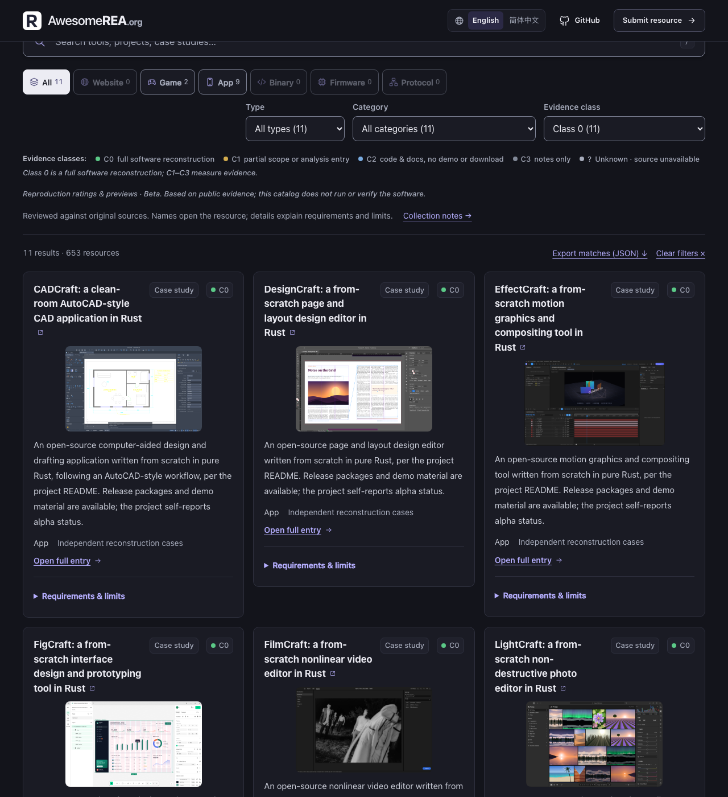

# 精选条目证据档位（Class 0-3 + Unknown，v3）

状态：v3 Beta，自动生成 + 人工复核。口径版本：`evidence-class-v3`。生成脚本：[`scripts/classify_evidence_classes.py`](../scripts/classify_evidence_classes.py)。数据：[`data/evidence-classes.json`](../data/evidence-classes.json)。Class 0 复核：[`data/evidence-class-zero-reviews.json`](../data/evidence-class-zero-reviews.json)。

本文件定义主页精选目录全部 653 个条目的**证据档位**和**复现范围**。这是 Beta 口径：只依据公开证据，**本目录没有运行或验收任何软件**。**Class 0 只授予人工确认的完整软件复现**；自动规则最高只到 Class 1。

档位、复现范围和运行状态分开记录：

- `evidence_class`：0–3；来源不可读时为空
- `scope`：`full` / `partial` / `analysis` / `unknown` / `notes`
- `runtime_status`：固定 `not-run`
- `evidence_status`：`observed` / `unknown`

档位展示在主页卡片的 `C0`–`C3` / `?` 徽章上，筛选栏下方有图例，并可通过“证据档位”下拉筛选。Class 0/1 且文档中有 demo 的条目显示示范截图；只有视频/链接、没有可提取图片时显示「有 demo · 暂无截图」占位。



## 1. 档位定义

| 档位 | 定义 | 徽章 |
| --- | --- | --- |
| Class 0 | **人工确认的完整软件复现**（`kind: case-study`）：范围、目标版本和一手证据已逐条复核，记录在 `data/evidence-class-zero-reviews.json` | C0 |
| Class 1 | **自动判定上限**：有下载方式和非品牌 demo、有文档；但范围是部分/补丁/移植，或本身不是软件复现（工具、集成、指南、binary 分析条目） | C1 |
| Class 2 | 缺 demo 或下载方式，但有代码和文档；不确定能不能构建 | C2 |
| Class 3 | 无代码或无文档，只有笔记、进度记录或局部片段 | C3 |
| Unknown | 复核时来源不可达或不可读，未分类（不当作“仅笔记”） | ? |

## 2. 判定信号

只使用条目 URL 的公开内容（GitHub REST、GitLab REST 或页面抓取）：

| 信号 | 含义 |
| --- | --- |
| `code` | URL 是代码仓库，或页面链接到代码仓库 |
| `docs` / `docs_full` | README 或页面正文 ≥ 400 字节；章节结构覆盖安装/构建与使用 |
| `download` | Release **附产物**、可执行产物直链，或**安装目标软件本身**的包命令（包名与仓库名匹配，fenced code block 也算） |
| `demo` | 非品牌的位图截图、视频平台链接或 demo/playable 链接 |

不算下载：只有 Release tag、没有产物；构建依赖（如仓库是 `foo` 时 `pip install ninja`）。
不算 demo：logo、徽章、Discord/QQ 群邀请、进度图、CI/Release 徽章、SVG。

判定顺序：

1. 无 code 或 docs → **Class 3**
2. 有 code + docs，但缺 demo 或缺 download → **Class 2**
3. download + demo 都有 → 自动最高 **Class 1**
4. **Class 0 只能由人工复核授予**：复核文件里 `scope: full`，且至少具备 code、docs、download、demo、`kind: case-study`、非 binary 目标

## 3. 方法与局限

- 653 条中，586 条通过 GitHub REST 读取仓库元数据、releases 和 README；2 条走 GitLab REST；37 条抓取页面；17 条人工边界覆盖；11 条人工确认 Class 0；7 条来源不可读标为 Unknown。
- GitHub token 只发送到 `api.github.com`；跨域重定向会剥离认证头。页面的普通抓取不携带 token。
- 图片过滤掉 logo、徽章、二维码、群聊和赞助链接，避免把品牌图当成 demo。
- 主页示范截图由 [`scripts/build_evidence_previews.py`](../scripts/build_evidence_previews.py) 选取并写入 [`data/evidence-previews.json`](../data/evidence-previews.json)；[`scripts/fetch_previews.py`](../scripts/fetch_previews.py) 在构建前下载到 `.cache/previews/`，构建复制到站点的 `previews/` 目录，页面不外链第三方图片。
- 181 条 Class 0/1 中 173 条有预览 URL（164 张图片 + 9 个视频封面）；8 条没有合格图片，另有 5 张超过 8MB、3 张不可达，这些条目显示占位。
- 已知局限：文档完整度靠章节结构推断，不看内容质量；JS 渲染页面可能漏检媒体；“下载方式”不含纯源码构建说明；C0 是人工范围复核，不是运行验收。
- 人工修订：[`data/evidence-class-overrides.json`](../data/evidence-class-overrides.json) 记录边界修正；Class 0 只能在 [`data/evidence-class-zero-reviews.json`](../data/evidence-class-zero-reviews.json) 中逐条确认。

## 4. 重新生成

```bash
python3 scripts/classify_evidence_classes.py            # 带本地缓存
python3 scripts/classify_evidence_classes.py --fresh    # 忽略缓存全部重抓
python3 scripts/build_evidence_previews.py
python3 scripts/fetch_previews.py
python3 scripts/build_site.py
```

`build_site.py` 把 `evidence_class`、`evidence_status`、`scope`、`runtime_status` 合并进 `catalog.json` / `catalog-index.json`，并在精选条目缺少档位时直接报错。
